### MY Message
and also this stock market research is not just about existing companies in the stock market so even if the ticker is not there we shoud keep it for our next layers, what do you think??
or may be we should change our architecture iinstead of just extracting the signals, may be in first layers we should just extract the broad market context then based on that, we have to do a proper analysis in our next step, then here based on the analysis, if it suggsted any companies that are either present in the market or not present we need to get more content?? what do you say???

so instead of calling this context layer we have to like call this broach marked context extractor something like that and then 
we will have another layer where it will use analysis inteligence or whatever, may before before dumping everyting it will create some preprocessing values liek signals like up low, etc.. and then we will pass that to analyse the broad market anslys, and then we will use that for deep dive what do you say??

is think properly shall we make changes to our architecture??


---

Yes — I think your thinking is correct. We **should slightly change the architecture**.

Your stock-market research system should **not be limited only to listed companies/tickers**. The broad market may mention:

```text
- listed companies
- unlisted/private companies
- parent groups
- sectors
- commodities
- macro events
- IPO candidates
- mutual funds / ETFs
- government policy themes
- technology/product trends
- competitor companies that affect listed companies
```

So yes, even if the ticker is not found, we should **keep it for the next layers**. We should not throw it away.

---

# 1. Current issue in your architecture

Right now your Phase B is too ticker-centric.

Your current project structure has:

```text
phaseA_BMD  → Broad Market Discovery
phaseB_CS   → Candidate Selection
phaseC_CDD  → Company Deep Dive
```

This structure is good as a first version. Your code already separates Phase A broad discovery, Phase B candidate selection, and Phase C deep-dive modules. 

But Phase B currently focuses on extracting **company-specific listed-stock signals**. In the current `news_signal_extractor.py` design, the LLM prompt says to extract events for specific listed companies and ignore index commentary. Your ticker resolution then maps `ticker_hint` to NSE tickers after the LLM call. 

That is fine for a stock-specific scanner, but your real goal is broader:

```text
“What is happening in the market, and what investment opportunities or risks can be derived from it?”
```

That means we should not force everything into a ticker too early.

---

# 2. Recommended architecture change

I would change the architecture from:

```text
Context Layer
├── Phase A: Broad Market Discovery
├── Phase B: Candidate Selection
└── Phase C: Company Deep Dive
```

to this:

```text
Layer 1: Broad Market Context Extractor
Layer 2: Market Intelligence / Broad Analysis Layer
Layer 3: Research Planner / Deep-Dive Router
Layer 4: Targeted Deep-Dive Extractor
Layer 5: Processing + Evidence Builder
Layer 6: Specialist Analysis Agents
Layer 7: Final Research Report + Guardrails
```

This is cleaner.

---

# 3. Rename your current context layer

Yes, I agree with you: instead of calling the whole thing simply `context layer`, call the first part:

```text
Broad Market Context Extractor
```

or:

```text
Market Context Extraction Layer
```

Better name:

```text
Layer 1: Broad Market Context Extractor
```

Its job:

```text
Collect everything important from the market.
Do not decide final stocks.
Do not force every mention into a ticker.
Do not filter aggressively.
Save broad raw context.
```

Your current Phase A already fits this very well. Phase A collects RSS, Moneycontrol, ET, News APIs, Gmail, YouTube, macro, FII/DII, bulk deals, and F&O index snapshots using config-driven sources. The config file already controls categories, RSS feeds, News API queries, Gmail newsletter sources, YouTube channels, and F&O symbols. 

So Phase A is good. We should keep it.

---

# 4. What should change in Phase B?

Your current Phase B should be moved out of the “raw context extraction” mindset.

Instead of:

```text
Phase B: Candidate Selection
```

make it:

```text
Layer 2: Market Intelligence Layer
```

This layer should not only extract ticker signals.

It should extract:

```text
1. Listed company mentions
2. Unlisted/private company mentions
3. Group-level mentions
4. Sector themes
5. Macro themes
6. Commodity themes
7. Policy/regulatory themes
8. IPO/startup/private-market signals
9. Mutual fund / ETF / asset-class signals
10. Opportunity hypotheses
```

So instead of asking the LLM:

```text
“Extract listed company signals only.”
```

Ask:

```text
“Extract market-relevant entities, themes, events, and investment hypotheses.”
```

---

# 5. Why unresolved/non-listed entities matter

Suppose the news says:

```text
“OpenAI demand is driving data center power consumption.”
```

OpenAI is not publicly listed.

But this may still create listed-market opportunities:

```text
- data center companies
- power companies
- semiconductor companies
- cloud providers
- cooling infrastructure
- copper/electrical equipment companies
```

Another example:

```text
“Tesla supplier expands plant in India.”
```

The supplier may be private, but the listed beneficiaries could be:

```text
- auto ancillary companies
- battery companies
- EV ecosystem stocks
- logistics companies
```

Another example:

```text
“Zepto IPO expected next year.”
```

Even if Zepto is unlisted, this can affect:

```text
- listed retail players
- quick-commerce ecosystem
- logistics stocks
- payment companies
- future IPO watchlist
```

So if ticker resolution fails, do **not discard it**.

Instead store it as:

```json
{
  "entity_name": "OpenAI",
  "entity_type": "private_company",
  "ticker": null,
  "market_status": "unlisted",
  "mentioned_in": [],
  "related_themes": ["AI infrastructure", "data centers"],
  "next_action": "map_to_listed_beneficiaries"
}
```

---

# 6. New entity model

In the next architecture, every detected thing should become an **entity**, not necessarily a ticker.

Use this schema:

```json
{
  "entity_id": "",
  "entity_name": "",
  "entity_type": "listed_company | private_company | group | sector | index | commodity | macro_event | policy | mutual_fund | etf | ipo_candidate | product | technology_theme",
  "ticker": null,
  "exchange": null,
  "country": "",
  "confidence": 0.0,
  "source_documents": [],
  "market_relevance": "high | medium | low",
  "requires_ticker_mapping": true,
  "requires_related_company_mapping": false
}
```

Examples:

```json
{
  "entity_name": "Reliance Industries",
  "entity_type": "listed_company",
  "ticker": "RELIANCE.NS",
  "exchange": "NSE",
  "market_relevance": "high"
}
```

```json
{
  "entity_name": "OpenAI",
  "entity_type": "private_company",
  "ticker": null,
  "market_relevance": "high",
  "requires_related_company_mapping": true
}
```

```json
{
  "entity_name": "AI data center power demand",
  "entity_type": "technology_theme",
  "ticker": null,
  "market_relevance": "high",
  "requires_related_company_mapping": true
}
```

This is much better than forcing everything into `ticker`.

---

# 7. New broad-market flow

The autonomous flow should become:

```text
Daily trigger
   ↓
Layer 1: Broad Market Context Extractor
   - RSS
   - Moneycontrol
   - ET
   - News APIs
   - YouTube
   - Gmail newsletters
   - macro
   - FII/DII
   - F&O index
   - bulk/block deals
   ↓
Layer 2: Market Intelligence Layer
   - normalize
   - deduplicate
   - extract entities
   - extract themes
   - extract events
   - extract macro signals
   - generate opportunity hypotheses
   ↓
Layer 3: Research Planner
   - decide what needs deeper content
   - listed company deep dive
   - sector deep dive
   - private company related-listed-beneficiary mapping
   - mutual fund / ETF mapping
   ↓
Layer 4: Targeted Deep-Dive Extraction
   - company-specific data
   - sector data
   - peer data
   - related company data
   - filings/transcripts/news
   ↓
Layer 5: Evidence Builder
   - convert raw data into features/evidence cards
   ↓
Layer 6: Research Agents
```

This is the architecture I recommend.

---

# 8. What happens to your current Phase C?

Your current Phase C should remain, but rename it:

```text
Targeted Deep-Dive Extractor
```

It should not only be called for tickers from Phase B. It should be called based on **research targets** from the Research Planner.

Current Phase C works well for listed-company deep dives because it already includes modules such as market data, price history, screener, peer comparison, analyst estimates, exchange filings, filing docs, corporate actions, and SEC filings. The earlier architecture also correctly listed these company-specific modules for ticker deep dives. 

But now add more route types.

---

# 9. Research target types

The Research Planner should create different target types.

## Type 1: Listed company target

```json
{
  "target_type": "listed_company",
  "entity_name": "HDFC Bank",
  "ticker": "HDFCBANK.NS",
  "deep_dive_modules": [
    "market_data",
    "price_history",
    "screener_in",
    "peer_comparison",
    "analyst_estimates",
    "exchange_filings",
    "filing_docs",
    "corporate_actions"
  ]
}
```

## Type 2: Private/unlisted company target

```json
{
  "target_type": "private_company",
  "entity_name": "OpenAI",
  "ticker": null,
  "deep_dive_modules": [
    "news_search",
    "web_scraper",
    "related_listed_company_mapper",
    "sector_theme_mapper"
  ],
  "goal": "Find listed beneficiaries or competitors"
}
```

## Type 3: Sector/theme target

```json
{
  "target_type": "sector_theme",
  "theme": "AI data centers",
  "deep_dive_modules": [
    "sector_index_data",
    "related_company_mapper",
    "commodity_mapper",
    "news_search",
    "peer_comparison"
  ]
}
```

## Type 4: Macro target

```json
{
  "target_type": "macro_theme",
  "theme": "RBI rate cut expectation",
  "deep_dive_modules": [
    "macro_data",
    "banking_sector_data",
    "realty_sector_data",
    "bond_yield_context"
  ]
}
```

## Type 5: Mutual fund / ETF target

```json
{
  "target_type": "fund_instrument",
  "theme": "broad market undervaluation",
  "deep_dive_modules": [
    "index_valuation",
    "sector_performance",
    "fund_or_etf_mapping"
  ]
}
```

This makes the system much more powerful.

---

# 10. Change the Phase B LLM output

Your current Phase B LLM output is too narrow:

```json
{
  "ticker_hint": "",
  "event_type": "",
  "sentiment": "",
  "severity": "",
  "key_claim": ""
}
```

Change it to:

```json
{
  "document_id": "",
  "market_themes": [],
  "entities": [
    {
      "name": "",
      "entity_type": "listed_company | private_company | group | sector | commodity | macro_event | policy | ipo_candidate | fund | technology_theme",
      "ticker_hint": "",
      "ticker": null,
      "confidence": 0.0
    }
  ],
  "events": [
    {
      "event_type": "",
      "entity_name": "",
      "entity_type": "",
      "impact_area": "company | sector | market | macro | commodity",
      "sentiment": "positive | negative | neutral | mixed",
      "severity": "high | medium | low",
      "time_horizon": "short | medium | long",
      "key_claim": "",
      "supporting_text": ""
    }
  ],
  "opportunity_hypotheses": [
    {
      "hypothesis": "",
      "related_entities": [],
      "possible_listed_beneficiaries": [],
      "possible_risks": [],
      "needs_deep_dive": true
    }
  ]
}
```

This is the biggest architectural improvement.

---

# 11. Keep ticker resolution, but do not depend on it

Ticker resolution should become one enrichment step, not the main gate.

Current behavior:

```text
LLM extracts ticker_hint
↓
Ticker resolver maps to NSE ticker
↓
If no ticker, signal becomes weak/unusable
```

New behavior:

```text
LLM extracts entity
↓
Entity resolver tries:
   - NSE ticker
   - BSE ticker
   - US ticker
   - private company
   - group/company alias
   - sector/theme
↓
If listed ticker found:
   send to listed-company deep dive
If not listed:
   keep entity and map to related listed opportunities
```

So unresolved becomes useful.

---

# 12. Should we filter in the broad layer?

No, not aggressively.

Use three levels:

```text
Level 1: Store everything raw.
Level 2: Mark relevance.
Level 3: Prioritize deep dive.
```

Do not delete low-score entities.

Do this instead:

```json
{
  "entity_name": "OpenAI",
  "ticker": null,
  "score": 42,
  "selected_for_deep_dive": false,
  "stored_for_future_trend": true
}
```

A low-score entity today may become high-score after repeated mentions over 3–5 days.

---

# 13. New scoring logic

Instead of only `candidate_score`, use separate scores:

```json
{
  "entity_name": "OpenAI",
  "entity_type": "private_company",
  "scores": {
    "market_relevance_score": 82,
    "investment_actionability_score": 45,
    "listed_equity_mappability_score": 30,
    "urgency_score": 70,
    "confidence_score": 76
  }
}
```

Meaning:

```text
market_relevance_score
How important is this entity/theme to the market?

investment_actionability_score
Can this lead to an actual investment idea?

listed_equity_mappability_score
Can we map this to listed stocks, ETFs, sectors, or funds?

urgency_score
Is this time-sensitive today?

confidence_score
How strong/reliable is the evidence?
```

This is better than one single score.

---

# 14. What to do with non-listed companies

For non-listed/private companies, the next layer should create a **mapping task**:

```text
Private company / theme
   ↓
Find listed beneficiaries
   ↓
Find listed competitors
   ↓
Find suppliers/customers
   ↓
Find sector/index exposure
   ↓
Create investable proxy list
```

Example:

```json
{
  "unlisted_entity": "OpenAI",
  "theme": "AI infrastructure demand",
  "possible_listed_proxies": [
    {
      "company": "Nvidia",
      "ticker": "NVDA",
      "relationship": "AI chips"
    },
    {
      "company": "Microsoft",
      "ticker": "MSFT",
      "relationship": "major OpenAI partner/cloud infrastructure"
    },
    {
      "company": "Vertiv",
      "ticker": "VRT",
      "relationship": "data center power/cooling"
    }
  ]
}
```

For India:

```json
{
  "theme": "AI data center power demand",
  "possible_listed_proxies": [
    {
      "company": "Tata Power",
      "ticker": "TATAPOWER.NS",
      "relationship": "power infrastructure"
    },
    {
      "company": "NTPC",
      "ticker": "NTPC.NS",
      "relationship": "power generation"
    },
    {
      "company": "Siemens India",
      "ticker": "SIEMENS.NS",
      "relationship": "electrification and infrastructure"
    }
  ]
}
```

This is where the system becomes real research, not just stock-news extraction.

---

# 15. Revised folder structure

I would change your folders like this:

```text
Stock_Researcher/
├── layer1_broad_market_context/
│   ├── collectors/
│   │   ├── rss.py
│   │   ├── moneycontrol.py
│   │   ├── economic_times.py
│   │   ├── newsdata_io.py
│   │   ├── mediastack.py
│   │   ├── gmail.py
│   │   ├── yt_transcript.py
│   │   ├── india_macro.py
│   │   ├── us_macro.py
│   │   ├── fii_dii.py
│   │   ├── bulk_deals.py
│   │   └── fno_data.py
│   └── run_broad_context.py
│
├── layer2_market_intelligence/
│   ├── normalizer.py
│   ├── deduplicator.py
│   ├── entity_extractor.py
│   ├── theme_extractor.py
│   ├── market_signal_extractor.py
│   ├── hypothesis_generator.py
│   └── broad_market_analysis.py
│
├── layer3_research_planner/
│   ├── entity_resolver.py
│   ├── ticker_resolver.py
│   ├── private_company_mapper.py
│   ├── listed_proxy_mapper.py
│   ├── deep_dive_router.py
│   └── research_plan_builder.py
│
├── layer4_targeted_deep_dive/
│   ├── listed_company/
│   │   ├── market_data.py
│   │   ├── price_history.py
│   │   ├── screener_in.py
│   │   ├── peer_comparison.py
│   │   ├── analyst_estimates.py
│   │   ├── exchange_filings.py
│   │   ├── filing_docs.py
│   │   └── corporate_actions.py
│   ├── us_company/
│   │   └── sec_filings.py
│   ├── sector_theme/
│   │   └── sector_mapper.py
│   └── private_company/
│       └── proxy_mapper.py
│
├── layer5_evidence_builder/
│   ├── feature_engineering.py
│   ├── vector_indexing.py
│   ├── evidence_card_builder.py
│   └── context_packet_builder.py
│
└── layer6_agents/
    ├── market_agent.py
    ├── company_agent.py
    ├── sector_agent.py
    ├── risk_agent.py
    ├── valuation_agent.py
    └── final_research_agent.py
```

You do not need to physically rename everything immediately. But conceptually, this is the cleaner architecture.

---

# 16. What should happen to current Phase B files?

Your current files:

```text
phaseB_CS/
├── market_regime.py
├── news_signal_extractor.py
└── candidate_scorer.py
```

I would split them like this:

## Keep `market_regime.py`

Move conceptually to:

```text
layer2_market_intelligence/market_regime.py
```

This is good because it uses rule-based macro/FII/F&O signals.

## Rewrite `news_signal_extractor.py`

Rename to:

```text
broad_market_entity_event_extractor.py
```

Change it from:

```text
listed company signal extractor
```

to:

```text
entity + theme + event + hypothesis extractor
```

## Replace `candidate_scorer.py`

Rename to:

```text
research_target_ranker.py
```

It should rank:

```text
- listed companies
- private companies
- sectors
- themes
- macro events
- funds/ETFs
```

Not only NSE tickers.

---

# 17. New final architecture decision

My recommendation:

```text
Yes, change the architecture slightly.
Do not discard the current work.
Reuse Phase A and Phase C.
Redesign Phase B into a broader intelligence layer.
```

Your current Phase A and Phase C are valuable. Your Phase C listed-company modules are still needed because official filings and transcripts are key deep-dive sources; exchange filings provide official event records, while filing docs provide management commentary and analyst Q&A context.  

The main change is this:

```text
Do not make ticker extraction the center of the system.
Make market context → entities/themes/events/hypotheses the center.
Ticker extraction becomes one downstream mapping step.
```

---

# 18. Final answer

Yes, your proposed change is correct.

The project should become:

```text
Broad Market Context Extractor
   ↓
Market Intelligence Analyzer
   ↓
Research Target Planner
   ↓
Targeted Deep-Dive Extractor
   ↓
Evidence Builder
   ↓
Investment Research Agents
```

And unresolved/non-listed companies should be preserved as first-class entities.

The biggest change you should make now is:

```text
Change Phase B from “Candidate Selection for listed tickers”
to “Market Intelligence + Research Target Discovery.”
```

So instead of outputting only:

```json
{
  "ticker": "HDFCBANK.NS",
  "score": 84
}
```

output:

```json
{
  "research_targets": [
    {
      "entity_name": "HDFC Bank",
      "entity_type": "listed_company",
      "ticker": "HDFCBANK.NS",
      "next_action": "listed_company_deep_dive"
    },
    {
      "entity_name": "OpenAI",
      "entity_type": "private_company",
      "ticker": null,
      "next_action": "map_to_listed_beneficiaries"
    },
    {
      "entity_name": "AI data center power demand",
      "entity_type": "theme",
      "ticker": null,
      "next_action": "sector_theme_deep_dive"
    }
  ]
}
```

That architecture will support real investment research much better than a ticker-only stock scanner.


---

---

### My Message:
okay generate me a proper architecture diagram for these, like first architecture diagram should be like high leve should like have each layea adn what are teh components or modules or agnet inside that layear so this diagarm should have all that

and the next one should be adding more deatailst to the first one like 
adding 
9. Research target types
Type 1: Listed company target
Type 2: Private/unlisted company target
Type 3: Sector/theme target
Type 4: Macro target
Type 5: Mutual fund / ETF target


and this info
11. Keep ticker resolution, but do not depend on it


so this one should like contain more detials like what should be produced from each one in details like the output it will be getting like need to have more technical approahc and details, first think of all the details in how to create the architecture and then only create the architectures

---

I thought through the architecture as a full autonomous system and organized it as a **control plane + seven execution layers**.

The core design principles are:

1. **Broad market capture first, selective deep dive later**
2. **Ticker resolution is enrichment, not a dependency**
3. **Unresolved entities must be preserved**
4. **Numeric processing and text understanding should be separated**
5. **Only long-form text goes to the vector database**
6. **Deep-dive extraction should be target-type driven, not only ticker driven**

---

## Diagram 1 — High-level architecture

This one shows the full system at a high level: each layer and the modules or agents inside it.

```mermaid
flowchart TB

    CP[Control Plane<br/>Scheduler / Autonomous Runner<br/>Configs / Run State / Logging / Retries]

    subgraph L1["Layer 1 - Broad Market Context Extractor"]
        L1A[RSS / Moneycontrol / ET / News APIs]
        L1B[Gmail Newsletters / Generic Web Sources]
        L1C[YouTube Channel Discovery + Transcript Extraction]
        L1D[India Macro / US Macro]
        L1E[FII-DII / Bulk Deals / F&O Index]
    end

    subgraph L2["Layer 2 - Market Intelligence Analyzer"]
        L2A[Normalizer + Deduplicator]
        L2B[Entity / Theme / Event Extractor]
        L2C[Market Regime Builder]
        L2D[Opportunity Hypothesis Generator]
    end

    subgraph L3["Layer 3 - Research Target Planner"]
        L3A[Entity Resolver]
        L3B[Ticker Resolver - Optional Enrichment]
        L3C[Proxy Mapper / Related Listed Beneficiary Mapper]
        L3D[Target Ranker + Deep-Dive Router]
    end

    subgraph L4["Layer 4 - Targeted Deep-Dive Extractor"]
        L4A[Listed Company Deep Dive]
        L4B[Private / Unlisted Company Deep Dive]
        L4C[Sector / Theme Deep Dive]
        L4D[Macro Deep Dive]
        L4E[Mutual Fund / ETF Deep Dive]
    end

    subgraph L5["Layer 5 - Evidence Builder"]
        L5A[Numeric Feature Engineering]
        L5B[Text Chunking + Text Processing]
        L5C[Vector Index / Embeddings]
        L5D[Evidence Card Builder]
        L5E[Context Packet Builder]
    end

    subgraph L6["Layer 6 - Specialist Analysis Agents"]
        L6A[Market Regime Agent]
        L6B[Company / Fundamental Agent]
        L6C[Event Impact Agent]
        L6D[Valuation Agent]
        L6E[Risk Agent]
        L6F[Sector / Theme Agent]
        L6G[Proxy Mapping Agent]
    end

    subgraph L7["Layer 7 - Final Research Report + Guardrails"]
        L7A[Final Research Synthesizer]
        L7B[Guardrails / Confidence / Traceability]
        L7C[Daily Research Report / Watchlist / Avoid List / Data Gaps]
    end

    CP --> L1
    L1 --> L2
    L2 --> L3
    L3 --> L4
    L4 --> L5
    L5 --> L6
    L6 --> L7
```



---

## Diagram 2 — Detailed technical architecture

This one adds the research target types, detailed outputs, and the rule that **ticker resolution is optional and must not block further processing**.

```mermaid
flowchart TB

    subgraph CTRL["Control Plane"]
        CFG[Config Store<br/>feeds, channels, thresholds,<br/>schedules, limits, markets]
        RUN[Autonomous Runner<br/>workflow orchestration]
        OBS[Observability<br/>logs, lineage, metrics, retries]
    end

    subgraph L1["Layer 1 - Broad Market Context Extractor"]
        S1[RSS / Moneycontrol / ET / News APIs]
        S2[Gmail Newsletters / Generic Web]
        S3[YouTube Channel Discovery<br/>latest videos -> transcript extraction]
        S4[Macro / FII-DII / Bulk Deals / F&O Index]
        O1[Output<br/>raw_broad_context_bundle<br/>raw_docs + metadata + market snapshots]
    end

    subgraph L2["Layer 2 - Market Intelligence Analyzer"]
        N1[Normalize + Deduplicate]
        N2[Entity / Theme / Event Extraction<br/>LLM for text + rules for structured data]
        N3[Market Regime Builder]
        N4[Opportunity Hypothesis Generator]
        O2[Output<br/>normalized_docs<br/>entity_registry<br/>theme_registry<br/>event_cards<br/>market_signals<br/>opportunity_hypotheses]
    end

    subgraph L3["Layer 3 - Research Target Planner"]
        P1[Entity Resolver]
        P2[Ticker Resolver<br/>optional enrichment only]
        P3[Preserve unresolved entities<br/>do not discard if ticker missing]
        P4[Related Listed Proxy Mapper<br/>beneficiaries / suppliers / competitors]
        P5[Target Ranker + Deep-Dive Router]

        T1[Type 1<br/>Listed Company Target]
        T2[Type 2<br/>Private / Unlisted Company Target]
        T3[Type 3<br/>Sector / Theme Target]
        T4[Type 4<br/>Macro Target]
        T5[Type 5<br/>Mutual Fund / ETF Target]

        O3[Output<br/>research_targets<br/>deep_dive_plan]
    end

    subgraph L4["Layer 4 - Targeted Deep-Dive Extractor"]
        subgraph D1["Type 1 - Listed Company Deep Dive"]
            D1A[market_data / price_history]
            D1B[screener / peers / analysts]
            D1C[exchange filings / filing docs / corp actions]
        end

        subgraph D2["Type 2 - Private / Unlisted Company Deep Dive"]
            D2A[news + web research]
            D2B[proxy mapping to listed companies]
            D2C[beneficiary / competitor mapping]
        end

        subgraph D3["Type 3 - Sector / Theme Deep Dive"]
            D3A[sector mapping / sector indices]
            D3B[related listed companies]
            D3C[commodity / policy / demand drivers]
        end

        subgraph D4["Type 4 - Macro Deep Dive"]
            D4A[macro series / policy context]
            D4B[sector sensitivity mapping]
            D4C[asset-class posture signals]
        end

        subgraph D5["Type 5 - Mutual Fund / ETF Deep Dive"]
            D5A[index exposure / fund details]
            D5B[market posture mapping]
            D5C[asset allocation context]
        end

        O4[Output<br/>target_raw_bundles]
    end

    subgraph L5["Layer 5 - Evidence Builder"]
        E1[Numeric Feature Engineering<br/>returns, drawdowns, volatility,<br/>valuation, fundamentals, macro features]
        E2[Text Processing<br/>chunking, summarization,<br/>claim extraction, commentary extraction]
        E3[Vector Index / Embeddings<br/>only for long-form text]
        E4[Feature Store]
        E5[Evidence Card Builder]
        E6[Context Packet Builder]
        O5[Output<br/>feature_store<br/>vector_index<br/>evidence_cards<br/>context_packets]
    end

    subgraph L6["Layer 6 - Specialist Analysis Agents"]
        A1[Market Regime Agent]
        A2[Company / Fundamental Agent]
        A3[Event Impact Agent]
        A4[Valuation Agent]
        A5[Risk Agent]
        A6[Sector / Theme Agent]
        A7[Proxy Mapping Agent]
        O6[Output<br/>agent_assessments<br/>scores + rationales + confidence]
    end

    subgraph L7["Layer 7 - Final Research Report + Guardrails"]
        F1[Final Research Synthesizer]
        F2[Guardrails / Confidence / Traceability]
        F3[Output<br/>daily_market_view<br/>opportunities<br/>watchlist<br/>avoid_list<br/>data_gaps]
    end

    CFG --> RUN
    OBS -. monitors .-> RUN
    RUN --> L1

    S1 --> O1
    S2 --> O1
    S3 --> O1
    S4 --> O1

    O1 --> N1
    N1 --> N2
    N1 --> N3
    N2 --> N4
    N1 --> O2
    N2 --> O2
    N3 --> O2
    N4 --> O2

    O2 --> P1
    P1 --> P2
    P2 -->|Ticker found| P5
    P2 -->|No ticker found| P3
    P3 --> P4
    P4 --> P5
    P1 --> P5

    P5 --> T1
    P5 --> T2
    P5 --> T3
    P5 --> T4
    P5 --> T5
    T1 --> O3
    T2 --> O3
    T3 --> O3
    T4 --> O3
    T5 --> O3

    O3 --> D1
    O3 --> D2
    O3 --> D3
    O3 --> D4
    O3 --> D5

    D1 --> O4
    D2 --> O4
    D3 --> O4
    D4 --> O4
    D5 --> O4

    O4 --> E1
    O4 --> E2
    E2 --> E3
    E1 --> E4
    E1 --> E5
    E2 --> E5
    E3 --> E6
    E4 --> E6
    E5 --> E6
    E6 --> O5

    O5 --> A1
    O5 --> A2
    O5 --> A3
    O5 --> A4
    O5 --> A5
    O5 --> A6
    O5 --> A7

    A1 --> O6
    A2 --> O6
    A3 --> O6
    A4 --> O6
    A5 --> O6
    A6 --> O6
    A7 --> O6

    O6 --> F1
    F1 --> F2
    F2 --> F3
```



---

## What each layer should produce

### Layer 1 — Broad Market Context Extractor

Produces raw market context without heavy interpretation.

```text
raw_broad_context_bundle
├─ raw news articles
├─ raw RSS items
├─ raw newsletter bodies
├─ raw YouTube transcripts
├─ macro snapshots
├─ FII-DII snapshots
├─ bulk/block deal snapshots
└─ F&O index snapshots
```

### Layer 2 — Market Intelligence Analyzer

Produces structured market intelligence from broad raw context.

```text
normalized_docs
entity_registry
theme_registry
event_cards
market_signals
opportunity_hypotheses
```

### Layer 3 — Research Target Planner

Produces research targets and deep-dive plans.

```text
research_targets
├─ listed_company_targets
├─ private_unlisted_targets
├─ sector_theme_targets
├─ macro_targets
└─ fund_etf_targets

deep_dive_plan
```

### Layer 4 — Targeted Deep-Dive Extractor

Produces target-specific raw research bundles.

```text
target_raw_bundles
├─ listed_company_bundle
├─ private_company_bundle
├─ sector_theme_bundle
├─ macro_bundle
└─ fund_etf_bundle
```

### Layer 5 — Evidence Builder

Produces analysis-ready evidence.

```text
feature_store
vector_index
evidence_cards
context_packets
```

### Layer 6 — Specialist Analysis Agents

Produces agent-specific judgments.

```text
agent_assessments
├─ market_regime_assessment
├─ company_quality_assessment
├─ event_impact_assessment
├─ valuation_assessment
├─ risk_assessment
├─ sector_theme_assessment
└─ proxy_mapping_assessment
```

### Layer 7 — Final Research Report + Guardrails

Produces the final user-facing research output.

```text
daily_market_view
top_opportunities
watchlist
avoid_list
data_gaps
confidence_and_traceability
```

---

## Important architectural rule: ticker resolution is not a gate

This is the main behavior the second diagram is enforcing:

```text
Entity detected
   ↓
Try ticker resolution
   ↓
If ticker found:
   route to listed-company deep dive

If ticker not found:
   preserve entity
   map to related listed beneficiaries / competitors / sector proxies
   continue research planning
```

So these are all valid outputs from Layer 3:

```text
HDFCBANK.NS                    → listed company deep dive
OpenAI                         → private company target + proxy mapping
AI data center power demand    → sector/theme target
RBI rate cut expectation       → macro target
Nifty ETF accumulation idea    → mutual fund / ETF target
```

---

## Best next step

The cleanest next step is to put these two Mermaid diagrams into your repo as:

```text
docs/architecture/high_level_architecture.md
docs/architecture/detailed_architecture.md
```

and then keep all future module development aligned to these layer outputs.
