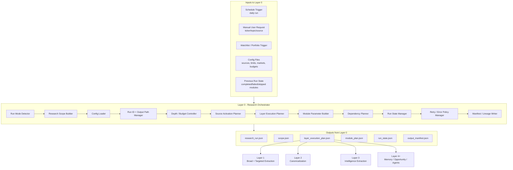

Yes. **Layer 0 should be the Research Orchestrator layer**. This layer is the “head” of the full system. It does **not collect data**, **does not analyze news**, and **does not make investment decisions**. Its job is to decide **what kind of research run we are doing**, **which layers/modules should run**, **with what parameters**, **in what order**, and **how to track the run**.

Your current repo already has `run_phase_a.py`, `run_phase_b.py`, `run_phase_c.py`, `config/phase_a.yaml`, and `config/paths.py`, so Layer 0 should sit above those runners and coordinate them. The project dump shows your current structure already separates Phase A broad market discovery, Phase B candidate selection, and Phase C company deep dive.  Your context-layer documentation also says the extraction layer should only collect raw data and avoid aggregation/calculation/analysis, which means orchestration should stay separate from extraction logic. 

---

# Layer 0 name

Use this name:

```text
Layer 0 - Research Orchestrator
```

Folder name:

```text
orchestration_layer/
```

Purpose:

```text
Decide what research run to perform, which modules to execute, what parameters to pass, how deep the run should go, and how to track the run end-to-end.
```

---

# Why Layer 0 is important

Without Layer 0, your system will become confusing because each module will run independently without a central plan.

Layer 0 answers these questions:

```text
What type of run is this?
Is this a daily autonomous market scan?
Is this a user-requested company analysis?
Is this a YouTube/article/newsletter analysis?
Is this a watchlist/portfolio monitoring run?
Which collectors should run?
Which sources are enabled?
What time window should we use?
How many articles/videos/newsletters should we collect?
Should we do a light, standard, or deep run?
Which phase should run first?
Should Phase C run now or wait for Layer 2/3 target selection?
Where should outputs be saved?
What already ran today?
What failed and needs retry?
```

This layer protects your architecture from becoming hardcoded.

---

# What Layer 0 should not do

Layer 0 should **not** do these:

```text
- It should not scrape websites.
- It should not extract tickers from news.
- It should not classify news as positive/negative.
- It should not calculate market regime.
- It should not create investment recommendations.
- It should not decide buy/sell.
- It should not summarize transcripts.
```

Those belong to later layers.

Layer 0 only creates the **plan** and manages the **run state**.

---

# Layer 0 architecture diagram



---

# Layer 0 high-level input

Layer 0 should accept one standard input object.

```json
{
  "trigger": {
    "trigger_type": "scheduled | manual | watchlist | portfolio | source_input",
    "triggered_at": "2026-05-09T08:00:00+05:30",
    "requested_by": "system | user"
  },
  "request": {
    "run_mode": "auto | ticker | topic | source | watchlist | portfolio",
    "market": "india | us | global",
    "tickers": [],
    "topics": [],
    "source_urls": [],
    "watchlist_id": null,
    "portfolio_id": null
  },
  "preferences": {
    "depth": "light | standard | deep",
    "max_targets": 10,
    "include_youtube": true,
    "include_newsletters": true,
    "include_cross_domain_opportunities": true
  }
}
```

---

# Layer 0 high-level output

Layer 0 should produce a **research run package**.

```json
{
  "research_run_id": "RUN_2026_05_09_AUTO_0800",
  "run_mode": "autonomous_daily",
  "market": "india",
  "depth": "standard",
  "run_date": "2026-05-09",
  "status": "planned",
  "scope": {},
  "layer_execution_plan": [],
  "module_execution_plan": [],
  "output_paths": {},
  "state_file": "",
  "manifest_file": ""
}
```

This output becomes the input for Layer 1 and later layers.

---

# Layer 0 modules

I would build Layer 0 with these modules:

```text
orchestration_layer/
├── run_mode_detector.py
├── research_scope_builder.py
├── config_loader.py
├── run_id_manager.py
├── depth_budget_controller.py
├── source_activation_planner.py
├── layer_execution_planner.py
├── module_parameter_builder.py
├── dependency_planner.py
├── run_state_manager.py
├── retry_error_policy.py
├── manifest_writer.py
└── autonomous_runner.py
```

Now let’s design each module properly.

---

# Module 1: `run_mode_detector.py`

## Purpose

Detect what type of research run is being requested.

## Why it matters

Your system can run in many ways:

```text
daily autonomous market scan
specific ticker analysis
article/newsletter/YouTube analysis
watchlist monitoring
portfolio monitoring
sector/theme analysis
```

Each mode needs different sources and different depth.

## Questions it answers

```text
Is this a scheduled daily scan?
Is the user asking about a specific stock?
Is the input a source URL?
Is this a portfolio/watchlist check?
Should the system start broad or targeted?
```

## Input

```json
{
  "trigger_type": "scheduled",
  "request": {
    "run_mode": "auto",
    "tickers": [],
    "topics": [],
    "source_urls": []
  }
}
```

## Logic

```text
If trigger_type = scheduled:
    run_mode = autonomous_daily

If tickers are provided:
    run_mode = ticker_research

If source_urls are provided:
    run_mode = source_research

If topics are provided:
    run_mode = topic_research

If watchlist_id exists:
    run_mode = watchlist_monitoring

If portfolio_id exists:
    run_mode = portfolio_monitoring
```

## Output

```json
{
  "run_mode": "autonomous_daily",
  "mode_reason": "Scheduled daily trigger with no seed ticker/source",
  "requires_broad_context": true,
  "requires_targeted_deep_dive": false,
  "requires_user_portfolio": false
}
```

---

# Module 2: `research_scope_builder.py`

## Purpose

Define the research scope.

## Why it matters

Before collecting data, the system should know whether it is researching:

```text
Indian market
US market
global macro
one ticker
one sector
all market news
portfolio holdings
cross-domain opportunities
```

## Questions it answers

```text
Which market are we analyzing?
What asset classes are in scope?
Are non-stock opportunities allowed?
Should we include macro?
Should we include mutual funds/ETFs/REITs later?
What time horizon should this run support?
```

## Input

```json
{
  "run_mode": "autonomous_daily",
  "request": {
    "market": "india",
    "topics": [],
    "tickers": []
  },
  "preferences": {
    "include_cross_domain_opportunities": true
  }
}
```

## Logic

For autonomous daily run:

```text
market = india
asset_classes = stocks, sectors, ETFs/mutual funds, REITs/InvITs later, cross-domain opportunity radar
time_horizons = short, medium, long
broad_context_required = true
targeted_deep_dive_required = conditional
```

For ticker mode:

```text
market = inferred from ticker
asset_classes = listed_stock
broad_context_required = light
targeted_deep_dive_required = true
```

For source mode:

```text
market = inferred from source/entity extraction later
asset_classes = unknown initially
broad_context_required = source only
targeted_deep_dive_required = after target planning
```

## Output

```json
{
  "scope_id": "SCOPE_2026_05_09_AUTO",
  "primary_market": "india",
  "secondary_markets": ["us_macro", "global_commodities"],
  "asset_classes": [
    "listed_stocks",
    "sectors",
    "mutual_funds_etfs",
    "reits_invits",
    "cross_domain_opportunities"
  ],
  "time_horizons": ["short_term", "medium_term", "long_term"],
  "broad_context_required": true,
  "targeted_deep_dive_policy": "after_research_target_planner"
}
```

---

# Module 3: `config_loader.py`

## Purpose

Load all runtime configuration.

## Why it matters

You already have `config/phase_a.yaml`, which controls categories, RSS feeds, News API queries, Gmail sources, YouTube channels, F&O symbols, and limits.  Layer 0 should load this instead of hardcoding module parameters.

## Questions it answers

```text
Which RSS feeds are enabled?
Which YouTube channels are enabled?
How many articles should we fetch?
Which Moneycontrol/ET categories are enabled?
Which News API queries should run?
What are the limits?
Which modules are enabled or disabled?
```

## Input

```json
{
  "config_paths": [
    "config/phase_a.yaml",
    "config/research_modes.yaml",
    "config/layer0.yaml"
  ]
}
```

## Logic

```text
Load YAML files.
Validate required keys.
Apply defaults.
Apply run-mode overrides.
Return merged config.
```

## Output

```json
{
  "config_version": "2026-05-09",
  "enabled_sources": {
    "moneycontrol": true,
    "economic_times": true,
    "rss": true,
    "newsdata_io": true,
    "mediastack": true,
    "gmail": true,
    "youtube": true,
    "macro": true,
    "fii_dii": true,
    "bulk_deals": true,
    "fno": true
  },
  "limits": {
    "max_news_articles_per_source": 50,
    "max_youtube_videos_per_channel": 3,
    "max_targets": 10
  }
}
```

---

# Module 4: `run_id_manager.py`

## Purpose

Create run IDs and output folder paths.

## Why it matters

Your current `config/paths.py` already creates date-based output directories for Phase A, Phase B, Phase C, LLM logs, and module-specific outputs.  Layer 0 should formalize this into a run-level object.

## Questions it answers

```text
What is this run called?
Where should outputs be saved?
Which date folder should be used?
Is this run retrying a previous run?
```

## Input

```json
{
  "run_mode": "autonomous_daily",
  "run_date": "2026-05-09",
  "triggered_at": "2026-05-09T08:00:00+05:30"
}
```

## Logic

```text
Generate deterministic run ID:
RUN_{date}_{mode}_{time}

Create output folders:
output/{date}/layer0/
output/{date}/phaseA/
output/{date}/phaseC/
output/{date}/intelligence/
output/{date}/evidence/
output/{date}/reports/
```

## Output

```json
{
  "research_run_id": "RUN_2026_05_09_AUTONOMOUS_DAILY_0800",
  "run_date": "2026-05-09",
  "output_root": "output/2026-05-09",
  "layer_output_dirs": {
    "layer0": "output/2026-05-09/layer0",
    "layer1": "output/2026-05-09/layer1",
    "layer7": "output/2026-05-09/layer7",
    "canonical": "output/2026-05-09/canonical",
    "intelligence": "output/2026-05-09/intelligence",
    "memory": "output/2026-05-09/memory",
    "evidence": "output/2026-05-09/evidence",
    "reports": "output/2026-05-09/reports"
  }
}
```

---

# Module 5: `depth_budget_controller.py`

## Purpose

Control how much work the system should do.

## Why it matters

A daily scan should not do deep-dive extraction for 100 companies. You need controlled depth.

## Questions it answers

```text
Should this run be light, standard, or deep?
How many sources should be collected?
How many YouTube videos should be processed?
How many research targets should later be deep-dived?
Should we include expensive LLM processing?
Should we skip lower-priority modules today?
```

## Input

```json
{
  "run_mode": "autonomous_daily",
  "preferences": {
    "depth": "standard",
    "max_targets": 10
  },
  "config": {}
}
```

## Logic

```text
light:
    broad news + macro only
    no YouTube long videos
    max_targets = 5

standard:
    full broad context
    moderate YouTube/newsletters
    max_targets = 10

deep:
    broad context + more long-form text
    max_targets = 25
    include more historical context
```

## Output

```json
{
  "depth_profile": "standard",
  "budgets": {
    "max_articles_total": 300,
    "max_youtube_videos_total": 30,
    "max_newsletters": 20,
    "max_llm_documents_for_layer3": 100,
    "max_research_targets": 10,
    "max_company_deep_dives": 10
  },
  "enabled_expensive_steps": {
    "youtube_transcripts": true,
    "long_text_llm_extraction": true,
    "cross_domain_mapping": true
  }
}
```

---

# Module 6: `source_activation_planner.py`

## Purpose

Decide which source modules should be activated for this run.

## Why it matters

Not every run needs every source.

For example:

```text
Daily scan → run broad sources.
Ticker analysis → run company deep-dive plus recent news.
Source analysis → collect only the given URL/transcript first.
Watchlist monitoring → run price/news/filings only for watchlist.
```

## Input

```json
{
  "run_mode": "autonomous_daily",
  "scope": {},
  "depth_profile": "standard",
  "config": {}
}
```

## Logic

For autonomous daily:

```text
Activate:
- RSS
- Moneycontrol
- Economic Times
- News APIs
- Gmail
- YouTube
- India macro
- US macro
- FII/DII
- Bulk deals
- F&O index

Do not activate:
- Screener
- Peer comparison
- Analyst estimates
- Company filings
until later research target planning.
```

For ticker research:

```text
Activate:
- market_data
- price_history
- screener
- peer_comparison
- analyst_estimates
- exchange_filings
- filing_docs
- corporate_actions
- recent news
```

## Output

```json
{
  "activated_source_groups": {
    "broad_market_news": true,
    "newsletters": true,
    "youtube": true,
    "macro": true,
    "institutional_activity": true,
    "derivatives": true,
    "company_deep_dive": false
  },
  "activated_modules": [
    "rss",
    "moneycontrol",
    "economic_times",
    "newsdata_io",
    "mediastack",
    "gmail",
    "yt_transcript",
    "india_macro",
    "us_macro",
    "fii_dii",
    "bulk_deals",
    "fno_data"
  ]
}
```

---

# Module 7: `layer_execution_planner.py`

## Purpose

Create the full layer-level execution order.

## Why it matters

Your final architecture has many layers. The system should know the order.

## Questions it answers

```text
Should we run Layer 1 only?
Should we run Layer 2 after Layer 1?
Should targeted deep dive run immediately or wait for research targets?
Should final agents run today?
```

## Input

```json
{
  "run_mode": "autonomous_daily",
  "activated_modules": [],
  "depth_profile": "standard"
}
```

## Logic

For autonomous daily final system:

```text
Run:
Layer 1 broad extraction
Layer 2 canonicalization
Layer 3 intelligence extraction
Layer 4 memory qualification
Layer 5 opportunity intelligence
Layer 6 research target planning
Layer 7 targeted deep dive
Layer 8 evidence builder
Layer 9 specialist agents
Layer 10 final report
Cross-cutting guardrails (embedded within L3/L4/L5/L6/L8/L9/L10 — not a separate execution step)
```

But for current implementation stage, you can make this configurable.

## Output

```json
{
  "layer_execution_plan": [
    {
      "layer": "L1_broad_context_extraction",
      "enabled": true,
      "depends_on": []
    },
    {
      "layer": "L2_source_canonicalization",
      "enabled": true,
      "depends_on": ["L1_broad_context_extraction"]
    },
    {
      "layer": "L3_intelligence_extraction",
      "enabled": true,
      "depends_on": ["L2_source_canonicalization"]
    },
    {
      "layer": "L6_research_target_planner",
      "enabled": true,
      "depends_on": ["L3_intelligence_extraction"]
    },
    {
      "layer": "L7_targeted_deep_dive",
      "enabled": "conditional",
      "depends_on": ["L6_research_target_planner"]
    }
  ]
}
```

---

# Module 8: `module_parameter_builder.py`

## Purpose

Build concrete module-level input parameters.

## Why it matters

Your collectors require different parameters:

```text
moneycontrol → category, days_back, max_pages
economic_times → category, days_back, max_pages
rss → feed_name, feed_url
newsdata_io → query, country, language, limit
youtube → channel_id, days_back, max videos, search_query
fno → symbol
market_data → ticker
screener → company URL
filing_docs → ticker, transcripts, presentations
```

Layer 0 should generate these parameters.

## Input

```json
{
  "activated_modules": ["moneycontrol", "rss", "youtube", "fno_data"],
  "config": {},
  "budgets": {}
}
```

## Logic

Read config and create executable module plans.

## Output

```json
{
  "module_execution_plan": [
    {
      "module_id": "moneycontrol_markets",
      "layer": "L1",
      "module": "moneycontrol",
      "function": "save_category",
      "params": {
        "category_name": "markets",
        "days_back": 2,
        "max_pages": 5
      },
      "output_expected": "phaseA/moneycontrol/markets_2026-05-09.json"
    },
    {
      "module_id": "rss_mint_markets",
      "layer": "L1",
      "module": "rss",
      "function": "save_feed",
      "params": {
        "feed_name": "mint_markets",
        "url": "https://www.livemint.com/rss/markets"
      },
      "output_expected": "phaseA/rss/mint_markets_2026-05-09.json"
    },
    {
      "module_id": "fno_nifty",
      "layer": "L1",
      "module": "fno_data",
      "function": "save_fno_snapshot",
      "params": {
        "ticker": "NIFTY"
      },
      "output_expected": "phaseA/fno_data/NIFTY_fno_2026-05-09.json"
    }
  ]
}
```

---

# Module 9: `dependency_planner.py`

## Purpose

Define dependencies between tasks.

## Why it matters

Some tasks can run independently. Others depend on previous outputs.

Examples:

```text
RSS, Moneycontrol, ET, macro can run in parallel.
Ticker-specific deep dive depends on research target planner output.
FII/DII and bulk deals should sync to history after extraction.
Layer 3 intelligence extraction depends on Layer 2 canonical docs.
Layer 8 evidence builder depends on deep-dive bundles.
```

Your context documentation specifically notes that `fii_dii`, `bulk_deals`, and `fno_data` have freshness limitations, and that `fii_dii`, `bulk_deals`, and macro data should be synced to persistent history after daily collection. 

## Input

```json
{
  "layer_execution_plan": [],
  "module_execution_plan": []
}
```

## Logic

Create a DAG:

```text
Broad collectors → raw bundle
Raw bundle → canonicalization
Canonicalization → intelligence extraction
Intelligence extraction → memory + target planning
Target planning → targeted deep dive
Today-only modules → history sync
```

## Output

```json
{
  "execution_dag": [
    {
      "task_id": "collect_moneycontrol_markets",
      "depends_on": []
    },
    {
      "task_id": "collect_fii_dii",
      "depends_on": []
    },
    {
      "task_id": "sync_history",
      "depends_on": ["collect_fii_dii", "collect_bulk_deals", "collect_macro"]
    },
    {
      "task_id": "canonicalize_sources",
      "depends_on": ["collect_moneycontrol_markets", "collect_fii_dii"]
    }
  ]
}
```

---

# Module 10: `run_state_manager.py`

## Purpose

Track progress of the run.

## Why it matters

If the run fails halfway, you should know what completed, what failed, and what can be retried.

## Questions it answers

```text
Which modules completed?
Which modules failed?
Which modules were skipped?
Which output files were created?
Can this run resume?
```

## Input

```json
{
  "research_run_id": "RUN_2026_05_09_AUTO_0800",
  "execution_dag": []
}
```

## Logic

Maintain a JSON state file.

States:

```text
planned
running
success
failed
skipped
partial
retry_pending
```

## Output

```json
{
  "research_run_id": "RUN_2026_05_09_AUTO_0800",
  "status": "running",
  "tasks": [
    {
      "task_id": "collect_moneycontrol_markets",
      "status": "success",
      "started_at": "",
      "ended_at": "",
      "output_files": []
    },
    {
      "task_id": "collect_youtube_cnbc",
      "status": "failed",
      "error": "quota exceeded",
      "retry_count": 1
    }
  ]
}
```

---

# Module 11: `retry_error_policy.py`

## Purpose

Define what should happen when a module fails.

## Why it matters

Some failures should not stop the full run.

Examples:

```text
If one RSS feed fails → continue.
If macro data fails → continue but mark market regime confidence lower.
If config loading fails → stop.
If output folder creation fails → stop.
If all news sources fail → stop or mark insufficient broad context.
```

## Input

```json
{
  "task_id": "collect_youtube_cnbc",
  "module": "yt_transcript",
  "error_type": "quota_error",
  "retry_count": 1
}
```

## Logic

```text
critical module failure:
    fail run

non-critical source failure:
    mark partial and continue

quota/rate error:
    retry later or skip

data quality failure:
    mark low-quality output
```

## Output

```json
{
  "action": "skip_and_continue",
  "reason": "YouTube source is useful but non-critical for daily run",
  "impact": {
    "data_completeness": "reduced",
    "market_report_confidence_penalty": 0.05
  }
}
```

---

# Module 12: `manifest_writer.py`

## Purpose

Create final run manifest and lineage.

## Why it matters

This is needed for auditability and hallucination control later. Every final report should trace back to sources, and this starts at Layer 0.

## Input

```json
{
  "research_run_id": "",
  "module_execution_plan": [],
  "run_state": {},
  "output_files": []
}
```

## Output

```json
{
  "research_run_id": "RUN_2026_05_09_AUTO_0800",
  "run_mode": "autonomous_daily",
  "status": "completed",
  "started_at": "",
  "ended_at": "",
  "outputs": {
    "phaseA_raw": [],
    "canonical_documents": [],
    "intelligence_objects": [],
    "reports": []
  },
  "failures": [],
  "skipped_modules": [],
  "data_completeness_score": 0.87
}
```

---

# Module 13: `autonomous_runner.py`

## Purpose

Main entrypoint that calls all Layer 0 modules and triggers the rest of the pipeline.

## Input

```json
{
  "trigger_type": "scheduled",
  "request": {
    "run_mode": "auto",
    "market": "india"
  }
}
```

## Logic

```python
def run_autonomous_research(request):
    mode = run_mode_detector.detect(request)

    scope = research_scope_builder.build(mode, request)

    config = config_loader.load(scope)

    run_context = run_id_manager.create(mode, scope)

    depth = depth_budget_controller.create_profile(mode, scope, config)

    activated_sources = source_activation_planner.plan(
        mode=mode,
        scope=scope,
        config=config,
        depth=depth
    )

    layer_plan = layer_execution_planner.plan(
        mode=mode,
        scope=scope,
        activated_sources=activated_sources
    )

    module_plan = module_parameter_builder.build(
        layer_plan=layer_plan,
        config=config,
        depth=depth
    )

    dag = dependency_planner.build(module_plan)

    run_state = run_state_manager.initialize(run_context, dag)

    manifest = manifest_writer.initialize(run_context, module_plan)

    return {
        "run_context": run_context,
        "scope": scope,
        "layer_plan": layer_plan,
        "module_plan": module_plan,
        "dag": dag,
        "run_state": run_state,
        "manifest": manifest
    }
```

## Output

```json
{
  "research_run_id": "RUN_2026_05_09_AUTONOMOUS_DAILY_0800",
  "status": "planned",
  "next_action": "execute_layer_1",
  "module_execution_plan_path": "output/2026-05-09/layer0/module_execution_plan.json",
  "run_state_path": "output/2026-05-09/layer0/run_state.json",
  "manifest_path": "output/2026-05-09/layer0/manifest.json"
}
```

---

# Layer 0 final output package

At the end of Layer 0, you should have these files:

```text
output/2026-05-09/layer0/
├── research_run.json
├── research_scope.json
├── depth_budget.json
├── activated_sources.json
├── layer_execution_plan.json
├── module_execution_plan.json
├── execution_dag.json
├── run_state.json
└── manifest.json
```

---

# Example: `research_run.json`

```json
{
  "research_run_id": "RUN_2026_05_09_AUTONOMOUS_DAILY_0800",
  "run_mode": "autonomous_daily",
  "market": "india",
  "trigger_type": "scheduled",
  "started_at": "2026-05-09T08:00:00+05:30",
  "status": "planned",
  "description": "Daily autonomous investor intelligence run for Indian markets"
}
```

---

# Example: `module_execution_plan.json`

```json
{
  "research_run_id": "RUN_2026_05_09_AUTONOMOUS_DAILY_0800",
  "modules": [
    {
      "task_id": "phaseA_moneycontrol_markets",
      "layer": "L1",
      "phase": "broad_context_extraction",
      "module": "moneycontrol",
      "function": "save_category",
      "params": {
        "category_name": "markets",
        "days_back": 2,
        "max_pages": 5
      },
      "criticality": "medium",
      "enabled": true
    },
    {
      "task_id": "phaseA_rss_mint_markets",
      "layer": "L1",
      "phase": "broad_context_extraction",
      "module": "rss",
      "function": "save_feed",
      "params": {
        "feed_name": "mint_markets",
        "url": "https://www.livemint.com/rss/markets"
      },
      "criticality": "low",
      "enabled": true
    },
    {
      "task_id": "phaseA_india_macro",
      "layer": "L1",
      "phase": "broad_context_extraction",
      "module": "india_macro",
      "function": "save_macro_snapshot",
      "params": {},
      "criticality": "high",
      "enabled": true
    }
  ]
}
```

---

# How Layer 0 connects to Layer 1

Layer 1 should not decide what to run. It should receive a module plan from Layer 0.

```text
Layer 0 produces:
module_execution_plan.json

Layer 1 consumes:
module_execution_plan.json

Layer 1 produces:
raw_context_bundle.json
raw files
collection_status.json
```

Layer 1 runner should behave like:

```python
def run_layer1(module_execution_plan):
    for task in module_execution_plan["modules"]:
        if task["layer"] != "L1":
            continue

        execute_module(
            module=task["module"],
            function=task["function"],
            params=task["params"]
        )
```

---

# How Layer 0 should handle current Phase A/B/C

Your current repo has:

```text
run_phase_a.py
run_phase_b.py
run_phase_c.py
```

For the final system, Layer 0 should not directly think only in Phase A/B/C. It should think in layers.

But temporarily, you can map them like this:

```text
Current Phase A → Layer 1 broad extraction
Current Phase B → partly Layer 3 / Layer 5 / Layer 6 later
Current Phase C → Layer 7 targeted deep-dive extraction
```

So in Layer 0, your execution plan can temporarily include:

```json
{
  "legacy_phase_mapping": {
    "run_phase_a.py": "L1_broad_context_extraction",
    "run_phase_b.py": "temporary_candidate_selection_until_L3_L5_L6_are_ready",
    "run_phase_c.py": "L7_targeted_deep_dive_extraction"
  }
}
```

---

# Important design decision

Layer 0 should **not assume every opportunity starts with a ticker**.

So the scope object should support this:

```json
{
  "target_types_supported": [
    "listed_company",
    "private_unlisted_company",
    "sector_theme",
    "macro_theme",
    "mutual_fund_etf",
    "reit_invit",
    "real_estate_theme_later",
    "commodity_later"
  ],
  "ticker_resolution_policy": "optional_enrichment_not_required"
}
```

This keeps the system aligned with the opportunity-engine goal.

---

# Recommended `orchestration_layer` folder

```text
orchestration_layer/
├── __init__.py
├── schemas.py
├── run_mode_detector.py
├── research_scope_builder.py
├── config_loader.py
├── run_id_manager.py
├── depth_budget_controller.py
├── source_activation_planner.py
├── layer_execution_planner.py
├── module_parameter_builder.py
├── dependency_planner.py
├── run_state_manager.py
├── retry_error_policy.py
├── manifest_writer.py
└── autonomous_runner.py
```

---

# Pydantic-style schemas

Use schemas to keep everything strict.

```python
from pydantic import BaseModel
from typing import Literal, Optional, Any

class Trigger(BaseModel):
    trigger_type: Literal["scheduled", "manual", "watchlist", "portfolio", "source_input"]
    triggered_at: str
    requested_by: Literal["system", "user"]

class ResearchRequest(BaseModel):
    run_mode: Literal["auto", "ticker", "topic", "source", "watchlist", "portfolio"]
    market: Literal["india", "us", "global"] = "india"
    tickers: list[str] = []
    topics: list[str] = []
    source_urls: list[str] = []
    watchlist_id: Optional[str] = None
    portfolio_id: Optional[str] = None

class ResearchPreferences(BaseModel):
    depth: Literal["light", "standard", "deep"] = "standard"
    max_targets: int = 10
    include_youtube: bool = True
    include_newsletters: bool = True
    include_cross_domain_opportunities: bool = True

class ResearchRunInput(BaseModel):
    trigger: Trigger
    request: ResearchRequest
    preferences: ResearchPreferences

class ModuleTask(BaseModel):
    task_id: str
    layer: str
    phase: str
    module: str
    function: str
    params: dict[str, Any]
    criticality: Literal["low", "medium", "high", "critical"]
    enabled: bool = True
```

---

# Final Layer 0 summary

Layer 0 is not an analysis layer. It is the **control layer**.

It should produce:

```text
What run is this?
What scope are we researching?
Which layers should run?
Which modules should run?
What parameters should be passed?
What budget/depth is allowed?
Where should outputs go?
What already ran?
What failed?
What can be resumed?
```

The final Layer 0 output is:

```text
research_run.json
research_scope.json
layer_execution_plan.json
module_execution_plan.json
execution_dag.json
run_state.json
manifest.json
```

That gives your entire system a proper “head.” Once Layer 0 is designed like this, every later layer becomes easier because each layer receives a clear structured plan instead of guessing what to do.
