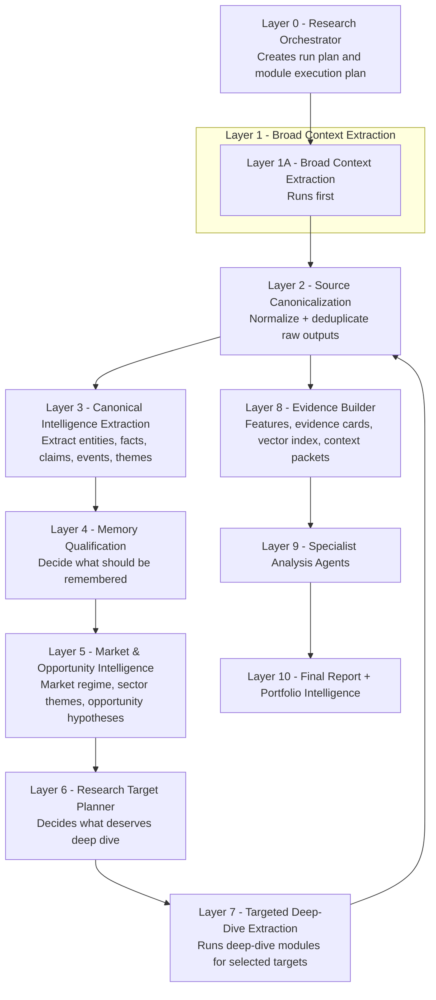
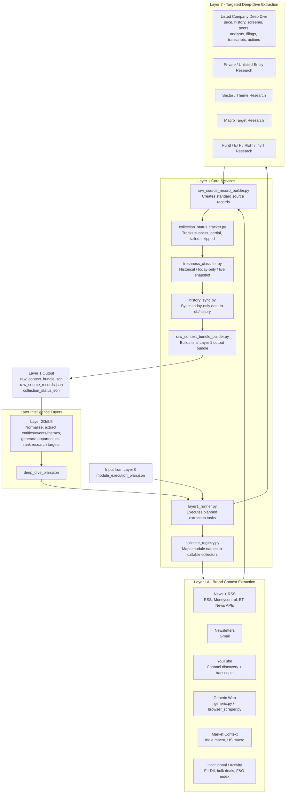

Below is the **updated Layer 1 implementation design** with the new clarification included:

```text
We do NOT deep dive every company.

Layer 1A collects broad raw context.
Layer 2/3/5/6 decide what deserves deep dive.
Layer 7 runs targeted deep-dive extraction only for selected research targets.
```

So Layer 1 is still raw extraction, but it has **two execution points**:

```text
First pass  → broad context extraction
Second pass → targeted extraction after research targets are selected
```

Your current repo already has most of this foundation. The project files show broad collectors like RSS, Moneycontrol, Economic Times, News APIs, Gmail, YouTube, macro, FII/DII, bulk deals, and F&O, plus company deep-dive collectors like market data, price history, screener, peer comparison, analyst estimates, exchange filings, filing docs, corporate actions, and SEC filings.  Your context-layer principle is also correct: this layer should extract raw data and save structured JSON, with no aggregation, calculations, or analysis in this layer. 

---

# Layer 1 — Broad Context + Targeted Extraction

## Layer purpose

Layer 1 is the **evidence collection layer**.

Its job is to collect raw context from the market and from selected research targets.

It should answer:

```text
What raw data exists?
What sources were collected?
What articles, transcripts, filings, prices, flows, financials, and announcements are available?
Where is each raw source stored?
Can later layers trace every conclusion back to original data?
```

It should **not** answer:

```text
Which stock should I buy?
Is this news positive or negative?
Is this event temporary or structural?
Which company deserves deep dive?
What is the final opportunity?
```

Those decisions happen later in intelligence, opportunity, and planning layers.

---

# Where Layer 1 sits in the full architecture



Important:

```text
Layer 1A does broad extraction before we know which companies matter.

Layer 7 does targeted extraction only after Layer 6 creates a deep-dive plan.
```

---

# Layer 1 internal architecture



---

# Important rule: how do we know which companies to deep dive?

We do **not** know that inside Layer 1A.

The decision flow is:

```text
Layer 1A: Collect broad raw context
   ↓
Layer 2: Normalize sources
   ↓
Layer 3: Extract entities / events / themes / claims
   ↓
Layer 5: Generate opportunity hypotheses
   ↓
Layer 6: Rank research targets and build deep-dive plan
   ↓
Layer 7: Run targeted extraction only for selected targets
```

So the LLM is **not removed**. It is moved to the correct layer.

Earlier:

```text
Phase A raw data
   ↓
Phase B LLM stock signal extraction
   ↓
Phase C company deep dive
```

Updated design:

```text
Layer 1A raw data
   ↓
Layer 2 canonicalization
   ↓
Layer 3 LLM/rule-based entity-event-theme extraction
   ↓
Layer 5 opportunity intelligence
   ↓
Layer 6 research target planner
   ↓
Layer 7 targeted extraction
```

This is cleaner because Layer 1 remains raw-only, while intelligence lives in later layers.

---

# Layer 1 execution modes

Layer 1 supports two extraction modes.

## Mode 1: Broad Context Extraction

Used for:

```text
daily autonomous market scan
source discovery
market monitoring
newsletter/video ingestion
macro/institutional snapshot
```

No ticker required.

Output:

```text
raw broad market context
```

## Mode 2: Targeted Deep-Dive Extraction

Used after Layer 6 produces selected targets.

Input:

```text
deep_dive_plan.json
```

Output:

```text
target-specific raw research bundles
```

This is where selected companies, private entities, sectors, macro themes, or ETF/fund targets are researched.

---

# Layer 1 high-level input

Layer 1 consumes the execution plan from Layer 0.

```json
{
  "research_run_id": "RUN_2026_05_09_AUTONOMOUS_DAILY_0800",
  "run_mode": "autonomous_daily",
  "market": "india",
  "depth": "standard",
  "module_execution_plan": [
    {
      "task_id": "phaseA_moneycontrol_markets",
      "layer": "L1",
      "extraction_phase": "broad_context",
      "module": "moneycontrol",
      "function": "save_category",
      "params": {
        "category_name": "markets",
        "days_back": 2,
        "max_pages": 5
      },
      "criticality": "medium",
      "enabled": true
    }
  ]
}
```

For targeted extraction, Layer 1 consumes:

```json
{
  "research_run_id": "RUN_2026_05_09_AUTONOMOUS_DAILY_0800",
  "extraction_phase": "targeted_deep_dive",
  "deep_dive_plan": [
    {
      "target_id": "TARGET_001",
      "target_type": "listed_company",
      "entity_name": "HDFC Bank",
      "ticker": "HDFCBANK.NS",
      "market": "india",
      "modules_to_run": [
        "market_data",
        "price_history",
        "screener_in",
        "peer_comparison",
        "analyst_estimates",
        "exchange_filings",
        "filing_docs",
        "corporate_actions"
      ]
    }
  ]
}
```

---

# Layer 1 high-level output

Layer 1 produces:

```json
{
  "research_run_id": "RUN_2026_05_09_AUTONOMOUS_DAILY_0800",
  "layer": "L1_broad_context_targeted_extraction",
  "status": "success",
  "raw_context_bundle_path": "output/2026-05-09/layer1/raw_context_bundle.json",
  "raw_source_records_path": "output/2026-05-09/layer1/raw_source_records.json",
  "collection_status_path": "output/2026-05-09/layer1/collection_status.json",
  "data_freshness_report_path": "output/2026-05-09/layer1/data_freshness_report.json",
  "history_sync_report_path": "output/2026-05-09/layer1/history_sync_report.json"
}
```

---

# Layer 1 output folder

```text
output/2026-05-09/layer1/
├── raw_context_bundle.json
├── raw_source_records.json
├── collection_status.json
├── collection_errors.json
├── data_freshness_report.json
└── history_sync_report.json
```

---

# Layer 1 common raw source record

Every module keeps its current raw output, but Layer 1 also creates a standard wrapper.

```json
{
  "source_record_id": "SRCREC_20260509_MONEYCONTROL_MARKETS_0001",
  "research_run_id": "RUN_2026_05_09_AUTONOMOUS_DAILY_0800",
  "layer": "L1",
  "extraction_phase": "broad_context",
  "module": "moneycontrol",
  "source_type": "news_article",
  "source_name": "Moneycontrol",
  "input_params": {
    "category_name": "markets",
    "days_back": 2,
    "max_pages": 5
  },
  "raw_output_path": "output/2026-05-09/phaseA/moneycontrol/markets_2026-05-09.json",
  "record_count": 42,
  "collected_at": "2026-05-09T08:12:00+05:30",
  "data_date_range": {
    "from": "2026-05-08",
    "to": "2026-05-09"
  },
  "status": "success",
  "content_type": "text",
  "freshness_type": "historical_available",
  "requires_history_sync": false,
  "notes": []
}
```

This is important for:

```text
traceability
audit
debugging
Layer 2 normalization
hallucination control
source-linked reasoning later
```

---

# `raw_context_bundle.json`

```json
{
  "research_run_id": "RUN_2026_05_09_AUTONOMOUS_DAILY_0800",
  "layer": "L1",
  "created_at": "2026-05-09T09:05:00+05:30",
  "broad_context": {
    "rss_items": [],
    "moneycontrol_articles": [],
    "economic_times_articles": [],
    "news_api_items": [],
    "newsletters": [],
    "youtube_transcripts": [],
    "generic_web_pages": [],
    "macro_snapshots": [],
    "institutional_flows": [],
    "bulk_block_deals": [],
    "fno_index_snapshots": []
  },
  "targeted_context": {
    "listed_company_bundles": [],
    "private_entity_bundles": [],
    "sector_theme_bundles": [],
    "macro_target_bundles": [],
    "fund_etf_bundles": []
  },
  "raw_source_record_paths": [],
  "status_summary": {
    "success": 0,
    "partial": 0,
    "failed": 0,
    "skipped": 0
  }
}
```

---

# Layer 1 core modules

These modules are not data collectors. They manage Layer 1 execution.

```text
context_ext_layer/
├── layer1_runner.py
├── collector_registry.py
├── raw_source_record_builder.py
├── collection_status_tracker.py
├── freshness_classifier.py
├── history_sync.py
└── raw_context_bundle_builder.py
```

---

## 1. `layer1_runner.py`

### Purpose

Execute Layer 1 tasks from Layer 0’s module execution plan.

### Why important

Layer 1 should not hardcode what to run. Layer 0 decides the plan; Layer 1 executes it.

### Questions answered

```text
Which extraction tasks should run?
Which are enabled?
Which belong to broad context vs targeted extraction?
Which task failed or succeeded?
```

### Input

```json
{
  "module_execution_plan": [
    {
      "task_id": "phaseA_rss_mint_markets",
      "module": "rss",
      "function": "save_feed",
      "params": {
        "feed_name": "mint_markets",
        "url": "https://www.livemint.com/rss/markets"
      }
    }
  ]
}
```

### Logic

```text
Read module_execution_plan.
For each enabled L1 task:
    load collector from registry
    call function with params
    capture output path/result
    create status record
    create raw source record
After tasks finish:
    run history sync for today-only sources
    build raw_context_bundle.json
```

### Output

```json
{
  "layer": "L1",
  "status": "success",
  "raw_context_bundle_path": "",
  "collection_status_path": ""
}
```

---

## 2. `collector_registry.py`

### Purpose

Map logical module names to actual Python functions.

### Why important

Avoid hardcoding imports everywhere.

### Input

```json
{
  "module": "moneycontrol",
  "function": "save_category"
}
```

### Logic

```python
COLLECTOR_REGISTRY = {
    "rss": {
        "module_path": "context_ext_layer.phaseA_broad_context.rss",
        "functions": ["save_feed", "save_all_feeds"]
    },
    "moneycontrol": {
        "module_path": "context_ext_layer.phaseA_broad_context.moneycontrol",
        "functions": ["save_category"]
    },
    "market_data": {
        "module_path": "context_ext_layer.phaseC_targeted_deep_dive.market_data",
        "functions": ["save_market_snapshot"]
    }
}
```

### Output

```json
{
  "callable_found": true,
  "module_path": "",
  "function_name": ""
}
```

---

## 3. `raw_source_record_builder.py`

### Purpose

Create a standardized source wrapper for every raw output.

### Why important

Later layers need source traceability.

### Input

```json
{
  "task_id": "phaseA_moneycontrol_markets",
  "module": "moneycontrol",
  "params": {},
  "output_file": "",
  "record_count": 42
}
```

### Output

```json
{
  "source_record_id": "",
  "research_run_id": "",
  "module": "",
  "raw_output_path": "",
  "source_type": "",
  "record_count": 42,
  "status": "success"
}
```

---

## 4. `collection_status_tracker.py`

### Purpose

Track task status.

### Input

```json
{
  "task_id": "phaseA_youtube_cnbc",
  "module": "yt_transcript",
  "status": "failed",
  "error": "Transcript unavailable"
}
```

### Output

```json
{
  "task_id": "phaseA_youtube_cnbc",
  "status": "failed",
  "started_at": "",
  "ended_at": "",
  "duration_seconds": 4.2,
  "output_file": null,
  "error": {
    "message": "Transcript unavailable",
    "retryable": false
  }
}
```

---

## 5. `freshness_classifier.py`

### Purpose

Mark whether data can be re-fetched or must be synced daily.

Your context docs already identify that some modules have full history while FII/DII and bulk deals are today-only, and F&O is a live snapshot. 

### Output example

```json
{
  "module": "fii_dii",
  "freshness_type": "today_only",
  "history_available": false,
  "requires_daily_run": true,
  "requires_history_sync": true
}
```

### Freshness classification

```text
historical_available:
- screener_in
- peer_comparison
- analyst_estimates
- price_history
- corporate_actions
- exchange_filings
- filing_docs
- sec_filings
- macro_data
- us_macro

today_only:
- fii_dii
- bulk_deals

live_snapshot:
- fno_data
```

---

## 6. `history_sync.py`

### Purpose

Persist today-only/live data into history.

### Why important

If you miss FII/DII or bulk deal data, it may be unrecoverable from the public source later. Your docs explicitly call this out and recommend syncing FII/DII, bulk deals, and macro data to `db/history`. 

### Input

```json
{
  "modules_to_sync": ["fii_dii", "bulk_deals", "macro_data"],
  "run_date": "2026-05-09"
}
```

### Output

```json
{
  "sync_status": "success",
  "synced_files": [
    "db/history/fii_dii.jsonl",
    "db/history/bulk_deals.jsonl",
    "db/history/macro_data.jsonl"
  ]
}
```

---

## 7. `raw_context_bundle_builder.py`

### Purpose

Build one official Layer 1 output file.

### Input

```json
{
  "raw_source_records": [],
  "collection_status": []
}
```

### Output

```json
{
  "raw_context_bundle_path": "output/2026-05-09/layer1/raw_context_bundle.json"
}
```

---

# Layer 1A — Broad Context Extraction

Layer 1A collects market-wide raw context. No ticker is required.

It should run daily.

---

## Broad modules overview

| Module                         |   Already exists? | Purpose                                         |
| ------------------------------ | ----------------: | ----------------------------------------------- |
| `rss.py`                       |               Yes | Broad headlines and summaries                   |
| `moneycontrol.py`              |               Yes | Full Indian market/company/economy articles     |
| `economic_times.py`            |               Yes | Full ET stock/market/expert articles            |
| `newsdata_io.py`               |               Yes | Query-based news metadata                       |
| `mediastack.py`                |               Yes | Secondary news API metadata                     |
| `gmail.py`                     |               Yes | Newsletter raw context                          |
| `youtube_channel_discovery.py` | Needs improvement | Discover latest videos from configured channels |
| `yt_transcript.py`             |               Yes | Extract YouTube transcripts                     |
| `generic.py`                   |               Yes | Extract open webpage/article text               |
| `browser_scraper.py`           |               Yes | Extract JS-rendered webpage text                |
| `india_macro.py`               |               Yes | Indian macro/market snapshot                    |
| `us_macro.py`                  |               Yes | US/global macro context                         |
| `fii_dii.py`                   |               Yes | Institutional flows                             |
| `bulk_deals.py`                |               Yes | Bulk/block deals                                |
| `fno_data.py`                  |               Yes | F&O index snapshot                              |

Your existing documentation already groups these collectors under news/information, market/price data, institutional activity, and utilities. 

---

## A1. `rss.py`

### Purpose

Collect RSS headlines, URLs, summaries, and published dates.

### Why important

RSS is useful for broad low-cost discovery. It helps later layers know which full articles or themes may need attention.

### Input

```json
{
  "feed_name": "mint_markets",
  "url": "https://www.livemint.com/rss/markets"
}
```

### Logic

```text
Fetch feed.
Parse entries.
Extract title, URL, summary, published date.
Save raw feed JSON.
Do not classify sentiment.
Do not extract entities here.
```

### Module output

```json
{
  "feed_name": "mint_markets",
  "url": "",
  "fetched_at": "",
  "total": 25,
  "articles": [
    {
      "title": "",
      "url": "",
      "published": "",
      "summary": ""
    }
  ]
}
```

---

## A2. `moneycontrol.py`

### Purpose

Collect full-body articles from Moneycontrol categories.

### Why important

Moneycontrol is a strong Indian market source for stocks, earnings, economy, IPOs, commodities, companies, and mutual funds.

### Input

```json
{
  "category_name": "markets",
  "days_back": 2,
  "max_pages": 5
}
```

### Logic

```text
Read configured category URL.
Fetch listing pages.
Stop when articles exceed days_back.
Fetch article pages.
Extract title, author, published date, modified date, description, body.
Save raw article JSON.
```

### Output

```json
{
  "category": "markets",
  "fetched_at": "",
  "days_back": 2,
  "total": 40,
  "articles": [
    {
      "url": "",
      "title": "",
      "author": "",
      "published": "",
      "modified": "",
      "description": "",
      "body": ""
    }
  ]
}
```

---

## A3. `economic_times.py`

### Purpose

Collect full-body articles from Economic Times categories.

### Why important

Useful for stock news, expert views, stock recommendations, commodities, and market commentary.

### Input

```json
{
  "category_name": "stocks_news",
  "days_back": 2,
  "max_pages": 5
}
```

### Logic

```text
Fetch category pages.
Extract article URLs.
Fetch article pages.
Extract title, author, published date, modified date, description, body.
Save raw JSON.
```

### Output

```json
{
  "category": "stocks_news",
  "fetched_at": "",
  "days_back": 2,
  "total": 30,
  "articles": [
    {
      "url": "",
      "title": "",
      "author": "",
      "published": "",
      "modified": "",
      "description": "",
      "body": ""
    }
  ]
}
```

---

## A4. `newsdata_io.py`

### Purpose

Collect query-based broad news items.

### Why important

Useful for discovering market stories not covered by RSS or fixed scrapers.

### Input

```json
{
  "query": "Nifty Sensex stock market India",
  "country": "in",
  "language": "en",
  "limit": 10
}
```

### Logic

```text
Call API.
Save title, description, URL, source, published date, keywords.
Do not assume full article body is present.
Mark as metadata/discovery source.
```

### Output

```json
{
  "query": "Nifty Sensex stock market India",
  "fetched_at": "",
  "total": 10,
  "articles": [
    {
      "title": "",
      "description": "",
      "url": "",
      "source": "",
      "published": "",
      "keywords": []
    }
  ]
}
```

---

## A5. `mediastack.py`

### Purpose

Collect secondary broad news metadata.

### Why important

Useful for source diversity and coverage, but use with limits.

### Input

```json
{
  "query": "Nifty Sensex",
  "countries": "in",
  "languages": "en",
  "categories": "business",
  "limit": 10
}
```

### Logic

```text
Call Mediastack.
Save title, description, URL, source, author, published date.
Use configured low-volume queries.
```

### Output

```json
{
  "query": "Nifty Sensex",
  "fetched_at": "",
  "total": 10,
  "articles": [
    {
      "title": "",
      "description": "",
      "url": "",
      "source": "",
      "author": "",
      "published": ""
    }
  ]
}
```

---

## A6. `gmail.py`

### Purpose

Collect newsletters from configured senders/subjects.

### Why important

Newsletters often contain curated ideas, but they are not final evidence. Later layers should verify them.

### Input

```json
{
  "from_domain": "busline.hindugroup.org",
  "subject_keyword": null,
  "limit": 5
}
```

### Logic

```text
Search mailbox by sender or subject.
Extract subject, sender, date, body.
Save raw newsletter text.
```

### Output

```json
{
  "from_domain": "busline.hindugroup.org",
  "subject_keyword": null,
  "fetched_at": "",
  "total": 5,
  "newsletters": [
    {
      "subject": "",
      "sender": "",
      "date": "",
      "body": ""
    }
  ]
}
```

---

## A7. `youtube_channel_discovery.py`

### Purpose

Autonomously discover new videos from configured YouTube channels.

### Why important

Your existing YouTube module works when given a video URL, but autonomous mode needs to discover latest videos first.

### Input

```json
{
  "channel_id": "UC...",
  "name": "CNBC TV18",
  "days_back": 5,
  "max_latest_videos": 3,
  "keywords": ["market", "nifty", "earnings", "stocks", "results"]
}
```

### Logic

```text
For each enabled channel:
    fetch latest video metadata
    filter by date
    filter by keywords if configured
    check processed_video_registry
    produce selected video URLs
```

### Output

```json
{
  "channel_id": "",
  "channel_name": "",
  "fetched_at": "",
  "videos_found": 12,
  "videos_selected": 3,
  "videos": [
    {
      "video_id": "",
      "url": "",
      "title": "",
      "published_at": "",
      "duration_seconds": 780,
      "already_processed": false
    }
  ]
}
```

### Needed history table

```text
db/history/youtube_processed_videos.jsonl
```

Record format:

```json
{
  "video_id": "",
  "channel_id": "",
  "title": "",
  "published_at": "",
  "processed_at": "",
  "transcript_status": "success"
}
```

---

## A8. `yt_transcript.py`

### Purpose

Extract transcript text for selected YouTube videos.

### Input

```json
{
  "video_url": "https://www.youtube.com/watch?v=...",
  "video_id": "",
  "language": "en"
}
```

### Logic

```text
Extract video ID.
Fetch transcript segments.
Save transcript metadata and raw transcript.
Do not summarize or classify here.
```

### Output

```json
{
  "video_id": "",
  "url": "",
  "title": "",
  "channel_name": "",
  "published_at": "",
  "fetched_at": "",
  "language": "en",
  "transcript": [
    {
      "start": 10.2,
      "duration": 4.6,
      "text": ""
    }
  ]
}
```

---

## A9. `generic.py`

### Purpose

Extract article text from open URLs.

### Input

```json
{
  "url": "https://finshots.in/..."
}
```

### Logic

```text
Fetch HTML.
Extract title, author, date, text.
Save by domain + URL hash.
```

### Output

```json
{
  "url": "",
  "extracted_at": "",
  "title": "",
  "author": "",
  "date": "",
  "text": ""
}
```

---

## A10. `browser_scraper.py`

### Purpose

Extract content from JavaScript-rendered open pages.

### Input

```json
{
  "url": "https://tickertape.in/stocks/reliance-industries-RELI"
}
```

### Logic

```text
Open page using Playwright.
Wait for rendering.
Extract HTML/text.
Save raw extracted text.
```

### Output

```json
{
  "url": "",
  "extracted_at": "",
  "title": "",
  "author": "",
  "date": "",
  "text": ""
}
```

---

## A11. `india_macro.py`

### Purpose

Collect Indian macro and market snapshot.

### Why important

Later market-regime analysis needs macro, index valuation, breadth, rates, commodities, currency, VIX, and RBI context.

### Input

```json
{
  "include_indices": true,
  "include_commodities": true,
  "include_world_bank": true,
  "include_rbi_repo": true
}
```

### Logic

```text
Fetch NSE index and valuation data.
Fetch market breadth.
Fetch rates and commodities.
Fetch CPI/GDP if available.
Fetch RBI repo rate if available.
Save raw macro snapshot.
```

### Output

```json
{
  "fetched_at": "",
  "market_breadth": {},
  "nse_indices": [],
  "market_rates": {},
  "commodity_prices": {},
  "india_macro": {},
  "rbi_repo_rate": ""
}
```

---

## A12. `us_macro.py`

### Purpose

Collect US/global macro context.

### Input

```json
{
  "series": ["DFF", "DGS10", "DGS2", "CPIAUCSL", "T10Y2Y", "DEXINUS"],
  "lookback_count": 30
}
```

### Logic

```text
Fetch configured FRED/global macro series.
Save latest observations and recent history.
```

### Output

```json
{
  "fetched_at": "",
  "series": {
    "fed_funds_rate": [],
    "us_10y_treasury": [],
    "us_2y_treasury": [],
    "us_cpi": [],
    "yield_curve_10y_2y": [],
    "usd_inr": []
  }
}
```

---

## A13. `fii_dii.py`

### Purpose

Collect FII/DII daily institutional flow.

### Input

```json
{}
```

### Logic

```text
Fetch latest FII/DII data.
Save buy, sell, net values.
Mark as today-only.
Trigger history sync.
```

### Output

```json
{
  "fetched_at": "",
  "date": "",
  "fii": {
    "buy": 0,
    "sell": 0,
    "net": 0
  },
  "dii": {
    "buy": 0,
    "sell": 0,
    "net": 0
  }
}
```

---

## A14. `bulk_deals.py`

### Purpose

Collect NSE bulk/block deals.

### Why important

Bulk/block deals can become deep-dive triggers later, but Layer 1 only collects raw deal rows.

### Input

```json
{}
```

or targeted:

```json
{
  "ticker": "RELIANCE.NS"
}
```

### Logic

```text
Fetch NSE bulk CSV.
Fetch NSE block CSV.
Normalize rows.
Save raw deal records.
Mark as today-only.
Trigger history sync.
```

### Output

```json
{
  "fetched_at": "",
  "bulk_deals": [
    {
      "date": "",
      "symbol": "",
      "scrip_name": "",
      "client": "",
      "buy_sell": "",
      "quantity": "",
      "trade_price": "",
      "remarks": ""
    }
  ],
  "block_deals": []
}
```

---

## A15. `fno_data.py` — index mode

### Purpose

Collect NIFTY/BANKNIFTY option-chain snapshot.

### Input

```json
{
  "ticker": "NIFTY"
}
```

### Logic

```text
Fetch option chain.
Save full option chain and source-level derived fields like PCR, max pain, top OI strikes, ATM IV.
Do not interpret bullish/bearish here.
```

### Output

```json
{
  "fetched_at": "",
  "ticker": "NIFTY",
  "underlying_value": 0,
  "timestamp": "",
  "expiry_dates": [],
  "pcr": 0,
  "max_pain": 0,
  "atm_iv": {},
  "top_oi_strikes": {},
  "option_chain": []
}
```

---

# Layer 7 — Targeted Deep-Dive Extraction

> **Architecture note:** What was previously called "Layer 1B" is now **Layer 7 — Targeted Deep-Dive Extraction**. The full canonical design is in `docs/system_design_docs/layer_7.md`. The content below documents the same concepts and remains valid as reference; Layer 7 is the authoritative implementation doc.

Layer 7 runs only after Layer 6 produces `deep_dive_plan.json`.

This is the answer to your important question:

```text
How do we know what companies to deep dive?
```

We know because:

```text
Layer 3 extracts entities/events/themes.
Layer 5 generates opportunity hypotheses.
Layer 6 ranks research targets.
Layer 6 outputs deep_dive_plan.json.
Layer 7 consumes that plan.
```

We do not deep dive all companies.

---

# Deep-dive target types

Layer 7 supports these target types:

```text
Type 1: Listed company target
Type 2: Private / unlisted company target
Type 3: Sector / theme target
Type 4: Macro target
Type 5: Mutual fund / ETF / REIT / InvIT target
```

---

# `deep_dive_plan.json`

```json
{
  "research_run_id": "RUN_2026_05_09_AUTONOMOUS_DAILY_0800",
  "created_by": "Layer_6_Research_Target_Planner",
  "targets": [
    {
      "target_id": "TARGET_001",
      "target_type": "listed_company",
      "entity_name": "HDFC Bank",
      "ticker": "HDFCBANK.NS",
      "market": "india",
      "priority_score": 82,
      "why_selected": [
        "Mentioned in multiple credible sources",
        "Banking margin pressure event detected",
        "High market relevance"
      ],
      "modules_to_run": [
        "market_data",
        "price_history",
        "screener_in",
        "peer_comparison",
        "analyst_estimates",
        "exchange_filings",
        "filing_docs"
      ]
    }
  ]
}
```

---

## B1. `market_data.py`

### Purpose

Fetch current price snapshot for a listed stock.

### Input

```json
{
  "ticker": "HDFCBANK.NS"
}
```

### Logic

```text
Fetch quote snapshot.
Save price, change, volume, market cap, sector, industry, 52-week high/low.
```

### Output

```json
{
  "ticker": "HDFCBANK.NS",
  "company_name": "",
  "exchange": "NSE",
  "currency": "INR",
  "fetched_at": "",
  "price": 0,
  "day_change_pct": 0,
  "volume": 0,
  "market_cap": 0,
  "fifty_two_week_high": 0,
  "fifty_two_week_low": 0,
  "sector": "",
  "industry": ""
}
```

---

## B2. `price_history.py`

### Purpose

Fetch historical OHLCV data.

### Input

```json
{
  "ticker": "HDFCBANK.NS",
  "period": "1y",
  "interval": "1d"
}
```

### Logic

```text
Fetch OHLCV rows.
Save raw historical rows.
Do not calculate final trend interpretation here.
```

### Output

```json
{
  "ticker": "HDFCBANK.NS",
  "period": "1y",
  "interval": "1d",
  "fetched_at": "",
  "history": [
    {
      "date": "",
      "open": 0,
      "high": 0,
      "low": 0,
      "close": 0,
      "volume": 0
    }
  ]
}
```

---

## B3. `screener_in.py`

### Purpose

Fetch Indian company fundamentals.

### Input

```json
{
  "screener_url": "https://www.screener.in/company/HDFCBANK/",
  "fetch_pdfs": false,
  "pdf_quarters": null
}
```

### Logic

```text
Scrape key ratios, pros/cons, quarterly results, P&L, balance sheet, cash flow, ratios, growth metrics, and shareholding.
Save raw structured JSON.
```

### Output

```json
{
  "company_name": "",
  "description": "",
  "key_ratios": {},
  "pros": [],
  "cons": [],
  "quarterly_results": [],
  "profit_loss": [],
  "balance_sheet": [],
  "cash_flow": [],
  "ratios": [],
  "growth_metrics": {},
  "shareholding_quarterly": [],
  "shareholding_yearly": [],
  "quarterly_pdfs": []
}
```

---

## B4. `peer_comparison.py`

### Purpose

Fetch sector peer comparison.

### Input

```json
{
  "ticker": "HDFCBANK.NS",
  "max_peers": 15
}
```

### Logic

```text
Infer sector/industry.
Map to NSE sector index.
Fetch peer constituents.
Fetch ratios for target and peers.
Save raw comparison.
```

### Output

```json
{
  "fetched_at": "",
  "ticker": "HDFCBANK",
  "sector_index": "NIFTY BANK",
  "target": {},
  "peers": []
}
```

---

## B5. `analyst_estimates.py`

### Purpose

Fetch analyst estimates and revisions.

### Input

```json
{
  "ticker": "HDFCBANK.NS"
}
```

### Logic

```text
Fetch price targets, EPS estimates, revenue estimates, earnings history, recommendations, EPS trend, EPS revisions.
Save raw JSON.
```

### Output

```json
{
  "ticker": "HDFCBANK",
  "fetched_at": "",
  "price_targets": {},
  "earnings_estimates": {},
  "revenue_estimates": {},
  "earnings_history": [],
  "recommendations": [],
  "eps_trend": {},
  "eps_revisions": {}
}
```

---

## B6. `exchange_filings.py`

### Purpose

Fetch NSE corporate announcements.

### Input

```json
{
  "ticker": "HDFCBANK",
  "limit": 50,
  "material_only": true
}
```

### Logic

```text
Fetch corporate announcements.
Optionally filter material announcements.
Save date, type, subject, attachment URL, XBRL flag.
```

### Output

```json
{
  "ticker": "HDFCBANK",
  "fetched_at": "",
  "total_returned": 50,
  "material_only": true,
  "announcements": [
    {
      "date": "",
      "type": "",
      "subject": "",
      "attachment_url": "",
      "has_xbrl": false
    }
  ]
}
```

---

## B7. `filing_docs.py`

### Purpose

Fetch concall transcripts and investor presentations.

### Input

```json
{
  "ticker": "HDFCBANK",
  "transcripts": 4,
  "presentations": 2
}
```

### Logic

```text
Find transcript and presentation filings.
Download PDFs.
Extract text.
Save raw transcript/presentation text.
```

### Output

```json
{
  "ticker": "HDFCBANK",
  "fetched_at": "",
  "transcripts": [
    {
      "date": "",
      "subject": "",
      "pdf_url": "",
      "text": ""
    }
  ],
  "presentations": [
    {
      "date": "",
      "subject": "",
      "pdf_url": "",
      "text": ""
    }
  ]
}
```

---

## B8. `corporate_actions.py`

### Purpose

Fetch dividends, splits, bonuses, rights, buybacks.

### Input

```json
{
  "ticker": "HDFCBANK.NS"
}
```

### Logic

```text
Fetch NSE corporate actions.
Fetch yfinance dividends/splits.
Save combined raw history.
```

### Output

```json
{
  "ticker": "HDFCBANK",
  "fetched_at": "",
  "nse_actions": [],
  "yf_dividends": [],
  "yf_splits": []
}
```

---

## B9. `sec_filings.py`

### Purpose

Fetch SEC filings and XBRL financials for US companies.

### Input

```json
{
  "ticker": "AAPL",
  "fetch_financials": true,
  "fetch_filings": true,
  "fetch_texts": false,
  "text_form_types": ["8-K"],
  "limit_per_type": 5
}
```

### Logic

```text
Resolve ticker to CIK.
Fetch XBRL company facts.
Fetch recent filing metadata.
Optionally fetch text for selected filings.
Save raw SEC JSON.
```

### Output

```json
{
  "ticker": "AAPL",
  "cik": "",
  "company_name": "Apple Inc.",
  "fetched_at": "",
  "key_financials": {},
  "recent_filings": {},
  "filing_texts": []
}
```

---

## B10. `fno_data.py` — stock mode

### Purpose

Fetch stock-level F&O data if eligible.

### Input

```json
{
  "ticker": "HDFCBANK.NS"
}
```

### Logic

```text
Fetch stock option chain.
Save option chain and source-level fields like PCR, max pain, OI, IV.
```

### Output

```json
{
  "ticker": "HDFCBANK",
  "underlying_value": 0,
  "timestamp": "",
  "expiry_dates": [],
  "pcr": 0,
  "max_pain": 0,
  "atm_iv": {},
  "top_oi_strikes": {},
  "option_chain": []
}
```

---

# New targeted modules for opportunity engine

Your current implementation is strong for listed companies. For final-product design, add these later.

---

## B11. `targeted_news.py`

### Purpose

Fetch news specific to a selected research target.

### Input

```json
{
  "target_id": "TARGET_001",
  "queries": [
    "HDFC Bank margin pressure latest news",
    "HDFC Bank earnings NIM management commentary"
  ],
  "days_back": 30
}
```

### Output

```json
{
  "target_id": "",
  "target_type": "listed_company",
  "queries": [],
  "raw_articles": []
}
```

---

## B12. `private_company_research.py`

### Purpose

Collect raw context for private/unlisted companies.

### Input

```json
{
  "target_id": "TARGET_OPENAI_001",
  "entity_name": "OpenAI",
  "target_type": "private_unlisted_company",
  "queries": [
    "OpenAI data center demand",
    "OpenAI Microsoft cloud infrastructure",
    "OpenAI Nvidia chips"
  ]
}
```

### Logic

```text
Fetch targeted news/web pages.
Save raw articles.
Do not infer listed beneficiaries here.
```

### Output

```json
{
  "target_id": "",
  "entity_name": "OpenAI",
  "target_type": "private_unlisted_company",
  "raw_articles": [],
  "source_queries": []
}
```

---

## B13. `sector_theme_research.py`

### Purpose

Collect raw context for sectors/themes.

### Input

```json
{
  "target_id": "TARGET_THEME_001",
  "theme": "AI data center power demand",
  "market": "india",
  "related_sectors": ["power", "electrical equipment", "data centers"]
}
```

### Output

```json
{
  "target_id": "",
  "target_type": "sector_theme",
  "theme": "",
  "raw_sector_articles": [],
  "related_indices": [],
  "related_companies": [],
  "raw_macro_links": []
}
```

---

## B14. `macro_target_research.py`

### Purpose

Collect additional context for macro targets.

### Input

```json
{
  "target_id": "TARGET_MACRO_001",
  "macro_theme": "RBI rate cut expectation",
  "required_series": ["repo_rate", "inflation", "bond_yields", "banking_index"]
}
```

### Output

```json
{
  "target_id": "",
  "target_type": "macro_theme",
  "macro_theme": "",
  "raw_macro_series": {},
  "related_market_data": []
}
```

---

## B15. `fund_etf_research.py`

### Purpose

Collect raw information for mutual funds, ETFs, REITs, and InvITs.

### Input

```json
{
  "target_id": "TARGET_ETF_001",
  "theme": "broad Nifty accumulation",
  "instrument_type": "etf"
}
```

### Output

```json
{
  "target_id": "",
  "target_type": "fund_etf_reit_invit",
  "fund_candidates": [],
  "raw_fund_facts": [],
  "holdings": [],
  "expense_ratios": []
}
```

---

# Layer 1 module status format

Every module should return a standard status.

```json
{
  "task_id": "phaseA_moneycontrol_markets",
  "module": "moneycontrol",
  "status": "success",
  "started_at": "",
  "ended_at": "",
  "duration_seconds": 12.4,
  "input_params": {},
  "output_file": "",
  "record_count": 42,
  "error": null,
  "warnings": []
}
```

Failure example:

```json
{
  "task_id": "phaseA_youtube_cnbc",
  "module": "yt_transcript",
  "status": "failed",
  "started_at": "",
  "ended_at": "",
  "duration_seconds": 4.2,
  "input_params": {},
  "output_file": null,
  "record_count": 0,
  "error": {
    "error_type": "transcript_unavailable",
    "message": "Transcript unavailable for this video",
    "retryable": false
  },
  "warnings": []
}
```

---

# Layer 1 data quality checks

Layer 1 should only do light quality checks.

It can check:

```text
Was output file created?
Is record_count greater than zero?
Is article body missing?
Is transcript missing?
Is date missing?
Is source empty because market is closed?
Did source fail due to quota/rate limit?
```

It should not classify meaning.

Example:

```json
{
  "task_id": "phaseA_economic_times_stocks_news",
  "quality": {
    "record_count": 32,
    "empty_body_count": 3,
    "missing_date_count": 1,
    "quality_status": "usable_with_warnings"
  }
}
```

---

# What should move out of Layer 1

Your previous Phase B logic should not stay inside Layer 1.

Move it like this:

```text
Old Phase B market_regime.py
    → Layer 5 Market & Opportunity Intelligence

Old Phase B news_signal_extractor.py
    → Layer 3 Entity/Event/Theme Extraction

Old Phase B candidate_scorer.py
    → Layer 6 Research Target Planner
```

This keeps Layer 1 raw-only while preserving the useful logic.

---

# What is already good

You already have around **70–80% of Layer 1 collectors**.

Already strong:

```text
RSS collection
Moneycontrol collection
Economic Times collection
News API collection
Gmail newsletters
YouTube transcript extraction
Generic web extraction
Browser scraper
India macro
US macro
FII/DII
Bulk deals
F&O
Market data
Price history
Screener
Peer comparison
Analyst estimates
Exchange filings
Filing docs
Corporate actions
SEC filings
```

Your repo already has these modules organized under `context_ext_layer`, along with output folders and persistent history directories. 

---

# What needs to be added or improved

## Must add now

```text
1. layer1_runner.py
2. collector_registry.py
3. raw_source_record_builder.py
4. collection_status_tracker.py
5. freshness_classifier.py
6. raw_context_bundle_builder.py
7. raw_source_records.json output
8. collection_status.json output
9. data_freshness_report.json output
```

## Should add soon

```text
1. youtube_channel_discovery.py
2. youtube_processed_videos.jsonl
3. targeted_news.py
4. deep_dive_plan consumer in Layer 7
5. target-type support: listed company, private company, sector/theme, macro, ETF/fund
```

## Add later

```text
1. private_company_research.py
2. sector_theme_research.py
3. macro_target_research.py
4. fund_etf_research.py
5. real_estate_theme_research.py
6. commodity_research.py
```

---

# Layer 1 final contract

## Layer 0 gives Layer 1:

```json
{
  "research_run_id": "",
  "module_execution_plan": []
}
```

## Layer 1A gives Layer 2:

```json
{
  "raw_context_bundle_path": "",
  "raw_source_records_path": "",
  "collection_status_path": ""
}
```

## Layer 6 gives Layer 7:

```json
{
  "deep_dive_plan_path": ""
}
```

## Layer 7 gives Layer 2 / Layer 8:

```json
{
  "target_raw_bundles": [],
  "raw_source_records_path": "",
  "collection_status_path": ""
}
```

---

# Final Layer 1 summary

Layer 1 should behave like this:

```text
Layer 1A:
    collect broad raw context daily

Layer 2/3/5/6:
    understand broad context and decide research targets

Layer 7:
    deep dive selected targets only

Layer 1 output:
    raw files + source records + status + freshness report
```

So the final answer to the deep-dive question is:

```text
We do not deep dive all companies.
We deep dive only targets selected by later intelligence/planning layers.
Layer 7 waits for deep_dive_plan.json.
```

This keeps your architecture clean:

```text
Layer 1 = broad collection
Layer 3 = understanding
Layer 5 = opportunity reasoning
Layer 6 = target selection
Layer 7 = targeted collection
Layer 8+ = evidence and analysis
```

That is the correct final Layer 1 implementation design.
