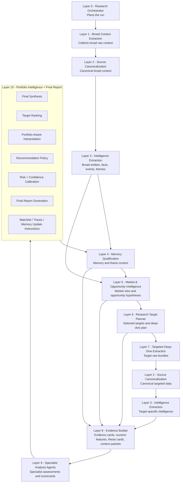
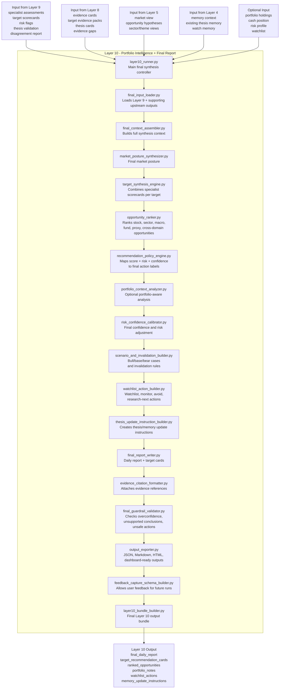

Below is the detailed implementation design for:

```text
Layer 10 — Portfolio Intelligence + Final Report
```

Layer 10 is the **final synthesis layer** of your investor intelligence system.

All previous layers prepared the system:

```text
Layer 1  → broad raw context
Layer 2  → canonical sources
Layer 3  → entities, facts, claims, events, themes
Layer 4  → memory and thesis tracking
Layer 5  → market and opportunity intelligence
Layer 6  → selected research targets
Layer 7  → targeted deep-dive extraction
Layer 8  → evidence cards and context packets
Layer 9  → specialist agent assessments
Layer 10 → final investor-facing decision-support report
```

Layer 10 is where the system finally says:

```text
This looks research-worthy.
This looks attractive but needs confirmation.
This should be watched.
This should be avoided for now.
This is too speculative.
This may be a long-term opportunity.
This may be a short-term event-driven opportunity.
```

But it should **not** blindly say:

```text
Buy this with X amount immediately.
```

Instead, it should give a structured, evidence-linked recommendation with risk, confidence, assumptions, invalidation conditions, and next steps.

---

# Layer 10 — Portfolio Intelligence + Final Report

## Layer purpose

Layer 10 answers:

```text
What is the final view after combining all specialist assessments?
Which targets are most attractive?
Which targets should be watched, avoided, researched more, or considered for action?
What is the market posture today?
What are the best stock opportunities?
What are the best sector/theme opportunities?
What are the best cross-domain opportunities?
What risks could invalidate each idea?
What evidence supports each conclusion?
What data is missing?
How should this update memory, thesis, or watchlist?
```

Layer 10 should produce:

```text
daily investor report
target ranking
opportunity ranking
final target cards
portfolio-aware notes
watchlist updates
thesis updates
risk summary
action queue
```

---

# What Layer 10 should not do

Layer 10 should not:

```text
place trades
connect to broker and execute orders
guarantee returns
hide uncertainty
ignore missing data
give high-confidence conclusions without evidence
treat speculative claims as facts
recommend allocation without user risk profile and portfolio context
```

If you later add portfolio features, Layer 10 can provide **decision-support allocation suggestions**, but it should still include constraints and risk warnings.

---

# Why Layer 10 is important

Layer 9 gives specialist assessments, but those assessments may conflict.

Example:

```text
Fundamental Agent:
    Company quality is good.

Valuation Agent:
    Valuation is only fair, not cheap.

Technical Agent:
    Short-term price action is weak.

Risk Agent:
    Margin pressure is a medium-high risk.

Thesis Agent:
    Thesis is partially supported but needs confirmation.
```

Layer 10 must combine these into a clear final view:

```text
Final view:
    Watch / selective research candidate, not strong buy yet.

Why:
    Fundamentals are acceptable, but valuation is not deeply discounted,
    technical trend is weak, and margin pressure still needs confirmation.

Next action:
    Add to watchlist, wait for management commentary / better price / NIM stabilization.
```

So Layer 10 is the **decision synthesis layer**.

---

# Where Layer 10 sits in the full architecture



Important:

```text
Layer 10 can send update instructions back to Layer 4.

Example:
- add HDFC Bank to watch memory
- update AI power thesis
- archive weak opportunity
- store final report summary
```

Layer 10 does not directly rewrite Layer 4 memory by itself unless you design it that way. Safer approach:

```text
Layer 10 produces memory_update_instructions.json
Layer 4 consumes it in the next memory update cycle
```

---

# Layer 10 internal architecture



---

# Layer 10 high-level input

Layer 10 consumes Layer 9 outputs and some upstream supporting context.

```json
{
  "research_run_id": "RUN_2026_05_09_AUTONOMOUS_DAILY_0800",
  "layer9_outputs": {
    "specialist_assessments_path": "output/2026-05-09/layer9/specialist_assessments.json",
    "target_specialist_scorecards_path": "output/2026-05-09/layer9/target_specialist_scorecards.json",
    "agent_disagreement_report_path": "output/2026-05-09/layer9/agent_disagreement_report.json",
    "risk_flags_path": "output/2026-05-09/layer9/risk_flags.json",
    "thesis_validation_results_path": "output/2026-05-09/layer9/thesis_validation_results.json",
    "layer9_quality_report_path": "output/2026-05-09/layer9/layer9_quality_report.json"
  },
  "supporting_outputs": {
    "market_view_path": "output/2026-05-09/layer5/market_view.json",
    "opportunity_hypotheses_path": "output/2026-05-09/layer5/opportunity_hypotheses.json",
    "selected_research_targets_path": "output/2026-05-09/layer6/selected_research_targets.json",
    "target_evidence_packs_path": "output/2026-05-09/layer8/target_evidence_packs.json",
    "evidence_cards_path": "output/2026-05-09/layer8/evidence_cards.json",
    "thesis_cards_path": "output/2026-05-09/layer8/thesis_cards.json",
    "evidence_gap_report_path": "output/2026-05-09/layer8/evidence_gap_report.json"
  },
  "optional_user_context": {
    "portfolio_path": "db/user/portfolio.json",
    "watchlist_path": "db/user/watchlist.json",
    "risk_profile_path": "db/user/risk_profile.json",
    "cash_available": null,
    "investment_horizon": "medium_to_long_term"
  },
  "layer10_config": {
    "generate_daily_report": true,
    "generate_target_cards": true,
    "generate_portfolio_notes": true,
    "enable_position_sizing_hints": false,
    "strict_evidence_mode": true,
    "max_final_opportunities": 10,
    "min_confidence_for_actionable_label": 0.65
  }
}
```

---

# Layer 10 high-level output

Layer 10 produces final decision-support outputs.

```json
{
  "research_run_id": "RUN_2026_05_09_AUTONOMOUS_DAILY_0800",
  "layer": "L10_portfolio_intelligence_final_report",
  "status": "success",
  "final_daily_report_path": "output/2026-05-09/layer10/final_daily_report.md",
  "final_daily_report_json_path": "output/2026-05-09/layer10/final_daily_report.json",
  "target_recommendation_cards_path": "output/2026-05-09/layer10/target_recommendation_cards.json",
  "ranked_opportunities_path": "output/2026-05-09/layer10/ranked_opportunities.json",
  "portfolio_notes_path": "output/2026-05-09/layer10/portfolio_notes.json",
  "watchlist_actions_path": "output/2026-05-09/layer10/watchlist_actions.json",
  "memory_update_instructions_path": "output/2026-05-09/layer10/memory_update_instructions.json",
  "final_guardrail_report_path": "output/2026-05-09/layer10/final_guardrail_report.json"
}
```

---

# Layer 10 output folder

```text
output/2026-05-09/layer10/
├── final_daily_report.md
├── final_daily_report.json
├── target_recommendation_cards.json
├── ranked_opportunities.json
├── market_summary_card.json
├── portfolio_notes.json
├── watchlist_actions.json
├── thesis_update_instructions.json
├── memory_update_instructions.json
├── final_guardrail_report.json
├── final_audit_log.json
├── feedback_schema.json
└── layer10_manifest.json
```

---

# What Layer 10 produces

Layer 10 produces:

```text
1. Final daily investor report
2. Final market summary card
3. Ranked opportunity list
4. Target recommendation cards
5. Portfolio-aware notes
6. Watchlist actions
7. Thesis update instructions
8. Memory update instructions
9. Final guardrail report
10. Feedback schema
```

---

# Final action labels

Layer 10 should use controlled labels.

Recommended action labels:

```text
strong_research_candidate
selective_buy_candidate
watchlist
wait_for_confirmation
avoid_for_now
reject_due_to_weak_evidence
too_speculative
portfolio_hold_review
portfolio_trim_review
portfolio_add_review
```

For MVP, use safer labels:

```text
research_candidate
watchlist
wait_for_confirmation
avoid_for_now
too_speculative
```

Only use stronger labels like `selective_buy_candidate` if:

```text
evidence is strong
confidence is sufficient
risk is acceptable
valuation is reasonable
market posture is not hostile
critical data gaps are not present
```

---

# Recommended folder structure

```text
final_synthesis_layer/
├── layer10_runner.py
├── final_input_loader.py
├── final_context_assembler.py
├── market_posture_synthesizer.py
├── target_synthesis_engine.py
├── opportunity_ranker.py
├── recommendation_policy_engine.py
├── portfolio_context_analyzer.py
├── risk_confidence_calibrator.py
├── scenario_and_invalidation_builder.py
├── watchlist_action_builder.py
├── thesis_update_instruction_builder.py
├── memory_update_instruction_builder.py
├── final_report_writer.py
├── evidence_citation_formatter.py
├── final_guardrail_validator.py
├── output_exporter.py
├── feedback_capture_schema_builder.py
└── layer10_bundle_builder.py
```

---

# Layer 10 module designs

## 1. `layer10_runner.py`

### Purpose

Main controller for the final synthesis layer.

### Why important

It coordinates final input loading, target synthesis, ranking, recommendation policy, portfolio interpretation, final report writing, and guardrail validation.

### Questions it answers

```text
Which targets are ready for final synthesis?
Which specialist scorecards are valid?
Which opportunities should appear in the final report?
Which targets should be watchlist vs action candidate?
Which conclusions are unsupported and should be downgraded?
Where should final outputs be written?
```

### Input

```json
{
  "research_run_id": "RUN_2026_05_09_AUTONOMOUS_DAILY_0800",
  "layer9_outputs": {},
  "supporting_outputs": {},
  "optional_user_context": {},
  "layer10_config": {}
}
```

### Logic

```text
Load Layer 9 outputs.
Load Layer 8 evidence references.
Load Layer 5 market/opportunity context.
Load optional portfolio/watchlist/risk profile.
Assemble final synthesis context.
Generate final market posture.
Synthesize each target.
Rank opportunities.
Apply recommendation policy.
Apply portfolio-aware interpretation if portfolio exists.
Calibrate risk and confidence.
Build scenarios and invalidation rules.
Build watchlist and memory update instructions.
Generate final report.
Run final guardrails.
Export outputs.
```

### Output

```json
{
  "status": "success",
  "targets_synthesized": 10,
  "ranked_opportunities": 8,
  "watchlist_actions": 5,
  "portfolio_notes_created": 3,
  "final_report_path": "output/2026-05-09/layer10/final_daily_report.md"
}
```

---

## 2. `final_input_loader.py`

### Purpose

Load all final synthesis inputs.

### Input

```json
{
  "specialist_assessments_path": "",
  "target_specialist_scorecards_path": "",
  "agent_disagreement_report_path": "",
  "risk_flags_path": "",
  "thesis_validation_results_path": "",
  "market_view_path": "",
  "opportunity_hypotheses_path": "",
  "target_evidence_packs_path": "",
  "evidence_cards_path": ""
}
```

### Logic

```text
Read Layer 9 scorecards.
Read risk flags.
Read thesis validation results.
Read market view.
Read opportunity hypotheses.
Read evidence packs and evidence cards.
Read optional portfolio/watchlist/risk profile.
Validate required files exist.
```

### Output

```json
{
  "specialist_assessments": [],
  "target_scorecards": [],
  "risk_flags": [],
  "thesis_validation_results": [],
  "market_view": {},
  "opportunity_hypotheses": [],
  "evidence_cards": [],
  "portfolio": {},
  "watchlist": {},
  "risk_profile": {}
}
```

---

## 3. `final_context_assembler.py`

### Purpose

Create one complete final synthesis context per target.

### Why important

Layer 10 should synthesize target by target, using all relevant specialist views and evidence.

### Input

```json
{
  "target_scorecards": [],
  "specialist_assessments": [],
  "risk_flags": [],
  "thesis_validation_results": [],
  "opportunity_hypotheses": [],
  "evidence_cards": []
}
```

### Logic

```text
For each target:
    attach specialist scorecard
    attach all specialist assessments
    attach risk flags
    attach thesis validation
    attach linked opportunities
    attach top evidence cards
    attach data gaps
    attach disagreements
    attach portfolio position if exists
```

### Output

```json
{
  "final_target_contexts": [
    {
      "target_id": "TARGET_20260509_0001",
      "target_name": "HDFC Bank",
      "ticker": "HDFCBANK.NS",
      "target_type": "listed_company",
      "scorecard": {},
      "specialist_assessments": [],
      "risk_flags": [],
      "thesis_validation": {},
      "linked_opportunities": [],
      "top_evidence_cards": [],
      "critical_data_gaps": [],
      "portfolio_context": null
    }
  ]
}
```

---

## 4. `market_posture_synthesizer.py`

### Purpose

Create final market posture for the report.

### Why important

The final recommendation should respect market conditions.

### Questions it answers

```text
Is today a broad buying environment?
Should the system prefer selective research?
Is the market risky?
Should new entries be delayed?
Are sector-specific opportunities better than broad-market buying?
```

### Input

```json
{
  "market_view": {},
  "market_context_agent_assessment": {},
  "macro_risk_flags": [],
  "memory_context": {}
}
```

### Logic

```text
Combine Layer 5 market view and Layer 9 market assessment.
Adjust for risk flags and confidence.
Create final market posture label.
Create report summary.
```

### Output

```json
{
  "market_summary_card": {
    "market": "india",
    "final_market_posture": "selective_research",
    "risk_level": "medium",
    "summary": "Market conditions are mixed, so broad aggressive buying is not preferred. Selective research is more appropriate.",
    "supporting_points": [
      {
        "point": "FII flows are negative but domestic flows partially offset them.",
        "evidence_refs": ["EVID_FII_DII_001"]
      }
    ],
    "confidence": 0.71,
    "report_language": "Selective opportunities may exist, but broad-market aggression is not justified by current evidence."
  }
}
```

---

## 5. `target_synthesis_engine.py`

### Purpose

Combine specialist assessments into one final target-level synthesis.

### Why important

This is where Layer 10 turns many specialist views into one coherent target card.

### Input

```json
{
  "target_context": {
    "target_id": "TARGET_001",
    "scorecard": {},
    "specialist_assessments": [],
    "risk_flags": [],
    "thesis_validation": {},
    "evidence_gaps": []
  }
}
```

### Logic

```text
Read specialist dimension scores.
Read dimension labels.
Read risk flags.
Read thesis validation.
Read agent disagreements.
Read evidence gaps.
Create final synthesis:
    thesis summary
    what supports it
    what weakens it
    risk summary
    confidence level
    data gaps
    final target view
```

### Output

```json
{
  "target_synthesis": {
    "target_id": "TARGET_001",
    "target_name": "HDFC Bank",
    "ticker": "HDFCBANK.NS",
    "target_type": "listed_company",
    "final_view": "watchlist_wait_for_confirmation",
    "summary": "HDFC Bank remains a research-worthy watchlist candidate, but the current evidence does not yet support a high-confidence action because margin pressure needs confirmation.",
    "supportive_points": [
      {
        "point": "Fundamental quality appears acceptable.",
        "evidence_refs": ["EVID_FUND_001"]
      }
    ],
    "weakening_points": [
      {
        "point": "Margin pressure remains the main uncertainty.",
        "evidence_refs": ["EVID_MARGIN_001", "EVID_EVENT_001"]
      }
    ],
    "critical_risks": [
      {
        "risk": "Margin pressure may become structural.",
        "risk_flag_refs": ["RISK_TARGET_001_MARGIN"]
      }
    ],
    "critical_data_gaps": [
      "Recent management commentary is unavailable."
    ],
    "confidence": 0.62,
    "not_final_trade_execution": true
  }
}
```

---

## 6. `opportunity_ranker.py`

### Purpose

Rank opportunities and targets.

### Why important

The user should not see 30 equal items. They need priority.

### Ranking categories

```text
stock opportunities
sector/theme opportunities
macro opportunities
fund/ETF/REIT/InvIT opportunities
private-company proxy opportunities
cross-domain opportunities
watchlist opportunities
avoid/reject items
```

### Input

```json
{
  "target_syntheses": [],
  "market_summary_card": {},
  "opportunity_hypotheses": [],
  "target_scorecards": []
}
```

### Suggested ranking score

```text
final_opportunity_score =
    specialist_quality_score
  + valuation_attractiveness_score
  + thesis_support_score
  + event_opportunity_score
  + market_alignment_score
  + evidence_strength_score
  + confidence_score
  - risk_penalty
  - missing_data_penalty
  - overvaluation_penalty
```

### Output

```json
{
  "ranked_opportunities": [
    {
      "rank": 1,
      "target_id": "TARGET_001",
      "target_name": "HDFC Bank",
      "ticker": "HDFCBANK.NS",
      "target_type": "listed_company",
      "final_opportunity_score": 68,
      "final_view": "watchlist_wait_for_confirmation",
      "ranking_reason": [
        "Fundamentals are acceptable",
        "Valuation is not deeply cheap",
        "Margin pressure remains unresolved"
      ],
      "confidence": 0.62
    }
  ]
}
```

---

## 7. `recommendation_policy_engine.py`

### Purpose

Convert final synthesis into controlled recommendation/action labels.

### Why important

This prevents overconfident or unsafe recommendations.

### Input

```json
{
  "target_synthesis": {},
  "ranked_score": 68,
  "risk_flags": [],
  "confidence": 0.62,
  "market_posture": "selective_research",
  "critical_data_gaps": []
}
```

### Policy rules

```text
If confidence < 0.45:
    action_label = too_speculative

If evidence weak or only opinion-based:
    action_label = wait_for_confirmation

If risk high and thesis weak:
    action_label = avoid_for_now

If fundamentals strong but valuation expensive:
    action_label = watchlist

If valuation attractive + thesis supported + risk acceptable + market supportive:
    action_label = research_candidate or selective_buy_candidate

If user already owns it and thesis weakens:
    action_label = portfolio_hold_review or portfolio_trim_review

If user already owns it and thesis strengthens:
    action_label = portfolio_add_review
```

### Output

```json
{
  "recommendation_policy_result": {
    "target_id": "TARGET_001",
    "action_label": "watchlist_wait_for_confirmation",
    "action_strength": "medium",
    "action_reason": [
      "Evidence supports continued monitoring.",
      "Key risk remains unresolved.",
      "Critical management commentary is missing."
    ],
    "allowed_user_action_language": "Watchlist candidate. Wait for confirmation before considering action.",
    "blocked_language": [
      "Strong buy",
      "Guaranteed upside",
      "Buy immediately"
    ],
    "confidence": 0.62
  }
}
```

---

# Recommended final action label mapping

```text
Score 80+ and confidence 0.75+:
    selective_buy_candidate
    only if no critical data gaps and risk is acceptable

Score 65-79:
    research_candidate / watchlist
    depending on risk and market posture

Score 50-64:
    wait_for_confirmation

Score 35-49:
    avoid_for_now or low-priority watch

Score <35:
    reject_due_to_weak_evidence / too_speculative
```

Add overrides:

```text
Critical missing data:
    downgrade at least one level

High risk flag:
    downgrade unless valuation/opportunity is exceptional

Weak evidence:
    cannot be above watchlist

Unverified proxy exposure:
    cannot be above research_candidate

Only YouTube/newsletter claim:
    cannot be above watchlist unless independently verified
```

---

## 8. `portfolio_context_analyzer.py`

### Purpose

Optionally interpret conclusions using the user’s portfolio.

### Why optional

Early version can work without portfolio context.
Later, if the user provides holdings, cash, allocation, and risk profile, Layer 10 can become portfolio-aware.

### Questions it answers

```text
Do I already own this target?
Am I overexposed to this sector?
Does this opportunity duplicate existing exposure?
Would adding this increase concentration risk?
Should this be a new position, add-on, hold review, or trim review?
```

### Input

```json
{
  "target_synthesis": {},
  "portfolio": {
    "holdings": [
      {
        "ticker": "HDFCBANK.NS",
        "quantity": 10,
        "average_price": 1450,
        "current_weight_pct": 8.5
      }
    ],
    "cash_pct": 12,
    "risk_profile": "moderate"
  }
}
```

### Logic

```text
If target exists in portfolio:
    classify as existing_holding_review

If same sector exposure high:
    flag concentration risk

If no portfolio data:
    output generic decision-support note only

If cash/risk profile missing:
    do not provide allocation size
```

### Output

```json
{
  "portfolio_note": {
    "target_id": "TARGET_001",
    "portfolio_status": "existing_holding",
    "current_weight_pct": 8.5,
    "portfolio_action_context": "hold_review",
    "portfolio_note": "Because this is already a meaningful holding, new additions should depend on confirmation that margin pressure is temporary.",
    "concentration_risk": "medium",
    "allocation_guidance_available": false,
    "reason_allocation_not_available": "Risk limits and full portfolio context are incomplete."
  }
}
```

---

## 9. `risk_confidence_calibrator.py`

### Purpose

Adjust final confidence and action strength.

### Why important

Layer 10 should not simply average scores. It must account for risk, disagreement, missing data, and evidence quality.

### Inputs

```json
{
  "target_synthesis": {},
  "risk_flags": [],
  "agent_disagreements": [],
  "evidence_gaps": [],
  "evidence_quality": {},
  "market_posture": {}
}
```

### Logic

Downgrade confidence if:

```text
critical data gaps exist
agents disagree strongly
risk flags are high severity
evidence is mostly claims/opinion
market posture is hostile
valuation data is incomplete
proxy exposure is speculative
```

Upgrade confidence if:

```text
multiple strong evidence cards support same conclusion
official filings support thesis
numeric features and management commentary align
memory confirms recurring trend
risk flags are low
```

### Output

```json
{
  "calibrated_result": {
    "target_id": "TARGET_001",
    "initial_confidence": 0.70,
    "final_confidence": 0.62,
    "confidence_label": "medium",
    "calibration_reasons": [
      "Management commentary missing",
      "Risk agent flagged margin pressure",
      "Valuation is not deeply discounted"
    ]
  }
}
```

---

## 10. `scenario_and_invalidation_builder.py`

### Purpose

Build bull/base/bear scenarios and invalidation conditions.

### Why important

Investment decisions should not be single-point conclusions. They should include:

```text
What could go right?
What could go wrong?
What would invalidate the thesis?
What should be monitored next?
```

### Input

```json
{
  "target_synthesis": {},
  "thesis_validation": {},
  "risk_flags": [],
  "evidence_cards": []
}
```

### Output

```json
{
  "scenario_analysis": {
    "target_id": "TARGET_001",
    "bull_case": {
      "summary": "Margin pressure proves temporary and valuation rerates.",
      "evidence_refs": ["EVID_FUND_001"],
      "conditions": [
        "NIM stabilizes",
        "Deposit cost pressure reduces",
        "Management commentary turns constructive"
      ]
    },
    "base_case": {
      "summary": "Company remains stable but upside is limited until margin clarity improves.",
      "evidence_refs": ["EVID_VAL_001", "EVID_MARGIN_001"]
    },
    "bear_case": {
      "summary": "Margin pressure becomes structural and earnings expectations are cut further.",
      "evidence_refs": ["EVID_MARGIN_001", "EVID_ANALYST_003"]
    },
    "invalidation_conditions": [
      "NIM continues declining for multiple quarters",
      "Asset quality deteriorates",
      "EPS revisions remain negative"
    ],
    "monitoring_triggers": [
      "next quarterly result",
      "management commentary",
      "analyst EPS revisions",
      "price reaction around support levels"
    ]
  }
}
```

---

## 11. `watchlist_action_builder.py`

### Purpose

Convert final decisions into actionable tracking items.

### Why important

Not every opportunity becomes a buy. Many should become watchlist or monitoring tasks.

### Input

```json
{
  "target_synthesis": {},
  "recommendation_policy_result": {},
  "scenario_analysis": {}
}
```

### Output

```json
{
  "watchlist_actions": [
    {
      "watch_action_id": "WATCH_20260509_0001",
      "target_id": "TARGET_001",
      "target_name": "HDFC Bank",
      "ticker": "HDFCBANK.NS",
      "action_type": "add_to_watchlist",
      "reason": "Research-worthy but needs margin pressure confirmation.",
      "monitoring_triggers": [
        "NIM stabilization",
        "management commentary",
        "analyst EPS revisions"
      ],
      "review_frequency": "weekly_or_next_result",
      "expiry_or_review_date": "2026-06-09"
    }
  ]
}
```

---

## 12. `thesis_update_instruction_builder.py`

### Purpose

Create instructions for updating thesis memory.

### Why important

Layer 10 should feed final conclusions back into memory safely.

### Input

```json
{
  "target_synthesis": {},
  "thesis_validation": {},
  "scenario_analysis": {},
  "recommendation_policy_result": {}
}
```

### Output

```json
{
  "thesis_update_instructions": [
    {
      "instruction_id": "THESIS_UPDATE_20260509_0001",
      "target_id": "TARGET_001",
      "thesis_id": "THESIS_BANK_MARGIN_001",
      "update_type": "downgrade_confidence",
      "reason": "Margin pressure remains unresolved and management commentary is missing.",
      "new_status_suggestion": "active_but_needs_confirmation",
      "evidence_refs": ["EVID_MARGIN_001", "EGAP_MGMT_001"],
      "new_monitoring_triggers": [
        "NIM trend",
        "management commentary",
        "EPS revisions"
      ]
    }
  ]
}
```

---

## 13. `memory_update_instruction_builder.py`

### Purpose

Create memory update instructions for Layer 4.

### Output

```json
{
  "memory_update_instructions": [
    {
      "instruction_id": "MEM_UPDATE_20260509_0001",
      "memory_action": "add_watch_memory",
      "target_id": "TARGET_001",
      "title": "HDFC Bank margin pressure remains unresolved",
      "summary": "Final synthesis suggests HDFC Bank should remain on watch until margin pressure clarity improves.",
      "linked_evidence_refs": ["EVID_MARGIN_001"],
      "retention_days": 90,
      "confidence": 0.62
    }
  ]
}
```

---

## 14. `final_report_writer.py`

### Purpose

Generate user-facing daily report.

### Report sections

```text
1. Executive summary
2. Market posture
3. Top opportunities
4. Stock opportunity cards
5. Sector/theme opportunities
6. Cross-domain opportunities
7. Watchlist additions
8. Avoid / reject list
9. Key risks
10. Missing data / confidence limitations
11. What to monitor next
12. Evidence appendix
```

### Input

```json
{
  "market_summary_card": {},
  "ranked_opportunities": [],
  "target_recommendation_cards": [],
  "portfolio_notes": [],
  "watchlist_actions": [],
  "risk_summary": {},
  "evidence_refs": []
}
```

### Output — Markdown report

```markdown
# Daily Investor Intelligence Report — 2026-05-09

## Executive Summary
Market posture is selective. Broad aggressive buying is not supported by current evidence, but a few research-worthy opportunities were identified.

## Top Opportunities
1. HDFC Bank — Watchlist / Wait for Confirmation
2. AI Data Center Power Theme — Research Candidate
3. Banking Sector Margin Pressure — Sector Watch

## Key Risks
- Margin pressure remains unresolved.
- Management commentary is missing for some targets.
- Market flows are mixed.

## Next Actions
- Add HDFC Bank to watchlist.
- Monitor NIM trend and EPS revisions.
- Deepen AI data center power proxy mapping.
```

---

## 15. `evidence_citation_formatter.py`

### Purpose

Attach evidence references to final report and target cards.

### Why important

Final report should never be unsupported.

### Input

```json
{
  "target_recommendation_cards": [],
  "evidence_cards": []
}
```

### Output

```json
{
  "formatted_evidence_refs": [
    {
      "evidence_ref_id": "EVID_MARGIN_001",
      "display_label": "Margin trend evidence",
      "source_type": "numeric_feature",
      "source_reliability": "high",
      "source_path": "output/.../evidence_cards.json"
    }
  ]
}
```

For human-readable reports, use internal references like:

```text
Evidence: EVID_MARGIN_001, EVID_VAL_002, RISK_TARGET_001_MARGIN
```

Later, you can render clickable links in a UI.

---

## 16. `final_guardrail_validator.py`

### Purpose

Validate final recommendations and report language.

### Critical rules

```text
No unsupported final conclusion.
No buy/sell label without evidence.
No “guaranteed” or “sure profit” language.
No high confidence if critical gaps exist.
No treating claims as facts.
No portfolio allocation if portfolio/risk profile is missing.
No proxy exposure treated as confirmed unless supported.
All final target cards must include evidence_refs.
All final target cards must include risk and confidence.
```

### Input

```json
{
  "final_report": {},
  "target_recommendation_cards": [],
  "ranked_opportunities": []
}
```

### Output

```json
{
  "final_guardrail_report": {
    "status": "pass_with_warnings",
    "items_checked": 85,
    "downgraded_items": [
      {
        "target_id": "TARGET_003",
        "issue": "Proxy exposure was too strongly stated.",
        "action": "downgraded action label from research_candidate to watchlist"
      }
    ],
    "blocked_items": [],
    "warnings": [
      "Some recommendations have medium confidence due to missing management commentary."
    ]
  }
}
```

---

## 17. `output_exporter.py`

### Purpose

Export final outputs in multiple formats.

### Outputs

```text
JSON for system consumption
Markdown for reading
HTML/dashboard-ready format later
CSV summary later
```

### Output

```json
{
  "exported_outputs": {
    "json": "output/2026-05-09/layer10/final_daily_report.json",
    "markdown": "output/2026-05-09/layer10/final_daily_report.md",
    "dashboard_json": "output/2026-05-09/layer10/dashboard_payload.json"
  }
}
```

---

## 18. `feedback_capture_schema_builder.py`

### Purpose

Allow the user to give feedback for future runs.

### Why important

Your system should improve over time.

Feedback examples:

```text
This was useful.
This stock is not relevant to me.
I already own this.
I do not want high-risk smallcaps.
Focus more on long-term investing.
Ignore short-term F&O signals.
```

### Output

```json
{
  "feedback_schema": {
    "research_run_id": "RUN_2026_05_09_AUTONOMOUS_DAILY_0800",
    "feedback_items": [
      {
        "target_id": "TARGET_001",
        "feedback_type_options": [
          "useful",
          "not_useful",
          "too_risky",
          "already_owned",
          "add_to_watchlist",
          "ignore_future",
          "research_deeper"
        ]
      }
    ]
  }
}
```

This feedback can later update:

```text
Layer 0 run planning
Layer 4 memory
Layer 6 target selection policy
Layer 10 report personalization
```

---

## 19. `layer10_bundle_builder.py`

### Purpose

Build final Layer 10 manifest and output bundle.

### Output

```json
{
  "research_run_id": "RUN_2026_05_09_AUTONOMOUS_DAILY_0800",
  "layer": "L10_portfolio_intelligence_final_report",
  "created_at": "2026-05-09T16:00:00+05:30",
  "final_daily_report_path": "",
  "final_daily_report_json_path": "",
  "target_recommendation_cards_path": "",
  "ranked_opportunities_path": "",
  "portfolio_notes_path": "",
  "watchlist_actions_path": "",
  "thesis_update_instructions_path": "",
  "memory_update_instructions_path": "",
  "final_guardrail_report_path": "",
  "feedback_schema_path": ""
}
```

---

# Main Layer 10 object schemas

## 1. Final market summary card

```json
{
  "market_summary_card_id": "MARKET_SUMMARY_20260509_INDIA",
  "research_run_id": "RUN_2026_05_09_AUTONOMOUS_DAILY_0800",
  "market": "india",
  "final_market_posture": "selective_research",
  "risk_level": "medium",
  "summary": "Market conditions are mixed. Selective research is preferred over broad aggressive buying.",
  "supportive_points": [
    {
      "point": "Some opportunities exist in specific sectors.",
      "evidence_refs": ["EVID_MARKET_001"]
    }
  ],
  "risk_points": [
    {
      "point": "Institutional flows are mixed.",
      "evidence_refs": ["EVID_FII_DII_001"]
    }
  ],
  "confidence": 0.71
}
```

---

## 2. Target recommendation card

```json
{
  "target_recommendation_id": "REC_20260509_TARGET_001",
  "research_run_id": "RUN_2026_05_09_AUTONOMOUS_DAILY_0800",

  "target_id": "TARGET_20260509_0001",
  "target_name": "HDFC Bank",
  "target_type": "listed_company",
  "ticker": "HDFCBANK.NS",
  "market": "india",

  "final_action_label": "watchlist_wait_for_confirmation",
  "action_strength": "medium",
  "time_horizon": "medium_term",

  "final_summary": "HDFC Bank is a research-worthy watchlist candidate, but current evidence does not support a high-confidence action yet because margin pressure needs confirmation.",

  "why_this_matters": [
    "The stock is linked to a recurring banking margin-pressure theme.",
    "Fundamentals appear acceptable, but margin uncertainty remains."
  ],

  "supportive_points": [
    {
      "point": "Fundamental quality appears acceptable.",
      "evidence_refs": ["EVID_FUND_001"]
    }
  ],

  "weakening_points": [
    {
      "point": "Margin pressure remains unresolved.",
      "evidence_refs": ["EVID_MARGIN_001"]
    }
  ],

  "risk_flags": [
    {
      "risk_flag_id": "RISK_TARGET_001_MARGIN",
      "summary": "Margin pressure may become structural."
    }
  ],

  "critical_data_gaps": [
    "Recent management commentary is unavailable."
  ],

  "scenario_summary": {
    "bull_case": "Margin pressure proves temporary and valuation rerates.",
    "base_case": "Company remains stable but upside is limited until margin clarity improves.",
    "bear_case": "Margin pressure becomes structural and EPS revisions worsen."
  },

  "invalidation_conditions": [
    "NIM continues declining for multiple quarters",
    "Asset quality deteriorates",
    "EPS revisions remain negative"
  ],

  "monitoring_triggers": [
    "next quarterly result",
    "management commentary",
    "analyst EPS revisions"
  ],

  "final_opportunity_score": 68,
  "confidence": 0.62,
  "confidence_label": "medium",
  "not_trade_execution": true
}
```

---

## 3. Ranked opportunity

```json
{
  "rank": 1,
  "opportunity_id": "OPP_20260509_0001",
  "target_id": "TARGET_20260509_0001",
  "target_name": "HDFC Bank",
  "target_type": "listed_company",
  "ticker": "HDFCBANK.NS",
  "opportunity_category": "stock_watchlist",
  "final_action_label": "watchlist_wait_for_confirmation",
  "final_opportunity_score": 68,
  "confidence": 0.62,
  "ranking_reason": [
    "Research-worthy target",
    "Fundamentals are acceptable",
    "Margin pressure requires confirmation"
  ]
}
```

---

## 4. Portfolio note

```json
{
  "portfolio_note_id": "PORTNOTE_20260509_TARGET_001",
  "target_id": "TARGET_20260509_0001",
  "ticker": "HDFCBANK.NS",
  "portfolio_status": "existing_holding",
  "portfolio_action_context": "hold_review",
  "note": "If already held, this should be reviewed rather than automatically added. Additional buying should wait for evidence that margin pressure is temporary.",
  "concentration_risk": "medium",
  "allocation_guidance_available": false,
  "reason_allocation_not_available": "Full portfolio and risk constraints are incomplete."
}
```

---

## 5. Watchlist action

```json
{
  "watch_action_id": "WATCH_20260509_0001",
  "target_id": "TARGET_20260509_0001",
  "target_name": "HDFC Bank",
  "ticker": "HDFCBANK.NS",
  "action_type": "add_to_watchlist",
  "reason": "Research-worthy but needs margin pressure confirmation.",
  "monitoring_triggers": [
    "NIM stabilization",
    "management commentary",
    "analyst EPS revisions"
  ],
  "review_frequency": "weekly_or_next_result",
  "review_after_days": 30
}
```

---

## 6. Final daily report JSON

```json
{
  "report_id": "FINAL_REPORT_20260509",
  "research_run_id": "RUN_2026_05_09_AUTONOMOUS_DAILY_0800",
  "created_at": "2026-05-09T16:00:00+05:30",

  "executive_summary": {
    "market_posture": "selective_research",
    "summary": "Market conditions are mixed. Selective opportunities exist, but broad aggressive buying is not supported by current evidence.",
    "top_findings": [
      "Banking margin pressure remains a key watch theme.",
      "AI data center power demand is a structurally interesting theme but needs proxy verification."
    ]
  },

  "top_opportunities": [],
  "watchlist_candidates": [],
  "avoid_or_reject_items": [],
  "cross_domain_opportunities": [],
  "portfolio_notes": [],
  "key_risks": [],
  "data_gaps": [],
  "next_actions": [],
  "evidence_appendix": []
}
```

---

# Report format design

Final Markdown report should be readable.

Recommended structure:

```markdown
# Daily Investor Intelligence Report — 2026-05-09

## 1. Executive Summary
- Market posture
- Top opportunities
- Key risks
- Best next actions

## 2. Market View
- Market regime
- Flows
- Macro
- Volatility
- Posture

## 3. Top Ranked Opportunities
| Rank | Target | Type | Final View | Confidence | Why |

## 4. Stock Opportunity Cards
### HDFC Bank
Final View: Watchlist / Wait for Confirmation
Confidence: Medium
Why it matters:
Supportive evidence:
Risks:
What would change the view:
Next action:

## 5. Sector / Theme Opportunities
### AI Data Center Power Demand
View:
Potential beneficiaries:
Evidence:
Gaps:
Next action:

## 6. Cross-Domain Opportunities
- Industrial corridor → logistics / warehousing / REIT / cement watch

## 7. Portfolio Notes
Only if portfolio context exists.

## 8. Watchlist Actions
- Add / monitor / review

## 9. Avoid / Reject / Too Speculative
Explain why.

## 10. Evidence and Limitations
- Missing data
- Low-confidence items
- Evidence IDs
```

---

# Final recommendation policy examples

## Example 1 — strong but not final trade execution

```json
{
  "final_action_label": "research_candidate",
  "meaning": "This target is worth deeper review and may be actionable if user constraints fit.",
  "allowed_language": "Research candidate with supportive evidence.",
  "blocked_language": "Guaranteed buy."
}
```

## Example 2 — wait

```json
{
  "final_action_label": "wait_for_confirmation",
  "meaning": "The idea is interesting, but critical confirmation is missing.",
  "allowed_language": "Wait for management commentary or next result before acting.",
  "blocked_language": "Buy immediately."
}
```

## Example 3 — avoid

```json
{
  "final_action_label": "avoid_for_now",
  "meaning": "Risk/reward is not attractive under current evidence.",
  "allowed_language": "Avoid for now unless new evidence changes the thesis.",
  "blocked_language": "This will definitely fall."
}
```

## Example 4 — too speculative

```json
{
  "final_action_label": "too_speculative",
  "meaning": "Evidence is too weak or too indirect.",
  "allowed_language": "Keep as low-priority watch only.",
  "blocked_language": "Act on this idea."
}
```

---

# LLM usage in Layer 10

Layer 10 can use LLMs for:

```text
final explanation writing
synthesis across specialist assessments
scenario writing
report generation
human-readable summaries
portfolio note wording
```

Layer 10 should not use LLMs for:

```text
raw numeric calculation
unsupported financial claims
broker execution
hidden allocation decisions
inventing evidence
overriding guardrails
```

Best practice:

```text
Use deterministic scoring and policy first.
Use LLM only to explain the structured result clearly.
```

So the flow should be:

```text
structured inputs
   ↓
deterministic policy and score synthesis
   ↓
LLM-assisted explanation
   ↓
guardrail validation
   ↓
final report
```

---

# Final synthesis scoring design

Layer 10 can compute a final score, but it must be transparent.

Example score:

```text
final_opportunity_score =
    0.20 * fundamental_score
  + 0.20 * valuation_score
  + 0.15 * thesis_support_score
  + 0.10 * event_opportunity_score
  + 0.10 * market_alignment_score
  + 0.10 * technical_score
  + 0.10 * analyst_signal_score
  - 0.15 * risk_penalty
  - 0.10 * missing_data_penalty
```

But make weights configurable.

For different target types:

```text
Listed company:
    fundamentals, valuation, risk, technical, event, thesis

Sector/theme:
    theme strength, structural relevance, proxy mappability, evidence strength

Macro:
    market regime impact, sector sensitivity, historical context

Fund/ETF/REIT/InvIT:
    exposure fit, fees, AUM, liquidity, performance, concentration

Cross-domain:
    causal chain quality, evidence strength, implementation feasibility
```

---

# Layer 10 guardrail rules

Layer 10 must enforce:

```text
Every final target card must include evidence_refs.
Every action label must have confidence.
Every action label must have risks.
Every action label must have invalidation conditions or monitoring triggers.
No high-confidence action if critical data gaps exist.
No portfolio allocation if portfolio context is incomplete.
No broker execution.
No guarantee language.
No claim treated as fact.
No proxy exposure treated as confirmed unless evidence supports it.
No report item above watchlist if evidence is weak.
```

---

# What Layer 10 should send back to memory

Layer 10 should generate update instructions, not silently mutate memory.

Examples:

```text
add_to_watch_memory
update_existing_thesis
downgrade_thesis_confidence
archive_rejected_opportunity
store_final_report_summary
create_monitoring_trigger
```

Output file:

```text
memory_update_instructions.json
```

Layer 4 can consume this in the next run or at the end of the same run.

---

# What is already implemented vs missing

Layer 10 is likely mostly new.

You may already have pieces like:

```text
candidate scoring
market regime output
some summary/report generation
```

But final Layer 10 should be built as a separate structured layer.

Need to build:

```text
1. layer10_runner.py
2. final_input_loader.py
3. final_context_assembler.py
4. market_posture_synthesizer.py
5. target_synthesis_engine.py
6. opportunity_ranker.py
7. recommendation_policy_engine.py
8. portfolio_context_analyzer.py
9. risk_confidence_calibrator.py
10. scenario_and_invalidation_builder.py
11. watchlist_action_builder.py
12. thesis_update_instruction_builder.py
13. memory_update_instruction_builder.py
14. final_report_writer.py
15. evidence_citation_formatter.py
16. final_guardrail_validator.py
17. output_exporter.py
18. feedback_capture_schema_builder.py
19. layer10_bundle_builder.py
```

---

# Recommended implementation order for Layer 10

## Step 1 — Load Layer 9 and build target synthesis

Build:

```text
final_input_loader.py
final_context_assembler.py
target_synthesis_engine.py
```

Goal:

```text
Layer 9 scorecards → one final target synthesis per target
```

---

## Step 2 — Recommendation policy

Build:

```text
recommendation_policy_engine.py
risk_confidence_calibrator.py
```

Goal:

```text
target synthesis → safe final action label
```

Use simple labels first:

```text
research_candidate
watchlist
wait_for_confirmation
avoid_for_now
too_speculative
```

---

## Step 3 — Ranking

Build:

```text
opportunity_ranker.py
```

Goal:

```text
many targets → ranked opportunities
```

---

## Step 4 — Scenario and invalidation

Build:

```text
scenario_and_invalidation_builder.py
```

Goal:

```text
each final target → bull/base/bear + invalidation conditions
```

---

## Step 5 — Final report

Build:

```text
final_report_writer.py
evidence_citation_formatter.py
output_exporter.py
```

Goal:

```text
ranked opportunities + target cards → final_daily_report.md/json
```

---

## Step 6 — Guardrails

Build:

```text
final_guardrail_validator.py
```

Goal:

```text
prevent unsupported / overconfident final output
```

---

## Step 7 — Portfolio-aware mode

Build later:

```text
portfolio_context_analyzer.py
```

Goal:

```text
personal holdings + risk profile → portfolio-aware notes
```

---

## Step 8 — Memory and feedback loop

Build:

```text
watchlist_action_builder.py
thesis_update_instruction_builder.py
memory_update_instruction_builder.py
feedback_capture_schema_builder.py
```

Goal:

```text
final report → watchlist/thesis/memory updates + user feedback
```

---

# Final Layer 10 contract

## Layer 9 gives Layer 10

```json
{
  "specialist_assessments_path": "",
  "target_specialist_scorecards_path": "",
  "agent_disagreement_report_path": "",
  "risk_flags_path": "",
  "thesis_validation_results_path": "",
  "layer9_quality_report_path": ""
}
```

## Layer 10 gives final outputs

```json
{
  "final_daily_report_path": "",
  "final_daily_report_json_path": "",
  "target_recommendation_cards_path": "",
  "ranked_opportunities_path": "",
  "portfolio_notes_path": "",
  "watchlist_actions_path": "",
  "thesis_update_instructions_path": "",
  "memory_update_instructions_path": "",
  "final_guardrail_report_path": "",
  "feedback_schema_path": ""
}
```

---

# Final Layer 10 summary

Layer 10 is the **final synthesis and report layer**.

It transforms:

```text
specialist assessments
target scorecards
risk flags
thesis validation results
market view
opportunity hypotheses
portfolio context
evidence references
```

into:

```text
final daily report
target recommendation cards
ranked opportunities
portfolio-aware notes
watchlist actions
thesis update instructions
memory update instructions
```

The core rule:

```text
Layer 10 gives final decision-support.
Layer 10 does not execute trades.
```

The most important design principle:

```text
Every final conclusion must be evidence-linked, risk-aware, confidence-scored, and reversible if new evidence invalidates the thesis.
```

This is what turns your system from:

```text
an analysis pipeline
```

into:

```text
a practical investor intelligence assistant
```
