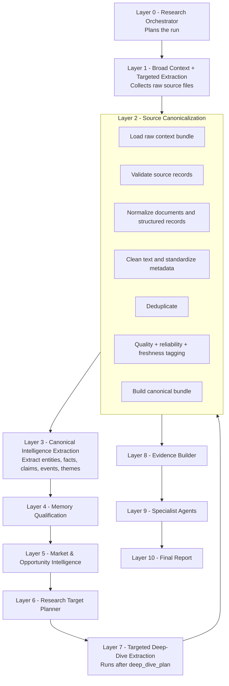

Below is the detailed implementation design for:

```text
Layer 2 — Source Canonicalization
```

Layer 2 is the layer that makes your system **stable, traceable, and analysis-ready**.

Layer 1 collects raw context from many different sources. But each source has a different shape:

```text
Moneycontrol article output ≠ YouTube transcript output
FII/DII output ≠ Screener output
SEC filing output ≠ RSS output
F&O output ≠ Gmail newsletter output
```

Layer 2 converts all of them into a **common canonical format**.

Your existing context-layer principle says Layer 1 should only extract raw data and avoid aggregation, calculation, and analysis. That is correct.  Layer 2 should also avoid investment analysis, but it should clean, validate, standardize, deduplicate, and prepare the raw data for later intelligence layers.

---

# Layer 2 — Source Canonicalization

## Layer purpose

Layer 2 converts raw extraction outputs into standardized, clean, traceable, canonical records.

It answers:

```text
What exactly did we collect?
From which source?
When was it published?
When did we collect it?
What type of source is it?
Is it article text, transcript, filing, table, macro snapshot, or price data?
Is the content complete or partial?
Is this source reliable?
Is this a duplicate?
Is the date valid?
Is the source fresh or stale?
Can later layers safely use it?
```

It does **not** answer:

```text
Which stock should we buy?
Is this news positive or negative?
What event happened?
What companies are mentioned?
What themes are emerging?
Is this a long-term opportunity?
```

Those belong to Layer 3 and later.

---

# Why Layer 2 is important

Layer 2 is important because your system depends on evidence-linked reasoning.

If your final agent says:

```text
“HDFC Bank is a watchlist candidate because margin pressure may be temporary.”
```

You need to trace that back to:

```text
final conclusion
   ↓
agent assessment
   ↓
evidence card
   ↓
event card
   ↓
canonical document
   ↓
raw source file
   ↓
original source URL / transcript / filing / API response
```

Layer 2 creates the **canonical document and source ledger** needed for this chain.

Without Layer 2, later agents will consume inconsistent JSON and hallucination control becomes difficult.

---

# Where Layer 2 sits in the full architecture



Important:

```text
Layer 2 runs after Layer 1A broad extraction.
Layer 2 also runs after Layer 7 targeted deep-dive extraction.
```

So Layer 2 must support both:

```text
broad market raw context
target-specific raw context
```

---

# Layer 2 internal architecture

```mermaid
flowchart TB

    IN["Input from Layer 1<br/>raw_context_bundle.json<br/>raw_source_records.json<br/>collection_status.json"]

    subgraph L2["Layer 2 - Source Canonicalization"]
        M1["layer2_runner.py<br/>Controls canonicalization workflow"]

        M2["raw_bundle_loader.py<br/>Loads Layer 1 raw bundles"]

        M3["source_record_validator.py<br/>Validates Layer 1 source records"]

        M4["normalizer_registry.py<br/>Maps source_type/module to normalizer"]

        subgraph NORMALIZERS["Source-Specific Normalizers"]
            N1["news_article_normalizer.py"]
            N2["rss_item_normalizer.py"]
            N3["newsletter_normalizer.py"]
            N4["youtube_transcript_normalizer.py"]
            N5["filing_doc_normalizer.py"]
            N6["market_data_normalizer.py"]
            N7["fundamental_data_normalizer.py"]
            N8["macro_data_normalizer.py"]
            N9["institutional_activity_normalizer.py"]
            N10["derivatives_data_normalizer.py"]
            N11["corporate_action_normalizer.py"]
            N12["sec_filing_normalizer.py"]
        end

        M5["metadata_normalizer.py<br/>dates, source, market, target, language"]

        M6["text_cleaner.py<br/>HTML cleanup, whitespace, boilerplate removal"]

        M7["content_fingerprint.py<br/>hashes and similarity keys"]

        M8["deduplicator.py<br/>exact and near duplicate detection"]

        M9["content_quality_checker.py<br/>complete, partial, empty, noisy"]

        M10["source_reliability_tagger.py<br/>official, media, opinion, low confidence"]

        M11["freshness_validator.py<br/>historical / today-only / live snapshot"]

        M12["schema_validator.py<br/>canonical schema enforcement"]

        M13["canonical_bundle_builder.py<br/>Final Layer 2 output"]

        M14["quarantine_writer.py<br/>Invalid or failed records"]
    end

    OUT["Layer 2 Output<br/>canonical_documents.json<br/>canonical_structured_records.json<br/>canonical_source_ledger.json<br/>duplicate_map.json<br/>quality_report.json"]

    IN --> M1
    M1 --> M2
    M2 --> M3
    M3 --> M4
    M4 --> NORMALIZERS
    NORMALIZERS --> M5
    M5 --> M6
    M6 --> M7
    M7 --> M8
    M8 --> M9
    M9 --> M10
    M10 --> M11
    M11 --> M12
    M12 --> M13
    M12 --> M14
    M13 --> OUT
```



---

# Layer 2 high-level input

Layer 2 receives the official output from Layer 1.

```json
{
  "research_run_id": "RUN_2026_05_09_AUTONOMOUS_DAILY_0800",
  "layer1_outputs": {
    "raw_context_bundle_path": "output/2026-05-09/layer1/raw_context_bundle.json",
    "raw_source_records_path": "output/2026-05-09/layer1/raw_source_records.json",
    "collection_status_path": "output/2026-05-09/layer1/collection_status.json",
    "data_freshness_report_path": "output/2026-05-09/layer1/data_freshness_report.json"
  },
  "canonicalization_scope": {
    "include_broad_context": true,
    "include_targeted_context": true,
    "deduplicate": true,
    "validate_schema": true
  }
}
```

---

# Layer 2 high-level output

Layer 2 produces canonical, clean, validated source objects.

```json
{
  "research_run_id": "RUN_2026_05_09_AUTONOMOUS_DAILY_0800",
  "layer": "L2_source_canonicalization",
  "status": "success",
  "canonical_bundle_path": "output/2026-05-09/layer2/canonical_bundle.json",
  "canonical_documents_path": "output/2026-05-09/layer2/canonical_documents.json",
  "canonical_structured_records_path": "output/2026-05-09/layer2/canonical_structured_records.json",
  "canonical_source_ledger_path": "output/2026-05-09/layer2/canonical_source_ledger.json",
  "duplicate_map_path": "output/2026-05-09/layer2/duplicate_map.json",
  "quality_report_path": "output/2026-05-09/layer2/quality_report.json",
  "quarantine_path": "output/2026-05-09/layer2/quarantine.json"
}
```

---

# Layer 2 output folder

```text
output/2026-05-09/layer2/
├── canonical_bundle.json
├── canonical_documents.json
├── canonical_structured_records.json
├── canonical_source_ledger.json
├── duplicate_map.json
├── quality_report.json
├── schema_validation_report.json
├── freshness_report.json
├── quarantine.json
└── layer2_manifest.json
```

---

# What Layer 2 produces

Layer 2 produces 4 main object types:

```text
1. canonical_source_ledger
2. canonical_documents
3. canonical_structured_records
4. duplicate_map / quality reports
```

---

## 1. `canonical_source_ledger`

This tracks every source collected by Layer 1.

```json
{
  "canonical_source_id": "CSRC_20260509_MONEYCONTROL_MARKETS",
  "source_record_id": "SRCREC_20260509_MONEYCONTROL_MARKETS_0001",
  "research_run_id": "RUN_2026_05_09_AUTONOMOUS_DAILY_0800",
  "layer1_module": "moneycontrol",
  "source_type": "news_article",
  "source_name": "Moneycontrol",
  "extraction_phase": "broad_context",
  "raw_output_path": "output/2026-05-09/phaseA/moneycontrol/markets.json",
  "canonical_output_path": "output/2026-05-09/layer2/canonical_documents.json",
  "collection_status": "success",
  "record_count_raw": 42,
  "record_count_canonical": 39,
  "duplicates_removed": 3,
  "quality_status": "usable",
  "created_at": "2026-05-09T09:20:00+05:30"
}
```

---

## 2. `canonical_documents`

This is for text-based sources:

```text
articles
RSS items
newsletters
YouTube transcripts
generic web pages
browser-scraped pages
filing documents
SEC filing text
investor presentations
concall transcripts
```

Canonical document format:

```json
{
  "document_id": "DOC_20260509_000001",
  "research_run_id": "RUN_2026_05_09_AUTONOMOUS_DAILY_0800",
  "canonical_source_id": "CSRC_20260509_MONEYCONTROL_MARKETS",
  "source_record_id": "SRCREC_20260509_MONEYCONTROL_MARKETS_0001",

  "document_type": "news_article",
  "source_type": "news_article",
  "source_name": "Moneycontrol",
  "source_reliability": "medium_high",

  "title": "",
  "url": "",
  "author": "",
  "publisher": "Moneycontrol",

  "published_at": "2026-05-09T07:30:00+05:30",
  "collected_at": "2026-05-09T08:12:00+05:30",
  "canonicalized_at": "2026-05-09T09:20:00+05:30",

  "market": "india",
  "language": "en",
  "content_format": "html_extracted_text",

  "raw_text": "",
  "clean_text": "",
  "text_length_chars": 4820,
  "content_quality_score": 0.86,
  "content_quality_status": "usable",

  "fingerprint": {
    "url_hash": "",
    "title_hash": "",
    "content_hash": "",
    "simhash": ""
  },

  "duplicate_status": {
    "is_duplicate": false,
    "duplicate_group_id": null,
    "canonical_document_for_group": true
  },

  "freshness": {
    "freshness_type": "historical_available",
    "is_stale": false,
    "data_date": "2026-05-09"
  },

  "target_context": {
    "target_id": null,
    "target_type": null,
    "ticker": null,
    "entity_name": null
  },

  "lineage": {
    "raw_output_path": "",
    "raw_record_index": 0,
    "module": "moneycontrol",
    "input_params": {}
  }
}
```

---

## 3. `canonical_structured_records`

This is for non-text/tabular/market data sources:

```text
market_data
price_history
screener tables
peer comparison
analyst estimates
macro snapshots
FII/DII
bulk deals
F&O option chain
corporate actions
SEC XBRL financials
```

Canonical structured record format:

```json
{
  "record_id": "SREC_20260509_000001",
  "research_run_id": "RUN_2026_05_09_AUTONOMOUS_DAILY_0800",
  "canonical_source_id": "CSRC_20260509_FII_DII",

  "record_type": "institutional_flow",
  "source_name": "NSE",
  "source_reliability": "high",
  "market": "india",

  "data_date": "2026-05-09",
  "collected_at": "2026-05-09T18:00:00+05:30",
  "canonicalized_at": "2026-05-09T18:05:00+05:30",

  "target_context": {
    "target_id": null,
    "target_type": "market",
    "ticker": null,
    "entity_name": "Indian equity market"
  },

  "data": {
    "fii": {
      "buy": 0,
      "sell": 0,
      "net": 0
    },
    "dii": {
      "buy": 0,
      "sell": 0,
      "net": 0
    }
  },

  "freshness": {
    "freshness_type": "today_only",
    "requires_history_sync": true
  },

  "quality": {
    "quality_score": 0.95,
    "quality_status": "usable",
    "missing_fields": []
  },

  "lineage": {
    "raw_output_path": "",
    "module": "fii_dii",
    "raw_record_index": null
  }
}
```

---

# Layer 2 modules

Recommended folder:

```text
source_canonicalization_layer/
├── layer2_runner.py
├── raw_bundle_loader.py
├── source_record_validator.py
├── normalizer_registry.py
├── normalizers/
│   ├── news_article_normalizer.py
│   ├── rss_item_normalizer.py
│   ├── newsletter_normalizer.py
│   ├── youtube_transcript_normalizer.py
│   ├── generic_web_normalizer.py
│   ├── filing_doc_normalizer.py
│   ├── market_data_normalizer.py
│   ├── price_history_normalizer.py
│   ├── screener_normalizer.py
│   ├── peer_comparison_normalizer.py
│   ├── analyst_estimates_normalizer.py
│   ├── macro_data_normalizer.py
│   ├── institutional_activity_normalizer.py
│   ├── bulk_deals_normalizer.py
│   ├── derivatives_data_normalizer.py
│   ├── corporate_actions_normalizer.py
│   └── sec_filing_normalizer.py
├── metadata_normalizer.py
├── text_cleaner.py
├── content_fingerprint.py
├── deduplicator.py
├── content_quality_checker.py
├── source_reliability_tagger.py
├── freshness_validator.py
├── schema_validator.py
├── canonical_bundle_builder.py
└── quarantine_writer.py
```

---

# Core module designs

## 1. `layer2_runner.py`

### Purpose

Main entrypoint for Layer 2.

### Why important

It coordinates all canonicalization steps.

### Questions it answers

```text
Which raw bundle should be canonicalized?
Which normalizer should process each source?
Which records succeeded, failed, or were quarantined?
Where are canonical outputs saved?
```

### Input

```json
{
  "research_run_id": "RUN_2026_05_09_AUTONOMOUS_DAILY_0800",
  "raw_context_bundle_path": "output/2026-05-09/layer1/raw_context_bundle.json",
  "raw_source_records_path": "output/2026-05-09/layer1/raw_source_records.json"
}
```

### Logic

```text
Load raw context bundle.
Load raw source records.
Validate source records.
For each source record:
    identify module/source_type
    load matching normalizer
    normalize into canonical_document or canonical_structured_record
Clean text if text source.
Normalize metadata.
Generate fingerprints.
Run deduplication.
Run quality checks.
Tag reliability and freshness.
Validate schema.
Write canonical outputs.
Quarantine invalid records.
Build final canonical bundle.
```

### Output

```json
{
  "status": "success",
  "canonical_bundle_path": "output/2026-05-09/layer2/canonical_bundle.json",
  "canonical_documents_count": 180,
  "canonical_structured_records_count": 45,
  "quarantined_count": 6
}
```

---

## 2. `raw_bundle_loader.py`

### Purpose

Load and validate Layer 1 output files.

### Questions it answers

```text
Does raw_context_bundle.json exist?
Do raw source files exist?
Can we load the files?
Are expected keys present?
```

### Input

```json
{
  "raw_context_bundle_path": "",
  "raw_source_records_path": "",
  "collection_status_path": ""
}
```

### Logic

```text
Read JSON files.
Verify required keys.
Verify referenced raw_output_path files exist.
Return loaded bundle and source records.
```

### Output

```json
{
  "loaded": true,
  "raw_context_bundle": {},
  "raw_source_records": [],
  "missing_files": [],
  "load_errors": []
}
```

---

## 3. `source_record_validator.py`

### Purpose

Validate Layer 1 source records.

### Why important

Layer 2 should not process invalid source records blindly.

### Questions it answers

```text
Does every source record have a module?
Does every source record have raw_output_path?
Does every raw output file exist?
Does record_count match actual file content?
Was the source success, partial, failed, or skipped?
```

### Input

```json
{
  "source_record_id": "",
  "module": "moneycontrol",
  "raw_output_path": "",
  "status": "success",
  "record_count": 42
}
```

### Logic

```text
Check required fields.
Check file existence.
Check status.
If failed/skipped, do not canonicalize but keep ledger entry.
If partial, canonicalize available records and mark warning.
```

### Output

```json
{
  "source_record_id": "",
  "valid": true,
  "canonicalization_allowed": true,
  "warnings": [],
  "errors": []
}
```

---

## 4. `normalizer_registry.py`

### Purpose

Map each raw module/source type to the correct normalizer.

### Why important

Every module has a different JSON structure.

### Input

```json
{
  "module": "moneycontrol",
  "source_type": "news_article"
}
```

### Logic

```python
NORMALIZER_REGISTRY = {
    "moneycontrol": "news_article_normalizer",
    "economic_times": "news_article_normalizer",
    "rss": "rss_item_normalizer",
    "gmail": "newsletter_normalizer",
    "yt_transcript": "youtube_transcript_normalizer",
    "filing_docs": "filing_doc_normalizer",
    "market_data": "market_data_normalizer",
    "price_history": "price_history_normalizer",
    "screener_in": "screener_normalizer",
    "peer_comparison": "peer_comparison_normalizer",
    "analyst_estimates": "analyst_estimates_normalizer",
    "india_macro": "macro_data_normalizer",
    "us_macro": "macro_data_normalizer",
    "fii_dii": "institutional_activity_normalizer",
    "bulk_deals": "bulk_deals_normalizer",
    "fno_data": "derivatives_data_normalizer",
    "corporate_actions": "corporate_actions_normalizer",
    "sec_filings": "sec_filing_normalizer"
}
```

### Output

```json
{
  "normalizer_name": "news_article_normalizer",
  "record_kind": "canonical_document"
}
```

---

# Source-specific normalizers

## 5. `news_article_normalizer.py`

Used for:

```text
moneycontrol.py
economic_times.py
targeted_news.py
```

### Purpose

Normalize full-body news article outputs.

### Input

```json
{
  "category": "markets",
  "articles": [
    {
      "url": "",
      "title": "",
      "author": "",
      "published": "",
      "modified": "",
      "description": "",
      "body": ""
    }
  ]
}
```

### Logic

```text
For each article:
    map title → title
    map body → raw_text
    map published → published_at
    map url → url
    map author → author
    set document_type = news_article
    set source_name = Moneycontrol or Economic Times
    clean body text
    produce canonical_document
```

### Output

```json
{
  "document_id": "DOC_20260509_NEWS_0001",
  "document_type": "news_article",
  "source_name": "Moneycontrol",
  "title": "",
  "url": "",
  "author": "",
  "published_at": "",
  "raw_text": "",
  "clean_text": "",
  "market": "india",
  "source_reliability": "medium_high"
}
```

---

## 6. `rss_item_normalizer.py`

### Purpose

Normalize RSS headline/summary records.

### Input

```json
{
  "feed_name": "mint_markets",
  "articles": [
    {
      "title": "",
      "url": "",
      "published": "",
      "summary": ""
    }
  ]
}
```

### Logic

```text
For each RSS item:
    create canonical_document
    document_type = rss_item
    raw_text = title + summary
    mark content_quality_status = summary_only
    mark needs_full_article_fetch = true
```

### Output

```json
{
  "document_id": "DOC_20260509_RSS_0001",
  "document_type": "rss_item",
  "source_name": "mint_markets",
  "title": "",
  "url": "",
  "published_at": "",
  "raw_text": "",
  "clean_text": "",
  "content_quality_status": "summary_only",
  "needs_full_article_fetch": true
}
```

---

## 7. `newsletter_normalizer.py`

### Purpose

Normalize Gmail/newsletter records.

### Input

```json
{
  "newsletters": [
    {
      "subject": "",
      "sender": "",
      "date": "",
      "body": ""
    }
  ]
}
```

### Logic

```text
For each newsletter:
    subject → title
    body → raw_text
    sender → author/source
    date → published_at
    document_type = newsletter
    source_reliability = medium or opinion_based
    clean footer/unsubscribe text lightly
```

### Output

```json
{
  "document_id": "DOC_20260509_NEWSLETTER_0001",
  "document_type": "newsletter",
  "source_name": "",
  "title": "",
  "author": "",
  "published_at": "",
  "raw_text": "",
  "clean_text": "",
  "source_reliability": "medium_opinion_based"
}
```

---

## 8. `youtube_transcript_normalizer.py`

### Purpose

Normalize YouTube transcript outputs.

### Input

```json
{
  "video_id": "",
  "url": "",
  "title": "",
  "channel_name": "",
  "published_at": "",
  "language": "en",
  "transcript": [
    {
      "start": 10.2,
      "duration": 4.6,
      "text": ""
    }
  ]
}
```

### Logic

```text
Concatenate transcript segments into raw_text.
Preserve segment timestamps in metadata.
document_type = youtube_transcript
source_reliability = medium_low/opinion_based
Do not summarize.
Do not extract claims.
```

### Output

```json
{
  "document_id": "DOC_20260509_YT_0001",
  "document_type": "youtube_transcript",
  "source_name": "CNBC TV18",
  "title": "",
  "url": "",
  "published_at": "",
  "raw_text": "",
  "clean_text": "",
  "transcript_segments": [
    {
      "start": 10.2,
      "duration": 4.6,
      "text": ""
    }
  ],
  "source_reliability": "medium_low"
}
```

---

## 9. `filing_doc_normalizer.py`

Used for:

```text
concall transcripts
investor presentations
NSE filing PDFs
```

### Purpose

Normalize extracted filing document text.

### Input

```json
{
  "ticker": "RELIANCE",
  "transcripts": [
    {
      "date": "",
      "subject": "",
      "pdf_url": "",
      "text": ""
    }
  ],
  "presentations": []
}
```

### Logic

```text
For each transcript:
    create canonical_document
    document_type = concall_transcript
    source_reliability = high
    target_context.ticker = ticker
    raw_text = transcript text

For each presentation:
    document_type = investor_presentation
    source_reliability = high
```

### Output

```json
{
  "document_id": "DOC_20260509_RELIANCE_CONCALL_0001",
  "document_type": "concall_transcript",
  "source_name": "NSE Filing",
  "ticker": "RELIANCE.NS",
  "title": "",
  "url": "",
  "published_at": "",
  "raw_text": "",
  "clean_text": "",
  "source_reliability": "high"
}
```

---

## 10. `market_data_normalizer.py`

### Purpose

Normalize current market snapshot.

### Input

```json
{
  "ticker": "RELIANCE.NS",
  "price": 1436.0,
  "day_change_pct": 0.74,
  "volume": 1234567,
  "market_cap": 19432629862400,
  "sector": "Energy",
  "industry": "Oil & Gas"
}
```

### Logic

```text
Create canonical_structured_record.
record_type = market_snapshot.
target_context.ticker = ticker.
Preserve raw numeric fields.
Do not calculate trend or recommendation.
```

### Output

```json
{
  "record_id": "SREC_20260509_RELIANCE_MARKET",
  "record_type": "market_snapshot",
  "target_context": {
    "ticker": "RELIANCE.NS",
    "target_type": "listed_company"
  },
  "data": {
    "price": 1436.0,
    "day_change_pct": 0.74,
    "volume": 1234567,
    "market_cap": 19432629862400,
    "sector": "Energy",
    "industry": "Oil & Gas"
  }
}
```

---

## 11. `price_history_normalizer.py`

### Purpose

Normalize OHLCV history.

### Input

```json
{
  "ticker": "RELIANCE.NS",
  "period": "1y",
  "interval": "1d",
  "history": [
    {
      "date": "",
      "open": 0,
      "high": 0,
      "low": 0,
      "close": 0,
      "volume": 0
    }
  ]
}
```

### Logic

```text
Create canonical_structured_record.
record_type = price_history.
Preserve OHLCV rows.
Validate date/order/numeric fields.
Do not calculate returns/drawdowns here.
```

### Output

```json
{
  "record_id": "SREC_20260509_RELIANCE_PRICE_HISTORY",
  "record_type": "price_history",
  "target_context": {
    "ticker": "RELIANCE.NS"
  },
  "data": {
    "period": "1y",
    "interval": "1d",
    "history": []
  }
}
```

---

## 12. `screener_normalizer.py`

### Purpose

Normalize Screener fundamentals.

### Input

```json
{
  "company_name": "",
  "key_ratios": {},
  "quarterly_results": [],
  "profit_loss": [],
  "balance_sheet": [],
  "cash_flow": [],
  "ratios": [],
  "growth_metrics": {},
  "shareholding_quarterly": []
}
```

### Logic

```text
Create canonical_structured_record.
record_type = indian_fundamentals.
Preserve all raw tables.
Standardize metric names only lightly.
Do not calculate business quality score.
```

### Output

```json
{
  "record_id": "SREC_20260509_RELIANCE_SCREENER",
  "record_type": "indian_company_fundamentals",
  "target_context": {
    "ticker": "RELIANCE.NS",
    "entity_name": "Reliance Industries"
  },
  "data": {
    "key_ratios": {},
    "quarterly_results": [],
    "profit_loss": [],
    "balance_sheet": [],
    "cash_flow": [],
    "ratios": [],
    "growth_metrics": {},
    "shareholding_quarterly": []
  }
}
```

---

## 13. `peer_comparison_normalizer.py`

### Purpose

Normalize peer comparison output.

### Input

```json
{
  "ticker": "RELIANCE",
  "sector_index": "NIFTY OIL AND GAS",
  "target": {},
  "peers": []
}
```

### Logic

```text
Create canonical_structured_record.
record_type = peer_comparison.
Preserve target and peer ratios.
Do not decide cheap/expensive.
```

### Output

```json
{
  "record_id": "SREC_20260509_RELIANCE_PEERS",
  "record_type": "peer_comparison",
  "target_context": {
    "ticker": "RELIANCE.NS"
  },
  "data": {
    "sector_index": "NIFTY OIL AND GAS",
    "target": {},
    "peers": []
  }
}
```

---

## 14. `analyst_estimates_normalizer.py`

### Purpose

Normalize analyst estimates.

### Input

```json
{
  "ticker": "RELIANCE",
  "price_targets": {},
  "earnings_estimates": {},
  "revenue_estimates": {},
  "earnings_history": [],
  "recommendations": [],
  "eps_trend": {},
  "eps_revisions": {}
}
```

### Logic

```text
Create canonical_structured_record.
record_type = analyst_estimates.
Preserve all analyst fields.
Do not classify bullish/bearish here.
```

### Output

```json
{
  "record_id": "SREC_20260509_RELIANCE_ANALYSTS",
  "record_type": "analyst_estimates",
  "target_context": {
    "ticker": "RELIANCE.NS"
  },
  "data": {
    "price_targets": {},
    "earnings_estimates": {},
    "revenue_estimates": {},
    "earnings_history": [],
    "recommendations": [],
    "eps_trend": {},
    "eps_revisions": {}
  }
}
```

---

## 15. `macro_data_normalizer.py`

### Purpose

Normalize India/US macro snapshots.

### Input

```json
{
  "market_breadth": {},
  "nse_indices": [],
  "market_rates": {},
  "commodity_prices": {},
  "india_macro": {},
  "rbi_repo_rate": ""
}
```

### Logic

```text
Create canonical_structured_record.
record_type = macro_snapshot.
Set market = india/us/global.
Preserve series and values.
Do not classify risk-on/risk-off here.
```

### Output

```json
{
  "record_id": "SREC_20260509_INDIA_MACRO",
  "record_type": "macro_snapshot",
  "market": "india",
  "data": {
    "market_breadth": {},
    "nse_indices": [],
    "market_rates": {},
    "commodity_prices": {},
    "india_macro": {},
    "rbi_repo_rate": ""
  }
}
```

---

## 16. `institutional_activity_normalizer.py`

### Purpose

Normalize FII/DII flow data.

### Input

```json
{
  "date": "",
  "fii": {
    "buy": 0,
    "sell": 0,
    "net": 0
  },
  "dii": {
    "buy": 0,
    "sell": 0,
    "net": 0
  }
}
```

### Logic

```text
Create canonical_structured_record.
record_type = institutional_flow.
Tag freshness_type = today_only.
Preserve raw values.
```

### Output

```json
{
  "record_id": "SREC_20260509_FII_DII",
  "record_type": "institutional_flow",
  "market": "india",
  "data_date": "",
  "data": {
    "fii": {},
    "dii": {}
  },
  "freshness": {
    "freshness_type": "today_only"
  }
}
```

---

## 17. `bulk_deals_normalizer.py`

### Purpose

Normalize bulk/block deal records.

### Input

```json
{
  "bulk_deals": [],
  "block_deals": []
}
```

### Logic

```text
For each deal:
    create structured record or grouped structured record.
record_type = bulk_block_deals.
Tag today_only.
Preserve client, symbol, buy/sell, quantity, price.
```

### Output

```json
{
  "record_id": "SREC_20260509_BULK_DEALS",
  "record_type": "bulk_block_deals",
  "market": "india",
  "data": {
    "bulk_deals": [],
    "block_deals": []
  }
}
```

---

## 18. `derivatives_data_normalizer.py`

### Purpose

Normalize F&O option chain snapshots.

### Input

```json
{
  "ticker": "NIFTY",
  "underlying_value": 0,
  "pcr": 0,
  "max_pain": 0,
  "atm_iv": {},
  "top_oi_strikes": {},
  "option_chain": []
}
```

### Logic

```text
Create canonical_structured_record.
record_type = derivatives_snapshot.
Tag freshness_type = live_snapshot.
Preserve option chain and source-level derived values.
Do not interpret sentiment.
```

### Output

```json
{
  "record_id": "SREC_20260509_NIFTY_FNO",
  "record_type": "derivatives_snapshot",
  "target_context": {
    "ticker": "NIFTY",
    "target_type": "index"
  },
  "data": {
    "underlying_value": 0,
    "pcr": 0,
    "max_pain": 0,
    "atm_iv": {},
    "top_oi_strikes": {},
    "option_chain": []
  }
}
```

---

## 19. `corporate_action_normalizer.py`

### Purpose

Normalize corporate actions.

### Input

```json
{
  "ticker": "RELIANCE",
  "nse_actions": [],
  "yf_dividends": [],
  "yf_splits": []
}
```

### Logic

```text
Create canonical_structured_record.
record_type = corporate_actions.
Preserve dividends, splits, rights, bonuses, buybacks.
Do not decide shareholder-friendliness here.
```

### Output

```json
{
  "record_id": "SREC_20260509_RELIANCE_CORP_ACTIONS",
  "record_type": "corporate_actions",
  "target_context": {
    "ticker": "RELIANCE.NS"
  },
  "data": {
    "nse_actions": [],
    "yf_dividends": [],
    "yf_splits": []
  }
}
```

---

## 20. `sec_filing_normalizer.py`

### Purpose

Normalize SEC XBRL and filing metadata/text.

### Input

```json
{
  "ticker": "AAPL",
  "cik": "",
  "company_name": "Apple Inc.",
  "key_financials": {},
  "recent_filings": {},
  "filing_texts": []
}
```

### Logic

```text
Create structured record for XBRL financials.
Create canonical documents for filing_texts if present.
Create structured records for recent filing metadata.
source_reliability = high.
```

### Output

```json
{
  "record_id": "SREC_20260509_AAPL_SEC",
  "record_type": "sec_company_facts",
  "target_context": {
    "ticker": "AAPL",
    "entity_name": "Apple Inc."
  },
  "data": {
    "cik": "",
    "key_financials": {},
    "recent_filings": {}
  }
}
```

---

# Shared utility modules

## 21. `metadata_normalizer.py`

### Purpose

Standardize common metadata.

### Standardizes

```text
published_at
collected_at
market
source_name
source_type
language
ticker format
target_id
target_type
URL
author
publisher
```

### Output example

```json
{
  "published_at": "2026-05-09T07:30:00+05:30",
  "collected_at": "2026-05-09T08:12:00+05:30",
  "market": "india",
  "language": "en"
}
```

---

## 22. `text_cleaner.py`

### Purpose

Clean text without changing meaning.

### Logic

```text
Remove HTML tags.
Normalize whitespace.
Remove duplicate spaces.
Remove obvious boilerplate.
Remove newsletter footer/unsubscribe if clearly identifiable.
Preserve factual content.
```

### Input

```json
{
  "raw_text": "<p>Market update...</p>"
}
```

### Output

```json
{
  "clean_text": "Market update...",
  "cleaning_notes": ["html_removed", "whitespace_normalized"]
}
```

---

## 23. `content_fingerprint.py`

### Purpose

Create hashes for deduplication and traceability.

### Logic

```text
url_hash = hash(normalized_url)
title_hash = hash(clean_title)
content_hash = hash(clean_text)
simhash = fuzzy text similarity fingerprint
```

### Output

```json
{
  "url_hash": "",
  "title_hash": "",
  "content_hash": "",
  "simhash": ""
}
```

---

## 24. `deduplicator.py`

### Purpose

Detect exact and near duplicates.

### Why important

The same article may appear via RSS, News API, and scraper. Do not let the system treat one story as three independent sources.

### Logic

```text
Exact duplicate:
    same normalized URL
    or same content_hash

Near duplicate:
    same/similar title
    same publisher
    same published date
    high simhash similarity

Create duplicate_group_id.
Pick canonical document for group.
```

### Output

```json
{
  "duplicate_groups": [
    {
      "duplicate_group_id": "DUPGRP_20260509_001",
      "canonical_document_id": "DOC_001",
      "duplicate_document_ids": ["DOC_002", "DOC_003"],
      "reason": "same_url"
    }
  ]
}
```

---

## 25. `content_quality_checker.py`

### Purpose

Decide whether content is usable.

### Checks

```text
empty body
too short
missing date
missing URL
summary-only RSS
transcript unavailable
extracted page contains navigation noise
structured data missing expected fields
```

### Output

```json
{
  "document_id": "DOC_001",
  "quality_score": 0.86,
  "quality_status": "usable | usable_with_warnings | partial | unusable",
  "warnings": [
    "missing_author"
  ]
}
```

---

## 26. `source_reliability_tagger.py`

### Purpose

Assign source reliability metadata.

### Important

This is not investment analysis. It is source metadata.

### Suggested reliability

```text
high:
- NSE filings
- SEC filings
- official company filings
- official macro/statistical data
- exchange data

medium_high:
- established financial news like Moneycontrol / ET
- trusted news APIs pointing to known publishers

medium:
- newsletters from known financial publishers
- analyst commentary sources

medium_low:
- YouTube transcripts
- blogs
- generic websites

low:
- unknown sources
- unsourced commentary
```

### Output

```json
{
  "source_name": "NSE Filing",
  "source_reliability": "high",
  "reason": "official_exchange_disclosure"
}
```

---

## 27. `freshness_validator.py`

### Purpose

Mark freshness and staleness.

### Logic

```text
Compare published_at/data_date with run_date.
Use module freshness rules from Layer 1.
Mark today-only/live snapshot/historical available.
Detect stale source.
```

### Output

```json
{
  "freshness_type": "today_only",
  "data_date": "2026-05-09",
  "is_stale": false,
  "requires_history_sync": true
}
```

---

## 28. `schema_validator.py`

### Purpose

Ensure every canonical object follows the expected schema.

### Output

```json
{
  "valid_records": 224,
  "invalid_records": 6,
  "errors": [
    {
      "record_id": "DOC_009",
      "error": "missing clean_text"
    }
  ]
}
```

Invalid records go to quarantine.

---

## 29. `quarantine_writer.py`

### Purpose

Store failed or invalid records separately.

### Why important

Do not silently drop bad data. Keep it for debugging.

### Output

```json
{
  "quarantined_records": [
    {
      "source_record_id": "",
      "reason": "missing_raw_output_file",
      "raw_reference": ""
    }
  ]
}
```

---

## 30. `canonical_bundle_builder.py`

### Purpose

Build final Layer 2 bundle.

### Output

```json
{
  "research_run_id": "RUN_2026_05_09_AUTONOMOUS_DAILY_0800",
  "layer": "L2_source_canonicalization",
  "created_at": "",
  "canonical_documents": [],
  "canonical_structured_records": [],
  "canonical_source_ledger": [],
  "duplicate_map": [],
  "quality_summary": {},
  "quarantine_summary": {}
}
```

---

# Layer 2 quality report format

```json
{
  "research_run_id": "RUN_2026_05_09_AUTONOMOUS_DAILY_0800",
  "total_raw_source_records": 35,
  "total_canonical_documents": 180,
  "total_canonical_structured_records": 45,
  "duplicates_detected": 22,
  "quarantined_records": 6,
  "quality_by_source": [
    {
      "source_name": "Moneycontrol",
      "documents": 42,
      "usable": 38,
      "partial": 4,
      "unusable": 0
    }
  ],
  "data_completeness_score": 0.89
}
```

---

# What Layer 2 should not do

Layer 2 should not do these:

```text
Do not extract companies from article text.
Do not classify sentiment.
Do not classify events.
Do not generate opportunity hypotheses.
Do not calculate stock returns.
Do not create evidence cards.
Do not create vector embeddings.
Do not summarize articles or transcripts.
Do not decide if something is important for memory.
```

These belong later:

```text
Layer 3: entity/fact/event/theme extraction
Layer 4: memory qualification
Layer 5: market/opportunity intelligence
Layer 8: evidence builder and vector indexing
```

---

# What is already implemented vs missing

## Already implemented in your repo

Your repo already has many Layer 1 collectors and raw JSON outputs. It has broad context collection and targeted company deep-dive modules. 

## Likely missing for Layer 2

You likely need to build most of Layer 2.

Add:

```text
1. layer2_runner.py
2. raw_bundle_loader.py
3. source_record_validator.py
4. normalizer_registry.py
5. source-specific normalizers
6. text_cleaner.py
7. content_fingerprint.py
8. deduplicator.py
9. content_quality_checker.py
10. source_reliability_tagger.py
11. freshness_validator.py
12. schema_validator.py
13. canonical_bundle_builder.py
14. quarantine_writer.py
```

Do not rewrite collectors. Build Layer 2 on top of the existing outputs.

---

# Final Layer 2 contract

## Layer 1 gives Layer 2

```json
{
  "raw_context_bundle_path": "",
  "raw_source_records_path": "",
  "collection_status_path": ""
}
```

## Layer 2 gives Layer 3

```json
{
  "canonical_bundle_path": "",
  "canonical_documents_path": "",
  "canonical_structured_records_path": "",
  "canonical_source_ledger_path": "",
  "duplicate_map_path": "",
  "quality_report_path": ""
}
```

Layer 3 then consumes:

```text
canonical_documents → for entity/fact/claim/event/theme extraction
canonical_structured_records → for market signals, numeric facts, later feature engineering
canonical_source_ledger → for traceability and evidence linking
duplicate_map → to avoid overcounting repeated news
quality_report → to adjust confidence
```

---

# Final summary

Layer 2 is the **standardization and trust layer**.

It transforms:

```text
many raw outputs from many collectors
```

into:

```text
one clean canonical source/document system
```

The key output is not investment analysis. The key output is:

```text
canonical documents
canonical structured records
source ledger
duplicate map
quality report
quarantine report
```

This makes later intelligence layers reliable, because every entity, event, memory, evidence card, and final recommendation can trace back to a clean canonical source object.
