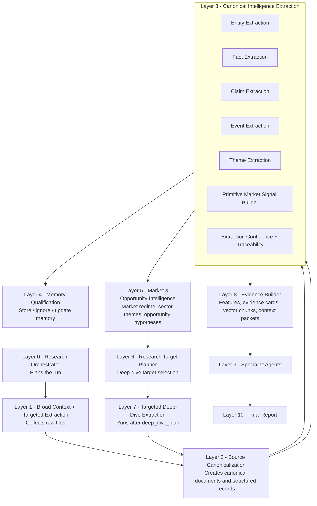
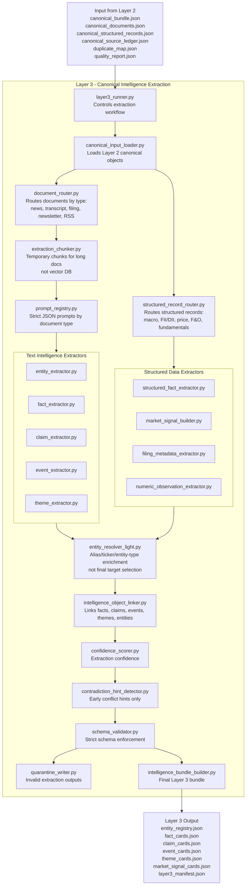

Below is the detailed design for:

```text
Layer 3 — Canonical Intelligence Extraction
```

This is the first true **understanding layer** in your investor intelligence system.

Layer 1 collected raw context.
Layer 2 normalized it into canonical documents and structured records.
Layer 3 now converts that canonical data into **structured intelligence objects**:

```text
entities
facts
claims
events
themes
primitive market signals
```

This layer should **not** recommend stocks, generate final opportunities, or decide what to deep dive. It prepares the intelligence objects that later layers will use for memory, opportunity discovery, target planning, and final analysis.

Your project discussion already identified this as the layer where raw text and raw numbers become structured market objects, and that it should produce entity objects, event objects, fact objects, claim objects, theme objects, and market signal objects. It also correctly notes that LLMs are useful here, but only with strict JSON output. 

---

# Layer 3 — Canonical Intelligence Extraction

## Layer purpose

Layer 3 answers:

```text
What entities are mentioned?
What factual statements are present?
What claims or opinions are being made?
What events happened?
What themes are emerging?
What primitive market signals exist?
Which source supports each extracted object?
How confident are we in the extraction?
```

It should not answer:

```text
Should I buy this stock?
Is this a final opportunity?
Should this go to portfolio?
Should this be stored long term?
Which exact stocks should deep dive?
```

Those decisions happen later in:

```text
Layer 4 — Memory Qualification
Layer 5 — Market & Opportunity Intelligence
Layer 6 — Research Target Planner
Layer 8 — Evidence Builder
Layer 9 — Specialist Agents
Layer 10 — Final Report
```

---

# Why Layer 3 is important

Layer 3 is where your pipeline stops being a raw data collector and starts becoming an **investor intelligence system**.

Without this layer, the later agents would receive messy articles, transcripts, and tables directly. That would create hallucination risk.

Layer 3 creates structured objects like:

```json
{
  "event_type": "guidance_cut",
  "entity": "Infosys",
  "source_document_id": "DOC_001",
  "supporting_text": "Management reduced FY guidance...",
  "confidence": 0.86
}
```

This makes later reasoning safer because every intelligence object is tied to:

```text
canonical document
source record
supporting text
source reliability
confidence
```

This supports your anti-hallucination goal: conclusions later must link back to source, event, extracted fact, and reasoning chain. Your earlier design discussion specifically emphasized evidence-linked reasoning and auditability. 

---

# Where Layer 3 sits in the full architecture



Important point:

```text
Layer 3 runs after both broad extraction and targeted extraction.

First run:
Layer 1A → Layer 2 → Layer 3
This extracts broad market entities, events, themes, and claims.

Second run:
Layer 7 → Layer 2 → Layer 3
This extracts deeper company/sector/filing/transcript intelligence.
```

---

# Layer 3 internal architecture



---

# Layer 3 high-level input

Layer 3 consumes Layer 2 canonical objects.

```json
{
  "research_run_id": "RUN_2026_05_09_AUTONOMOUS_DAILY_0800",
  "layer2_outputs": {
    "canonical_bundle_path": "output/2026-05-09/layer2/canonical_bundle.json",
    "canonical_documents_path": "output/2026-05-09/layer2/canonical_documents.json",
    "canonical_structured_records_path": "output/2026-05-09/layer2/canonical_structured_records.json",
    "canonical_source_ledger_path": "output/2026-05-09/layer2/canonical_source_ledger.json",
    "duplicate_map_path": "output/2026-05-09/layer2/duplicate_map.json",
    "quality_report_path": "output/2026-05-09/layer2/quality_report.json"
  },
  "layer3_config": {
    "use_llm_for_text": true,
    "use_rules_for_structured_data": true,
    "max_documents_for_llm": 150,
    "skip_duplicate_documents": true,
    "include_low_quality_documents": false
  }
}
```

---

# Layer 3 high-level output

Layer 3 produces structured intelligence objects.

```json
{
  "research_run_id": "RUN_2026_05_09_AUTONOMOUS_DAILY_0800",
  "layer": "L3_canonical_intelligence_extraction",
  "status": "success",
  "entity_registry_path": "output/2026-05-09/layer3/entity_registry.json",
  "fact_cards_path": "output/2026-05-09/layer3/fact_cards.json",
  "claim_cards_path": "output/2026-05-09/layer3/claim_cards.json",
  "event_cards_path": "output/2026-05-09/layer3/event_cards.json",
  "theme_cards_path": "output/2026-05-09/layer3/theme_cards.json",
  "market_signal_cards_path": "output/2026-05-09/layer3/market_signal_cards.json",
  "extraction_trace_path": "output/2026-05-09/layer3/extraction_trace.json",
  "quarantine_path": "output/2026-05-09/layer3/quarantine.json"
}
```

---

# Layer 3 output folder

```text
output/2026-05-09/layer3/
├── intelligence_bundle.json
├── entity_registry.json
├── fact_cards.json
├── claim_cards.json
├── event_cards.json
├── theme_cards.json
├── market_signal_cards.json
├── unresolved_entities.json
├── extraction_trace.json
├── extraction_quality_report.json
├── prompt_logs/
├── quarantine.json
└── layer3_manifest.json
```

---

# What Layer 3 produces

Layer 3 produces six main outputs:

```text
1. Entity registry
2. Fact cards
3. Claim cards
4. Event cards
5. Theme cards
6. Primitive market signal cards
```

These are not final evidence cards yet. Evidence cards are built later in Layer 8. Layer 3 creates **raw intelligence objects**.

---

# Important distinction: facts vs claims vs events vs themes

This distinction is critical.

## Fact

A fact is a verifiable statement.

Example:

```text
FII net sold ₹2,000 crore.
Company reported Q4 revenue of ₹10,000 crore.
RBI kept repo rate unchanged.
```

## Claim

A claim is an interpretation, opinion, forecast, rumor, or analyst view.

Example:

```text
The analyst believes margin pressure is temporary.
A newsletter says data center demand will benefit power stocks.
A YouTuber says banking stocks may bounce.
```

## Event

An event is something that happened or was announced.

Example:

```text
guidance cut
earnings miss
policy announcement
management resignation
bulk deal
rate decision
credit rating downgrade
```

## Theme

A theme is a broader pattern.

Example:

```text
AI data center power demand
banking margin pressure
India semiconductor manufacturing
FII selling pressure
rate-sensitive sectors
industrial corridor growth
```

Layer 3 should keep these separate. Your project notes also highlight the need to extract entities, claims, and events separately from narrative sources. 

---

# Layer 3 modules

Recommended folder structure:

```text
intelligence_layer/
└── canonical_intelligence_extraction/
    ├── layer3_runner.py
    ├── canonical_input_loader.py
    ├── document_router.py
    ├── structured_record_router.py
    ├── extraction_chunker.py
    ├── prompt_registry.py
    ├── llm_json_client.py
    ├── extractors/
    │   ├── entity_extractor.py
    │   ├── fact_extractor.py
    │   ├── claim_extractor.py
    │   ├── event_extractor.py
    │   ├── theme_extractor.py
    │   ├── structured_fact_extractor.py
    │   ├── market_signal_builder.py
    │   ├── filing_metadata_extractor.py
    │   └── numeric_observation_extractor.py
    ├── post_processors/
    │   ├── entity_resolver_light.py
    │   ├── intelligence_object_linker.py
    │   ├── confidence_scorer.py
    │   ├── contradiction_hint_detector.py
    │   └── object_deduplicator.py
    ├── validators/
    │   ├── schema_validator.py
    │   ├── source_ref_validator.py
    │   └── hallucination_precheck.py
    ├── quarantine_writer.py
    └── intelligence_bundle_builder.py
```

---

# Core Layer 3 modules

## 1. `layer3_runner.py`

### Purpose

Main controller for Layer 3.

### Why important

It coordinates text extraction, structured extraction, schema validation, confidence scoring, and final output writing.

### Questions it answers

```text
Which canonical documents should be processed?
Which documents need LLM extraction?
Which structured records need rule-based extraction?
Which outputs were valid or invalid?
Where should the final intelligence bundle be saved?
```

### Input

```json
{
  "research_run_id": "RUN_2026_05_09_AUTONOMOUS_DAILY_0800",
  "canonical_documents_path": "output/2026-05-09/layer2/canonical_documents.json",
  "canonical_structured_records_path": "output/2026-05-09/layer2/canonical_structured_records.json",
  "canonical_source_ledger_path": "output/2026-05-09/layer2/canonical_source_ledger.json",
  "duplicate_map_path": "output/2026-05-09/layer2/duplicate_map.json",
  "quality_report_path": "output/2026-05-09/layer2/quality_report.json"
}
```

### Logic

```text
Load Layer 2 canonical objects.
Filter out unusable/quarantined documents.
Skip duplicate documents unless configured otherwise.
Route text documents to text extractors.
Route structured records to structured extractors.
Validate LLM JSON outputs.
Resolve light entity metadata.
Link facts, claims, events, themes, and entities.
Score extraction confidence.
Write final Layer 3 bundle.
```

### Output

```json
{
  "status": "success",
  "entities_extracted": 120,
  "facts_extracted": 340,
  "claims_extracted": 96,
  "events_extracted": 58,
  "themes_extracted": 22,
  "market_signals_extracted": 30,
  "quarantined_outputs": 4
}
```

---

## 2. `canonical_input_loader.py`

### Purpose

Load canonical documents and structured records from Layer 2.

### Input

```json
{
  "canonical_documents_path": "",
  "canonical_structured_records_path": "",
  "canonical_source_ledger_path": "",
  "duplicate_map_path": "",
  "quality_report_path": ""
}
```

### Logic

```text
Load JSON files.
Validate that Layer 2 output files exist.
Return documents, records, source ledger, duplicate map, and quality data.
```

### Output

```json
{
  "documents": [],
  "structured_records": [],
  "source_ledger": [],
  "duplicate_map": [],
  "quality_report": {}
}
```

---

## 3. `document_router.py`

### Purpose

Route canonical documents to the correct text extraction strategy.

### Why important

A news article, YouTube transcript, newsletter, and filing transcript should not use the exact same prompt.

### Input

```json
{
  "document_id": "DOC_001",
  "document_type": "news_article",
  "source_reliability": "medium_high",
  "clean_text": ""
}
```

### Logic

```text
If document_type = news_article:
    route to news extraction prompt

If document_type = newsletter:
    route to newsletter/claim-heavy prompt

If document_type = youtube_transcript:
    route to transcript prompt

If document_type = concall_transcript:
    route to management commentary/event prompt

If document_type = investor_presentation:
    route to filing/presentation prompt

If document_type = rss_item:
    route to light headline extraction
```

### Output

```json
{
  "document_id": "DOC_001",
  "extraction_profile": "news_article_extraction",
  "requires_llm": true,
  "chunking_required": false,
  "expected_outputs": ["entities", "facts", "claims", "events", "themes"]
}
```

---

## 4. `structured_record_router.py`

### Purpose

Route canonical structured records to rule-based extractors.

### Input

```json
{
  "record_id": "SREC_001",
  "record_type": "institutional_flow",
  "data": {}
}
```

### Logic

```text
If record_type = institutional_flow:
    route to market_signal_builder

If record_type = macro_snapshot:
    route to structured_fact_extractor + market_signal_builder

If record_type = market_snapshot:
    route to numeric_observation_extractor

If record_type = analyst_estimates:
    route to structured_fact_extractor

If record_type = derivatives_snapshot:
    route to market_signal_builder

If record_type = corporate_actions:
    route to structured_fact_extractor
```

### Output

```json
{
  "record_id": "SREC_001",
  "extraction_profile": "institutional_flow_signal",
  "requires_llm": false,
  "expected_outputs": ["facts", "market_signals"]
}
```

---

## 5. `extraction_chunker.py`

### Purpose

Temporarily split long documents for extraction.

### Why important

Long documents such as YouTube transcripts, earnings call transcripts, SEC filing text, and investor presentations may exceed LLM input limits.

### Important distinction

This is **not** the vector database chunking layer.
Persistent vector chunks belong to Layer 8.

Layer 3 chunking is temporary for extraction only.

### Input

```json
{
  "document_id": "DOC_CONCALL_001",
  "document_type": "concall_transcript",
  "clean_text": ""
}
```

### Logic

```text
For YouTube transcript:
    chunk by timestamp ranges or topic breaks.

For concall transcript:
    chunk by speaker, section, Q&A, management commentary.

For filing text:
    chunk by headings if available.

For normal article:
    no chunk unless text is too long.
```

### Output

```json
{
  "document_id": "DOC_CONCALL_001",
  "chunks": [
    {
      "chunk_id": "CHUNK_001",
      "chunk_index": 1,
      "section": "management_commentary",
      "start_offset": 0,
      "end_offset": 2400,
      "text": ""
    }
  ]
}
```

---

## 6. `prompt_registry.py`

### Purpose

Store strict JSON extraction prompts.

### Why important

Layer 3 uses LLMs, but it must not allow free-form outputs.

Your project notes already define an investment event extraction prompt that requires JSON only and explicitly says not to make final buy/sell recommendations. 

### Prompt types

```text
news_article_extraction_prompt
newsletter_extraction_prompt
youtube_transcript_extraction_prompt
concall_transcript_extraction_prompt
filing_document_extraction_prompt
rss_item_extraction_prompt
private_company_context_prompt
sector_theme_context_prompt
```

### Output

```json
{
  "prompt_name": "news_article_extraction_prompt",
  "version": "v1",
  "expected_schema": "intelligence_extraction_schema_v1"
}
```

---

# Text intelligence extractors

## 7. `entity_extractor.py`

### Purpose

Extract entities from text.

### Entity types

```text
listed_company
private_company
business_group
sector
industry
index
commodity
currency
macro_indicator
policy
regulator
government_body
person
product
technology_theme
regional_theme
mutual_fund
etf
reit
invit
unknown
```

### Input

```json
{
  "document_id": "DOC_001",
  "document_type": "news_article",
  "clean_text": "",
  "source_reliability": "medium_high"
}
```

### Logic

Use LLM for text documents and rule/dictionary matching where possible.

```text
Extract named entities.
Classify entity type.
Identify ticker hint if present.
Do not require ticker.
Preserve unresolved entities.
Attach supporting text.
```

### Output

```json
{
  "entities": [
    {
      "entity_id": "ENT_20260509_0001",
      "entity_name": "HDFC Bank",
      "entity_type": "listed_company",
      "ticker_hint": "HDFCBANK",
      "ticker": "HDFCBANK.NS",
      "market": "india",
      "confidence": 0.94,
      "source_refs": [
        {
          "document_id": "DOC_001",
          "source_id": "CSRC_001",
          "supporting_text": "HDFC Bank shares fell after..."
        }
      ]
    },
    {
      "entity_id": "ENT_20260509_0002",
      "entity_name": "AI data center power demand",
      "entity_type": "technology_theme",
      "ticker_hint": null,
      "ticker": null,
      "market": "global",
      "confidence": 0.82,
      "source_refs": []
    }
  ]
}
```

### Why important

This prevents your system from being ticker-only. Private companies, themes, policies, and sectors remain useful even without tickers.

---

## 8. `fact_extractor.py`

### Purpose

Extract verifiable factual statements from text.

### Input

```json
{
  "document_id": "DOC_001",
  "clean_text": "",
  "document_type": "news_article"
}
```

### Logic

```text
Extract only statements presented as facts.
Do not extract opinions.
Do not infer beyond text.
Attach exact supporting text.
Link to entities if possible.
```

### Output

```json
{
  "facts": [
    {
      "fact_id": "FACT_20260509_0001",
      "document_id": "DOC_001",
      "source_id": "CSRC_001",
      "fact_text": "RBI kept the repo rate unchanged at 6.5%.",
      "fact_type": "macro_policy_fact",
      "entities": ["Reserve Bank of India"],
      "related_metrics": ["repo_rate"],
      "supporting_text": "The RBI kept the repo rate unchanged at 6.5%.",
      "published_at": "2026-05-09T07:30:00+05:30",
      "confidence": 0.92
    }
  ]
}
```

### Why important

Facts are the foundation of evidence cards later.

---

## 9. `claim_extractor.py`

### Purpose

Extract opinions, forecasts, interpretations, rumors, and analyst views.

### Input

```json
{
  "document_id": "DOC_002",
  "document_type": "newsletter",
  "clean_text": ""
}
```

### Logic

```text
Identify opinion-like statements.
Classify claim_type:
    opinion
    forecast
    rumor
    analyst_view
    management_guidance
    market_commentary
    promotional_claim

Mark requires_verification = true when claim is not official.
Do not treat claims as facts.
```

### Output

```json
{
  "claims": [
    {
      "claim_id": "CLAIM_20260509_0001",
      "document_id": "DOC_002",
      "source_id": "CSRC_002",
      "claim_text": "The author believes margin pressure at HDFC Bank is temporary.",
      "claim_type": "opinion",
      "entities": ["HDFC Bank"],
      "supporting_text": "",
      "requires_verification": true,
      "evidence_strength": "medium",
      "source_reliability": "medium_opinion_based",
      "confidence": 0.78
    }
  ]
}
```

### Why important

Newsletters and YouTube content often contain useful ideas, but they are not official proof. Layer 3 must keep claims separate from facts.

---

## 10. `event_extractor.py`

### Purpose

Extract investment-relevant events.

### Event taxonomy

```text
earnings_beat
earnings_miss
guidance_raise
guidance_cut
margin_pressure
revenue_growth
revenue_decline
large_order_win
capex_announcement
merger_acquisition
divestment
management_change
regulatory_action
legal_issue
fraud_or_accounting_concern
credit_rating_change
dividend
buyback
split_bonus
bulk_deal
block_deal
policy_change
rate_decision
inflation_data
currency_move
commodity_move
sector_rotation
analyst_upgrade
analyst_downgrade
ipo_news
private_company_funding
industrial_corridor
real_estate_policy
other
```

### Input

```json
{
  "document_id": "DOC_003",
  "document_type": "news_article",
  "clean_text": "",
  "entities": []
}
```

### Logic

```text
Extract only investment-relevant events.
Classify event_type.
Identify entities affected.
Classify impact_scope:
    company
    sector
    macro
    commodity
    asset_class
    region
    cross_domain

Classify initial sentiment:
    positive
    negative
    neutral
    mixed
    unknown

Classify severity:
    low
    medium
    high

Classify time_horizon:
    short_term
    medium_term
    long_term
    unknown

Do not decide buy/sell.
```

### Output

```json
{
  "events": [
    {
      "event_id": "EVT_20260509_0001",
      "document_id": "DOC_003",
      "source_id": "CSRC_003",
      "event_type": "guidance_cut",
      "event_title": "Company cuts full-year revenue guidance",
      "event_summary": "The company reduced its FY revenue guidance due to weak demand.",
      "entities": [
        {
          "entity_name": "Infosys",
          "entity_type": "listed_company",
          "ticker": "INFY.NS"
        }
      ],
      "impact_scope": ["company", "sector"],
      "initial_sentiment": "negative",
      "business_impact": "negative",
      "severity": "high",
      "time_horizon": "medium_term",
      "temporary_or_structural_hint": "unknown",
      "supporting_text": "",
      "source_reliability": "medium_high",
      "confidence": 0.86
    }
  ]
}
```

### Why important

Events are one of the most important inputs for memory, opportunity discovery, and deep-dive target selection.

---

## 11. `theme_extractor.py`

### Purpose

Extract broader themes and trends.

### Input

```json
{
  "documents": [],
  "facts": [],
  "claims": [],
  "events": []
}
```

### Logic

There are two levels:

```text
Document-level theme extraction:
    Extract themes from each document.

Run-level theme aggregation:
    Group repeated themes across documents.
    Count mentions.
    Track entities and events associated with the theme.
```

### Theme examples

```text
banking margin pressure
AI data center power demand
India semiconductor manufacturing
FII selling pressure
rate-sensitive sectors
crude oil price decline
industrial corridor infrastructure
EV battery supply chain
private company IPO pipeline
```

### Output

```json
{
  "themes": [
    {
      "theme_id": "THEME_20260509_0001",
      "theme_name": "banking margin pressure",
      "theme_type": "sector_theme",
      "description": "Multiple sources discussed margin pressure in banking stocks.",
      "related_entities": ["HDFC Bank", "ICICI Bank", "NIFTY BANK"],
      "related_events": ["EVT_001", "EVT_002"],
      "source_document_ids": ["DOC_001", "DOC_004"],
      "mention_count": 5,
      "source_diversity_count": 3,
      "time_horizon_hint": "medium_term",
      "confidence": 0.81
    }
  ]
}
```

### Why important

The system should discover opportunities from themes, not only ticker mentions.

---

# Structured data intelligence extractors

## 12. `structured_fact_extractor.py`

### Purpose

Extract factual objects from canonical structured records.

### Used for

```text
macro data
FII/DII
bulk deals
market data
analyst estimates
corporate actions
SEC filings
screener tables
peer comparison
```

### Input

```json
{
  "record_id": "SREC_001",
  "record_type": "institutional_flow",
  "data": {}
}
```

### Logic

```text
Convert structured values into fact cards.
Do not interpret them.
Do not calculate complex features.
Preserve numeric values and units.
```

### Output

```json
{
  "facts": [
    {
      "fact_id": "FACT_20260509_FII_001",
      "record_id": "SREC_001",
      "fact_type": "institutional_flow_fact",
      "fact_text": "FII net flow was -₹2,000 crore.",
      "metric_name": "fii_net_flow",
      "metric_value": -2000,
      "unit": "INR crore",
      "data_date": "2026-05-09",
      "source_id": "CSRC_FII_DII",
      "confidence": 0.96
    }
  ]
}
```

---

## 13. `numeric_observation_extractor.py`

### Purpose

Extract simple numeric observations from market/fundamental records.

### Important boundary

Layer 3 can extract observations, but heavy calculations are later.

Allowed in Layer 3:

```text
current price observed
52-week high/low present
FII net value present
PCR value present
target price value present
revenue value reported
```

Not Layer 3:

```text
CAGR
drawdown
valuation attractiveness
trend classification
business quality score
buy/sell recommendation
```

### Output

```json
{
  "facts": [
    {
      "fact_id": "FACT_20260509_RELIANCE_PRICE",
      "fact_type": "market_snapshot_fact",
      "entity": "Reliance Industries",
      "ticker": "RELIANCE.NS",
      "metric_name": "current_price",
      "metric_value": 1436.0,
      "unit": "INR",
      "source_record_id": "SREC_001",
      "confidence": 0.95
    }
  ]
}
```

---

## 14. `market_signal_builder.py`

### Purpose

Create primitive market signal cards from structured market records.

### Important

These are **primitive signals**, not final interpretations.

Examples:

```text
FII net selling observed
DII net buying observed
India VIX level observed
bulk buy transaction observed
option chain PCR observed
large block deal observed
```

### Input

```json
{
  "record_type": "institutional_flow",
  "data": {
    "fii": {
      "net": -2000
    },
    "dii": {
      "net": 1500
    }
  }
}
```

### Logic

```text
Create market_signal_cards using simple deterministic rules.
Do not say market is risk-off yet.
Do not decide investment posture.
```

### Output

```json
{
  "market_signals": [
    {
      "signal_id": "SIG_20260509_0001",
      "signal_type": "institutional_flow",
      "signal_name": "FII net selling observed",
      "market": "india",
      "data_date": "2026-05-09",
      "metric_name": "fii_net_flow",
      "metric_value": -2000,
      "unit": "INR crore",
      "direction_hint": "negative",
      "time_horizon_hint": "short_term",
      "source_record_id": "SREC_001",
      "confidence": 0.95
    }
  ]
}
```

### Why important

Layer 5 Market Regime Agent can later use these primitive signals to decide risk-on/risk-off.

---

## 15. `filing_metadata_extractor.py`

### Purpose

Extract structured events from official filing metadata.

### Used for

```text
NSE announcements
SEC filing metadata
corporate actions
```

### Input

```json
{
  "record_type": "exchange_filings",
  "data": {
    "announcements": [
      {
        "date": "",
        "type": "",
        "subject": "",
        "attachment_url": ""
      }
    ]
  }
}
```

### Logic

```text
Use keyword/rule mapping for filing subjects.
Official source = high reliability.
Create event cards.
Do not decide final impact unless direct from filing type.
```

### Output

```json
{
  "events": [
    {
      "event_id": "EVT_20260509_RELIANCE_DIVIDEND",
      "event_type": "dividend",
      "event_title": "Company announced dividend",
      "entities": [
        {
          "entity_name": "Reliance Industries",
          "ticker": "RELIANCE.NS"
        }
      ],
      "source_id": "CSRC_NSE_FILING",
      "source_reliability": "high",
      "severity": "low",
      "time_horizon": "short_term",
      "confidence": 0.9
    }
  ]
}
```

---

# Post-processing modules

## 16. `entity_resolver_light.py`

### Purpose

Lightly enrich extracted entities.

### Important

This is not final research target selection.

It only adds:

```text
ticker if obvious
market if obvious
entity type
aliases
resolved/unresolved status
```

### Input

```json
{
  "entity_name": "HDFC Bank",
  "entity_type": "listed_company",
  "ticker_hint": "HDFCBANK"
}
```

### Logic

```text
Check ticker dictionary.
Check aliases.
Normalize name.
If ticker is found, attach it.
If not found, preserve as unresolved.
Do not discard.
```

### Output

```json
{
  "entity_name": "HDFC Bank",
  "entity_type": "listed_company",
  "ticker": "HDFCBANK.NS",
  "resolution_status": "resolved",
  "confidence": 0.96
}
```

Unresolved example:

```json
{
  "entity_name": "OpenAI",
  "entity_type": "private_company",
  "ticker": null,
  "resolution_status": "unresolved_no_public_ticker",
  "preserve_for_later": true,
  "confidence": 0.91
}
```

---

## 17. `intelligence_object_linker.py`

### Purpose

Connect entities, facts, claims, events, themes, and market signals.

### Why important

Later layers need relationships.

Example:

```text
Theme: banking margin pressure
    linked to HDFC Bank
    linked to event margin_pressure
    linked to claim from newsletter
    linked to fact from earnings transcript
```

### Output

```json
{
  "links": [
    {
      "link_id": "LINK_001",
      "from_object_type": "event",
      "from_object_id": "EVT_001",
      "to_object_type": "entity",
      "to_object_id": "ENT_HDFCBANK",
      "relationship": "affects"
    },
    {
      "link_id": "LINK_002",
      "from_object_type": "theme",
      "from_object_id": "THEME_BANK_MARGIN",
      "to_object_type": "event",
      "to_object_id": "EVT_001",
      "relationship": "supported_by"
    }
  ]
}
```

---

## 18. `confidence_scorer.py`

### Purpose

Assign confidence to extracted intelligence objects.

### Factors

```text
source reliability
document quality
whether exact supporting text exists
LLM extraction confidence
number of independent sources
whether source is duplicate
whether object is rule-extracted or inferred
```

### Output

```json
{
  "object_id": "EVT_001",
  "object_type": "event",
  "confidence": 0.84,
  "confidence_reason": [
    "medium_high source reliability",
    "exact supporting text present",
    "not duplicate",
    "event type clearly stated"
  ]
}
```

---

## 19. `contradiction_hint_detector.py`

### Purpose

Detect early hints of contradiction.

### Important

Full contradiction checking happens later in guardrails. Layer 3 only flags obvious issues.

### Example

```text
One source says analysts are raising EPS.
Structured analyst estimates show EPS revisions are down.
```

### Output

```json
{
  "contradiction_hints": [
    {
      "hint_id": "CONTRA_HINT_001",
      "object_1": "CLAIM_001",
      "object_2": "FACT_ANALYST_EPS_REVISION_001",
      "reason": "Claim says EPS revisions positive, structured data shows negative revision.",
      "severity": "medium",
      "action": "send_to_later_contradiction_checker"
    }
  ]
}
```

---

## 20. `object_deduplicator.py`

### Purpose

Merge duplicate extracted objects.

### Why important

If three duplicate articles produce the same event, do not count it as three separate events.

### Logic

```text
For facts:
    same metric/entity/date/source type

For events:
    same event_type/entity/date/theme

For claims:
    same claim text/source/source date

For themes:
    same normalized theme name
```

### Output

```json
{
  "deduped_events": [],
  "duplicate_object_map": [
    {
      "canonical_object_id": "EVT_001",
      "duplicate_object_ids": ["EVT_002", "EVT_003"],
      "reason": "same entity + event type + date"
    }
  ]
}
```

---

## 21. `schema_validator.py`

### Purpose

Validate every Layer 3 output.

### Checks

```text
Does each object have an ID?
Does it have source_refs?
Does it have confidence?
Does it have supporting text when text-derived?
Does it follow allowed taxonomy?
Does it avoid buy/sell recommendation fields?
```

### Output

```json
{
  "valid_objects": 612,
  "invalid_objects": 13,
  "errors": [
    {
      "object_id": "EVT_BAD_001",
      "error": "event_type not in taxonomy"
    }
  ]
}
```

---

## 22. `source_ref_validator.py`

### Purpose

Ensure every extracted object links back to Layer 2.

### Logic

```text
For every entity/fact/claim/event/theme:
    verify document_id or record_id exists
    verify source_id exists
    verify source ledger entry exists
```

### Output

```json
{
  "objects_without_source_refs": [],
  "source_ref_validation_status": "pass"
}
```

This is essential for hallucination control.

---

## 23. `hallucination_precheck.py`

### Purpose

Catch extraction outputs that appear unsupported.

### Logic

```text
If LLM output mentions entity/event/fact not found in source text:
    mark unsupported.
If supporting_text is empty for text-derived event:
    quarantine or downgrade.
If source says opinion but output marks fact:
    downgrade to claim.
```

### Output

```json
{
  "precheck_status": "pass_with_warnings",
  "warnings": [
    {
      "object_id": "FACT_009",
      "issue": "supporting_text_missing",
      "action": "downgraded_confidence"
    }
  ]
}
```

---

## 24. `quarantine_writer.py`

### Purpose

Store invalid or unsupported extraction outputs.

### Output

```json
{
  "quarantined_objects": [
    {
      "object_type": "event",
      "object_id": "EVT_BAD_001",
      "reason": "missing_source_ref",
      "raw_llm_output": {}
    }
  ]
}
```

---

## 25. `intelligence_bundle_builder.py`

### Purpose

Create final Layer 3 bundle.

### Output

```json
{
  "research_run_id": "RUN_2026_05_09_AUTONOMOUS_DAILY_0800",
  "layer": "L3_canonical_intelligence_extraction",
  "created_at": "2026-05-09T10:30:00+05:30",
  "entity_registry_path": "",
  "fact_cards_path": "",
  "claim_cards_path": "",
  "event_cards_path": "",
  "theme_cards_path": "",
  "market_signal_cards_path": "",
  "object_link_map_path": "",
  "extraction_quality_report_path": ""
}
```

---

# Main Layer 3 object schemas

## Entity object

```json
{
  "entity_id": "ENT_20260509_0001",
  "entity_name": "HDFC Bank",
  "normalized_name": "HDFC Bank Ltd",
  "entity_type": "listed_company",
  "market_status": "listed",
  "ticker": "HDFCBANK.NS",
  "exchange": "NSE",
  "country": "India",
  "aliases": ["HDFC Bank Ltd", "HDFCBANK"],
  "source_refs": [
    {
      "document_id": "DOC_001",
      "source_id": "CSRC_001",
      "supporting_text": ""
    }
  ],
  "mention_count": 4,
  "resolution_status": "resolved",
  "confidence": 0.95
}
```

---

## Fact card

```json
{
  "fact_id": "FACT_20260509_0001",
  "fact_type": "macro_policy_fact",
  "fact_text": "RBI kept the repo rate unchanged at 6.5%.",
  "entities": ["Reserve Bank of India"],
  "metrics": [
    {
      "metric_name": "repo_rate",
      "metric_value": 6.5,
      "unit": "%"
    }
  ],
  "source_refs": [
    {
      "document_id": "DOC_001",
      "source_id": "CSRC_001",
      "supporting_text": ""
    }
  ],
  "published_at": "",
  "confidence": 0.92
}
```

---

## Claim card

```json
{
  "claim_id": "CLAIM_20260509_0001",
  "claim_type": "opinion",
  "claim_text": "The author believes banking margin pressure is temporary.",
  "entities": ["HDFC Bank", "Banking sector"],
  "requires_verification": true,
  "evidence_strength": "medium",
  "source_refs": [
    {
      "document_id": "DOC_002",
      "source_id": "CSRC_002",
      "supporting_text": ""
    }
  ],
  "confidence": 0.78
}
```

---

## Event card

```json
{
  "event_id": "EVT_20260509_0001",
  "event_type": "margin_pressure",
  "event_title": "Banking sector faces margin pressure",
  "event_summary": "Multiple sources discussed margin pressure in banks.",
  "entities": [
    {
      "entity_name": "HDFC Bank",
      "entity_type": "listed_company",
      "ticker": "HDFCBANK.NS"
    }
  ],
  "impact_scope": ["company", "sector"],
  "initial_sentiment": "negative",
  "business_impact": "negative",
  "severity": "medium",
  "time_horizon": "medium_term",
  "temporary_or_structural_hint": "unknown",
  "source_refs": [
    {
      "document_id": "DOC_001",
      "source_id": "CSRC_001",
      "supporting_text": ""
    }
  ],
  "confidence": 0.82
}
```

---

## Theme card

```json
{
  "theme_id": "THEME_20260509_0001",
  "theme_name": "AI data center power demand",
  "theme_type": "technology_theme",
  "description": "Sources discussed rising electricity demand from AI/data center expansion.",
  "related_entities": ["OpenAI", "Microsoft", "Power sector"],
  "related_events": [],
  "source_refs": [],
  "mention_count": 3,
  "source_diversity_count": 2,
  "time_horizon_hint": "long_term",
  "confidence": 0.77
}
```

---

## Market signal card

```json
{
  "signal_id": "SIG_20260509_0001",
  "signal_type": "institutional_flow",
  "signal_name": "FII net selling observed",
  "market": "india",
  "data_date": "2026-05-09",
  "metric_name": "fii_net_flow",
  "metric_value": -2000,
  "unit": "INR crore",
  "direction_hint": "negative",
  "time_horizon_hint": "short_term",
  "source_record_id": "SREC_FII_DII_001",
  "confidence": 0.95
}
```

---

# LLM usage in Layer 3

Use LLM for:

```text
news article entity/fact/claim/event/theme extraction
newsletter claim/theme extraction
YouTube transcript claim/theme extraction
concall transcript management commentary/event extraction
investor presentation fact/event/theme extraction
generic article extraction
ambiguous entity classification
```

Do not use LLM for:

```text
FII/DII numeric values
F&O values
market snapshot values
price history rows
Screener raw tables
peer comparison raw ratios
analyst estimates raw values
macro numeric observations
```

Your earlier design correctly stated: LLMs should be used only for text interpretation, not numeric calculations. 

---

# Standard LLM extraction prompt pattern

Use this general structure:

```text
You are an investment intelligence extraction model.

Your task is to extract structured intelligence from the provided canonical document.

Return JSON only.

Do not make buy/sell recommendations.
Do not infer beyond the provided text.
Do not invent tickers.
If a company/entity is unresolved, preserve it as unresolved.
Separate facts from claims.
Separate claims from events.
Every extracted object must include supporting_text from the source.
If evidence is weak, lower confidence.
If not enough information, use "unknown".

Extract:
1. entities
2. facts
3. claims
4. events
5. themes

Use the provided JSON schema exactly.
```

This aligns with your earlier event extraction prompt that requires strict JSON and says not to make final buy/sell recommendations. 

---

# Layer 3 extraction quality report

```json
{
  "research_run_id": "RUN_2026_05_09_AUTONOMOUS_DAILY_0800",
  "documents_processed": 180,
  "structured_records_processed": 45,
  "documents_skipped_duplicates": 22,
  "documents_skipped_low_quality": 8,
  "llm_documents_processed": 104,
  "rule_based_records_processed": 45,
  "entities_extracted": 120,
  "facts_extracted": 340,
  "claims_extracted": 96,
  "events_extracted": 58,
  "themes_extracted": 22,
  "market_signals_extracted": 30,
  "invalid_outputs": 4,
  "unsupported_outputs": 3,
  "average_confidence": 0.81
}
```

---

# What Layer 3 should not do

Layer 3 should not:

```text
decide store/no-store memory
rank investment opportunities
rank research targets
run company deep dive
calculate valuation attractiveness
build final evidence cards
create portfolio recommendations
generate final report
```

Those belong to later layers.

---

# How Layer 3 helps deep-dive selection later

Layer 3 does not select deep-dive targets directly. But it creates the raw intelligence needed for Layer 6.

Example:

```json
{
  "entity": "HDFC Bank",
  "events": ["margin_pressure"],
  "themes": ["banking margin pressure"],
  "claims": ["pressure may be temporary"],
  "source_count": 5,
  "confidence": 0.82
}
```

Layer 6 later uses this to decide:

```text
HDFC Bank deserves targeted deep dive.
```

For non-ticker entities:

```json
{
  "entity": "OpenAI",
  "entity_type": "private_company",
  "themes": ["AI data center power demand"],
  "ticker": null,
  "preserve_for_later": true
}
```

Layer 6 later uses this to decide:

```text
OpenAI is not listed, but the theme deserves proxy mapping and sector/theme deep dive.
```

---

# What is already implemented vs missing

## Already partly implemented

Your current older Phase B has something similar to:

```text
news_signal_extractor.py
candidate_scorer.py
market_regime.py
```

But those responsibilities should be separated:

```text
news_signal_extractor.py
    → split into Layer 3 entity/fact/claim/event/theme extractors

candidate_scorer.py
    → move to Layer 6 target ranker

market_regime.py
    → move to Layer 5 market regime agent
```

Your project notes already mention extracting entities, claims, and events from narrative sources, which is exactly the core of Layer 3. 

## Need to build now

```text
1. layer3_runner.py
2. document_router.py
3. structured_record_router.py
4. prompt_registry.py
5. entity_extractor.py
6. fact_extractor.py
7. claim_extractor.py
8. event_extractor.py
9. theme_extractor.py
10. structured_fact_extractor.py
11. market_signal_builder.py
12. entity_resolver_light.py
13. intelligence_object_linker.py
14. confidence_scorer.py
15. schema_validator.py
16. source_ref_validator.py
17. hallucination_precheck.py
18. intelligence_bundle_builder.py
```

---

# Final Layer 3 contract

## Layer 2 gives Layer 3

```json
{
  "canonical_documents_path": "",
  "canonical_structured_records_path": "",
  "canonical_source_ledger_path": "",
  "duplicate_map_path": "",
  "quality_report_path": ""
}
```

## Layer 3 gives Layer 4 / Layer 5 / Layer 6 / Layer 8

```json
{
  "entity_registry_path": "",
  "fact_cards_path": "",
  "claim_cards_path": "",
  "event_cards_path": "",
  "theme_cards_path": "",
  "market_signal_cards_path": "",
  "object_link_map_path": "",
  "extraction_quality_report_path": ""
}
```

Layer 4 uses:

```text
event cards
fact cards
theme cards
market signal cards
```

to decide what should become memory.

Layer 5 uses:

```text
themes
market signals
events
claims
facts
```

to build market and opportunity intelligence.

Layer 6 uses:

```text
entities
events
themes
claims
source counts
confidence
```

to create research targets and deep-dive plans.

Layer 8 uses:

```text
facts
events
claims
source references
canonical documents
```

to build evidence cards and context packets.

---

# Final Layer 3 summary

Layer 3 is the **canonical intelligence extraction layer**.

It transforms:

```text
clean canonical documents and records
```

into:

```text
entities
facts
claims
events
themes
market signals
```

The key rule is:

```text
Layer 3 understands what the source says,
but it does not decide what to invest in.
```

The most important implementation principle:

```text
Every extracted object must include source references and confidence.
No supporting source means the object is invalid.
```

That gives your later memory layer, opportunity layer, research planner, evidence builder, and final agents a clean, auditable intelligence foundation.
