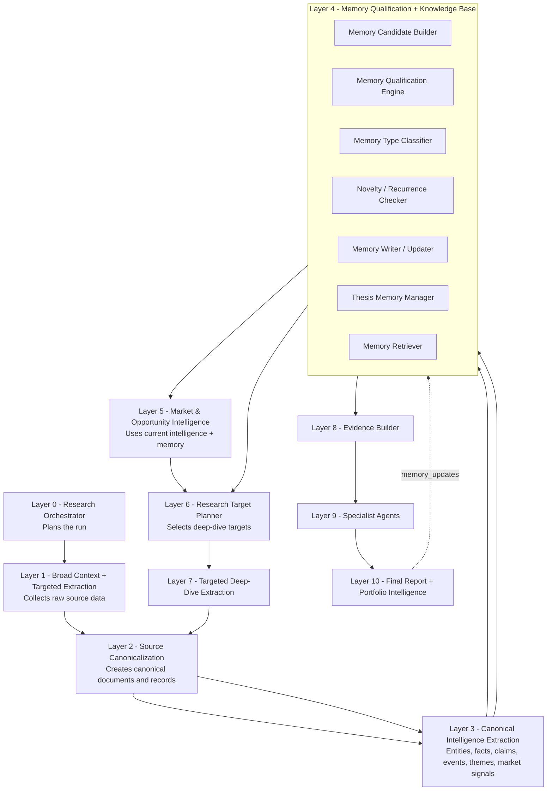
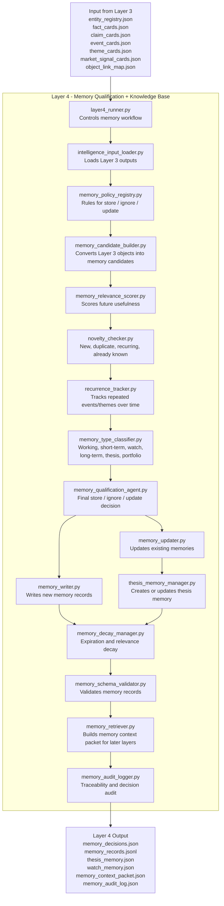

Below is the detailed implementation design for:

```text
Layer 4 — Memory Qualification + Knowledge Base
```

This layer is very important because your system should not treat each daily run as isolated. A real investor remembers important market changes, repeated risks, structural policies, thesis changes, and opportunity signals over time.

Layer 1 collects raw data.
Layer 2 canonicalizes it.
Layer 3 extracts entities, facts, claims, events, themes, and primitive market signals.
**Layer 4 decides what should be remembered for future analysis.**

---

# Layer 4 — Memory Qualification + Knowledge Base

## Layer purpose

Layer 4 decides:

```text
Should this extracted intelligence be remembered?
If yes, what type of memory should it become?
How long should it be retained?
Does it update an existing thesis?
Does it strengthen, weaken, or invalidate a previous idea?
Is this only short-term noise?
Should this be stored only for today’s report?
Should this become long-term investment memory?
```

Layer 4 does **not** make final investment recommendations.

It does not say:

```text
Buy HDFC Bank
Sell Infosys
Invest in real estate near this corridor
```

Instead, it says:

```text
This event is worth remembering.
This is only short-term noise.
This theme is becoming recurrent.
This claim needs future verification.
This event updates an existing thesis.
This company/theme should stay on watch.
```

---

# Why Layer 4 is important

Without Layer 4, your system will forget everything after each daily run.

That creates problems:

```text
1. The same news may appear repeatedly, but the system will not know it is recurring.
2. A stock thesis may weaken slowly over weeks, but the system will not track it.
3. A government policy may have long-term impact, but the system may treat it like daily news.
4. The model may overreact to today’s article because it has no memory of prior context.
5. Future reports cannot say “this confirms the trend we saw last week.”
```

Layer 4 makes the system behave more like an investor.

A real investor remembers:

```text
- why a stock was interesting
- what evidence supported the thesis
- what could invalidate the thesis
- whether new data confirms or weakens the thesis
- whether a theme is short-term hype or structural
- whether news is one-day noise or long-term signal
```

---

# Where Layer 4 sits in the full architecture



Important:

```text
Layer 4 runs after Layer 3.

It can run after broad context extraction:
Layer 1A → Layer 2 → Layer 3 → Layer 4

It can also run again after targeted deep-dive extraction:
Layer 7 → Layer 2 → Layer 3 → Layer 4
```

So Layer 4 updates memory from both:

```text
broad market intelligence
target-specific deep-dive intelligence
```

---

# Layer 4 internal architecture



---

# Layer 4 high-level input

Layer 4 consumes the intelligence objects produced by Layer 3. It also consumes memory update instructions produced by Layer 10 at the end of each run.

```json
{
  "research_run_id": "RUN_2026_05_09_AUTONOMOUS_DAILY_0800",
  "layer3_outputs": {
    "entity_registry_path": "output/2026-05-09/layer3/entity_registry.json",
    "fact_cards_path": "output/2026-05-09/layer3/fact_cards.json",
    "claim_cards_path": "output/2026-05-09/layer3/claim_cards.json",
    "event_cards_path": "output/2026-05-09/layer3/event_cards.json",
    "theme_cards_path": "output/2026-05-09/layer3/theme_cards.json",
    "market_signal_cards_path": "output/2026-05-09/layer3/market_signal_cards.json",
    "object_link_map_path": "output/2026-05-09/layer3/object_link_map.json",
    "extraction_quality_report_path": "output/2026-05-09/layer3/extraction_quality_report.json"
  },
  "layer10_feedback": {
    "memory_update_instructions_path": "output/2026-05-09/layer10/memory_update_instructions.json"
  },
  "memory_config": {
    "enable_thesis_memory": true,
    "enable_watch_memory": true,
    "enable_portfolio_memory": false,
    "min_memory_score": 55,
    "store_claims_only_if_verifiable": true
  }
}
```

---

# Layer 4 high-level output

Layer 4 outputs memory decisions and memory records.

```json
{
  "research_run_id": "RUN_2026_05_09_AUTONOMOUS_DAILY_0800",
  "layer": "L4_memory_qualification",
  "status": "success",
  "memory_decisions_path": "output/2026-05-09/layer4/memory_decisions.json",
  "new_memory_records_path": "db/memory/memory_records.jsonl",
  "updated_memory_records_path": "output/2026-05-09/layer4/updated_memory_records.json",
  "thesis_updates_path": "output/2026-05-09/layer4/thesis_updates.json",
  "memory_context_packet_path": "output/2026-05-09/layer4/memory_context_packet.json",
  "memory_audit_log_path": "output/2026-05-09/layer4/memory_audit_log.json"
}
```

---

# Layer 4 output folder

```text
output/2026-05-09/layer4/
├── memory_candidates.json
├── memory_decisions.json
├── new_memory_records.json
├── updated_memory_records.json
├── thesis_updates.json
├── memory_context_packet.json
├── memory_decay_report.json
├── memory_audit_log.json
├── memory_quality_report.json
└── layer4_manifest.json
```

Persistent memory store:

```text
db/memory/
├── working_memory/
│   └── current_run_memory.json
├── short_term_market_memory.jsonl
├── watch_memory.jsonl
├── long_term_investment_memory.jsonl
├── thesis_memory.jsonl
├── portfolio_memory.jsonl
├── entity_memory_index.json
├── theme_memory_index.json
└── memory_audit_index.jsonl
```

For now, JSON/JSONL is enough. You do not need advanced databases yet.

---

# Memory types

Layer 4 should support these memory categories.

## 1. Working memory

Used only inside the current run.

Purpose:

```text
Track unresolved entities, temporary notes, intermediate links, current-run signals.
```

Retention:

```text
current run only
```

Example:

```json
{
  "memory_type": "working_memory",
  "item": "OpenAI was mentioned as a private company related to AI infrastructure.",
  "expires_after": "current_run"
}
```

---

## 2. Short-term market memory

Used for short-term market behavior.

Purpose:

```text
Track market flows, daily themes, F&O signals, recurring short-term news, sector moves.
```

Retention:

```text
7 to 30 trading days
```

Examples:

```text
FII selling for 5 consecutive sessions
Banking margin pressure theme repeated this week
NIFTY option chain shows high resistance near a level
```

---

## 3. Watch memory

Used for things that are not yet strong enough for long-term thesis but should be monitored.

Purpose:

```text
Track repeated watch items, developing risks, developing themes, unresolved claims.
```

Retention:

```text
1 to 12 months
```

Examples:

```text
HDFC Bank margin pressure needs monitoring
IT sector guidance weakness appearing repeatedly
A private company may affect listed suppliers
CEO scandal needs more evidence before classification
```

---

## 4. Long-term investment memory

Used for structural information.

Purpose:

```text
Store policy changes, structural sector shifts, long-term macro regime changes, capex cycles, regulatory changes.
```

Retention:

```text
1 to 5 years
```

Examples:

```text
India semiconductor policy
Government industrial corridor
RBI regime shift
Long-term power demand due to data centers
China+1 manufacturing shift
```

---

## 5. Thesis memory

Used to track investment ideas.

Purpose:

```text
Track why an investment thesis exists, what supports it, what weakens it, and what invalidates it.
```

Retention:

```text
until thesis is closed, invalidated, or archived
```

Example:

```text
Thesis: AI data center growth may benefit Indian power and electrical equipment companies.
Supporting evidence: policy support, rising data center capex, power demand commentary.
Invalidating evidence: capacity oversupply, weak order inflow, valuation too expensive.
```

---

## 6. Portfolio memory

Used later when you add holdings.

Purpose:

```text
Track user positions, entry reasons, target allocation, risk limits, sell/trim rules.
```

Retention:

```text
permanent until position closed
```

Examples:

```text
User owns HDFCBANK.NS.
Entry thesis: merger-related pressure is temporary.
Invalidation: NIM compression persists for 3+ quarters.
```

For now, you can design this but implement later.

---

# Layer 4 module designs

## 1. `layer4_runner.py`

### Purpose

Main controller for the memory layer.

### Why important

It coordinates all memory qualification steps.

### Questions it answers

```text
Which Layer 3 objects should be reviewed for memory?
Which memory policies apply?
Which records are new, duplicate, recurring, or thesis-changing?
Where should memory be written?
What should later layers receive as memory context?
```

### Input

```json
{
  "research_run_id": "RUN_2026_05_09_AUTONOMOUS_DAILY_0800",
  "entity_registry_path": "",
  "fact_cards_path": "",
  "claim_cards_path": "",
  "event_cards_path": "",
  "theme_cards_path": "",
  "market_signal_cards_path": "",
  "object_link_map_path": ""
}
```

### Logic

```text
Load Layer 3 outputs.
Build memory candidates.
Score future usefulness.
Check novelty and recurrence.
Classify memory type.
Decide store / ignore / update.
Write new memory records.
Update existing memory records.
Update thesis memory if needed.
Apply memory decay rules.
Build memory context packet for Layer 5 and Layer 6.
Write audit log.
```

### Output

```json
{
  "status": "success",
  "memory_candidates": 120,
  "stored": 32,
  "updated": 14,
  "ignored": 74,
  "thesis_updates": 4,
  "memory_context_packet_path": ""
}
```

---

## 2. `intelligence_input_loader.py`

### Purpose

Load Layer 3 intelligence objects.

### Input

```json
{
  "entity_registry_path": "",
  "fact_cards_path": "",
  "claim_cards_path": "",
  "event_cards_path": "",
  "theme_cards_path": "",
  "market_signal_cards_path": "",
  "object_link_map_path": ""
}
```

### Logic

```text
Read all Layer 3 JSON outputs.
Validate file existence.
Return objects grouped by type.
```

### Output

```json
{
  "entities": [],
  "facts": [],
  "claims": [],
  "events": [],
  "themes": [],
  "market_signals": [],
  "object_links": []
}
```

---

## 3. `memory_policy_registry.py`

### Purpose

Define memory qualification policies.

### Why important

Memory decisions should not be random LLM choices. They should follow rules.

### Policy groups

```text
event policies
theme policies
fact policies
claim policies
market signal policies
thesis update policies
portfolio policies
```

### Example policy

```json
{
  "policy_id": "POLICY_STRUCTURAL_POLICY_EVENT",
  "applies_to": "event",
  "conditions": {
    "event_type": ["policy_change", "industrial_corridor", "regulatory_action"],
    "severity": ["medium", "high"],
    "time_horizon": ["medium_term", "long_term"]
  },
  "default_memory_type": "long_term_investment_memory",
  "default_retention_days": 1095,
  "minimum_confidence": 0.7
}
```

### Output

```json
{
  "policies_loaded": 25,
  "active_policies": []
}
```

---

## 4. `memory_candidate_builder.py`

### Purpose

Convert Layer 3 objects into memory candidates.

### Why important

Not every extracted object is automatically memory. First, it becomes a candidate.

### Input

```json
{
  "events": [],
  "themes": [],
  "facts": [],
  "claims": [],
  "market_signals": []
}
```

### Logic

```text
For each event:
    create event memory candidate if severity, source quality, or entity relevance is meaningful.

For each theme:
    create theme memory candidate if recurring, structural, or cross-domain.

For each fact:
    create fact memory candidate if official, metric-changing, or thesis-relevant.

For each claim:
    create claim memory candidate only if it is potentially useful and requires verification.

For each market signal:
    create short-term memory candidate if it affects market posture.
```

### Output

```json
{
  "memory_candidates": [
    {
      "candidate_id": "MEMCAND_20260509_0001",
      "source_object_type": "event",
      "source_object_id": "EVT_20260509_0001",
      "candidate_type": "event_memory_candidate",
      "summary": "Banking margin pressure theme appeared in multiple sources.",
      "linked_entities": ["HDFC Bank", "Banking sector"],
      "linked_themes": ["banking margin pressure"],
      "source_refs": [],
      "initial_reason": "medium severity event with sector relevance"
    }
  ]
}
```

---

## 5. `memory_relevance_scorer.py`

### Purpose

Score whether something is useful for future analysis.

### Why important

This answers your core question:

```text
How do we know whether news is useful for future use?
```

Use a **future usefulness score**.

### Scoring dimensions

```text
structural_score          0-20
recurrence_score          0-15
source_reliability_score  0-15
actionability_score       0-15
entity_importance_score   0-10
theme_importance_score    0-10
novelty_score             0-10
time_horizon_score        0-10
portfolio_or_watch_score  0-10
evidence_quality_score    0-10
```

Total can be normalized to 100.

### Input

```json
{
  "candidate_id": "MEMCAND_001",
  "source_object_type": "event",
  "event_type": "policy_change",
  "severity": "high",
  "source_reliability": "high",
  "time_horizon": "long_term",
  "linked_entities": [],
  "linked_themes": []
}
```

### Logic

Example:

```text
Daily stock up 2%:
    structural_score low
    recurrence_score low
    actionability low
    memory score low

India semiconductor policy:
    structural high
    time horizon long
    source reliability high
    memory score high

Fed rate pivot:
    macro regime high
    market-wide high
    memory score high

CEO scandal:
    depends on source reliability and severity
    if official/legal source: store
    if rumor source: watch memory only
```

### Output

```json
{
  "candidate_id": "MEMCAND_001",
  "memory_score": 86,
  "score_breakdown": {
    "structural_score": 18,
    "recurrence_score": 8,
    "source_reliability_score": 14,
    "actionability_score": 12,
    "entity_importance_score": 8,
    "theme_importance_score": 9,
    "novelty_score": 8,
    "time_horizon_score": 9
  },
  "score_reason": [
    "Long-term policy event",
    "High source reliability",
    "Likely sector impact"
  ]
}
```

---

## 6. `novelty_checker.py`

### Purpose

Check whether the memory candidate is new or already known.

### Why important

You do not want to store the same news every day as new memory.

### Input

```json
{
  "candidate_id": "MEMCAND_001",
  "summary": "Banking margin pressure theme",
  "linked_entities": ["HDFC Bank"],
  "linked_themes": ["banking margin pressure"]
}
```

### Logic

```text
Search existing memory by:
    entity
    theme
    event_type
    date window
    normalized summary
    source object relationship

Classify:
    new
    duplicate
    recurring
    update_to_existing
    contradiction_to_existing
```

### Output

```json
{
  "candidate_id": "MEMCAND_001",
  "novelty_status": "recurring",
  "matched_memory_ids": ["MEM_20260502_BANK_MARGIN"],
  "reason": "Same theme appeared in prior 7-day memory window"
}
```

---

## 7. `recurrence_tracker.py`

### Purpose

Track repeated themes/events over time.

### Why important

Repeated weak signals can become important.

Example:

```text
Day 1: IT demand weakness mentioned once → maybe ignore
Day 3: IT demand weakness mentioned by 4 sources → watch memory
Day 10: management guidance cuts confirm it → long-term risk memory
```

### Input

```json
{
  "candidate_id": "MEMCAND_001",
  "theme": "IT demand weakness",
  "event_type": "guidance_cut",
  "entity": "Infosys"
}
```

### Logic

```text
Look back 7, 30, 90 days.
Count matching memory records.
Count source diversity.
Count same entity/theme/event recurrence.
Update recurrence status.
```

### Output

```json
{
  "candidate_id": "MEMCAND_001",
  "recurrence": {
    "seen_before": true,
    "count_7d": 3,
    "count_30d": 8,
    "source_diversity_30d": 5,
    "recurrence_level": "high"
  }
}
```

---

## 8. `memory_type_classifier.py`

### Purpose

Decide which memory bucket should store the candidate.

### Input

```json
{
  "candidate_id": "MEMCAND_001",
  "memory_score": 86,
  "event_type": "policy_change",
  "time_horizon": "long_term",
  "novelty_status": "new"
}
```

### Logic

```text
If current-run-only:
    working_memory

If short-term flow/price/F&O:
    short_term_market_memory

If developing but not confirmed:
    watch_memory

If structural and high-confidence:
    long_term_investment_memory

If connected to an investment idea:
    thesis_memory

If connected to user holding:
    portfolio_memory
```

### Output

```json
{
  "candidate_id": "MEMCAND_001",
  "memory_type": "long_term_investment_memory",
  "retention_days": 1095,
  "reason": "High-confidence structural policy event"
}
```

---

## 9. `memory_qualification_agent.py`

### Purpose

Make the final store / ignore / update decision.

### Why this can use LLM

This module can use a small LLM call for nuanced text-based judgments, especially when deciding if something is structural, temporary, or memory-worthy.

But the LLM must only choose from structured options.

### Input

```json
{
  "candidate": {},
  "memory_score": 86,
  "novelty_status": "new",
  "recurrence": {},
  "suggested_memory_type": "long_term_investment_memory",
  "source_refs": []
}
```

### Logic

Decision options:

```text
store_new
update_existing
ignore_noise
store_as_watch
store_as_thesis_update
store_as_short_term
quarantine_due_to_low_support
```

### Output

```json
{
  "memory_decision_id": "MEMDEC_20260509_0001",
  "candidate_id": "MEMCAND_001",
  "decision": "store_new",
  "memory_type": "long_term_investment_memory",
  "reason": "Structural policy event with likely multi-year sector relevance.",
  "confidence": 0.84,
  "retention_days": 1095,
  "linked_existing_memory_ids": [],
  "source_refs": []
}
```

---

# Store / ignore examples

```text
Apple stock up 2% today
Decision: ignore_noise or short_term only
Reason: normal price move, no structural event

India semiconductor policy
Decision: store_new
Memory type: long_term_investment_memory
Reason: policy event with multi-year sector impact

Fed rate pivot
Decision: store_new
Memory type: long_term_investment_memory or macro_regime_memory
Reason: market-wide macro regime impact

CEO scandal
Decision: store_as_watch or store_new
Reason: depends on source reliability and severity
If official/legal source: long-term/watch memory
If rumor: watch memory only, requires verification
```

---

## 10. `memory_writer.py`

### Purpose

Write new memory records to the knowledge base.

### Input

```json
{
  "memory_decision": {
    "decision": "store_new",
    "memory_type": "long_term_investment_memory"
  },
  "candidate": {}
}
```

### Output memory record

```json
{
  "memory_id": "MEM_20260509_0001",
  "memory_type": "long_term_investment_memory",
  "created_at": "2026-05-09T10:45:00+05:30",
  "updated_at": "2026-05-09T10:45:00+05:30",
  "status": "active",

  "title": "India semiconductor policy may create long-term manufacturing opportunity",
  "summary": "A policy event suggests potential long-term support for semiconductor manufacturing and related listed beneficiaries.",
  "memory_scope": ["sector", "policy", "macro"],
  "time_horizon": "long_term",

  "linked_entities": [],
  "linked_themes": ["India semiconductor manufacturing"],
  "linked_events": ["EVT_20260509_0001"],
  "linked_facts": [],
  "linked_claims": [],

  "source_refs": [
    {
      "document_id": "DOC_001",
      "source_id": "CSRC_001",
      "supporting_text": ""
    }
  ],

  "why_stored": "Structural policy event with likely multi-year relevance.",
  "future_use_cases": [
    "sector opportunity analysis",
    "listed beneficiary mapping",
    "long-term thesis creation"
  ],

  "retention": {
    "retention_days": 1095,
    "expires_at": "2029-05-09",
    "decay_policy": "slow_decay"
  },

  "confidence": 0.84
}
```

---

## 11. `memory_updater.py`

### Purpose

Update existing memory records.

### Why important

Market knowledge evolves. Do not create a new memory every time the same theme appears.

### Input

```json
{
  "candidate_id": "MEMCAND_002",
  "matched_memory_ids": ["MEM_20260502_BANK_MARGIN"],
  "new_event_refs": ["EVT_20260509_0005"]
}
```

### Logic

```text
If same theme/event repeats:
    increment occurrence count
    append new source refs
    update last_seen_at
    update confidence if evidence strengthens
    add contradiction notes if evidence weakens

If candidate contradicts memory:
    add contradiction field
    mark needs review
```

### Output

```json
{
  "memory_id": "MEM_20260502_BANK_MARGIN",
  "update_type": "recurrence_update",
  "updated_fields": {
    "last_seen_at": "2026-05-09",
    "occurrence_count": 4,
    "new_source_refs": []
  },
  "confidence_change": 0.05
}
```

---

## 12. `thesis_memory_manager.py`

### Purpose

Create and update investment thesis memories.

### Why important

This is where the system starts behaving like an investor.

A thesis memory tracks:

```text
why the thesis exists
what supports it
what weakens it
what invalidates it
what is still unknown
what needs monitoring
```

### Input

```json
{
  "memory_candidate": {},
  "related_existing_theses": [],
  "linked_events": [],
  "linked_facts": [],
  "linked_claims": [],
  "linked_themes": []
}
```

### Logic

```text
If event/theme creates new opportunity hypothesis:
    create thesis seed

If new evidence supports existing thesis:
    append supporting evidence

If new evidence weakens thesis:
    append risk/negative evidence

If invalidation condition is met:
    mark thesis as weakened or invalidated
```

### Thesis memory format

```json
{
  "thesis_id": "THESIS_20260509_0001",
  "title": "AI data center growth may benefit Indian power and electrical equipment companies",
  "status": "active",
  "created_at": "2026-05-09T10:45:00+05:30",
  "updated_at": "2026-05-09T10:45:00+05:30",

  "thesis_type": "sector_theme_opportunity",
  "time_horizon": "long_term",

  "core_thesis": "Rising AI/data center demand may increase electricity and infrastructure demand, potentially benefiting power and electrical equipment companies.",

  "linked_entities": ["OpenAI", "Power sector", "Electrical equipment sector"],
  "linked_themes": ["AI data center power demand"],
  "candidate_targets": [],

  "supporting_evidence_refs": [],
  "contradicting_evidence_refs": [],
  "open_questions": [
    "Which listed Indian companies have direct exposure?",
    "Are valuations already expensive?",
    "Is order inflow visible in company filings?"
  ],

  "invalidation_conditions": [
    "No visible order growth in related companies for 2-3 quarters",
    "Power demand estimates revised down",
    "Valuations become excessive without earnings growth"
  ],

  "confidence": 0.62,
  "next_action": "send_to_opportunity_intelligence_and_proxy_mapping"
}
```

---

## 13. `memory_decay_manager.py`

### Purpose

Handle expiration and relevance decay.

### Why important

Not all memory remains useful forever.

### Decay examples

```text
F&O signal:
    expires in 1-5 trading days

FII/DII flow:
    useful for 7-30 days

earnings event:
    useful for 1-2 quarters

policy change:
    useful for years

thesis memory:
    remains until invalidated or archived
```

### Input

```json
{
  "memory_records": []
}
```

### Logic

```text
Check expires_at.
Check memory type.
Apply decay policy.
Mark memory as active, stale, archived, or expired.
```

### Output

```json
{
  "memory_decay_report": [
    {
      "memory_id": "MEM_OLD_001",
      "old_status": "active",
      "new_status": "expired",
      "reason": "short-term F&O signal expired"
    }
  ]
}
```

---

## 14. `memory_retriever.py`

### Purpose

Retrieve useful past memory for later layers.

### Why important

Layer 5 and Layer 6 need past context.

Example:

```text
Today’s news says banking margin pressure.
Memory says this same issue appeared 4 times in 30 days.
Layer 5 can treat it as a recurring theme, not one-day noise.
```

### Input

```json
{
  "current_entities": ["HDFC Bank", "Banking sector"],
  "current_themes": ["banking margin pressure"],
  "lookback_days": 90,
  "memory_types": ["short_term_market_memory", "watch_memory", "long_term_investment_memory", "thesis_memory"]
}
```

### Logic

```text
Search memory by:
    entity
    theme
    event type
    sector
    macro topic
    time horizon

Return only active or relevant stale memories.
```

### Output

```json
{
  "memory_context_packet": {
    "retrieved_for_run": "RUN_2026_05_09_AUTONOMOUS_DAILY_0800",
    "relevant_memories": [
      {
        "memory_id": "MEM_20260502_BANK_MARGIN",
        "memory_type": "watch_memory",
        "summary": "Banking margin pressure appeared repeatedly over the last week.",
        "linked_entities": ["HDFC Bank", "Banking sector"],
        "last_seen_at": "2026-05-09",
        "occurrence_count": 4,
        "confidence": 0.78
      }
    ],
    "relevant_theses": []
  }
}
```

---

## 15. `memory_schema_validator.py`

### Purpose

Validate memory records before writing.

### Checks

```text
memory_id exists
memory_type is valid
source_refs exist
linked objects exist
confidence exists
retention policy exists
no unsupported factual statement
claims are marked as claims
```

### Output

```json
{
  "valid_memory_records": 32,
  "invalid_memory_records": 2,
  "errors": [
    {
      "candidate_id": "MEMCAND_BAD_001",
      "error": "missing_source_refs"
    }
  ]
}
```

---

## 16. `memory_audit_logger.py`

### Purpose

Log why memory decisions were made.

### Why important

This is part of hallucination control.

You should be able to audit:

```text
Why was this stored?
Why was this ignored?
What source supported it?
Was this a fact, claim, event, or theme?
What confidence did it have?
```

### Output

```json
{
  "audit_id": "MEMAUDIT_20260509_0001",
  "candidate_id": "MEMCAND_001",
  "decision": "store_new",
  "memory_id": "MEM_20260509_0001",
  "decision_reason": "High structural score, high source reliability, long-term policy relevance.",
  "input_object_refs": ["EVT_001", "THEME_001"],
  "source_refs": [],
  "scoring_snapshot": {},
  "timestamp": "2026-05-09T10:45:00+05:30"
}
```

---

# Memory qualification decision table

Use this as the first rule set.

| Input intelligence               |          Store? | Memory type                     | Why                                      |
| -------------------------------- | --------------: | ------------------------------- | ---------------------------------------- |
| Normal stock up/down 1–2%        |              No | None / short-term only          | Usually noise unless linked to event     |
| Stock down sharply with no event |           Maybe | Short-term market memory        | Useful if repeated or volume spike       |
| Earnings miss                    |             Yes | Watch or thesis memory          | Can affect company thesis                |
| Guidance cut                     |             Yes | Watch / long-term / thesis      | Often thesis-changing                    |
| Dividend announcement            |           Maybe | Company memory                  | Useful if income thesis                  |
| Buyback                          |             Yes | Company memory                  | Capital allocation signal                |
| Bulk deal                        |           Maybe | Short-term/watch                | Useful if large/repeated                 |
| FII selling                      |             Yes | Short-term market memory        | Market regime input                      |
| FII selling for many days        |             Yes | Watch / market memory           | Recurring flow trend                     |
| India semiconductor policy       |             Yes | Long-term investment memory     | Structural sector signal                 |
| Fed rate pivot                   |             Yes | Long-term macro memory          | Market regime impact                     |
| CEO scandal                      |           Maybe | Watch / long-term risk          | Depends on source reliability            |
| Fraud/accounting allegation      | Yes if credible | Risk memory                     | High impact, but source-sensitive        |
| YouTube opinion only             |           Maybe | Claim/watch memory              | Needs verification                       |
| Newsletter idea                  |           Maybe | Claim/watch/thesis seed         | Idea source, not proof                   |
| Repeated sector theme            |             Yes | Watch or long-term theme memory | Can become opportunity                   |
| Industrial corridor news         |             Yes | Long-term/cross-domain memory   | Real estate/infra/logistics implications |

---

# Memory score thresholds

Suggested first version:

```text
score >= 80:
    store as long-term, watch, or thesis memory

65-79:
    store as watch memory or thesis seed

50-64:
    store as short-term memory if recurring or useful

35-49:
    keep in working memory only

<35:
    ignore as noise
```

But override rules:

```text
Official regulatory/fraud/legal event:
    store even if score is moderate

Portfolio/watchlist company event:
    store or watch even if score is moderate

Unsupported social/newsletter opinion:
    never store as fact
```

---

# Layer 4 object schemas

## Memory candidate

```json
{
  "candidate_id": "MEMCAND_20260509_0001",
  "research_run_id": "RUN_2026_05_09_AUTONOMOUS_DAILY_0800",
  "source_object_type": "event",
  "source_object_id": "EVT_20260509_0001",
  "candidate_summary": "Banking margin pressure was discussed across multiple sources.",
  "linked_entities": ["HDFC Bank", "Banking sector"],
  "linked_themes": ["banking margin pressure"],
  "linked_facts": [],
  "linked_claims": [],
  "linked_events": ["EVT_20260509_0001"],
  "source_refs": [],
  "initial_time_horizon": "medium_term",
  "source_confidence": 0.82
}
```

---

## Memory decision

```json
{
  "memory_decision_id": "MEMDEC_20260509_0001",
  "candidate_id": "MEMCAND_20260509_0001",
  "decision": "store_new | update_existing | ignore_noise | store_as_watch | store_as_thesis_update | quarantine",
  "memory_type": "watch_memory",
  "memory_score": 72,
  "decision_reason": "Recurring sector issue with medium-term company impact.",
  "retention_days": 180,
  "matched_memory_ids": [],
  "confidence": 0.78,
  "review_required": false
}
```

---

## Memory record

```json
{
  "memory_id": "MEM_20260509_0001",
  "memory_type": "watch_memory",
  "status": "active",

  "title": "Banking margin pressure requires monitoring",
  "summary": "Multiple sources discussed margin pressure in banking stocks, including HDFC Bank.",

  "created_at": "2026-05-09T10:45:00+05:30",
  "updated_at": "2026-05-09T10:45:00+05:30",
  "last_seen_at": "2026-05-09T10:45:00+05:30",

  "linked_entities": ["HDFC Bank", "Banking sector"],
  "linked_themes": ["banking margin pressure"],
  "linked_events": ["EVT_20260509_0001"],
  "linked_facts": [],
  "linked_claims": [],

  "source_refs": [
    {
      "document_id": "DOC_001",
      "source_id": "CSRC_001",
      "supporting_text": ""
    }
  ],

  "why_stored": "Recurring margin-pressure theme may affect medium-term banking thesis.",
  "future_use_cases": [
    "sector analysis",
    "HDFC Bank deep dive",
    "banking thesis monitoring"
  ],

  "recurrence": {
    "occurrence_count": 1,
    "source_diversity_count": 2
  },

  "retention": {
    "retention_days": 180,
    "expires_at": "2026-11-05",
    "decay_policy": "medium_decay"
  },

  "confidence": 0.78
}
```

---

## Thesis memory

```json
{
  "thesis_id": "THESIS_20260509_0001",
  "status": "active",
  "thesis_type": "sector_theme_opportunity",

  "title": "AI data center growth may benefit power and electrical equipment companies",
  "core_thesis": "Rising AI/data center demand may increase power and infrastructure demand, potentially benefiting power and electrical equipment companies.",

  "created_at": "2026-05-09T10:45:00+05:30",
  "updated_at": "2026-05-09T10:45:00+05:30",

  "time_horizon": "long_term",
  "linked_entities": ["OpenAI", "Power sector", "Electrical equipment sector"],
  "linked_themes": ["AI data center power demand"],

  "supporting_evidence_refs": [],
  "contradicting_evidence_refs": [],

  "open_questions": [
    "Which listed companies have direct exposure?",
    "Is order growth visible in company filings?",
    "Are valuations reasonable?"
  ],

  "invalidation_conditions": [
    "No order growth in related companies for 2-3 quarters",
    "Power demand projections are revised down",
    "Valuation becomes excessive without earnings growth"
  ],

  "confidence": 0.62,
  "next_action": "send_to_opportunity_intelligence_and_proxy_mapping"
}
```

---

# Layer 4 memory context packet

This is what Layer 5 and Layer 6 consume.

```json
{
  "research_run_id": "RUN_2026_05_09_AUTONOMOUS_DAILY_0800",
  "created_at": "2026-05-09T10:50:00+05:30",

  "relevant_short_term_memory": [
    {
      "memory_id": "MEM_20260508_FII_SELLING",
      "summary": "FII selling has persisted for 4 sessions.",
      "linked_themes": ["FII selling pressure"],
      "confidence": 0.82
    }
  ],

  "relevant_watch_memory": [
    {
      "memory_id": "MEM_20260502_BANK_MARGIN",
      "summary": "Banking margin pressure has appeared repeatedly.",
      "linked_entities": ["HDFC Bank", "Banking sector"],
      "occurrence_count": 4,
      "confidence": 0.78
    }
  ],

  "relevant_long_term_memory": [
    {
      "memory_id": "MEM_20260415_SEMICON_POLICY",
      "summary": "India semiconductor policy may create long-term manufacturing opportunity.",
      "linked_themes": ["semiconductor manufacturing"],
      "confidence": 0.84
    }
  ],

  "relevant_thesis_memory": [
    {
      "thesis_id": "THESIS_AI_POWER_001",
      "title": "AI data center growth may benefit power infrastructure",
      "status": "active",
      "confidence": 0.62
    }
  ]
}
```

---

# What Layer 4 should not do

Layer 4 should not:

```text
make final buy/sell recommendations
calculate valuation
rank opportunities
select final stocks
deep dive companies
summarize final report
build vector embeddings
turn weak claims into facts
store unsupported LLM output as memory
```

Layer 4 only decides memory.

---

# Hallucination control in Layer 4

Layer 4 must enforce these rules:

```text
No source_refs → do not store
Claim without verification → store only as claim/watch memory
Official source → higher memory confidence
Rumor → never store as fact
Duplicate article → do not create new memory
Repeated theme → update existing memory
Contradiction → flag for later review
Low confidence LLM extraction → working memory or ignore
```

This is one of the strongest hallucination-control layers because it prevents unsupported extracted objects from becoming long-term “knowledge.”

---

# What is already implemented vs missing

## Already partly present conceptually

Your earlier Phase B candidate scoring and signal extraction had some memory-like behavior indirectly, but Layer 4 as a separate memory qualification layer is likely not implemented yet.

## Need to build

```text
1. layer4_runner.py
2. intelligence_input_loader.py
3. memory_policy_registry.py
4. memory_candidate_builder.py
5. memory_relevance_scorer.py
6. novelty_checker.py
7. recurrence_tracker.py
8. memory_type_classifier.py
9. memory_qualification_agent.py
10. memory_writer.py
11. memory_updater.py
12. thesis_memory_manager.py
13. memory_decay_manager.py
14. memory_retriever.py
15. memory_schema_validator.py
16. memory_audit_logger.py
```

Start with JSON/JSONL. Do not overcomplicate.

---

# Recommended implementation order for Layer 4

## Step 1 — Basic memory candidate builder

Input:

```text
Layer 3 events, themes, facts, claims, market signals
```

Output:

```text
memory_candidates.json
```

## Step 2 — Rule-based memory scorer

Use basic scoring:

```text
structural + source reliability + recurrence + actionability + time horizon
```

Output:

```text
memory_scores.json
```

## Step 3 — Store / ignore decision

Implement without LLM first.

Output:

```text
memory_decisions.json
```

## Step 4 — JSONL memory store

Write:

```text
short_term_market_memory.jsonl
watch_memory.jsonl
long_term_investment_memory.jsonl
```

## Step 5 — Thesis memory

Add thesis creation/update.

Output:

```text
thesis_memory.jsonl
```

## Step 6 — Memory retrieval

Build `memory_context_packet.json` for Layer 5 and Layer 6.

---

# Final Layer 4 contract

## Layer 3 gives Layer 4

```json
{
  "entity_registry_path": "",
  "fact_cards_path": "",
  "claim_cards_path": "",
  "event_cards_path": "",
  "theme_cards_path": "",
  "market_signal_cards_path": "",
  "object_link_map_path": "",
  "extraction_quality_report_path": ""
}
```

## Layer 10 gives Layer 4 (memory feedback)

```json
{
  "memory_update_instructions_path": "output/2026-05-09/layer10/memory_update_instructions.json"
}
```

Layer 4 consumes this at the end of each run (or at the start of the next run).
Layer 10 produces instructions — it does not mutate memory directly.

## Layer 4 gives Layer 5 / Layer 6 / Layer 8

```json
{
  "memory_decisions_path": "",
  "new_memory_records_path": "",
  "updated_memory_records_path": "",
  "thesis_updates_path": "",
  "memory_context_packet_path": "",
  "memory_audit_log_path": ""
}
```

Layer 5 uses memory to understand:

```text
Is this new or recurring?
Is this structural or temporary?
Have we seen this theme before?
Does this strengthen an opportunity hypothesis?
```

Layer 6 uses memory to decide:

```text
Does this target deserve deep dive?
Is this already on watch?
Does this update an existing thesis?
Should this become a research target?
```

Layer 8 uses memory to build:

```text
evidence cards
thesis cards
agent context packets
```

---

# Final Layer 4 summary

Layer 4 is the **memory gate**.

It transforms:

```text
Layer 3 intelligence objects
```

into:

```text
working memory
short-term market memory
watch memory
long-term investment memory
thesis memory
portfolio memory later
```

The most important rule:

```text
Do not remember everything.
Remember only what has future analytical value.
```

The second most important rule:

```text
Never store unsupported LLM output as long-term knowledge.
Every stored memory must link back to Layer 3 objects and source references.
```

This layer is what lets your project move from:

```text
daily market summarizer
```

to:

```text
investor intelligence system with memory, thesis tracking, and opportunity discovery
```
