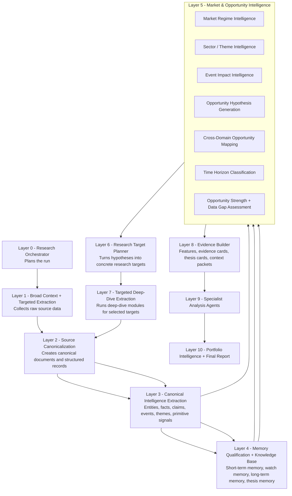
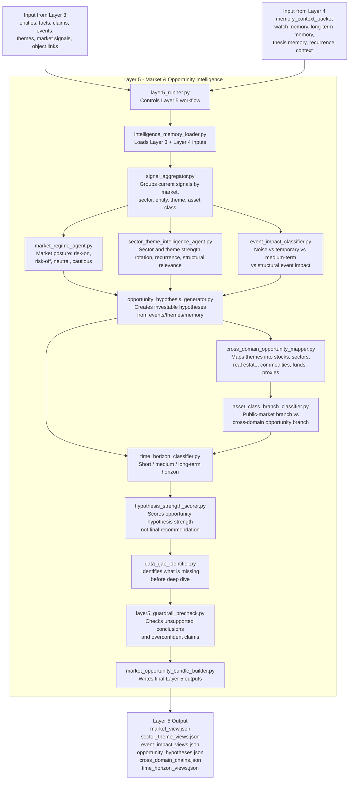

Below is the detailed implementation design for:

```text
Layer 5 — Market & Opportunity Intelligence
```

This is one of the most important layers in your system because this is where the pipeline starts thinking like an **investor**, not just a data extractor.

Layer 1 collects raw data.
Layer 2 canonicalizes sources.
Layer 3 extracts entities, facts, claims, events, themes, and primitive signals.
Layer 4 decides what should be remembered.
**Layer 5 uses current intelligence + memory to understand what may matter as an investment opportunity.**

This layer should produce **market view**, **sector/theme view**, **event impact view**, **opportunity hypotheses**, **cross-domain opportunity chains**, and **time-horizon classification**.

It should **not** produce final buy/sell decisions yet.

---

# Layer 5 — Market & Opportunity Intelligence

## Layer purpose

Layer 5 answers:

```text
What is the current market regime?
Is the market risk-on, risk-off, neutral, overheated, or cautious?
Which sectors or themes are becoming important?
Which events are noise, temporary, medium-term, or structural?
Which extracted facts/events/themes may become investment opportunities?
Which opportunities are stock-related?
Which are sector/theme-related?
Which are cross-domain opportunities?
Which opportunities need deeper research?
What is the likely time horizon: short, medium, or long term?
What evidence and memory support each hypothesis?
```

It should not answer:

```text
Should I buy this stock now?
What exact price should I enter?
How much money should I allocate?
Should I sell from my portfolio?
What is the final recommendation?
```

Those belong later to:

```text
Layer 6 — Research Target Planner
Layer 8 — Evidence Builder
Layer 9 — Specialist Analysis Agents
Layer 10 — Portfolio Intelligence + Final Report
```

---

# Why Layer 5 is important

Layer 5 is the bridge between **raw intelligence** and **research planning**.

Without Layer 5, your system would go like this:

```text
news → extracted company → score ticker → deep dive
```

That is too narrow.

The better flow is:

```text
news / macro / filings / flows
   ↓
facts / events / themes / memory
   ↓
market intelligence
   ↓
opportunity hypothesis
   ↓
research target planning
   ↓
deep dive
```

Your project discussion also says the system should evolve from a “market data collector + stock signal extractor” into an “investor intelligence system” that asks what changed, why it matters, whether it is noise or structural, and which asset classes, sectors, companies, or themes could benefit. 

That is exactly the role of Layer 5.

---

# Where Layer 5 sits in the full architecture



Important:

```text
Layer 5 runs after Layer 3 and Layer 4.

It uses:
- current extracted intelligence from Layer 3
- memory context from Layer 4
- quality/confidence metadata from Layer 2/3/4

It outputs:
- market views
- sector/theme views
- event impact assessments
- opportunity hypotheses
- cross-domain opportunity chains
- time horizon views

Layer 6 then converts those hypotheses into actual deep-dive targets.
```

---

# Layer 5 internal architecture



---

# Layer 5 high-level input

Layer 5 consumes outputs from Layer 3 and Layer 4.

```json
{
  "research_run_id": "RUN_2026_05_09_AUTONOMOUS_DAILY_0800",
  "layer3_outputs": {
    "entity_registry_path": "output/2026-05-09/layer3/entity_registry.json",
    "fact_cards_path": "output/2026-05-09/layer3/fact_cards.json",
    "claim_cards_path": "output/2026-05-09/layer3/claim_cards.json",
    "event_cards_path": "output/2026-05-09/layer3/event_cards.json",
    "theme_cards_path": "output/2026-05-09/layer3/theme_cards.json",
    "market_signal_cards_path": "output/2026-05-09/layer3/market_signal_cards.json",
    "object_link_map_path": "output/2026-05-09/layer3/object_link_map.json",
    "extraction_quality_report_path": "output/2026-05-09/layer3/extraction_quality_report.json"
  },
  "layer4_outputs": {
    "memory_context_packet_path": "output/2026-05-09/layer4/memory_context_packet.json",
    "memory_decisions_path": "output/2026-05-09/layer4/memory_decisions.json",
    "thesis_updates_path": "output/2026-05-09/layer4/thesis_updates.json"
  },
  "layer5_config": {
    "enable_cross_domain_opportunities": true,
    "enable_real_estate_opportunity_radar": true,
    "enable_commodity_opportunity_radar": true,
    "mvp_primary_focus": ["stocks", "sectors", "market_regime", "listed_proxies"],
    "max_opportunity_hypotheses": 25,
    "min_hypothesis_strength_score": 45
  }
}
```

---

# Layer 5 high-level output

Layer 5 outputs **intelligence views and opportunity hypotheses**, not final recommendations.

```json
{
  "research_run_id": "RUN_2026_05_09_AUTONOMOUS_DAILY_0800",
  "layer": "L5_market_opportunity_intelligence",
  "status": "success",
  "market_view_path": "output/2026-05-09/layer5/market_view.json",
  "sector_theme_views_path": "output/2026-05-09/layer5/sector_theme_views.json",
  "event_impact_views_path": "output/2026-05-09/layer5/event_impact_views.json",
  "opportunity_hypotheses_path": "output/2026-05-09/layer5/opportunity_hypotheses.json",
  "cross_domain_chains_path": "output/2026-05-09/layer5/cross_domain_chains.json",
  "time_horizon_views_path": "output/2026-05-09/layer5/time_horizon_views.json",
  "layer5_quality_report_path": "output/2026-05-09/layer5/layer5_quality_report.json"
}
```

---

# Layer 5 output folder

```text
output/2026-05-09/layer5/
├── market_view.json
├── sector_theme_views.json
├── event_impact_views.json
├── opportunity_hypotheses.json
├── cross_domain_chains.json
├── asset_class_branch_map.json
├── time_horizon_views.json
├── hypothesis_strength_scores.json
├── data_gaps.json
├── layer5_quality_report.json
├── layer5_audit_log.json
└── layer5_manifest.json
```

---

# What Layer 5 produces

Layer 5 produces seven main outputs:

```text
1. Market view
2. Sector/theme views
3. Event impact views
4. Opportunity hypotheses
5. Cross-domain opportunity chains
6. Asset-class branch map
7. Time-horizon views
```

These outputs are then consumed by:

```text
Layer 6 — Research Target Planner
Layer 8 — Evidence Builder
Layer 9 — Specialist Agents
```

---

# Key design boundary

Layer 5 should generate:

```text
"This may be an opportunity worth researching."
```

It should not generate:

```text
"Buy this now."
```

Example:

```text
Allowed Layer 5 output:
AI data center power demand may create an opportunity in power, electrical equipment, data center infrastructure, and related listed proxies.

Not allowed Layer 5 output:
Buy Tata Power now.
```

Layer 6 will decide which targets deserve deep dive. Later layers will analyze valuation, fundamentals, risk, and portfolio fit.

---

# Recommended folder structure

```text
intelligence_layer/
└── market_opportunity_intelligence/
    ├── layer5_runner.py
    ├── intelligence_memory_loader.py
    ├── signal_aggregator.py
    ├── market_regime_agent.py
    ├── sector_theme_intelligence_agent.py
    ├── event_impact_classifier.py
    ├── opportunity_hypothesis_generator.py
    ├── cross_domain_opportunity_mapper.py
    ├── asset_class_branch_classifier.py
    ├── time_horizon_classifier.py
    ├── hypothesis_strength_scorer.py
    ├── data_gap_identifier.py
    ├── layer5_guardrail_precheck.py
    └── market_opportunity_bundle_builder.py
```

---

# Layer 5 module designs

## 1. `layer5_runner.py`

### Purpose

Main controller for Layer 5.

### Why important

Layer 5 combines multiple intelligence inputs. It needs a controlled workflow so opportunity hypotheses are not generated randomly.

### Questions it answers

```text
Which extracted events, themes, claims, facts, and memory records should be used?
Which modules should run?
Which opportunities were generated?
Which were rejected due to weak evidence?
Where should Layer 5 outputs be written?
```

### Input

```json
{
  "research_run_id": "RUN_2026_05_09_AUTONOMOUS_DAILY_0800",
  "layer3_outputs": {},
  "layer4_outputs": {},
  "layer5_config": {}
}
```

### Logic

```text
Load Layer 3 outputs.
Load Layer 4 memory context.
Aggregate signals by market, entity, theme, sector, and asset class.
Run market regime agent.
Run sector/theme intelligence.
Run event impact classifier.
Generate opportunity hypotheses.
Map cross-domain opportunities.
Classify asset branch and time horizon.
Score hypothesis strength.
Identify data gaps.
Run guardrail precheck.
Write final Layer 5 outputs.
```

### Output

```json
{
  "status": "success",
  "market_views_created": 1,
  "sector_theme_views_created": 12,
  "event_impact_views_created": 36,
  "opportunity_hypotheses_created": 18,
  "cross_domain_chains_created": 5,
  "rejected_hypotheses": 7
}
```

---

## 2. `intelligence_memory_loader.py`

### Purpose

Load current-run intelligence and relevant memory.

### Why important

Layer 5 should not analyze today’s events in isolation. It should know whether a theme is new, recurring, or already part of an existing thesis.

### Questions it answers

```text
What did Layer 3 extract today?
What memory from prior runs is relevant?
Which themes/entities/events are recurring?
Which active theses may be affected?
```

### Input

```json
{
  "entity_registry_path": "",
  "fact_cards_path": "",
  "claim_cards_path": "",
  "event_cards_path": "",
  "theme_cards_path": "",
  "market_signal_cards_path": "",
  "memory_context_packet_path": ""
}
```

### Logic

```text
Load all Layer 3 intelligence objects.
Load Layer 4 memory context.
Join objects by entity, theme, event type, and time horizon.
Attach recurrence information from memory.
Attach existing thesis references if any.
```

### Output

```json
{
  "entities": [],
  "facts": [],
  "claims": [],
  "events": [],
  "themes": [],
  "market_signals": [],
  "memory_context": {},
  "active_theses": []
}
```

---

## 3. `signal_aggregator.py`

### Purpose

Group current intelligence into usable signal groups.

### Why important

Layer 5 agents need grouped context, not thousands of individual objects.

### Questions it answers

```text
Which events belong to the same entity?
Which themes are appearing across multiple sources?
Which market signals are related?
Which facts and claims support each theme?
Which memory records connect to today’s intelligence?
```

### Input

```json
{
  "entities": [],
  "facts": [],
  "claims": [],
  "events": [],
  "themes": [],
  "market_signals": [],
  "memory_context": {}
}
```

### Logic

Group by:

```text
market
sector
entity
theme
event_type
asset_class
time_horizon
source reliability
memory recurrence
```

### Output

```json
{
  "signal_groups": [
    {
      "signal_group_id": "SIGGRP_20260509_BANK_MARGIN",
      "group_type": "sector_theme",
      "theme": "banking margin pressure",
      "market": "india",
      "entities": ["HDFC Bank", "ICICI Bank", "NIFTY BANK"],
      "events": ["EVT_001", "EVT_002"],
      "facts": ["FACT_001"],
      "claims": ["CLAIM_001"],
      "market_signals": [],
      "memory_refs": ["MEM_20260502_BANK_MARGIN"],
      "source_diversity_count": 4,
      "recurrence_level": "high",
      "confidence": 0.78
    }
  ]
}
```

---

## 4. `market_regime_agent.py`

### Purpose

Create the overall market view.

### Why important

Your final report should not evaluate stocks without market context. A good company may still be a poor entry if the market is overheated. A falling market may create opportunity only if valuation, liquidity, trend, and macro conditions support it.

Your earlier notes already defined a market trend agent that evaluates risk-on/risk-off, trend, valuation, and whether selective buying or waiting is more appropriate. 

### Questions it answers

```text
Is the market risk-on, risk-off, neutral, or uncertain?
Is the market expensive, fair, cheap, or unclear?
Is broad buying attractive or should we be selective?
Are flows supportive or negative?
Is volatility elevated?
Is macro supportive or restrictive?
```

### Input

```json
{
  "market_signals": [
    {
      "signal_type": "institutional_flow",
      "metric_name": "fii_net_flow",
      "metric_value": -2000
    }
  ],
  "facts": [],
  "themes": [],
  "memory_context": {
    "relevant_short_term_memory": [],
    "relevant_long_term_memory": []
  }
}
```

### Logic

Use mostly deterministic rules.

Example signals:

```text
FII/DII flow
Nifty/Sensex trend
market breadth
India VIX
Nifty PE/PB if available
sector participation
USD/INR
US 10Y yield
RBI/Fed rate context
macro news
recurring market memory
```

Suggested regime logic:

```text
If breadth weak + VIX high + FII selling + macro pressure:
    regime = risk_off

If breadth strong + volatility low + flows positive:
    regime = risk_on

If mixed signals:
    regime = neutral_or_selective

If valuations high + momentum extended:
    regime = overextended

If valuation attractive but trend weak:
    regime = cautious_accumulation_candidate
```

### Output

```json
{
  "market_view_id": "MKT_VIEW_20260509_INDIA",
  "market": "india",
  "regime": "neutral_to_cautious",
  "risk_level": "medium",
  "trend_state": "sideways",
  "valuation_state": "fair_or_uncertain",
  "liquidity_flow_state": "mixed",
  "volatility_state": "moderate",
  "recommended_posture": "selective_research",
  "not_final_recommendation": true,
  "reasoning_summary": [
    "FII flows are negative but DII flows partially offset them.",
    "No strong evidence of broad-market undervaluation.",
    "Selective stock and sector research is preferred over broad aggressive buying."
  ],
  "supporting_refs": ["SIG_001", "FACT_002", "MEM_003"],
  "data_gaps": [
    "Need latest Nifty valuation percentile",
    "Need market breadth trend over 20 sessions"
  ],
  "confidence": 0.72
}
```

---

## 5. `sector_theme_intelligence_agent.py`

### Purpose

Analyze sector and theme-level intelligence.

### Why important

Your system should not only find individual stocks. Many investment opportunities start as sector or theme changes.

Example:

```text
Government policy → semiconductor sector opportunity
AI demand → data center/power/electrical equipment opportunity
RBI rate cuts → banks, real estate, NBFCs, bonds
Industrial corridor → infrastructure, cement, logistics, land/warehousing
```

Your architecture should support stocks first but remain compatible with real estate, commodities, ETFs, private-company trends, and regional growth opportunities. 

### Questions it answers

```text
Which sectors/themes are strengthening?
Which themes are recurring?
Which themes are short-term noise vs structural?
Which themes connect to listed companies or investable proxies?
Which themes may produce cross-domain opportunities?
```

### Input

```json
{
  "signal_groups": [],
  "themes": [],
  "events": [],
  "memory_context": {},
  "market_view": {}
}
```

### Logic

For each theme:

```text
Count current mentions.
Check source diversity.
Check event severity.
Check memory recurrence.
Check time horizon.
Check if theme is linked to policy/macro/capex/regulatory changes.
Check if theme has investable mapping potential.
```

### Output

```json
{
  "sector_theme_views": [
    {
      "theme_view_id": "THEME_VIEW_20260509_AI_POWER",
      "theme_name": "AI data center power demand",
      "theme_type": "technology_infrastructure_theme",
      "market": "india_global",
      "related_sectors": ["power", "electrical_equipment", "data_centers"],
      "related_entities": ["OpenAI", "Microsoft", "Power sector"],
      "current_signal_strength": "medium",
      "recurrence_level": "new_or_emerging",
      "structural_relevance": "high",
      "investment_relevance": "medium_high",
      "possible_opportunity_types": [
        "listed_proxy",
        "sector_theme",
        "infrastructure_theme",
        "commodity_power_demand"
      ],
      "reasoning_summary": [
        "Theme is linked to long-term AI infrastructure demand.",
        "No direct listed target has been confirmed yet.",
        "Requires proxy mapping and sector deep dive."
      ],
      "supporting_refs": ["THEME_001", "CLAIM_002", "MEM_004"],
      "data_gaps": [
        "Need listed company exposure mapping",
        "Need order book or capex confirmation"
      ],
      "confidence": 0.68
    }
  ]
}
```

---

## 6. `event_impact_classifier.py`

### Purpose

Classify how important each event is from an investment perspective.

### Why important

Not all news matters.

Example:

```text
Stock up 2% today → usually noise
CEO resignation → maybe material
Guidance cut → important
Policy change → possibly structural
Fraud allegation → high-risk if credible
Industrial corridor → cross-domain opportunity
```

Your earlier event-impact prompt already included the idea of classifying events as temporary, medium-term, structural risk, positive catalyst, or noise. 

### Questions it answers

```text
Is this event noise?
Is it temporary?
Is it medium-term?
Is it structural?
Is it positive, negative, mixed, or uncertain?
Does it affect a company, sector, macro regime, or cross-domain opportunity?
Does it require deep dive?
```

### Input

```json
{
  "events": [],
  "claims": [],
  "facts": [],
  "memory_context": {},
  "source_quality": {}
}
```

### Logic

Use event taxonomy + source reliability + memory recurrence.

Example:

```text
If event_type = guidance_cut:
    likely medium/high impact
    negative
    deep-dive likely required

If event_type = stock_price_move_only:
    low impact unless volume/event source exists

If event_type = policy_change:
    medium/high impact
    likely long-term
    route to sector/theme opportunity

If event_type = fraud_or_accounting_concern:
    high risk
    require high source reliability
    route to risk watch

If event repeats in memory:
    increase seriousness
```

### Output

```json
{
  "event_impact_views": [
    {
      "event_impact_id": "EVT_IMPACT_20260509_0001",
      "event_id": "EVT_20260509_0001",
      "event_type": "margin_pressure",
      "affected_entities": ["HDFC Bank", "Banking sector"],
      "impact_direction": "negative",
      "impact_strength": "medium",
      "temporary_or_structural": "temporary_possible",
      "time_horizon": "medium_term",
      "requires_deep_dive": true,
      "deep_dive_reason": "Need management commentary and NIM trend to determine if temporary or structural.",
      "reasoning_summary": [
        "Margin pressure can affect profitability.",
        "Prior memory shows this theme is recurring.",
        "Insufficient data to decide if structural."
      ],
      "supporting_refs": ["EVT_001", "MEM_002", "CLAIM_004"],
      "data_gaps": [
        "Need latest NIM trend",
        "Need concall management commentary"
      ],
      "confidence": 0.74
    }
  ]
}
```

---

## 7. `opportunity_hypothesis_generator.py`

### Purpose

Generate investment opportunity hypotheses.

### Why important

This is where the system becomes opportunity-first.

It should convert intelligence into hypotheses such as:

```text
Banking margin pressure may create selective opportunities if fundamentals remain strong and the issue is temporary.

AI data center demand may create long-term opportunities in power, electrical equipment, data center infrastructure, and listed proxies.

Industrial corridor announcement may create opportunities in logistics, warehousing, cement, infrastructure, and nearby real estate.
```

### Questions it answers

```text
What opportunity may exist?
Why might this matter?
What is the investable angle?
What type of target might express this opportunity?
What evidence supports the hypothesis?
What is missing?
What could invalidate it?
```

### Input

```json
{
  "market_view": {},
  "sector_theme_views": [],
  "event_impact_views": [],
  "memory_context": {},
  "claims": [],
  "facts": []
}
```

### Logic

Generate hypotheses from:

```text
high-impact events
recurring themes
long-term memory
market regime shifts
sector rotation
macro changes
policy events
cross-domain causal chains
```

Do not generate a hypothesis if:

```text
no source reference exists
source is too weak
claim is unsupported and not marked as hypothesis
theme is too vague
investment mapping is impossible
```

### Output

```json
{
  "opportunity_hypotheses": [
    {
      "opportunity_id": "OPP_20260509_0001",
      "opportunity_title": "Selective banking opportunities if margin pressure is temporary",
      "opportunity_type": "listed_stock_or_sector_watch",
      "origin": {
        "source_type": "event_theme_memory",
        "event_refs": ["EVT_001"],
        "theme_refs": ["THEME_001"],
        "memory_refs": ["MEM_20260502_BANK_MARGIN"]
      },
      "hypothesis": "Banking stocks under margin pressure may create selective opportunities if the pressure is temporary and fundamentals remain strong.",
      "affected_markets": ["india"],
      "potential_target_types": [
        "listed_company",
        "sector_theme",
        "banking_sector_index"
      ],
      "likely_beneficiaries_or_targets": [
        {
          "entity_name": "HDFC Bank",
          "ticker": "HDFCBANK.NS",
          "target_type": "listed_company",
          "mapping_status": "candidate_needs_deep_dive"
        },
        {
          "entity_name": "NIFTY BANK",
          "ticker": null,
          "target_type": "sector_theme",
          "mapping_status": "sector_needs_deep_dive"
        }
      ],
      "time_horizon": "medium_term",
      "hypothesis_strength": "medium",
      "requires_deep_dive": true,
      "required_deep_dive_questions": [
        "Is margin pressure temporary or structural?",
        "Are deposits and NIM stabilizing?",
        "Is valuation attractive after price correction?"
      ],
      "invalidating_conditions": [
        "NIM pressure persists for multiple quarters",
        "Asset quality deteriorates",
        "Management guidance worsens"
      ],
      "supporting_refs": ["EVT_001", "THEME_001", "MEM_002"],
      "confidence": 0.68
    }
  ]
}
```

---

## 8. `cross_domain_opportunity_mapper.py`

### Purpose

Map market events/themes into broader non-stock opportunities.

### Why important

You said your system should not only be a stock market analyzer. It should detect opportunities like:

```text
real estate opportunities
industrial corridor opportunities
commodity opportunities
regional growth
infrastructure booms
startup/private company trends
REIT/InvIT opportunities
ETF/fund opportunities
```

This module does not fully analyze those opportunities yet. It creates **causal opportunity chains**.

### Questions it answers

```text
Can this event/theme affect asset classes beyond stocks?
Can it affect real estate, commodities, infrastructure, funds, ETFs, REITs, or private companies?
What causal chain connects the event to a possible opportunity?
What needs deeper verification?
```

### Input

```json
{
  "opportunity_hypotheses": [],
  "theme_views": [],
  "event_impact_views": [],
  "memory_context": {}
}
```

### Logic

Use cause-effect templates.

Example templates:

```text
Industrial corridor policy
→ infrastructure spending
→ logistics/warehousing demand
→ land/REIT/InvIT/logistics/cement opportunity

Rate cut expectation
→ lower borrowing cost
→ real estate/NBFC/banking/fixed income opportunity

AI data center demand
→ power demand + electrical infrastructure
→ power/equipment/commodity/data center opportunity

Manufacturing policy
→ capex cycle
→ industrials, logistics, land, labor markets, materials
```

### Output

```json
{
  "cross_domain_chains": [
    {
      "chain_id": "CHAIN_20260509_INDUSTRIAL_CORRIDOR",
      "trigger_event_id": "EVT_20260509_0101",
      "trigger_theme": "industrial corridor development",
      "chain_type": "infrastructure_real_estate_logistics",
      "causal_chain": [
        {
          "step": 1,
          "statement": "Government corridor announcement may increase infrastructure spending.",
          "supporting_refs": ["EVT_0101"],
          "confidence": 0.78
        },
        {
          "step": 2,
          "statement": "Infrastructure spending may increase logistics and warehousing demand.",
          "supporting_refs": ["MEM_004"],
          "confidence": 0.63
        },
        {
          "step": 3,
          "statement": "Nearby industrial land, logistics companies, cement suppliers, and infrastructure vehicles may benefit.",
          "supporting_refs": [],
          "confidence": 0.48
        }
      ],
      "possible_opportunity_targets": [
        {
          "target_type": "listed_company_group",
          "target_group": "logistics and cement companies",
          "mapping_status": "needs_proxy_mapping"
        },
        {
          "target_type": "reit_invit",
          "target_group": "warehousing or infrastructure vehicles",
          "mapping_status": "needs_fund_vehicle_mapping"
        },
        {
          "target_type": "real_estate_theme",
          "target_group": "industrial land near corridor",
          "mapping_status": "later_stage_research"
        }
      ],
      "requires_deep_dive": true,
      "data_gaps": [
        "Need corridor route and locations",
        "Need listed beneficiaries",
        "Need project funding timeline"
      ],
      "confidence": 0.58
    }
  ]
}
```

---

## 9. `asset_class_branch_classifier.py`

### Purpose

Classify whether each opportunity belongs to the public-market branch or cross-domain branch.

### Why important

Your system will eventually support two branches:

```text
Branch A — Public market investing
stocks, sectors, mutual funds, ETFs, REITs, InvITs, listed proxies

Branch B — Cross-domain opportunity radar
real estate themes, regional growth, commodities, private companies, startup trends, industrial corridors
```

Your first production-quality version should focus on stocks, sectors, market regime, and listed proxies, while keeping the architecture compatible with real estate, commodities, ETFs, private-company trends, and regional opportunities. 

### Input

```json
{
  "opportunity_hypotheses": [],
  "cross_domain_chains": []
}
```

### Logic

```text
If target type includes listed_company:
    branch = public_market

If target type includes sector_theme:
    branch = public_market_and_theme

If target type includes private_company:
    branch = private_company_proxy_mapping

If target type includes real_estate_theme:
    branch = cross_domain

If target type includes commodity:
    branch = commodity_opportunity

If target type includes mutual_fund_etf_reit_invit:
    branch = public_market_vehicle
```

### Output

```json
{
  "asset_class_branch_map": [
    {
      "opportunity_id": "OPP_001",
      "primary_branch": "public_market",
      "secondary_branch": "sector_theme",
      "supported_target_types": [
        "listed_company",
        "sector_theme",
        "fund_etf"
      ],
      "implementation_priority": "mvp"
    },
    {
      "opportunity_id": "OPP_002",
      "primary_branch": "cross_domain",
      "secondary_branch": "real_estate_infrastructure",
      "supported_target_types": [
        "real_estate_theme",
        "listed_proxy",
        "reit_invit"
      ],
      "implementation_priority": "later"
    }
  ]
}
```

---

## 10. `time_horizon_classifier.py`

### Purpose

Classify each event, theme, and opportunity by time horizon.

### Why important

A short-term trading signal should not be mixed with a long-term investment thesis.

Time horizons:

```text
short_term     → days to weeks
medium_term    → weeks to quarters
long_term      → quarters to years
structural     → multi-year
```

### Questions it answers

```text
Is this useful for short-term trading?
Is this useful for medium-term investment watchlist?
Is this useful for long-term thesis building?
Is this structural and memory-worthy?
```

### Input

```json
{
  "opportunity_hypotheses": [],
  "event_impact_views": [],
  "theme_views": [],
  "market_view": {}
}
```

### Logic

```text
F&O, price moves, daily flows:
    short_term

earnings, guidance, analyst revisions:
    medium_term

policy, capex cycle, demographic/industrial shifts:
    long_term or structural

private company/startup trend:
    medium_to_long_term

real estate/regional development:
    long_term
```

### Output

```json
{
  "time_horizon_views": [
    {
      "object_id": "OPP_001",
      "object_type": "opportunity_hypothesis",
      "primary_time_horizon": "medium_term",
      "secondary_time_horizons": ["long_term"],
      "horizon_reason": [
        "Margin pressure should be evaluated across upcoming quarters.",
        "Fundamental confirmation requires quarterly results and management commentary."
      ],
      "confidence": 0.74
    }
  ]
}
```

---

## 11. `hypothesis_strength_scorer.py`

### Purpose

Score the strength of opportunity hypotheses.

### Important distinction

This is **not** final stock scoring.

It scores whether the hypothesis is strong enough to send to Layer 6 for target planning.

### Questions it answers

```text
Is this opportunity hypothesis strong enough to research further?
Is it supported by enough evidence?
Is it actionable?
Does it have clear target types?
Is it too speculative?
```

### Input

```json
{
  "opportunity_hypotheses": [],
  "market_view": {},
  "theme_views": [],
  "event_impact_views": [],
  "memory_context": {}
}
```

### Suggested scoring dimensions

```text
event_materiality_score        0-15
source_reliability_score       0-15
source_diversity_score         0-10
memory_recurrence_score        0-10
structural_relevance_score     0-15
investment_actionability_score 0-15
target_mappability_score       0-10
time_horizon_clarity_score     0-5
data_gap_penalty              -0 to -15
speculation_penalty           -0 to -20
```

### Output

```json
{
  "hypothesis_strength_scores": [
    {
      "opportunity_id": "OPP_001",
      "hypothesis_strength_score": 72,
      "strength_label": "research_worthy",
      "score_breakdown": {
        "event_materiality_score": 11,
        "source_reliability_score": 10,
        "source_diversity_score": 8,
        "memory_recurrence_score": 9,
        "structural_relevance_score": 8,
        "investment_actionability_score": 11,
        "target_mappability_score": 8,
        "time_horizon_clarity_score": 4,
        "data_gap_penalty": -7
      },
      "send_to_layer6": true,
      "reasoning_summary": [
        "Recurring theme with multiple sources.",
        "Clear listed-company and sector targets exist.",
        "Needs deep dive to separate temporary from structural impact."
      ],
      "confidence": 0.69
    }
  ]
}
```

---

## 12. `data_gap_identifier.py`

### Purpose

Identify what is missing before deeper research or final analysis.

### Why important

A good investor system should not pretend certainty when data is incomplete.

The property intelligence examples in your files also show the value of explicitly flagging missing critical inputs and blocking final confidence until those fields are backfilled. 

### Questions it answers

```text
What information is missing?
What deep-dive modules are required?
What would increase confidence?
What prevents this from becoming a final recommendation?
```

### Input

```json
{
  "market_view": {},
  "opportunity_hypotheses": [],
  "event_impact_views": [],
  "theme_views": []
}
```

### Output

```json
{
  "data_gaps": [
    {
      "gap_id": "GAP_20260509_0001",
      "object_id": "OPP_001",
      "object_type": "opportunity_hypothesis",
      "gap_type": "company_deep_dive_required",
      "description": "Need latest NIM trend, valuation, and management commentary to determine if margin pressure is temporary.",
      "recommended_next_step": "send_to_layer6_for_listed_company_deep_dive",
      "required_modules": [
        "market_data",
        "price_history",
        "screener_in",
        "analyst_estimates",
        "filing_docs"
      ],
      "severity": "high"
    }
  ]
}
```

---

## 13. `layer5_guardrail_precheck.py`

### Purpose

Prevent unsupported or overconfident opportunity hypotheses.

### Why important

Layer 5 uses some reasoning and LLM support. This can create hallucination risk. So this module checks whether every hypothesis has source support.

### Rules

```text
No supporting_refs → reject or quarantine
Only weak opinion source → mark speculative
No target mapping → keep as theme, not opportunity
No memory/source support → lower confidence
Sensitive allegation → require high-reliability source
Speculative causal chain → label as hypothesis, not fact
```

### Input

```json
{
  "opportunity_hypotheses": [],
  "cross_domain_chains": [],
  "hypothesis_strength_scores": []
}
```

### Output

```json
{
  "guardrail_results": [
    {
      "object_id": "OPP_001",
      "status": "pass",
      "issues": []
    },
    {
      "object_id": "OPP_007",
      "status": "downgraded",
      "issues": [
        "Only one low-reliability source",
        "No supporting factual evidence"
      ],
      "action": "mark_as_speculative_watch_only"
    }
  ]
}
```

---

## 14. `market_opportunity_bundle_builder.py`

### Purpose

Build the final Layer 5 bundle.

### Input

```json
{
  "market_view": {},
  "sector_theme_views": [],
  "event_impact_views": [],
  "opportunity_hypotheses": [],
  "cross_domain_chains": [],
  "time_horizon_views": [],
  "hypothesis_strength_scores": [],
  "data_gaps": [],
  "guardrail_results": []
}
```

### Output

```json
{
  "research_run_id": "RUN_2026_05_09_AUTONOMOUS_DAILY_0800",
  "layer": "L5_market_opportunity_intelligence",
  "created_at": "2026-05-09T11:30:00+05:30",
  "market_view_path": "",
  "sector_theme_views_path": "",
  "event_impact_views_path": "",
  "opportunity_hypotheses_path": "",
  "cross_domain_chains_path": "",
  "time_horizon_views_path": "",
  "data_gaps_path": "",
  "quality_report_path": ""
}
```

---

# Main Layer 5 object schemas

## 1. Market view schema

```json
{
  "market_view_id": "MKT_VIEW_20260509_INDIA",
  "research_run_id": "RUN_2026_05_09_AUTONOMOUS_DAILY_0800",
  "market": "india",
  "regime": "risk_on | risk_off | neutral | neutral_to_cautious | overextended | uncertain",
  "risk_level": "low | medium | high | uncertain",
  "trend_state": "bullish | bearish | sideways | recovering | overextended | uncertain",
  "valuation_state": "cheap | fair | expensive | uncertain",
  "liquidity_flow_state": "positive | negative | mixed | uncertain",
  "volatility_state": "low | moderate | elevated | high",
  "recommended_posture": "aggressive_research | selective_research | cautious_watchlist | defensive | wait",
  "not_final_recommendation": true,
  "reasoning_summary": [],
  "supporting_refs": [],
  "data_gaps": [],
  "confidence": 0.0
}
```

---

## 2. Sector/theme view schema

```json
{
  "theme_view_id": "THEME_VIEW_20260509_0001",
  "theme_name": "",
  "theme_type": "sector_theme | macro_theme | technology_theme | policy_theme | commodity_theme | regional_theme",
  "market": "india | us | global",
  "related_sectors": [],
  "related_entities": [],
  "current_signal_strength": "low | medium | high",
  "recurrence_level": "new | recurring | high_recurring",
  "structural_relevance": "low | medium | high",
  "investment_relevance": "low | medium | high",
  "possible_opportunity_types": [],
  "reasoning_summary": [],
  "supporting_refs": [],
  "data_gaps": [],
  "confidence": 0.0
}
```

---

## 3. Event impact view schema

```json
{
  "event_impact_id": "EVT_IMPACT_20260509_0001",
  "event_id": "",
  "event_type": "",
  "affected_entities": [],
  "impact_direction": "positive | negative | neutral | mixed | unknown",
  "impact_strength": "low | medium | high",
  "temporary_or_structural": "noise | temporary | medium_term | structural | unknown",
  "time_horizon": "short_term | medium_term | long_term | structural | unknown",
  "requires_deep_dive": true,
  "deep_dive_reason": "",
  "reasoning_summary": [],
  "supporting_refs": [],
  "data_gaps": [],
  "confidence": 0.0
}
```

---

## 4. Opportunity hypothesis schema

```json
{
  "opportunity_id": "OPP_20260509_0001",
  "opportunity_title": "",
  "opportunity_type": "listed_stock | sector_theme | macro_theme | fund_etf | private_company_proxy | real_estate_theme | commodity | cross_domain",
  "hypothesis": "",
  "origin": {
    "event_refs": [],
    "theme_refs": [],
    "memory_refs": [],
    "claim_refs": [],
    "fact_refs": []
  },
  "affected_markets": [],
  "potential_target_types": [],
  "likely_beneficiaries_or_targets": [],
  "time_horizon": "short_term | medium_term | long_term | structural",
  "hypothesis_strength": "low | medium | high",
  "requires_deep_dive": true,
  "required_deep_dive_questions": [],
  "invalidating_conditions": [],
  "supporting_refs": [],
  "data_gaps": [],
  "confidence": 0.0
}
```

---

## 5. Cross-domain chain schema

```json
{
  "chain_id": "CHAIN_20260509_0001",
  "trigger_event_id": "",
  "trigger_theme": "",
  "chain_type": "infrastructure_real_estate_logistics | macro_rate_sensitive | ai_power_demand | commodity_supply_chain | private_company_proxy",
  "causal_chain": [
    {
      "step": 1,
      "statement": "",
      "supporting_refs": [],
      "confidence": 0.0
    }
  ],
  "possible_opportunity_targets": [],
  "requires_deep_dive": true,
  "data_gaps": [],
  "confidence": 0.0
}
```

---

# LLM usage in Layer 5

Layer 5 can use LLMs, but only in controlled ways.

Use LLM for:

```text
opportunity hypothesis generation
cross-domain causal mapping
event temporary-vs-structural reasoning
sector/theme explanation
data gap identification
invalidating condition generation
```

Do not use LLM for:

```text
raw numeric calculation
price returns
valuation calculations
technical indicators
final buy/sell
position sizing
portfolio allocation
```

The output must be strict JSON with:

```text
reasoning_summary
supporting_refs
confidence
data_gaps
invalidating_conditions
```

Your prior design discussion specifically recommends structured agent outputs with conclusion, reasoning summary, evidence references, confidence, data gaps, and invalidating conditions rather than free-form hidden reasoning. 

---

# Layer 5 prompt pattern

Use this general prompt pattern for LLM modules:

```text
You are a market and opportunity intelligence model.

You receive structured facts, claims, events, themes, market signals, and memory records.

Your job is to generate investment opportunity hypotheses, not final buy/sell recommendations.

Rules:
- Do not invent facts.
- Every hypothesis must link to supporting_refs.
- If support is weak, label it speculative.
- Separate facts from claims.
- Preserve uncertainty.
- Identify data gaps.
- Identify invalidating conditions.
- Do not recommend buying or selling.
- Return JSON only using the provided schema.
```

---

# Layer 5 quality report

```json
{
  "research_run_id": "RUN_2026_05_09_AUTONOMOUS_DAILY_0800",
  "market_views_created": 1,
  "sector_theme_views_created": 12,
  "event_impact_views_created": 36,
  "opportunity_hypotheses_created": 18,
  "cross_domain_chains_created": 5,
  "hypotheses_sent_to_layer6": 11,
  "hypotheses_rejected": 7,
  "rejection_reasons": [
    "weak_source_support",
    "no_investable_mapping",
    "duplicate_hypothesis",
    "too_speculative"
  ],
  "average_hypothesis_confidence": 0.66,
  "data_gaps_identified": 41,
  "guardrail_downgrades": 3
}
```

---

# What Layer 5 should not do

Layer 5 should not:

```text
run company deep-dive extraction
choose exact tickers for deep dive by itself
perform final valuation analysis
build final evidence cards
build final portfolio actions
say buy/sell/add/trim
calculate position sizing
produce final investor report
```

Layer 5 can say:

```text
This opportunity hypothesis is research-worthy and should be sent to Layer 6.
```

Layer 6 decides actual research targets and deep-dive plans.

---

# What is already implemented vs missing

## Already partially implemented

Your older Phase B had early versions of:

```text
market_regime.py
news_signal_extractor.py
candidate_scorer.py
```

Those should now be repositioned:

```text
market_regime.py
    → Layer 5 market_regime_agent.py

news_signal_extractor.py
    → mostly Layer 3 entity/event/claim/theme extraction

candidate_scorer.py
    → Layer 6 target_ranker.py

some event impact logic
    → Layer 5 event_impact_classifier.py
```

Your files already mention market trend analysis and event classification concepts, including market regime, risk level, posture, event impact, time horizon, severity, and confidence.

## Need to build for Layer 5

```text
1. layer5_runner.py
2. intelligence_memory_loader.py
3. signal_aggregator.py
4. market_regime_agent.py
5. sector_theme_intelligence_agent.py
6. event_impact_classifier.py
7. opportunity_hypothesis_generator.py
8. cross_domain_opportunity_mapper.py
9. asset_class_branch_classifier.py
10. time_horizon_classifier.py
11. hypothesis_strength_scorer.py
12. data_gap_identifier.py
13. layer5_guardrail_precheck.py
14. market_opportunity_bundle_builder.py
```

---

# Recommended implementation order for Layer 5

## Step 1 — Signal aggregator

Build:

```text
signal_aggregator.py
```

Goal:

```text
Group entities, events, themes, memory, and signals into usable signal groups.
```

Output:

```text
signal_groups.json
```

---

## Step 2 — Market regime agent

Build:

```text
market_regime_agent.py
```

Start rule-based first.

Output:

```text
market_view.json
```

---

## Step 3 — Event impact classifier

Build:

```text
event_impact_classifier.py
```

Output:

```text
event_impact_views.json
```

---

## Step 4 — Sector/theme intelligence

Build:

```text
sector_theme_intelligence_agent.py
```

Output:

```text
sector_theme_views.json
```

---

## Step 5 — Opportunity hypothesis generator

Build:

```text
opportunity_hypothesis_generator.py
```

Output:

```text
opportunity_hypotheses.json
```

---

## Step 6 — Time horizon + strength scoring

Build:

```text
time_horizon_classifier.py
hypothesis_strength_scorer.py
```

Output:

```text
time_horizon_views.json
hypothesis_strength_scores.json
```

---

## Step 7 — Cross-domain mapper

Build this after stock/sector hypotheses are working.

```text
cross_domain_opportunity_mapper.py
asset_class_branch_classifier.py
```

Output:

```text
cross_domain_chains.json
asset_class_branch_map.json
```

---

# Final Layer 5 contract

## Layer 3 + Layer 4 give Layer 5

```json
{
  "entity_registry_path": "",
  "fact_cards_path": "",
  "claim_cards_path": "",
  "event_cards_path": "",
  "theme_cards_path": "",
  "market_signal_cards_path": "",
  "memory_context_packet_path": ""
}
```

## Layer 5 gives Layer 6

```json
{
  "market_view_path": "",
  "sector_theme_views_path": "",
  "event_impact_views_path": "",
  "opportunity_hypotheses_path": "",
  "cross_domain_chains_path": "",
  "asset_class_branch_map_path": "",
  "time_horizon_views_path": "",
  "hypothesis_strength_scores_path": "",
  "data_gaps_path": ""
}
```

Layer 6 uses these to answer:

```text
Which research targets should we deep dive?
Should this become a listed-company target?
Should this become a sector/theme target?
Should this become a private-company proxy mapping target?
Should this become a macro target?
Should this become a fund/ETF/REIT/InvIT target?
```

---

# Final Layer 5 summary

Layer 5 is the **market and opportunity intelligence layer**.

It transforms:

```text
entities + facts + claims + events + themes + market signals + memory
```

into:

```text
market view
sector/theme view
event impact view
opportunity hypotheses
cross-domain chains
time horizon views
hypothesis strength scores
data gaps
```

The key rule:

```text
Layer 5 discovers and explains possible opportunities.
Layer 5 does not make final investment decisions.
```

The most important design principle:

```text
Every opportunity hypothesis must be evidence-linked, uncertainty-aware, and labeled as hypothesis until deeper research confirms it.
```

This is the layer that moves your project from:

```text
stock scanner
```

to:

```text
investor opportunity intelligence system
```
