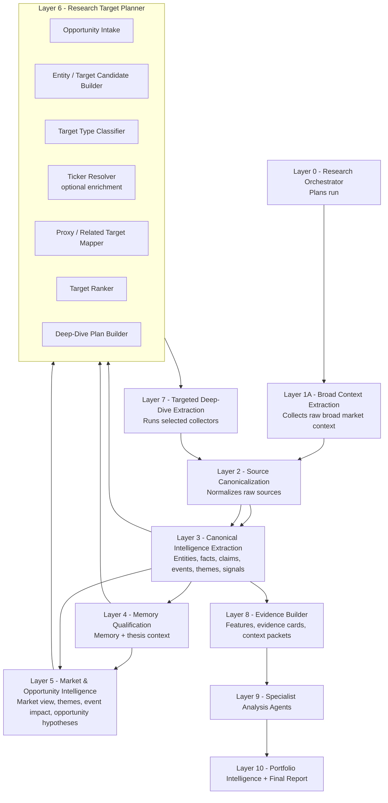
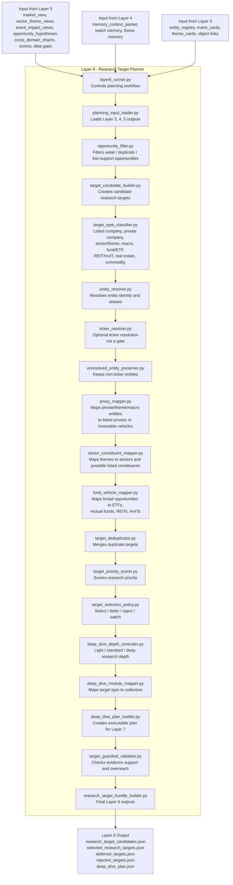

Below is the detailed implementation design for:

```text
Layer 6 — Research Target Planner
```

This layer is where your system answers one of the most important questions:

```text
What exactly should we deep dive next?
```

Layer 5 may say:

```text
AI data center demand may create an opportunity in power, electrical equipment, and data center infrastructure.
```

Layer 6 converts that into concrete research targets like:

```text
Target 1: Power sector theme
Target 2: Tata Power
Target 3: Siemens India
Target 4: Data center infrastructure theme
Target 5: REIT/InvIT or infrastructure vehicle research
```

Layer 6 is **not a final recommendation layer**. It is a **planning and routing layer**.

---

# Layer 6 — Research Target Planner

## Layer purpose

Layer 6 converts market intelligence and opportunity hypotheses into concrete deep-dive targets.

It answers:

```text
Which opportunities deserve deeper research?
Which entities should become research targets?
Is this a listed company, private company, sector, macro theme, ETF/fund, REIT/InvIT, commodity, or real estate theme?
Can we resolve this entity to a ticker?
If no ticker exists, can we map it to listed proxies?
Which deep-dive modules should run for each target?
How deep should each target be researched?
Which targets are selected now, deferred, rejected, or stored for watch?
```

It should not answer:

```text
Should I buy this stock?
Is this stock undervalued?
What price should I enter?
How much should I allocate?
Should I sell from portfolio?
```

Those decisions happen later in:

```text
Layer 8 — Evidence Builder
Layer 9 — Specialist Analysis Agents
Layer 10 — Portfolio Intelligence + Final Report
```

---

# Why Layer 6 is important

Layer 6 prevents your system from becoming either too narrow or too expensive.

Without Layer 6, you may do one of these mistakes:

```text
Mistake 1:
Deep dive every company mentioned in the news.
Result: too expensive, noisy, slow.

Mistake 2:
Deep dive only companies with resolved tickers.
Result: you miss private-company, policy, sector, macro, real estate, and fund opportunities.

Mistake 3:
Let the LLM directly decide final stocks.
Result: hallucination risk and weak traceability.

Mistake 4:
Use only a simple ticker mention count.
Result: you miss structural opportunities and overreact to noisy headlines.
```

Layer 6 solves this by creating a structured research plan:

```text
Opportunity hypothesis
   ↓
Research target candidates
   ↓
Target type classification
   ↓
Ticker/proxy resolution
   ↓
Priority scoring
   ↓
Deep-dive module planning
   ↓
deep_dive_plan.json
```

---

# Where Layer 6 sits in the full architecture



Important:

```text
Layer 6 is the decision layer for deep-dive planning.

Layer 6 does not collect data.
Layer 6 does not analyze final investment quality.
Layer 6 creates the deep_dive_plan.json that Layer 7 will execute.
```

---

# Layer 6 internal architecture



---

# Layer 6 high-level input

Layer 6 consumes outputs from Layer 5, and also uses memory/context from Layer 4 and entity/event details from Layer 3.

```json
{
  "research_run_id": "RUN_2026_05_09_AUTONOMOUS_DAILY_0800",
  "layer5_outputs": {
    "market_view_path": "output/2026-05-09/layer5/market_view.json",
    "sector_theme_views_path": "output/2026-05-09/layer5/sector_theme_views.json",
    "event_impact_views_path": "output/2026-05-09/layer5/event_impact_views.json",
    "opportunity_hypotheses_path": "output/2026-05-09/layer5/opportunity_hypotheses.json",
    "cross_domain_chains_path": "output/2026-05-09/layer5/cross_domain_chains.json",
    "asset_class_branch_map_path": "output/2026-05-09/layer5/asset_class_branch_map.json",
    "time_horizon_views_path": "output/2026-05-09/layer5/time_horizon_views.json",
    "hypothesis_strength_scores_path": "output/2026-05-09/layer5/hypothesis_strength_scores.json",
    "data_gaps_path": "output/2026-05-09/layer5/data_gaps.json"
  },
  "layer4_outputs": {
    "memory_context_packet_path": "output/2026-05-09/layer4/memory_context_packet.json",
    "thesis_updates_path": "output/2026-05-09/layer4/thesis_updates.json"
  },
  "layer3_outputs": {
    "entity_registry_path": "output/2026-05-09/layer3/entity_registry.json",
    "event_cards_path": "output/2026-05-09/layer3/event_cards.json",
    "theme_cards_path": "output/2026-05-09/layer3/theme_cards.json",
    "object_link_map_path": "output/2026-05-09/layer3/object_link_map.json"
  },
  "layer6_config": {
    "max_selected_targets": 10,
    "max_listed_company_targets": 6,
    "max_sector_theme_targets": 3,
    "max_private_proxy_targets": 2,
    "max_macro_targets": 2,
    "min_priority_score_for_deep_dive": 65,
    "ticker_resolution_policy": "optional_not_required",
    "default_depth": "standard"
  }
}
```

---

# Layer 6 high-level output

Layer 6 produces the official research target plan.

```json
{
  "research_run_id": "RUN_2026_05_09_AUTONOMOUS_DAILY_0800",
  "layer": "L6_research_target_planner",
  "status": "success",
  "research_target_candidates_path": "output/2026-05-09/layer6/research_target_candidates.json",
  "selected_research_targets_path": "output/2026-05-09/layer6/selected_research_targets.json",
  "deferred_targets_path": "output/2026-05-09/layer6/deferred_targets.json",
  "rejected_targets_path": "output/2026-05-09/layer6/rejected_targets.json",
  "unresolved_entities_path": "output/2026-05-09/layer6/unresolved_entities.json",
  "deep_dive_plan_path": "output/2026-05-09/layer6/deep_dive_plan.json",
  "layer6_quality_report_path": "output/2026-05-09/layer6/layer6_quality_report.json"
}
```

---

# Layer 6 output folder

```text
output/2026-05-09/layer6/
├── research_target_candidates.json
├── target_resolution_results.json
├── proxy_mapping_results.json
├── target_priority_scores.json
├── selected_research_targets.json
├── deferred_targets.json
├── rejected_targets.json
├── unresolved_entities.json
├── deep_dive_plan.json
├── target_selection_audit.json
├── layer6_quality_report.json
└── layer6_manifest.json
```

---

# What Layer 6 produces

Layer 6 produces five main outputs:

```text
1. Research target candidates
2. Resolved / unresolved target map
3. Selected research targets
4. Deferred / rejected targets
5. Deep-dive plan
```

Most important output:

```text
deep_dive_plan.json
```

This is consumed by:

```text
Layer 7 — Targeted Deep-Dive Extraction
```

---

# Core design rule: ticker resolution is optional

This rule must be preserved:

```text
Ticker resolution should enrich the target.
It should not decide whether the target exists.
```

Old ticker-first flow:

```text
Entity mentioned
   ↓
Ticker not found
   ↓
Ignore
```

New opportunity-first flow:

```text
Entity/theme/opportunity mentioned
   ↓
Try ticker resolution
   ↓
If ticker found:
      route to listed-company deep dive
   ↓
If no ticker found:
      preserve entity
      classify target type
      map to sector, proxy, fund, ETF, REIT, InvIT, commodity, real estate, or watch memory
```

Example:

```text
OpenAI
   ↓
No public ticker
   ↓
private/unlisted company target
   ↓
map to listed beneficiaries:
Microsoft, Nvidia, data center infrastructure, power equipment, cloud providers
```

Example India flow:

```text
AI data center power demand
   ↓
No ticker
   ↓
sector/theme target
   ↓
possible listed proxies:
power companies, electrical equipment companies, data center infrastructure companies
```

---

# Research target types

Layer 6 should support these target types.

```text
Type 1: Listed company target
Type 2: Private / unlisted company target
Type 3: Sector / theme target
Type 4: Macro target
Type 5: Mutual fund / ETF / REIT / InvIT target
Type 6: Commodity target
Type 7: Real estate / regional opportunity target
```

For MVP, focus on:

```text
Type 1: Listed company
Type 2: Private/unlisted proxy mapping
Type 3: Sector/theme
Type 4: Macro
Type 5: ETF/fund/REIT/InvIT basic support
```

Add commodity and real estate later.

---

# Recommended folder structure

```text
intelligence_layer/
└── research_target_planner/
    ├── layer6_runner.py
    ├── planning_input_loader.py
    ├── opportunity_filter.py
    ├── target_candidate_builder.py
    ├── target_type_classifier.py
    ├── entity_resolver.py
    ├── ticker_resolver.py
    ├── unresolved_entity_preserver.py
    ├── proxy_mapper.py
    ├── sector_constituent_mapper.py
    ├── fund_vehicle_mapper.py
    ├── macro_target_mapper.py
    ├── target_deduplicator.py
    ├── target_priority_scorer.py
    ├── target_selection_policy.py
    ├── deep_dive_depth_controller.py
    ├── deep_dive_module_mapper.py
    ├── deep_dive_plan_builder.py
    ├── target_guardrail_validator.py
    └── research_target_bundle_builder.py
```

---

# Layer 6 module designs

## 1. `layer6_runner.py`

### Purpose

Main controller for Layer 6.

### Why important

It coordinates opportunity intake, target creation, resolution, scoring, selection, and deep-dive plan generation.

### Questions it answers

```text
Which opportunities should become target candidates?
Which targets can be resolved to tickers?
Which unresolved entities should still be preserved?
Which selected targets should be deep-dived now?
Which modules should run for each selected target?
```

### Input

```json
{
  "research_run_id": "RUN_2026_05_09_AUTONOMOUS_DAILY_0800",
  "layer5_outputs": {},
  "layer4_outputs": {},
  "layer3_outputs": {},
  "layer6_config": {}
}
```

### Logic

```text
Load Layer 5 opportunity outputs.
Load Layer 4 memory context.
Load Layer 3 entity registry.
Filter weak or unsupported hypotheses.
Build target candidates.
Classify target types.
Resolve entities and tickers where possible.
Preserve unresolved entities.
Map proxies for private/theme/macro targets.
Deduplicate overlapping targets.
Score target priority.
Select, defer, reject, or watch targets.
Decide deep-dive depth.
Map selected targets to collector modules.
Build deep_dive_plan.json.
Write audit and quality report.
```

### Output

```json
{
  "status": "success",
  "target_candidates_created": 35,
  "targets_selected": 10,
  "targets_deferred": 14,
  "targets_rejected": 11,
  "deep_dive_tasks_created": 72,
  "deep_dive_plan_path": "output/2026-05-09/layer6/deep_dive_plan.json"
}
```

---

## 2. `planning_input_loader.py`

### Purpose

Load all planning inputs from Layers 3, 4, and 5.

### Why important

Layer 6 cannot select targets only from Layer 5 text. It needs entities, memory, events, themes, confidence, and source references.

### Input

```json
{
  "market_view_path": "",
  "sector_theme_views_path": "",
  "event_impact_views_path": "",
  "opportunity_hypotheses_path": "",
  "cross_domain_chains_path": "",
  "memory_context_packet_path": "",
  "entity_registry_path": ""
}
```

### Logic

```text
Load all required JSON files.
Join opportunities with related events/themes/entities.
Join memory context by entity/theme.
Attach hypothesis strength scores.
Attach data gaps.
Attach branch map and time horizon.
```

### Output

```json
{
  "market_view": {},
  "sector_theme_views": [],
  "event_impact_views": [],
  "opportunity_hypotheses": [],
  "cross_domain_chains": [],
  "memory_context": {},
  "entity_registry": [],
  "data_gaps": []
}
```

---

## 3. `opportunity_filter.py`

### Purpose

Filter out hypotheses that are too weak for target planning.

### Why important

Not every Layer 5 hypothesis should become a research target. Some may be speculative, unsupported, duplicate, or low priority.

### Questions it answers

```text
Is this opportunity supported by evidence?
Is it too speculative?
Is it a duplicate?
Does it have any investable mapping path?
Should it be deferred instead of planned now?
```

### Input

```json
{
  "opportunity_hypotheses": [],
  "hypothesis_strength_scores": [],
  "guardrail_results": [],
  "data_gaps": []
}
```

### Logic

```text
Reject if:
    no supporting_refs
    guardrail status = reject
    hypothesis_strength_score < minimum threshold
    no target mapping possible
    too speculative and not structurally important

Defer if:
    interesting but missing critical data
    long-term but not urgent
    low priority due to budget

Allow if:
    research-worthy
    evidence-backed
    target type is mappable
    score above threshold or override applies
```

### Output

```json
{
  "filtered_opportunities": [
    {
      "opportunity_id": "OPP_001",
      "status": "accepted_for_target_planning",
      "reason": "Research-worthy and evidence-linked"
    }
  ],
  "deferred_opportunities": [],
  "rejected_opportunities": []
}
```

---

## 4. `target_candidate_builder.py`

### Purpose

Convert accepted opportunities into target candidates.

### Why important

A single opportunity can generate multiple possible targets.

Example:

```text
Opportunity:
AI data center power demand

Target candidates:
- Power sector theme
- Electrical equipment sector theme
- Tata Power
- Siemens India
- Data center infrastructure theme
- REIT/InvIT infrastructure vehicle
```

### Input

```json
{
  "filtered_opportunities": [],
  "entity_registry": [],
  "event_impact_views": [],
  "sector_theme_views": [],
  "cross_domain_chains": []
}
```

### Logic

For each opportunity:

```text
Extract explicit listed companies.
Extract private companies.
Extract sectors/themes.
Extract macro drivers.
Extract possible funds/ETFs/REITs/InvITs.
Extract regional/real estate/commodity links if present.
Create one target candidate per meaningful target.
```

### Output

```json
{
  "target_candidates": [
    {
      "candidate_target_id": "TCAND_20260509_0001",
      "source_opportunity_id": "OPP_20260509_0001",
      "candidate_name": "HDFC Bank",
      "candidate_type_hint": "listed_company",
      "ticker_hint": "HDFCBANK",
      "market": "india",
      "why_candidate": [
        "Mentioned in margin pressure event",
        "Linked to recurring banking margin theme"
      ],
      "supporting_refs": ["OPP_001", "EVT_001", "THEME_001", "MEM_001"]
    }
  ]
}
```

---

## 5. `target_type_classifier.py`

### Purpose

Classify each target candidate into a supported research target type.

### Target types

```text
listed_company
private_unlisted_company
sector_theme
macro_theme
fund_etf
reit_invit
commodity
real_estate_regional_theme
index
unknown
```

### Input

```json
{
  "candidate_target_id": "TCAND_001",
  "candidate_name": "HDFC Bank",
  "candidate_type_hint": "listed_company",
  "ticker_hint": "HDFCBANK"
}
```

### Logic

```text
If ticker or exchange hint exists:
    listed_company

If company name exists but no public ticker:
    private_unlisted_company

If entity is sector, industry, technology, policy, regional, or theme:
    sector_theme or macro_theme

If target maps to investable pooled vehicle:
    fund_etf or reit_invit

If target is commodity:
    commodity

If target is location/corridor/land/region:
    real_estate_regional_theme
```

### Output

```json
{
  "candidate_target_id": "TCAND_001",
  "target_type": "listed_company",
  "classification_confidence": 0.94,
  "classification_reason": "Ticker hint and known NSE company match"
}
```

---

## 6. `entity_resolver.py`

### Purpose

Resolve entity identity, aliases, country, sector, and market status.

### Why important

The same entity may appear as:

```text
HDFC Bank
HDFCBANK
HDFC Bank Ltd
HDFC Bank Limited
```

Layer 6 must merge them into one target.

### Input

```json
{
  "candidate_name": "HDFC Bank",
  "target_type": "listed_company",
  "ticker_hint": "HDFCBANK",
  "market": "india"
}
```

### Logic

```text
Normalize name.
Check entity_registry from Layer 3.
Check alias dictionary.
Check known company master list.
Check previous memory index.
Assign normalized_entity_id.
```

### Output

```json
{
  "candidate_target_id": "TCAND_001",
  "resolved_entity": {
    "entity_id": "ENT_HDFCBANK",
    "entity_name": "HDFC Bank Ltd",
    "aliases": ["HDFC Bank", "HDFCBANK"],
    "entity_type": "listed_company",
    "country": "India",
    "market_status": "listed",
    "resolution_status": "resolved",
    "confidence": 0.96
  }
}
```

---

## 7. `ticker_resolver.py`

### Purpose

Resolve listed entities to ticker symbols.

### Important

Ticker resolution is **optional enrichment**.

If ticker fails, the target should not be discarded automatically.

### Input

```json
{
  "entity_name": "HDFC Bank Ltd",
  "ticker_hint": "HDFCBANK",
  "market": "india",
  "exchange_preference": ["NSE", "BSE"]
}
```

### Logic

```text
Check exact ticker map.
Check NSE/BSE symbol master.
Check alias dictionary.
Check fuzzy company name matching.
Check existing entity memory.
If confidence high:
    assign ticker
If ambiguous:
    mark needs_review
If not found:
    preserve as unresolved
```

### Output

Resolved:

```json
{
  "entity_name": "HDFC Bank Ltd",
  "ticker": "HDFCBANK.NS",
  "exchange": "NSE",
  "ticker_resolution_status": "resolved",
  "confidence": 0.97
}
```

Unresolved:

```json
{
  "entity_name": "OpenAI",
  "ticker": null,
  "exchange": null,
  "ticker_resolution_status": "no_public_ticker_found",
  "preserve_for_planning": true,
  "next_action": "private_company_proxy_mapping",
  "confidence": 0.91
}
```

Ambiguous:

```json
{
  "entity_name": "Tata",
  "ticker": null,
  "ticker_resolution_status": "ambiguous",
  "possible_matches": [
    "TATAMOTORS.NS",
    "TATASTEEL.NS",
    "TATAPOWER.NS",
    "TCS.NS"
  ],
  "next_action": "resolve_using_context",
  "confidence": 0.45
}
```

---

## 8. `unresolved_entity_preserver.py`

### Purpose

Preserve important entities even if no ticker exists.

### Why important

This keeps your system opportunity-first.

Examples:

```text
OpenAI
Zepto
India semiconductor policy
Industrial corridor
AI data center power demand
RBI rate cut expectation
```

### Input

```json
{
  "candidate_target_id": "TCAND_OPENAI_001",
  "entity_name": "OpenAI",
  "target_type": "private_unlisted_company",
  "ticker_resolution_status": "no_public_ticker_found"
}
```

### Logic

```text
If no ticker but entity/theme has investment relevance:
    preserve as unresolved_target
    assign target_type
    assign next action:
        proxy_mapping
        sector_theme_mapping
        macro_mapping
        fund_vehicle_mapping
        watch_only
```

### Output

```json
{
  "unresolved_target_id": "UNRES_20260509_0001",
  "entity_name": "OpenAI",
  "target_type": "private_unlisted_company",
  "reason_preserved": "Relevant to AI infrastructure opportunity but no public ticker.",
  "next_action": "proxy_mapping",
  "supporting_refs": ["OPP_002", "THEME_AI_POWER"],
  "confidence": 0.88
}
```

---

## 9. `proxy_mapper.py`

### Purpose

Map private companies, themes, or macro events to possible listed proxies.

### Why important

This is what converts non-listed opportunities into investable research paths.

Example:

```text
OpenAI
   ↓
AI infrastructure
   ↓
listed proxies:
Nvidia, Microsoft, data center REITs, power equipment, cloud infrastructure
```

India example:

```text
AI data center power demand
   ↓
power sector
electrical equipment
data center infrastructure
   ↓
possible listed proxies:
Tata Power, NTPC, Siemens India, ABB India, data center-related listed players
```

### Input

```json
{
  "unresolved_target_id": "UNRES_001",
  "entity_name": "OpenAI",
  "target_type": "private_unlisted_company",
  "linked_themes": ["AI data center power demand"],
  "market": "global"
}
```

### Logic

Use mapping templates:

```text
private company → suppliers / partners / competitors / sector beneficiaries
policy theme → sectors / beneficiaries / listed companies / funds
macro event → rate-sensitive sectors / currency-sensitive sectors
regional project → infra / cement / logistics / real estate / REITs
commodity theme → producers / users / ETFs / importers / exporters
```

### Output

```json
{
  "proxy_mapping_id": "PROXYMAP_20260509_0001",
  "source_target": {
    "entity_name": "OpenAI",
    "target_type": "private_unlisted_company"
  },
  "proxy_candidates": [
    {
      "proxy_name": "Microsoft",
      "ticker": "MSFT",
      "proxy_type": "listed_company",
      "relationship": "strategic/cloud infrastructure partner",
      "mapping_confidence": 0.72,
      "requires_deep_dive": true
    },
    {
      "proxy_name": "Nvidia",
      "ticker": "NVDA",
      "proxy_type": "listed_company",
      "relationship": "AI GPU supplier",
      "mapping_confidence": 0.76,
      "requires_deep_dive": true
    },
    {
      "proxy_name": "Data center power infrastructure theme",
      "ticker": null,
      "proxy_type": "sector_theme",
      "relationship": "infrastructure demand beneficiary",
      "mapping_confidence": 0.64,
      "requires_deep_dive": true
    }
  ],
  "supporting_refs": ["OPP_002", "THEME_AI_POWER"],
  "data_gaps": [
    "Need confirmation of direct revenue exposure.",
    "Need valuation and financial data for listed proxies."
  ]
}
```

---

## 10. `sector_constituent_mapper.py`

### Purpose

Map sector/theme opportunities to sectors and possible listed constituents.

### Input

```json
{
  "theme_name": "banking margin pressure",
  "market": "india",
  "related_sectors": ["banking", "financial services"]
}
```

### Logic

```text
Map theme to sector index if possible.
Map sector to known constituents.
Map mentioned entities first.
Add sector-level target if individual companies are unclear.
```

### Output

```json
{
  "sector_mapping_id": "SECMAP_20260509_BANKING",
  "theme_name": "banking margin pressure",
  "sector_targets": [
    {
      "target_name": "NIFTY BANK",
      "target_type": "sector_theme",
      "ticker": null,
      "requires_deep_dive": true
    }
  ],
  "possible_listed_constituents": [
    {
      "company": "HDFC Bank",
      "ticker": "HDFCBANK.NS",
      "reason": "Directly mentioned in event/theme"
    },
    {
      "company": "ICICI Bank",
      "ticker": "ICICIBANK.NS",
      "reason": "Major sector constituent"
    }
  ]
}
```

---

## 11. `fund_vehicle_mapper.py`

### Purpose

Map broad market, sector, or theme opportunities to mutual funds, ETFs, REITs, or InvITs.

### Why important

Sometimes an opportunity is better expressed through a basket or vehicle instead of one stock.

Examples:

```text
Broad Nifty accumulation → Nifty ETF / index fund
Banking sector opportunity → Bank ETF / financial services fund
Infrastructure theme → infrastructure mutual fund / InvIT
Commercial real estate trend → REIT
```

### Input

```json
{
  "opportunity_id": "OPP_001",
  "theme_name": "broad market accumulation",
  "market": "india",
  "target_type_hint": "fund_etf"
}
```

### Logic

```text
Map theme to investable vehicle class.
Suggest candidate vehicle categories.
Do not select final fund yet unless data exists.
Create fund/ETF/REIT/InvIT research targets.
```

### Output

```json
{
  "vehicle_mapping_id": "VEHMAP_20260509_0001",
  "theme_name": "broad market accumulation",
  "vehicle_targets": [
    {
      "target_type": "fund_etf",
      "vehicle_category": "Nifty 50 ETF or index fund",
      "requires_deep_dive": true,
      "reason": "Broad market opportunity may be better expressed as index exposure."
    },
    {
      "target_type": "fund_etf",
      "vehicle_category": "Banking sector ETF",
      "requires_deep_dive": true,
      "reason": "Banking theme detected."
    }
  ]
}
```

---

## 12. `macro_target_mapper.py`

### Purpose

Convert macro events into macro and sector research targets.

### Examples

```text
Fed pivot
→ global risk assets
→ IT/exporters/currency-sensitive sectors
→ gold/bonds/ETFs

RBI rate cut
→ banks, NBFCs, real estate, bonds
→ rate-sensitive sectors
```

### Input

```json
{
  "opportunity_id": "OPP_MACRO_001",
  "macro_theme": "RBI rate cut expectation",
  "affected_markets": ["india"]
}
```

### Output

```json
{
  "macro_target_mapping_id": "MACROMAP_20260509_001",
  "macro_targets": [
    {
      "target_type": "macro_theme",
      "target_name": "RBI rate cut expectation",
      "requires_deep_dive": true
    },
    {
      "target_type": "sector_theme",
      "target_name": "rate-sensitive sectors",
      "related_sectors": ["banking", "real estate", "NBFC"],
      "requires_deep_dive": true
    }
  ]
}
```

---

## 13. `target_deduplicator.py`

### Purpose

Merge duplicate or overlapping target candidates.

### Why important

The same target may come from multiple opportunities.

Example:

```text
HDFC Bank from:
- banking margin pressure
- bulk deal
- earnings commentary
- Nifty Bank theme
```

This should become one target with multiple reasons, not four separate targets.

### Input

```json
{
  "target_candidates": []
}
```

### Logic

Merge by:

```text
same ticker
same normalized entity_id
same theme name
same macro theme
same source opportunity group
```

### Output

```json
{
  "deduped_target_candidates": [
    {
      "candidate_target_id": "TCAND_HDFCBANK_MERGED",
      "entity_name": "HDFC Bank",
      "ticker": "HDFCBANK.NS",
      "merged_from": ["TCAND_001", "TCAND_008", "TCAND_012"],
      "combined_reasons": [
        "Margin pressure event",
        "Recurring banking theme",
        "Mentioned by multiple sources"
      ],
      "supporting_refs": []
    }
  ]
}
```

---

## 14. `target_priority_scorer.py`

### Purpose

Score each target’s priority for deep-dive research.

### Why important

This is how we avoid deep diving every company or every theme.

### Input

```json
{
  "target_candidate": {},
  "opportunity_hypothesis": {},
  "event_impact_view": {},
  "memory_context": {},
  "market_view": {}
}
```

### Suggested scoring dimensions

```text
opportunity_strength_score        0-20
event_materiality_score           0-15
source_reliability_score          0-15
source_diversity_score            0-10
memory_recurrence_score           0-10
target_actionability_score        0-15
ticker_or_proxy_mappability_score 0-10
time_sensitivity_score            0-10
portfolio_watchlist_boost         0-15
data_gap_penalty                 -0 to -15
speculation_penalty              -0 to -20
```

### Scoring interpretation

```text
>= 80  → high priority deep dive
65-79  → standard deep dive
50-64  → light deep dive or defer
35-49  → watch only
< 35   → reject / store only as low-priority context
```

### Output

```json
{
  "target_score_id": "TSCORE_20260509_HDFCBANK",
  "candidate_target_id": "TCAND_HDFCBANK_MERGED",
  "target_name": "HDFC Bank",
  "ticker": "HDFCBANK.NS",
  "priority_score": 82,
  "priority_label": "high_priority_deep_dive",
  "score_breakdown": {
    "opportunity_strength_score": 16,
    "event_materiality_score": 12,
    "source_reliability_score": 11,
    "source_diversity_score": 8,
    "memory_recurrence_score": 9,
    "target_actionability_score": 13,
    "ticker_or_proxy_mappability_score": 10,
    "time_sensitivity_score": 7,
    "data_gap_penalty": -4
  },
  "selection_recommendation": "select_for_deep_dive",
  "reasoning_summary": [
    "High source diversity.",
    "Recurring banking margin pressure memory.",
    "Listed company target is clearly resolvable.",
    "Deep dive required to determine temporary vs structural impact."
  ],
  "confidence": 0.78
}
```

---

## 15. `target_selection_policy.py`

### Purpose

Decide whether each target is selected, deferred, rejected, or watch-only.

### Input

```json
{
  "target_scores": [],
  "layer6_config": {
    "max_selected_targets": 10,
    "min_priority_score_for_deep_dive": 65
  }
}
```

### Logic

```text
Select if:
    score >= threshold
    and evidence support exists
    and target type is supported
    and budget allows

Defer if:
    score is moderate
    or opportunity is long-term but not urgent
    or target mapping is incomplete

Watch if:
    useful but insufficient for deep dive

Reject if:
    unsupported
    too speculative
    duplicate
    low relevance
```

### Output

```json
{
  "selected_targets": [],
  "deferred_targets": [],
  "watch_targets": [],
  "rejected_targets": []
}
```

Example selected target:

```json
{
  "target_id": "TARGET_20260509_0001",
  "target_name": "HDFC Bank",
  "target_type": "listed_company",
  "ticker": "HDFCBANK.NS",
  "selection_status": "selected_for_deep_dive",
  "priority_score": 82,
  "selection_reason": [
    "High priority score",
    "Recurring margin pressure theme",
    "Need company-level validation"
  ]
}
```

---

## 16. `deep_dive_depth_controller.py`

### Purpose

Decide research depth for each selected target.

### Depth levels

```text
light
standard
deep
```

### Logic

```text
light:
    market_data
    price_history
    recent_news

standard:
    market_data
    price_history
    screener
    peers
    analyst estimates
    filings

deep:
    everything in standard
    plus filing docs
    transcripts
    presentations
    deeper targeted news
    F&O if relevant
```

### Input

```json
{
  "target_id": "TARGET_001",
  "target_type": "listed_company",
  "priority_score": 82,
  "time_horizon": "medium_term",
  "data_gaps": []
}
```

### Output

```json
{
  "target_id": "TARGET_001",
  "deep_dive_depth": "deep",
  "depth_reason": [
    "High priority score",
    "Need management commentary to evaluate margin pressure",
    "Medium-term thesis uncertainty"
  ]
}
```

---

## 17. `deep_dive_module_mapper.py`

### Purpose

Map selected target type + depth to Layer 7 collector modules.

### Target type routing

| Target type          | Light                      | Standard                                     | Deep                                          |
| -------------------- | -------------------------- | -------------------------------------------- | --------------------------------------------- |
| Listed company       | market_data, price_history | + screener, peers, analysts, filings         | + filing_docs, targeted_news, F&O if eligible |
| Private/unlisted     | targeted_news              | + private_company_research, proxy_mapper     | + sector links, listed beneficiaries          |
| Sector/theme         | targeted_news              | + sector_theme_research, sector constituents | + commodity/macro links, proxy mapping        |
| Macro                | macro data                 | + sector sensitivity                         | + policy docs, historical context             |
| Fund/ETF/REIT/InvIT  | fund facts                 | + holdings/exposure                          | + performance/expense/vehicle comparison      |
| Commodity            | commodity snapshot         | + related producers/users                    | + global supply-demand context                |
| Real estate/regional | regional news              | + policy/infrastructure mapping              | + REIT/InvIT/listed proxy mapping             |

### Input

```json
{
  "target_id": "TARGET_001",
  "target_type": "listed_company",
  "ticker": "HDFCBANK.NS",
  "deep_dive_depth": "deep",
  "data_gaps": [
    "Need NIM trend",
    "Need management commentary"
  ]
}
```

### Output

```json
{
  "target_id": "TARGET_001",
  "modules_to_run": [
    {
      "module": "market_data",
      "params": {
        "ticker": "HDFCBANK.NS"
      }
    },
    {
      "module": "price_history",
      "params": {
        "ticker": "HDFCBANK.NS",
        "period": "1y",
        "interval": "1d"
      }
    },
    {
      "module": "screener_in",
      "params": {
        "ticker": "HDFCBANK",
        "fetch_pdfs": false
      }
    },
    {
      "module": "peer_comparison",
      "params": {
        "ticker": "HDFCBANK.NS",
        "max_peers": 15
      }
    },
    {
      "module": "analyst_estimates",
      "params": {
        "ticker": "HDFCBANK.NS"
      }
    },
    {
      "module": "exchange_filings",
      "params": {
        "ticker": "HDFCBANK",
        "limit": 50,
        "material_only": true
      }
    },
    {
      "module": "filing_docs",
      "params": {
        "ticker": "HDFCBANK",
        "transcripts": 4,
        "presentations": 2
      }
    }
  ]
}
```

---

## 18. `deep_dive_plan_builder.py`

### Purpose

Build the official executable deep-dive plan for Layer 7.

### Input

```json
{
  "selected_targets": [],
  "module_mappings": []
}
```

### Output

```json
{
  "research_run_id": "RUN_2026_05_09_AUTONOMOUS_DAILY_0800",
  "created_by": "Layer_6_Research_Target_Planner",
  "created_at": "2026-05-09T12:00:00+05:30",
  "deep_dive_plan_id": "DDPLAN_20260509_0001",
  "targets": [
    {
      "target_id": "TARGET_20260509_0001",
      "target_name": "HDFC Bank",
      "target_type": "listed_company",
      "ticker": "HDFCBANK.NS",
      "market": "india",
      "priority_score": 82,
      "deep_dive_depth": "deep",
      "source_opportunity_ids": ["OPP_001"],
      "why_selected": [
        "Recurring banking margin pressure theme",
        "Need management commentary and fundamentals",
        "High source diversity"
      ],
      "questions_to_answer": [
        "Is margin pressure temporary or structural?",
        "Are NIM and deposit costs stabilizing?",
        "Is valuation attractive after price movement?",
        "What does management say in latest transcript?"
      ],
      "modules_to_run": [
        {
          "task_id": "DD_HDFCBANK_MARKET_DATA",
          "module": "market_data",
          "function": "save_market_snapshot",
          "params": {
            "ticker": "HDFCBANK.NS"
          },
          "criticality": "high"
        }
      ]
    }
  ]
}
```

This file is the main output Layer 7 will consume.

---

## 19. `target_guardrail_validator.py`

### Purpose

Validate that selected targets are evidence-backed and not overreaching.

### Rules

```text
No supporting_refs → reject or defer
Only weak opinion source → watch, not deep dive unless memory/recurrence supports it
Ambiguous ticker → do not run listed-company modules until resolved
Private company → do not force ticker
Theme target → do not pretend it is a stock
Sensitive allegations → require high-reliability source before risk deep dive
```

### Input

```json
{
  "selected_targets": [],
  "deep_dive_plan": {}
}
```

### Output

```json
{
  "guardrail_results": [
    {
      "target_id": "TARGET_001",
      "status": "pass",
      "issues": []
    },
    {
      "target_id": "TARGET_004",
      "status": "downgraded_to_watch",
      "issues": [
        "Ticker ambiguous",
        "Insufficient direct evidence"
      ]
    }
  ]
}
```

---

## 20. `research_target_bundle_builder.py`

### Purpose

Build final Layer 6 output package.

### Output

```json
{
  "research_run_id": "RUN_2026_05_09_AUTONOMOUS_DAILY_0800",
  "layer": "L6_research_target_planner",
  "created_at": "2026-05-09T12:05:00+05:30",
  "research_target_candidates_path": "",
  "selected_research_targets_path": "",
  "deferred_targets_path": "",
  "rejected_targets_path": "",
  "unresolved_entities_path": "",
  "deep_dive_plan_path": "",
  "quality_report_path": ""
}
```

---

# Main Layer 6 object schemas

## 1. Research target candidate

```json
{
  "candidate_target_id": "TCAND_20260509_0001",
  "source_opportunity_id": "OPP_20260509_0001",
  "candidate_name": "HDFC Bank",
  "candidate_type_hint": "listed_company",
  "target_type": "listed_company",
  "ticker_hint": "HDFCBANK",
  "ticker": "HDFCBANK.NS",
  "market": "india",
  "time_horizon": "medium_term",
  "why_candidate": [
    "Linked to margin pressure event",
    "Mentioned across multiple sources",
    "Related to recurring banking margin theme"
  ],
  "supporting_refs": ["OPP_001", "EVT_001", "THEME_001", "MEM_001"],
  "confidence": 0.82
}
```

---

## 2. Selected research target

```json
{
  "target_id": "TARGET_20260509_0001",
  "target_name": "HDFC Bank",
  "target_type": "listed_company",
  "ticker": "HDFCBANK.NS",
  "market": "india",
  "selection_status": "selected_for_deep_dive",
  "priority_score": 82,
  "priority_label": "high_priority_deep_dive",
  "deep_dive_depth": "deep",
  "source_opportunity_ids": ["OPP_001"],
  "linked_entities": ["ENT_HDFCBANK"],
  "linked_themes": ["THEME_BANK_MARGIN"],
  "linked_events": ["EVT_MARGIN_PRESSURE"],
  "linked_memories": ["MEM_BANK_MARGIN"],
  "questions_to_answer": [
    "Is the margin pressure temporary or structural?",
    "What is the latest NIM trend?",
    "What does management say in concall transcripts?",
    "Is valuation attractive relative to peers?"
  ],
  "supporting_refs": [],
  "confidence": 0.78
}
```

---

## 3. Deferred target

```json
{
  "target_id": "TARGET_20260509_0007",
  "target_name": "AI data center infrastructure theme",
  "target_type": "sector_theme",
  "selection_status": "deferred",
  "priority_score": 58,
  "defer_reason": [
    "Theme is interesting but direct listed proxy mapping is incomplete.",
    "Needs more source confirmation."
  ],
  "next_action": "watch_memory_and_proxy_mapping",
  "review_after_days": 7
}
```

---

## 4. Rejected target

```json
{
  "target_id": "TARGET_20260509_0011",
  "target_name": "Unknown smallcap from single YouTube mention",
  "target_type": "listed_company",
  "selection_status": "rejected",
  "priority_score": 22,
  "rejection_reason": [
    "Single low-reliability source",
    "No official evidence",
    "No recurrence or memory support"
  ]
}
```

---

## 5. Unresolved entity target

```json
{
  "unresolved_target_id": "UNRES_20260509_0001",
  "entity_name": "OpenAI",
  "entity_type": "private_unlisted_company",
  "ticker": null,
  "resolution_status": "no_public_ticker_found",
  "preserve_for_later": true,
  "next_action": "proxy_mapping",
  "linked_themes": ["AI infrastructure", "AI data center demand"],
  "supporting_refs": ["OPP_002", "THEME_002"],
  "confidence": 0.88
}
```

---

## 6. Deep-dive plan

```json
{
  "deep_dive_plan_id": "DDPLAN_20260509_0001",
  "research_run_id": "RUN_2026_05_09_AUTONOMOUS_DAILY_0800",
  "created_at": "2026-05-09T12:00:00+05:30",
  "created_by": "Layer_6_Research_Target_Planner",
  "targets": [
    {
      "target_id": "TARGET_20260509_0001",
      "target_name": "HDFC Bank",
      "target_type": "listed_company",
      "ticker": "HDFCBANK.NS",
      "market": "india",
      "priority_score": 82,
      "deep_dive_depth": "deep",
      "modules_to_run": [
        {
          "task_id": "DD_HDFCBANK_MARKET_DATA",
          "layer": "L7",
          "module": "market_data",
          "function": "save_market_snapshot",
          "params": {
            "ticker": "HDFCBANK.NS"
          },
          "criticality": "high"
        },
        {
          "task_id": "DD_HDFCBANK_PRICE_HISTORY",
          "layer": "L7",
          "module": "price_history",
          "function": "save_price_history",
          "params": {
            "ticker": "HDFCBANK.NS",
            "period": "1y",
            "interval": "1d"
          },
          "criticality": "high"
        },
        {
          "task_id": "DD_HDFCBANK_SCREENER",
          "layer": "L7",
          "module": "screener_in",
          "function": "save_company_fundamentals",
          "params": {
            "ticker": "HDFCBANK"
          },
          "criticality": "high"
        }
      ]
    }
  ]
}
```

---

# Target selection examples

## Example 1 — Listed company

Layer 5 says:

```text
Banking margin pressure may create selective opportunities if temporary.
```

Layer 6 creates:

```text
Target: HDFC Bank
Type: listed_company
Ticker: HDFCBANK.NS
Depth: deep
Modules: market_data, price_history, screener, peers, analysts, filings, transcripts
```

---

## Example 2 — Private company

Layer 5 says:

```text
OpenAI infrastructure demand may create AI data center opportunity.
```

Layer 6 creates:

```text
Target: OpenAI
Type: private_unlisted_company
Ticker: null
Action: proxy mapping

Possible proxy targets:
- Microsoft
- Nvidia
- data center infrastructure theme
- power/electrical equipment theme
```

---

## Example 3 — Sector/theme

Layer 5 says:

```text
India semiconductor policy may create long-term manufacturing opportunity.
```

Layer 6 creates:

```text
Target: India semiconductor manufacturing
Type: sector_theme
Ticker: null
Action: sector/theme deep dive

Possible target modules:
- sector_theme_research
- targeted_news
- related listed company mapping
- fund/ETF mapping
```

---

## Example 4 — Macro

Layer 5 says:

```text
RBI rate cut expectation may affect rate-sensitive sectors.
```

Layer 6 creates:

```text
Target: RBI rate cut expectation
Type: macro_theme

Secondary targets:
- banking sector
- NBFC sector
- real estate sector
- bond/fixed-income vehicle research
```

---

## Example 5 — Real estate / regional opportunity

Layer 5 says:

```text
Industrial corridor announcement may create logistics, warehousing, land, and infrastructure opportunity.
```

Layer 6 creates:

```text
Target: industrial corridor regional opportunity
Type: real_estate_regional_theme
Implementation priority: later

Proxy targets:
- logistics companies
- cement companies
- infrastructure companies
- REIT/InvIT vehicles
```

---

# LLM usage in Layer 6

Layer 6 can use LLMs only for controlled tasks.

Use LLM for:

```text
ambiguous entity classification
private-company-to-proxy mapping
cross-domain target mapping
sector/theme interpretation
target planning explanation
data gap question generation
```

Do not use LLM for:

```text
ticker resolution when exact data exists
priority scoring arithmetic
module selection rules
final buy/sell
valuation judgment
portfolio actions
```

Best practice:

```text
LLM can suggest candidates.
Rules and schemas must validate them.
Unsupported candidates should be downgraded or rejected.
```

---

# Layer 6 guardrail rules

Layer 6 must enforce:

```text
No target without supporting_refs.
No ticker forcing for private companies.
No listed-company deep dive if ticker is ambiguous.
No sensitive-risk target unless source reliability is enough.
No deep dive for single weak-source YouTube/newsletter idea unless memory recurrence exists.
Do not select more targets than budget allows.
Do not treat proxy mapping as proven exposure.
Do not make final buy/sell recommendation.
```

---

# Layer 6 quality report

```json
{
  "research_run_id": "RUN_2026_05_09_AUTONOMOUS_DAILY_0800",
  "target_candidates_created": 35,
  "targets_selected": 10,
  "targets_deferred": 14,
  "targets_rejected": 11,
  "unresolved_entities_preserved": 6,
  "listed_company_targets": 6,
  "private_unlisted_targets": 2,
  "sector_theme_targets": 3,
  "macro_targets": 1,
  "fund_etf_reit_invit_targets": 1,
  "deep_dive_tasks_created": 72,
  "average_selected_target_score": 74.6,
  "guardrail_downgrades": 3,
  "rejection_reasons": {
    "weak_source_support": 4,
    "duplicate_target": 2,
    "ambiguous_ticker": 2,
    "below_priority_threshold": 3
  }
}
```

---

# What Layer 6 should not do

Layer 6 should not:

```text
collect deep-dive data
scrape websites
calculate valuation attractiveness
analyze business quality
decide buy/sell
build final evidence cards
write final report
perform portfolio allocation
```

Layer 6 only plans:

```text
what to research next
why to research it
how deeply to research it
which modules should run
```

---

# What is already implemented vs missing

## Already partially implemented conceptually

Your previous `candidate_scorer.py` logic belongs mostly here, but it needs to be expanded.

Old behavior:

```text
ticker signal → score ticker → select candidate
```

New Layer 6 behavior:

```text
opportunity hypothesis
   ↓
target candidates
   ↓
target type classification
   ↓
ticker/proxy resolution
   ↓
priority scoring
   ↓
deep-dive plan
```

So you can reuse ideas from the old scorer, but redesign it as:

```text
target_priority_scorer.py
target_selection_policy.py
deep_dive_plan_builder.py
```

## Need to build

```text
1. layer6_runner.py
2. planning_input_loader.py
3. opportunity_filter.py
4. target_candidate_builder.py
5. target_type_classifier.py
6. entity_resolver.py
7. ticker_resolver.py
8. unresolved_entity_preserver.py
9. proxy_mapper.py
10. sector_constituent_mapper.py
11. fund_vehicle_mapper.py
12. macro_target_mapper.py
13. target_deduplicator.py
14. target_priority_scorer.py
15. target_selection_policy.py
16. deep_dive_depth_controller.py
17. deep_dive_module_mapper.py
18. deep_dive_plan_builder.py
19. target_guardrail_validator.py
20. research_target_bundle_builder.py
```

---

# Recommended implementation order for Layer 6

## Step 1 — Opportunity intake and target candidate builder

Build:

```text
planning_input_loader.py
opportunity_filter.py
target_candidate_builder.py
```

Goal:

```text
Layer 5 opportunities → target candidates
```

---

## Step 2 — Target classification and ticker resolution

Build:

```text
target_type_classifier.py
entity_resolver.py
ticker_resolver.py
unresolved_entity_preserver.py
```

Goal:

```text
target candidates → listed/private/sector/macro/fund targets
```

---

## Step 3 — Target scoring and selection

Build:

```text
target_deduplicator.py
target_priority_scorer.py
target_selection_policy.py
```

Goal:

```text
many candidates → selected/deferred/rejected targets
```

---

## Step 4 — Deep-dive module planning

Build:

```text
deep_dive_depth_controller.py
deep_dive_module_mapper.py
deep_dive_plan_builder.py
```

Goal:

```text
selected targets → executable deep_dive_plan.json
```

---

## Step 5 — Proxy and cross-domain expansion

Build:

```text
proxy_mapper.py
sector_constituent_mapper.py
fund_vehicle_mapper.py
macro_target_mapper.py
```

Goal:

```text
non-ticker opportunities → investable proxy research paths
```

---

# Final Layer 6 contract

## Layer 5 gives Layer 6

```json
{
  "market_view_path": "",
  "sector_theme_views_path": "",
  "event_impact_views_path": "",
  "opportunity_hypotheses_path": "",
  "cross_domain_chains_path": "",
  "asset_class_branch_map_path": "",
  "time_horizon_views_path": "",
  "hypothesis_strength_scores_path": "",
  "data_gaps_path": ""
}
```

## Layer 6 gives Layer 7

```json
{
  "deep_dive_plan_path": "",
  "selected_research_targets_path": "",
  "target_selection_audit_path": ""
}
```

Layer 7 uses:

```text
deep_dive_plan.json
```

to run:

```text
market_data
price_history
screener
peer_comparison
analyst_estimates
exchange_filings
filing_docs
corporate_actions
SEC filings
targeted_news
sector_theme_research
private_company_research
fund_etf_research
macro_target_research
```

---

# Final Layer 6 summary

Layer 6 is the **research routing layer**.

It transforms:

```text
market views
event impact views
sector/theme views
opportunity hypotheses
cross-domain chains
memory context
```

into:

```text
research targets
selected targets
deferred targets
unresolved targets
deep_dive_plan.json
```

The core rule:

```text
Layer 6 decides what deserves deeper research.
Layer 6 does not decide what to buy.
```

The most important design principle:

```text
Do not deep dive everything.
Deep dive only evidence-backed, research-worthy targets.
```

And the second most important principle:

```text
Do not depend on ticker resolution.
If no ticker exists, preserve the entity and map it to sectors, proxies, funds, ETFs, REITs, InvITs, commodities, or cross-domain research paths.
```
