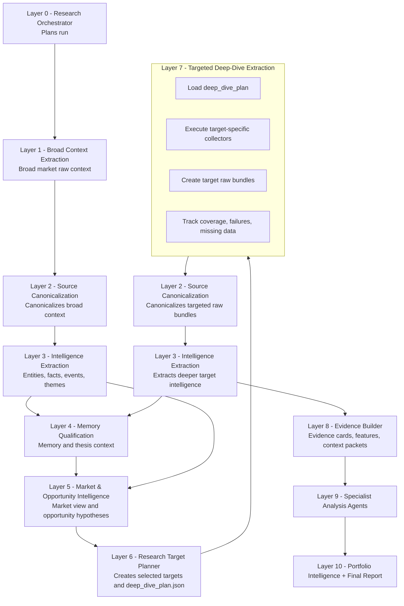

Below is the detailed implementation design for:

```text
Layer 7 — Targeted Deep-Dive Extraction
```

This layer is the execution layer that runs **after Layer 6 selects research targets**.

Layer 6 answers:

```text
What should we research deeply?
```

Layer 7 answers:

```text
What raw target-specific data do we need to collect for those selected targets?
```

Layer 7 does **not** decide what to buy. It does **not** analyze valuation. It does **not** generate final recommendations. It only collects deeper raw data for selected targets and sends that data back into the canonicalization/intelligence pipeline.

---

# 1. Layer 7 purpose

Layer 7 collects target-specific raw research data for selected targets.

It runs only after Layer 6 creates:

```text
deep_dive_plan.json
```

Layer 7’s job is to execute that plan.

It answers:

```text
Which selected targets need deeper data?
Which collector modules should run for each target?
What raw company, sector, macro, fund, ETF, REIT, private-company, or regional data was collected?
Which requested data was missing?
Which collectors failed?
Which outputs should be sent back to Layer 2 for canonicalization?
```

It should not answer:

```text
Is the stock undervalued?
Is this a buy/sell?
Is this event temporary or structural?
Which opportunity is best?
How much money should be invested?
```

Those belong later to:

```text
Layer 8 — Evidence Builder
Layer 9 — Specialist Analysis Agents
Layer 10 — Portfolio Intelligence + Final Report
```

---

# 2. Important clarification: Layer 1B vs Layer 7

Earlier we discussed **Layer 1B — Targeted Deep-Dive Extraction**. In the final architecture, it is cleaner to treat that as its own layer:

```text
Layer 1A = Broad Context Extraction
Layer 7  = Targeted Deep-Dive Extraction
```

So:

```text
Layer 1A collects broad market context before we know the targets.

Layer 6 decides what targets deserve deep dive.

Layer 7 collects target-specific raw data for those selected targets.
```

This avoids confusion.

---

# 3. Where Layer 7 sits in the full architecture



Key point:

```text
Layer 7 output goes back to Layer 2.

Why?

Because Layer 7 collects raw target-specific data, and all raw data must be canonicalized before intelligence extraction or evidence building.
```

---

# 4. Layer 7 internal architecture

```mermaid
flowchart TB

    IN["Input from Layer 6<br/>deep_dive_plan.json<br/>selected_research_targets.json"]

    subgraph L7["Layer 7 - Targeted Deep-Dive Extraction"]

        M1["layer7_runner.py<br/>Main execution controller"]

        M2["deep_dive_plan_loader.py<br/>Loads and validates deep_dive_plan"]

        M3["target_execution_context_builder.py<br/>Creates per-target execution context"]

        M4["target_task_expander.py<br/>Expands target modules into executable tasks"]

        M5["collector_registry_adapter.py<br/>Maps task module to actual collector"]

        M6["parameter_validator.py<br/>Validates ticker, target_id, URL, date range, depth"]

        M7["target_task_scheduler.py<br/>Runs tasks sequentially or in safe parallel"]

        M8["target_output_writer.py<br/>Writes raw outputs under target folders"]

        M9["target_source_record_builder.py<br/>Creates source records for each target output"]

        M10["target_extraction_status_tracker.py<br/>Tracks success, partial, failed, skipped"]

        M11["coverage_validator.py<br/>Checks whether deep-dive questions have enough raw coverage"]

        M12["missing_data_reporter.py<br/>Records unavailable data or failed collectors"]

        M13["target_raw_bundle_builder.py<br/>Builds target_raw_bundles.json"]

        M14["layer7_audit_logger.py<br/>Lineage and execution audit"]

        M15["post_collection_router.py<br/>Routes output back to Layer 2"]
    end

    subgraph TARGET_MODULES["Target-Specific Collector Groups"]
        G1["Type 1 - Listed Company Collectors"]
        G2["Type 2 - Private / Unlisted Collectors"]
        G3["Type 3 - Sector / Theme Collectors"]
        G4["Type 4 - Macro Target Collectors"]
        G5["Type 5 - Fund / ETF / REIT / InvIT Collectors"]
        G6["Type 6 - Commodity Collectors - Later"]
        G7["Type 7 - Real Estate / Regional Collectors - Later"]
    end

    OUT["Layer 7 Output<br/>target_raw_bundles.json<br/>target_source_records.json<br/>target_extraction_status.json<br/>coverage_report.json<br/>missing_data_report.json"]

    IN --> M1
    M1 --> M2
    M2 --> M3
    M3 --> M4
    M4 --> M5
    M5 --> M6
    M6 --> M7
    M7 --> TARGET_MODULES
    TARGET_MODULES --> M8
    M8 --> M9
    M9 --> M10
    M10 --> M11
    M11 --> M12
    M12 --> M13
    M13 --> M14
    M14 --> M15
    M15 --> OUT
```



---

# 5. Layer 7 high-level input

Layer 7 consumes the `deep_dive_plan.json` from Layer 6.

```json
{
  "research_run_id": "RUN_2026_05_09_AUTONOMOUS_DAILY_0800",
  "layer6_outputs": {
    "selected_research_targets_path": "output/2026-05-09/layer6/selected_research_targets.json",
    "deep_dive_plan_path": "output/2026-05-09/layer6/deep_dive_plan.json",
    "target_selection_audit_path": "output/2026-05-09/layer6/target_selection_audit.json"
  },
  "layer7_config": {
    "execution_mode": "standard",
    "max_parallel_targets": 3,
    "max_parallel_tasks_per_target": 4,
    "retry_failed_tasks": true,
    "allow_partial_target_bundle": true,
    "stop_on_critical_target_failure": false
  }
}
```

---

# 6. Layer 7 high-level output

Layer 7 produces raw target-specific bundles.

```json
{
  "research_run_id": "RUN_2026_05_09_AUTONOMOUS_DAILY_0800",
  "layer": "L7_targeted_deep_dive_extraction",
  "status": "success",
  "target_raw_bundles_path": "output/2026-05-09/layer7/target_raw_bundles.json",
  "target_source_records_path": "output/2026-05-09/layer7/target_source_records.json",
  "target_extraction_status_path": "output/2026-05-09/layer7/target_extraction_status.json",
  "coverage_report_path": "output/2026-05-09/layer7/coverage_report.json",
  "missing_data_report_path": "output/2026-05-09/layer7/missing_data_report.json",
  "next_layer_input": {
    "send_to_layer2": true,
    "raw_bundle_path": "output/2026-05-09/layer7/target_raw_bundles.json"
  }
}
```

---

# 7. Layer 7 output folder

```text
output/2026-05-09/layer7/
├── target_raw_bundles.json
├── target_source_records.json
├── target_extraction_status.json
├── coverage_report.json
├── missing_data_report.json
├── retry_report.json
├── layer7_audit_log.json
├── layer7_manifest.json
└── targets/
    ├── TARGET_20260509_0001_HDFCBANK/
    │   ├── market_data.json
    │   ├── price_history.json
    │   ├── screener_in.json
    │   ├── peer_comparison.json
    │   ├── analyst_estimates.json
    │   ├── exchange_filings.json
    │   ├── filing_docs.json
    │   ├── corporate_actions.json
    │   ├── targeted_news.json
    │   └── target_bundle.json
    │
    ├── TARGET_20260509_0002_AI_POWER_THEME/
    │   ├── sector_theme_research.json
    │   ├── targeted_news.json
    │   ├── related_companies_raw.json
    │   └── target_bundle.json
    │
    └── TARGET_20260509_0003_OPENAI_PROXY/
        ├── private_company_research.json
        ├── targeted_news.json
        ├── proxy_context_raw.json
        └── target_bundle.json
```

---

# 8. What Layer 7 produces

Layer 7 produces:

```text
1. target_raw_bundles.json
2. target_source_records.json
3. target_extraction_status.json
4. coverage_report.json
5. missing_data_report.json
6. layer7_audit_log.json
```

Most important file:

```text
target_raw_bundles.json
```

This is sent to Layer 2 for canonicalization.

---

# 9. Recommended folder structure

```text
targeted_deep_dive_layer/
├── layer7_runner.py
├── deep_dive_plan_loader.py
├── target_execution_context_builder.py
├── target_task_expander.py
├── collector_registry_adapter.py
├── parameter_validator.py
├── target_task_scheduler.py
├── target_output_writer.py
├── target_source_record_builder.py
├── target_extraction_status_tracker.py
├── coverage_validator.py
├── missing_data_reporter.py
├── target_raw_bundle_builder.py
├── layer7_audit_logger.py
├── post_collection_router.py
│
├── collectors/
│   ├── listed_company/
│   │   ├── market_data.py
│   │   ├── price_history.py
│   │   ├── screener_in.py
│   │   ├── peer_comparison.py
│   │   ├── analyst_estimates.py
│   │   ├── exchange_filings.py
│   │   ├── filing_docs.py
│   │   ├── corporate_actions.py
│   │   ├── stock_fno_data.py
│   │   ├── sec_filings.py
│   │   └── targeted_news.py
│   │
│   ├── private_unlisted/
│   │   ├── private_company_research.py
│   │   ├── private_company_news.py
│   │   ├── partnership_supplier_context.py
│   │   ├── funding_ipo_signal_collector.py
│   │   └── proxy_context_collector.py
│   │
│   ├── sector_theme/
│   │   ├── sector_theme_research.py
│   │   ├── sector_news_collector.py
│   │   ├── sector_index_snapshot.py
│   │   ├── sector_constituent_snapshot.py
│   │   └── theme_policy_doc_collector.py
│   │
│   ├── macro/
│   │   ├── macro_series_expander.py
│   │   ├── policy_document_collector.py
│   │   ├── central_bank_event_collector.py
│   │   └── rate_fx_commodity_snapshot.py
│   │
│   ├── funds_vehicles/
│   │   ├── fund_facts_collector.py
│   │   ├── holdings_exposure_collector.py
│   │   ├── nav_performance_collector.py
│   │   └── fees_aum_liquidity_collector.py
│   │
│   ├── commodities_later/
│   │   ├── commodity_price_history.py
│   │   ├── supply_demand_news.py
│   │   └── producer_consumer_context.py
│   │
│   └── real_estate_later/
│       ├── regional_policy_news.py
│       ├── infrastructure_project_docs.py
│       ├── location_growth_context.py
│       └── listed_proxy_context.py
```

---

# 10. Core Layer 7 service modules

## 10.1 `layer7_runner.py`

### Purpose

Main controller for Layer 7.

### Why important

It executes the selected target plan created by Layer 6.

### Questions it answers

```text
Which targets should be deep-dived?
Which tasks should run for each target?
Which collectors succeeded or failed?
Which target bundles are complete or partial?
What output should be sent to Layer 2?
```

### Input

```json
{
  "research_run_id": "RUN_2026_05_09_AUTONOMOUS_DAILY_0800",
  "deep_dive_plan_path": "output/2026-05-09/layer6/deep_dive_plan.json"
}
```

### Logic

```text
Load deep_dive_plan.
Validate target list and module list.
Build execution context for each target.
Expand target modules into executable collector tasks.
Execute collectors.
Write raw outputs.
Create target source records.
Track status.
Build target raw bundles.
Create coverage and missing-data reports.
Route output to Layer 2.
```

### Output

```json
{
  "status": "success",
  "targets_processed": 10,
  "targets_success": 7,
  "targets_partial": 3,
  "targets_failed": 0,
  "collector_tasks_created": 72,
  "collector_tasks_success": 61,
  "collector_tasks_failed": 8,
  "collector_tasks_skipped": 3,
  "target_raw_bundles_path": "output/2026-05-09/layer7/target_raw_bundles.json"
}
```

---

## 10.2 `deep_dive_plan_loader.py`

### Purpose

Load and validate the Layer 6 deep-dive plan.

### Input

```json
{
  "deep_dive_plan_path": "output/2026-05-09/layer6/deep_dive_plan.json"
}
```

### Logic

```text
Check file exists.
Validate deep_dive_plan_id.
Validate each target has target_id, target_type, priority_score, modules_to_run.
Validate modules_to_run is not empty.
Validate ticker exists only when required.
Validate supporting_refs exist.
```

### Output

```json
{
  "plan_loaded": true,
  "deep_dive_plan_id": "DDPLAN_20260509_0001",
  "target_count": 10,
  "task_count": 72,
  "validation_errors": []
}
```

---

## 10.3 `target_execution_context_builder.py`

### Purpose

Create a per-target execution context.

### Why important

Each target needs target metadata attached to every collector output for traceability.

### Input

```json
{
  "target_id": "TARGET_20260509_0001",
  "target_name": "HDFC Bank",
  "target_type": "listed_company",
  "ticker": "HDFCBANK.NS",
  "priority_score": 82,
  "deep_dive_depth": "deep",
  "questions_to_answer": [
    "Is margin pressure temporary or structural?",
    "What is latest NIM trend?"
  ],
  "modules_to_run": []
}
```

### Output

```json
{
  "target_execution_context": {
    "target_id": "TARGET_20260509_0001",
    "target_name": "HDFC Bank",
    "target_type": "listed_company",
    "ticker": "HDFCBANK.NS",
    "market": "india",
    "deep_dive_depth": "deep",
    "target_output_dir": "output/2026-05-09/layer7/targets/TARGET_20260509_0001_HDFCBANK",
    "source_opportunity_ids": ["OPP_001"],
    "questions_to_answer": []
  }
}
```

---

## 10.4 `target_task_expander.py`

### Purpose

Expand selected target modules into executable task records.

### Input

```json
{
  "target_id": "TARGET_20260509_0001",
  "modules_to_run": [
    {
      "module": "market_data",
      "params": {
        "ticker": "HDFCBANK.NS"
      }
    }
  ]
}
```

### Logic

```text
For each target:
    For each module:
        create task_id
        attach target_id
        attach collector function
        attach output path
        attach criticality
        attach retry policy
```

### Output

```json
{
  "target_tasks": [
    {
      "task_id": "DD_HDFCBANK_MARKET_DATA",
      "target_id": "TARGET_20260509_0001",
      "target_type": "listed_company",
      "module": "market_data",
      "function": "save_market_snapshot",
      "params": {
        "ticker": "HDFCBANK.NS"
      },
      "output_path": "output/2026-05-09/layer7/targets/TARGET_20260509_0001_HDFCBANK/market_data.json",
      "criticality": "high",
      "retryable": true
    }
  ]
}
```

---

## 10.5 `collector_registry_adapter.py`

### Purpose

Map Layer 7 task module names to actual collector implementations.

### Why important

You already have many collectors. Layer 7 should reuse them rather than rewriting them.

### Registry example

```python
COLLECTOR_REGISTRY = {
    "market_data": {
        "module_path": "context_ext_layer.phaseC_CDD.market_data",
        "function": "save_market_snapshot"
    },
    "price_history": {
        "module_path": "context_ext_layer.phaseC_CDD.price_history",
        "function": "save_price_history"
    },
    "screener_in": {
        "module_path": "context_ext_layer.phaseC_CDD.screener_in",
        "function": "save_company_fundamentals"
    },
    "peer_comparison": {
        "module_path": "context_ext_layer.phaseC_CDD.peer_comparison",
        "function": "save_peer_comparison"
    },
    "analyst_estimates": {
        "module_path": "context_ext_layer.phaseC_CDD.analyst_estimates",
        "function": "save_analyst_estimates"
    },
    "exchange_filings": {
        "module_path": "context_ext_layer.phaseC_CDD.exchange_filings",
        "function": "save_exchange_filings"
    },
    "filing_docs": {
        "module_path": "context_ext_layer.phaseC_CDD.filing_docs",
        "function": "save_filing_docs"
    },
    "corporate_actions": {
        "module_path": "context_ext_layer.phaseC_CDD.corporate_actions",
        "function": "save_corporate_actions"
    },
    "sec_filings": {
        "module_path": "context_ext_layer.phaseC_CDD.sec_filings",
        "function": "save_sec_filings"
    }
}
```

### Output

```json
{
  "task_id": "DD_HDFCBANK_MARKET_DATA",
  "collector_found": true,
  "module_path": "context_ext_layer.phaseC_CDD.market_data",
  "function": "save_market_snapshot"
}
```

---

## 10.6 `parameter_validator.py`

### Purpose

Validate collector parameters before execution.

### Why important

Prevents invalid calls like:

```text
Run screener_in without ticker.
Run SEC filings for Indian ticker.
Run listed-company collectors for private company.
Run F&O collector for non-F&O eligible target.
```

### Input

```json
{
  "task_id": "DD_HDFCBANK_SCREENER",
  "module": "screener_in",
  "params": {
    "ticker": "HDFCBANK"
  },
  "target_type": "listed_company"
}
```

### Logic

```text
Validate required params by module.
Validate target type compatibility.
Validate ticker format.
Validate date ranges.
Validate optional params.
If invalid but non-critical:
    skip task and record reason.
If invalid and critical:
    fail target or require review.
```

### Output

```json
{
  "task_id": "DD_HDFCBANK_SCREENER",
  "valid": true,
  "warnings": [],
  "errors": []
}
```

---

## 10.7 `target_task_scheduler.py`

### Purpose

Execute target tasks safely.

### Logic

```text
Group tasks by target.
Run independent tasks in safe parallel.
Respect API limits.
Retry retryable failures.
Do not stop the full run for one non-critical failure.
Stop target only if all critical modules fail.
```

### Output

```json
{
  "tasks_executed": 72,
  "success": 61,
  "partial": 3,
  "failed": 8,
  "skipped": 3
}
```

---

## 10.8 `target_output_writer.py`

### Purpose

Write each raw collector output into the target folder.

### Output example

```json
{
  "task_id": "DD_HDFCBANK_MARKET_DATA",
  "target_id": "TARGET_20260509_0001",
  "module": "market_data",
  "output_path": "output/2026-05-09/layer7/targets/TARGET_20260509_0001_HDFCBANK/market_data.json",
  "record_count": 1,
  "status": "success"
}
```

---

## 10.9 `target_source_record_builder.py`

### Purpose

Create source records for each target-specific raw output.

### Why important

Layer 2 needs source records to canonicalize and trace data.

### Output

```json
{
  "target_source_record_id": "TSRCREC_20260509_HDFCBANK_MARKET_DATA",
  "research_run_id": "RUN_2026_05_09_AUTONOMOUS_DAILY_0800",
  "layer": "L7",
  "target_id": "TARGET_20260509_0001",
  "target_type": "listed_company",
  "target_name": "HDFC Bank",
  "ticker": "HDFCBANK.NS",
  "module": "market_data",
  "source_type": "market_snapshot",
  "raw_output_path": "output/2026-05-09/layer7/targets/TARGET_20260509_0001_HDFCBANK/market_data.json",
  "record_count": 1,
  "collected_at": "2026-05-09T12:20:00+05:30",
  "status": "success",
  "content_type": "structured_json",
  "freshness_type": "live_or_recent_snapshot",
  "requires_history_sync": false,
  "lineage": {
    "deep_dive_plan_id": "DDPLAN_20260509_0001",
    "source_opportunity_ids": ["OPP_001"]
  }
}
```

---

## 10.10 `target_extraction_status_tracker.py`

### Purpose

Track status per target and per module.

### Output

```json
{
  "target_id": "TARGET_20260509_0001",
  "target_name": "HDFC Bank",
  "target_status": "partial_success",
  "modules": [
    {
      "module": "market_data",
      "status": "success",
      "record_count": 1
    },
    {
      "module": "filing_docs",
      "status": "failed",
      "error": "No transcript found"
    }
  ],
  "critical_failures": [],
  "non_critical_failures": ["filing_docs"],
  "can_continue_to_layer2": true
}
```

---

## 10.11 `coverage_validator.py`

### Purpose

Check whether Layer 7 collected enough raw data to answer Layer 6’s research questions.

### Important

This is not analysis. It only checks **coverage**.

Example question from Layer 6:

```text
What does management say about NIM pressure?
```

Coverage validator checks:

```text
Did filing_docs or transcript collector return text?
```

It does not interpret the transcript.

### Input

```json
{
  "target_id": "TARGET_20260509_0001",
  "questions_to_answer": [
    "Is margin pressure temporary or structural?",
    "What does management say in latest concall?"
  ],
  "module_status": []
}
```

### Output

```json
{
  "target_id": "TARGET_20260509_0001",
  "coverage_status": "partial",
  "question_coverage": [
    {
      "question": "Is margin pressure temporary or structural?",
      "coverage": "partial",
      "available_modules": ["screener_in", "analyst_estimates"],
      "missing_modules": ["filing_docs"],
      "notes": "No transcript was available, so management commentary coverage is missing."
    },
    {
      "question": "Is valuation attractive relative to peers?",
      "coverage": "available",
      "available_modules": ["peer_comparison", "market_data", "screener_in"]
    }
  ]
}
```

---

## 10.12 `missing_data_reporter.py`

### Purpose

Record missing/unavailable target data.

### Output

```json
{
  "missing_data_items": [
    {
      "target_id": "TARGET_20260509_0001",
      "module": "filing_docs",
      "missing_data_type": "concall_transcript",
      "reason": "No recent transcript found from source",
      "impact": "Management commentary gap",
      "next_action": "try alternate source or mark gap for Layer 8/9"
    }
  ]
}
```

---

## 10.13 `target_raw_bundle_builder.py`

### Purpose

Build final raw bundle per target and full Layer 7 bundle.

### Output

```json
{
  "research_run_id": "RUN_2026_05_09_AUTONOMOUS_DAILY_0800",
  "layer": "L7_targeted_deep_dive_extraction",
  "created_at": "2026-05-09T12:45:00+05:30",
  "target_raw_bundles": [
    {
      "target_id": "TARGET_20260509_0001",
      "target_name": "HDFC Bank",
      "target_type": "listed_company",
      "ticker": "HDFCBANK.NS",
      "target_status": "partial_success",
      "raw_outputs": {
        "market_data": "output/.../market_data.json",
        "price_history": "output/.../price_history.json",
        "screener_in": "output/.../screener_in.json",
        "peer_comparison": "output/.../peer_comparison.json",
        "analyst_estimates": "output/.../analyst_estimates.json",
        "exchange_filings": "output/.../exchange_filings.json",
        "filing_docs": null,
        "corporate_actions": "output/.../corporate_actions.json"
      },
      "source_records": [],
      "coverage_status": "partial",
      "missing_data": []
    }
  ]
}
```

---

## 10.14 `post_collection_router.py`

### Purpose

Prepare Layer 7 output as input for Layer 2.

### Output

```json
{
  "next_layer": "Layer 2 - Source Canonicalization",
  "layer2_input": {
    "research_run_id": "RUN_2026_05_09_AUTONOMOUS_DAILY_0800",
    "raw_context_bundle_path": "output/2026-05-09/layer7/target_raw_bundles.json",
    "raw_source_records_path": "output/2026-05-09/layer7/target_source_records.json",
    "collection_status_path": "output/2026-05-09/layer7/target_extraction_status.json",
    "canonicalization_scope": {
      "include_targeted_context": true,
      "include_broad_context": false
    }
  }
}
```

---

# 11. Target type 1 — Listed company deep-dive collectors

This is the part your current repo mostly already supports.

## Type 1 purpose

Collect raw data needed for company-level stock research.

It should answer:

```text
What is the current market price context?
How has the stock behaved historically?
What are the company fundamentals?
How does it compare with peers?
What do analysts expect?
What has the company officially disclosed?
What does management say?
What capital actions happened?
Is there F&O activity?
```

---

## 11.1 `market_data.py`

### Purpose

Fetch current price snapshot.

### Input

```json
{
  "target_id": "TARGET_20260509_0001",
  "ticker": "HDFCBANK.NS"
}
```

### Logic

```text
Fetch quote snapshot.
Save price, day change, volume, market cap, 52-week high/low, sector, industry.
No interpretation.
```

### Output

```json
{
  "target_id": "TARGET_20260509_0001",
  "ticker": "HDFCBANK.NS",
  "fetched_at": "",
  "price": 0,
  "day_change_pct": 0,
  "volume": 0,
  "market_cap": 0,
  "fifty_two_week_high": 0,
  "fifty_two_week_low": 0,
  "sector": "",
  "industry": ""
}
```

---

## 11.2 `price_history.py`

### Purpose

Fetch OHLCV history.

### Input

```json
{
  "target_id": "TARGET_20260509_0001",
  "ticker": "HDFCBANK.NS",
  "period": "1y",
  "interval": "1d"
}
```

### Logic

```text
Fetch historical price rows.
Save raw OHLCV data.
No trend analysis here.
```

### Output

```json
{
  "target_id": "TARGET_20260509_0001",
  "ticker": "HDFCBANK.NS",
  "period": "1y",
  "interval": "1d",
  "history": [
    {
      "date": "",
      "open": 0,
      "high": 0,
      "low": 0,
      "close": 0,
      "volume": 0
    }
  ]
}
```

---

## 11.3 `screener_in.py`

### Purpose

Fetch Indian listed-company fundamentals.

### Input

```json
{
  "target_id": "TARGET_20260509_0001",
  "ticker": "HDFCBANK",
  "screener_url": "https://www.screener.in/company/HDFCBANK/"
}
```

### Logic

```text
Extract company description, key ratios, pros/cons, quarterly results, P&L, balance sheet, cash flow, ratios, growth metrics, and shareholding.
No business-quality scoring here.
```

### Output

```json
{
  "target_id": "TARGET_20260509_0001",
  "company_name": "",
  "description": "",
  "key_ratios": {},
  "pros": [],
  "cons": [],
  "quarterly_results": [],
  "profit_loss": [],
  "balance_sheet": [],
  "cash_flow": [],
  "ratios": [],
  "growth_metrics": {},
  "shareholding_quarterly": [],
  "shareholding_yearly": []
}
```

---

## 11.4 `peer_comparison.py`

### Purpose

Fetch peer data.

### Input

```json
{
  "target_id": "TARGET_20260509_0001",
  "ticker": "HDFCBANK.NS",
  "max_peers": 15
}
```

### Logic

```text
Identify sector/index peers.
Fetch raw peer metrics.
Save target and peer data.
No valuation judgment here.
```

### Output

```json
{
  "target_id": "TARGET_20260509_0001",
  "ticker": "HDFCBANK.NS",
  "sector_index": "NIFTY BANK",
  "target": {},
  "peers": []
}
```

---

## 11.5 `analyst_estimates.py`

### Purpose

Fetch analyst targets and estimate revisions.

### Input

```json
{
  "target_id": "TARGET_20260509_0001",
  "ticker": "HDFCBANK.NS"
}
```

### Logic

```text
Fetch price targets, earnings estimates, revenue estimates, earnings history, recommendations, EPS trend, EPS revisions.
No bullish/bearish conclusion here.
```

### Output

```json
{
  "target_id": "TARGET_20260509_0001",
  "ticker": "HDFCBANK.NS",
  "price_targets": {},
  "earnings_estimates": {},
  "revenue_estimates": {},
  "earnings_history": [],
  "recommendations": [],
  "eps_trend": {},
  "eps_revisions": {}
}
```

---

## 11.6 `exchange_filings.py`

### Purpose

Fetch official corporate announcements.

### Input

```json
{
  "target_id": "TARGET_20260509_0001",
  "ticker": "HDFCBANK",
  "limit": 50,
  "material_only": true
}
```

### Logic

```text
Fetch exchange announcements.
Save date, subject, category, attachment URL, XBRL flag.
No event interpretation here.
```

### Output

```json
{
  "target_id": "TARGET_20260509_0001",
  "ticker": "HDFCBANK",
  "announcements": [
    {
      "date": "",
      "subject": "",
      "category": "",
      "attachment_url": "",
      "has_xbrl": false
    }
  ]
}
```

---

## 11.7 `filing_docs.py`

### Purpose

Fetch concall transcripts and investor presentations.

### Input

```json
{
  "target_id": "TARGET_20260509_0001",
  "ticker": "HDFCBANK",
  "transcripts": 4,
  "presentations": 2
}
```

### Logic

```text
Find relevant filing documents.
Download or extract text if available.
Save raw transcript and presentation text.
No summarization here.
```

### Output

```json
{
  "target_id": "TARGET_20260509_0001",
  "ticker": "HDFCBANK",
  "transcripts": [
    {
      "date": "",
      "subject": "",
      "pdf_url": "",
      "text": ""
    }
  ],
  "presentations": [
    {
      "date": "",
      "subject": "",
      "pdf_url": "",
      "text": ""
    }
  ]
}
```

---

## 11.8 `corporate_actions.py`

### Purpose

Fetch dividends, splits, bonuses, rights, buybacks.

### Input

```json
{
  "target_id": "TARGET_20260509_0001",
  "ticker": "HDFCBANK.NS"
}
```

### Output

```json
{
  "target_id": "TARGET_20260509_0001",
  "ticker": "HDFCBANK.NS",
  "nse_actions": [],
  "yf_dividends": [],
  "yf_splits": []
}
```

---

## 11.9 `stock_fno_data.py`

### Purpose

Fetch stock-level F&O data if eligible.

### Input

```json
{
  "target_id": "TARGET_20260509_0001",
  "ticker": "HDFCBANK.NS"
}
```

### Logic

```text
Check F&O eligibility.
Fetch option-chain data if available.
Save full chain and source-level values.
Do not interpret sentiment.
```

### Output

```json
{
  "target_id": "TARGET_20260509_0001",
  "ticker": "HDFCBANK.NS",
  "fno_available": true,
  "underlying_value": 0,
  "pcr": 0,
  "max_pain": 0,
  "atm_iv": {},
  "top_oi_strikes": {},
  "option_chain": []
}
```

---

## 11.10 `sec_filings.py`

### Purpose

Fetch SEC filings for US companies.

### Input

```json
{
  "target_id": "TARGET_US_0001",
  "ticker": "AAPL",
  "fetch_financials": true,
  "fetch_filings": true,
  "fetch_texts": false
}
```

### Output

```json
{
  "target_id": "TARGET_US_0001",
  "ticker": "AAPL",
  "cik": "",
  "company_name": "",
  "key_financials": {},
  "recent_filings": {},
  "filing_texts": []
}
```

---

## 11.11 `targeted_news.py`

### Purpose

Fetch target-specific recent news.

### Input

```json
{
  "target_id": "TARGET_20260509_0001",
  "target_name": "HDFC Bank",
  "ticker": "HDFCBANK.NS",
  "queries": [
    "HDFC Bank margin pressure latest",
    "HDFC Bank NIM management commentary",
    "HDFC Bank Q4 results margin"
  ],
  "days_back": 30,
  "max_results": 20
}
```

### Output

```json
{
  "target_id": "TARGET_20260509_0001",
  "queries": [],
  "articles": [
    {
      "title": "",
      "url": "",
      "published_at": "",
      "source": "",
      "description": "",
      "body": ""
    }
  ]
}
```

---

# 12. Target type 2 — Private / unlisted company deep dive

## Purpose

Collect raw context for entities without a public ticker.

Examples:

```text
OpenAI
Zepto
Perplexity
SpaceX
private suppliers
IPO candidates
startup trends
```

Layer 7 should not force these into stocks. It should collect raw context and allow later layers to map them to listed proxies, sectors, funds, or watch memory.

---

## 12.1 `private_company_research.py`

### Input

```json
{
  "target_id": "TARGET_OPENAI_001",
  "entity_name": "OpenAI",
  "target_type": "private_unlisted_company",
  "linked_themes": ["AI data center demand"],
  "queries": [
    "OpenAI data center demand",
    "OpenAI Microsoft cloud infrastructure",
    "OpenAI Nvidia chips"
  ]
}
```

### Logic

```text
Collect raw news and public web context.
Collect company profile context if available.
Collect major partnerships, funding, IPO signals, customers, suppliers.
Do not infer investment conclusion.
```

### Output

```json
{
  "target_id": "TARGET_OPENAI_001",
  "entity_name": "OpenAI",
  "target_type": "private_unlisted_company",
  "raw_articles": [],
  "profile_pages": [],
  "partnership_mentions": [],
  "funding_or_ipo_mentions": [],
  "source_queries": []
}
```

---

## 12.2 `partnership_supplier_context.py`

### Purpose

Collect raw references to suppliers, partners, customers, and competitors.

### Output

```json
{
  "target_id": "TARGET_OPENAI_001",
  "entity_name": "OpenAI",
  "relationship_context": [
    {
      "related_entity": "Microsoft",
      "relationship_type": "partner",
      "source_url": "",
      "raw_text": ""
    },
    {
      "related_entity": "Nvidia",
      "relationship_type": "supplier_or_infrastructure",
      "source_url": "",
      "raw_text": ""
    }
  ]
}
```

---

## 12.3 `proxy_context_collector.py`

### Purpose

Collect raw data around possible listed proxies identified by Layer 6.

### Input

```json
{
  "target_id": "TARGET_OPENAI_PROXY_001",
  "source_entity": "OpenAI",
  "proxy_candidates": [
    {
      "name": "Microsoft",
      "ticker": "MSFT"
    },
    {
      "name": "Nvidia",
      "ticker": "NVDA"
    }
  ]
}
```

### Output

```json
{
  "target_id": "TARGET_OPENAI_PROXY_001",
  "proxy_context": [
    {
      "proxy_name": "Microsoft",
      "ticker": "MSFT",
      "raw_articles": [],
      "relationship_sources": []
    }
  ]
}
```

---

# 13. Target type 3 — Sector / theme deep dive

## Purpose

Collect raw data for sector or theme opportunities.

Examples:

```text
banking margin pressure
AI data center power demand
semiconductor manufacturing
renewable energy capex
industrial corridor logistics
EV battery supply chain
```

---

## 13.1 `sector_theme_research.py`

### Input

```json
{
  "target_id": "TARGET_THEME_001",
  "theme": "AI data center power demand",
  "market": "india",
  "related_sectors": ["power", "electrical equipment", "data centers"],
  "queries": [
    "India data center power demand",
    "AI data center electricity demand India",
    "Indian power companies data center demand"
  ]
}
```

### Logic

```text
Collect raw sector/theme articles.
Collect raw reports if open and accessible.
Collect related sector mentions.
Collect possible listed company mentions.
Do not decide final beneficiaries.
```

### Output

```json
{
  "target_id": "TARGET_THEME_001",
  "theme": "AI data center power demand",
  "raw_sector_articles": [],
  "raw_reports": [],
  "related_sectors": [],
  "related_company_mentions": [],
  "source_queries": []
}
```

---

## 13.2 `sector_index_snapshot.py`

### Purpose

Collect raw sector index data if available.

### Input

```json
{
  "target_id": "TARGET_BANKING_THEME_001",
  "sector_index": "NIFTY BANK"
}
```

### Output

```json
{
  "target_id": "TARGET_BANKING_THEME_001",
  "sector_index": "NIFTY BANK",
  "fetched_at": "",
  "index_snapshot": {},
  "constituents": []
}
```

---

## 13.3 `sector_constituent_snapshot.py`

### Purpose

Collect raw list of possible listed companies in a sector/theme.

### Input

```json
{
  "target_id": "TARGET_AI_POWER_THEME_001",
  "related_sectors": ["power", "electrical equipment"]
}
```

### Output

```json
{
  "target_id": "TARGET_AI_POWER_THEME_001",
  "related_sectors": ["power", "electrical equipment"],
  "possible_constituents": [
    {
      "company_name": "",
      "ticker": "",
      "sector": "",
      "source": ""
    }
  ]
}
```

---

## 13.4 `theme_policy_doc_collector.py`

### Purpose

Collect raw policy documents or official context linked to a theme.

### Input

```json
{
  "target_id": "TARGET_SEMICON_POLICY_001",
  "theme": "India semiconductor manufacturing policy",
  "queries": [
    "India semiconductor policy official document",
    "India semiconductor mission policy"
  ]
}
```

### Output

```json
{
  "target_id": "TARGET_SEMICON_POLICY_001",
  "theme": "India semiconductor manufacturing policy",
  "policy_documents": [
    {
      "title": "",
      "url": "",
      "source": "",
      "raw_text": ""
    }
  ]
}
```

---

# 14. Target type 4 — Macro target deep dive

## Purpose

Collect deeper macro context for market regime or sector sensitivity.

Examples:

```text
RBI rate cut expectation
Fed pivot
inflation trend
USD/INR movement
bond yields
crude oil shock
```

---

## 14.1 `macro_series_expander.py`

### Input

```json
{
  "target_id": "TARGET_MACRO_RBI_001",
  "macro_theme": "RBI rate cut expectation",
  "series": ["repo_rate", "cpi", "bond_yield", "usd_inr", "banking_index"],
  "lookback": "2y"
}
```

### Output

```json
{
  "target_id": "TARGET_MACRO_RBI_001",
  "macro_theme": "RBI rate cut expectation",
  "series_data": {
    "repo_rate": [],
    "cpi": [],
    "bond_yield": [],
    "usd_inr": []
  }
}
```

---

## 14.2 `policy_document_collector.py`

### Purpose

Collect official macro/policy documents.

### Input

```json
{
  "target_id": "TARGET_MACRO_RBI_001",
  "policy_source": "RBI",
  "document_types": ["monetary_policy_statement", "minutes", "press_release"]
}
```

### Output

```json
{
  "target_id": "TARGET_MACRO_RBI_001",
  "policy_documents": [
    {
      "title": "",
      "url": "",
      "published_at": "",
      "raw_text": ""
    }
  ]
}
```

---

## 14.3 `rate_fx_commodity_snapshot.py`

### Purpose

Collect rates, currency, and commodity snapshots relevant to macro target.

### Output

```json
{
  "target_id": "TARGET_MACRO_RBI_001",
  "rates": {},
  "fx": {},
  "commodities": {},
  "fetched_at": ""
}
```

---

# 15. Target type 5 — Fund / ETF / REIT / InvIT deep dive

## Purpose

Collect raw data about investable vehicles.

Examples:

```text
Nifty ETF
Bank ETF
sector mutual fund
REIT
InvIT
infrastructure fund
gold ETF
```

This matters because some opportunities are better expressed through a basket, not a single stock.

---

## 15.1 `fund_facts_collector.py`

### Input

```json
{
  "target_id": "TARGET_ETF_001",
  "vehicle_category": "Nifty 50 ETF",
  "market": "india"
}
```

### Output

```json
{
  "target_id": "TARGET_ETF_001",
  "vehicle_category": "Nifty 50 ETF",
  "fund_candidates": [
    {
      "name": "",
      "ticker_or_symbol": "",
      "issuer": "",
      "aum": null,
      "expense_ratio": null,
      "source_url": ""
    }
  ]
}
```

---

## 15.2 `holdings_exposure_collector.py`

### Purpose

Collect fund/ETF holdings or sector exposure.

### Output

```json
{
  "target_id": "TARGET_ETF_001",
  "vehicle_name": "",
  "holdings": [],
  "sector_exposure": [],
  "source_url": ""
}
```

---

## 15.3 `nav_performance_collector.py`

### Purpose

Collect NAV/price history and performance.

### Output

```json
{
  "target_id": "TARGET_ETF_001",
  "vehicle_name": "",
  "nav_history": [],
  "price_history": [],
  "performance": {}
}
```

---

## 15.4 `fees_aum_liquidity_collector.py`

### Purpose

Collect fees, AUM, liquidity, expense ratio.

### Output

```json
{
  "target_id": "TARGET_ETF_001",
  "vehicle_name": "",
  "aum": null,
  "expense_ratio": null,
  "avg_volume": null,
  "tracking_error": null,
  "source_url": ""
}
```

---

# 16. Target type 6 — Commodity deep dive later

## Purpose

Collect raw commodity context.

Examples:

```text
crude oil
gold
copper
lithium
natural gas
steel
cement input costs
```

Implement later.

### Output schema

```json
{
  "target_id": "TARGET_COMMODITY_001",
  "commodity": "copper",
  "price_history": [],
  "supply_demand_news": [],
  "related_producers": [],
  "related_consumers": []
}
```

---

# 17. Target type 7 — Real estate / regional opportunity later

## Purpose

Collect raw context for regional growth or real estate themes.

Examples:

```text
industrial corridor
new airport
metro expansion
logistics hub
IT park
manufacturing zone
```

Implement later, but design now.

### Output schema

```json
{
  "target_id": "TARGET_REGION_001",
  "region_or_project": "Industrial corridor",
  "policy_documents": [],
  "infrastructure_project_sources": [],
  "regional_news": [],
  "listed_proxy_context": [],
  "reit_invit_context": []
}
```

Layer 7 should only collect raw context. Later layers decide whether this becomes a real investment opportunity.

---

# 18. Target raw bundle schema

Every target should produce a consistent raw bundle.

```json
{
  "target_id": "TARGET_20260509_0001",
  "target_name": "HDFC Bank",
  "target_type": "listed_company",
  "ticker": "HDFCBANK.NS",
  "market": "india",
  "deep_dive_depth": "deep",
  "source_opportunity_ids": ["OPP_001"],

  "why_selected": [
    "Recurring banking margin pressure theme",
    "High source diversity",
    "Deep dive needed to determine temporary vs structural impact"
  ],

  "questions_to_answer": [
    "Is margin pressure temporary or structural?",
    "What is latest NIM trend?",
    "What does management say?",
    "Is valuation attractive relative to peers?"
  ],

  "raw_outputs": [
    {
      "module": "market_data",
      "status": "success",
      "raw_output_path": "output/.../market_data.json",
      "record_count": 1
    },
    {
      "module": "filing_docs",
      "status": "failed",
      "raw_output_path": null,
      "record_count": 0,
      "error": "No transcript found"
    }
  ],

  "coverage_status": "partial",
  "missing_data": [
    {
      "module": "filing_docs",
      "reason": "No recent transcript found",
      "impact": "management commentary unavailable"
    }
  ],

  "created_at": "2026-05-09T12:45:00+05:30"
}
```

---

# 19. Layer 7 status format

```json
{
  "target_id": "TARGET_20260509_0001",
  "target_name": "HDFC Bank",
  "target_type": "listed_company",
  "target_status": "success | partial_success | failed | skipped",
  "modules_requested": 8,
  "modules_success": 6,
  "modules_failed": 1,
  "modules_skipped": 1,
  "critical_modules_failed": [],
  "can_continue_to_layer2": true,
  "can_continue_to_layer8_after_canonicalization": true
}
```

---

# 20. Layer 7 quality and coverage report

```json
{
  "research_run_id": "RUN_2026_05_09_AUTONOMOUS_DAILY_0800",
  "targets_requested": 10,
  "targets_success": 7,
  "targets_partial": 3,
  "targets_failed": 0,
  "coverage_by_target": [
    {
      "target_id": "TARGET_20260509_0001",
      "target_name": "HDFC Bank",
      "coverage_status": "partial",
      "covered_questions": 3,
      "total_questions": 4,
      "missing_critical_data": ["management commentary"]
    }
  ],
  "common_failures": [
    {
      "module": "filing_docs",
      "count": 3,
      "reason": "No transcript found or PDF extraction failed"
    }
  ],
  "data_completeness_score": 0.81
}
```

---

# 21. What Layer 7 should not do

Layer 7 should not:

```text
interpret news
classify event impact
score valuation
rank opportunities
select targets
make buy/sell decisions
write final report
create evidence cards
create vector embeddings
update thesis memory
```

Layer 7 only collects raw target-specific data.

---

# 22. Hallucination control in Layer 7

Layer 7 helps hallucination control by preserving source lineage.

Rules:

```text
Every raw output must have target_id.
Every raw output must have module name.
Every raw output must have raw_output_path.
Every source should record URL/source name if available.
No collector should create conclusions.
No collector should rewrite facts into analysis.
Failed collectors must be reported, not hidden.
Missing data must become explicit data gaps.
```

This is important because later agents must know:

```text
What evidence exists?
What evidence is missing?
Which conclusions are impossible because data was unavailable?
```

---

# 23. What is already implemented vs missing

## Already mostly implemented

Your existing Phase C modules already cover most of Type 1 listed-company deep dive:

```text
market_data
price_history
screener_in
peer_comparison
analyst_estimates
exchange_filings
filing_docs
corporate_actions
sec_filings
F&O data
```

So for listed-company extraction, your system is already strong.

## Missing or needs improvement

You need to add Layer 7 orchestration around those collectors:

```text
layer7_runner.py
deep_dive_plan_loader.py
target_execution_context_builder.py
target_task_expander.py
target_source_record_builder.py
target_extraction_status_tracker.py
coverage_validator.py
target_raw_bundle_builder.py
post_collection_router.py
```

You also need new collectors for non-stock opportunity types:

```text
private_company_research.py
sector_theme_research.py
macro_target_research.py
fund_etf_research.py
commodity_research.py later
real_estate_regional_research.py later
```

---

# 24. Recommended implementation order for Layer 7

## Step 1 — Wrap existing Phase C as Layer 7

Build:

```text
layer7_runner.py
deep_dive_plan_loader.py
target_task_expander.py
collector_registry_adapter.py
target_output_writer.py
```

Goal:

```text
deep_dive_plan.json → listed-company raw outputs
```

---

## Step 2 — Add target source records and target bundles

Build:

```text
target_source_record_builder.py
target_raw_bundle_builder.py
target_extraction_status_tracker.py
```

Goal:

```text
raw target outputs → target_raw_bundles.json + target_source_records.json
```

---

## Step 3 — Add coverage validation

Build:

```text
coverage_validator.py
missing_data_reporter.py
```

Goal:

```text
Know what data was collected and what is missing.
```

---

## Step 4 — Add targeted news

Build:

```text
targeted_news.py
```

Goal:

```text
Every selected target can collect recent target-specific news.
```

---

## Step 5 — Add sector/theme and private-company collectors

Build:

```text
sector_theme_research.py
private_company_research.py
proxy_context_collector.py
```

Goal:

```text
Non-ticker opportunities can move forward.
```

---

## Step 6 — Add fund/ETF/REIT/InvIT collectors

Build:

```text
fund_facts_collector.py
holdings_exposure_collector.py
nav_performance_collector.py
fees_aum_liquidity_collector.py
```

Goal:

```text
The system can evaluate investment vehicles, not only individual stocks.
```

---

## Step 7 — Add commodity and real estate/regional collectors later

Build later:

```text
commodity_price_history.py
supply_demand_news.py
regional_policy_news.py
infrastructure_project_docs.py
listed_proxy_context.py
```

---

# 25. Final Layer 7 contract

## Layer 6 gives Layer 7

```json
{
  "deep_dive_plan_path": "",
  "selected_research_targets_path": "",
  "target_selection_audit_path": ""
}
```

## Layer 7 gives Layer 2

```json
{
  "target_raw_bundles_path": "",
  "target_source_records_path": "",
  "target_extraction_status_path": "",
  "coverage_report_path": "",
  "missing_data_report_path": ""
}
```

Layer 2 then canonicalizes the target data.

Layer 3 extracts deeper intelligence.

Layer 8 builds evidence and features.

Layer 9 performs specialist analysis.

Layer 10 creates final investor report.

---

# 26. Final Layer 7 summary

Layer 7 is the **targeted raw data collection layer**.

It transforms:

```text
deep_dive_plan.json
```

into:

```text
target_raw_bundles.json
target_source_records.json
coverage_report.json
missing_data_report.json
```

The core rule:

```text
Layer 6 decides what to research.
Layer 7 collects the raw data.
Layer 7 does not analyze or recommend.
```

The most important design principle:

```text
Do not deep dive everything.
Deep dive only selected, evidence-backed targets from Layer 6.
```

The second important principle:

```text
Targeted extraction is not only for listed stocks.
Layer 7 must support listed companies, private/unlisted companies, sector themes, macro themes, funds/ETFs/REITs/InvITs, commodities, and later real estate/regional opportunities.
```
