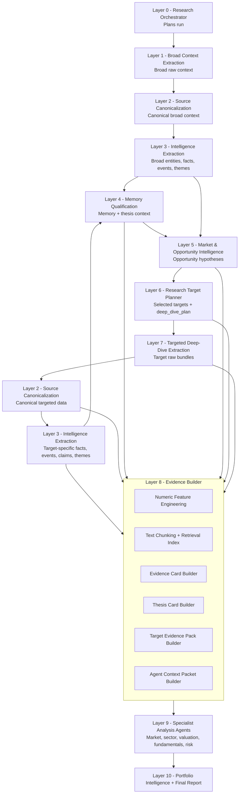
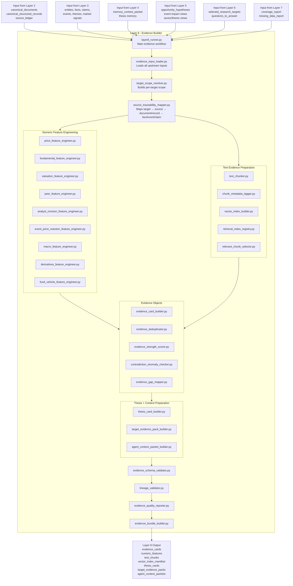

Below is the detailed implementation design for:

```text id="lmg5bz"
Layer 8 — Evidence Builder
```

Layer 8 is one of the most important layers for your system because it converts all collected and extracted intelligence into **analysis-ready evidence**.

Until Layer 7, the system has collected raw data and extracted intelligence objects. But before specialist agents can analyze stocks, sectors, risks, valuation, thesis strength, or portfolio actions, they need properly prepared evidence.

Layer 8 answers:

```text id="9qg665"
What evidence do we actually have?
Which facts support which opportunity?
Which numeric features are available?
Which text chunks should agents use?
Which evidence supports or weakens a thesis?
What data is missing?
What context packet should each specialist agent receive?
```

Layer 8 is the layer that prevents later agents from reading random raw data and hallucinating.

---

# Layer 8 — Evidence Builder

## Layer purpose

Layer 8 converts canonical data and intelligence objects into:

```text id="fb6ib5"
1. Evidence cards
2. Numeric features
3. Text chunks
4. Vector index records
5. Thesis cards
6. Target evidence packs
7. Agent context packets
```

Layer 8 should not make final investment decisions.

It should not say:

```text id="tslwuo"
Buy this stock.
Sell this stock.
This stock is definitely undervalued.
Invest 20% allocation.
```

Instead, it prepares structured evidence so Layer 9 specialist agents can analyze properly.

Layer 8 should say:

```text id="dc9gag"
Here are the verified facts.
Here are the numeric features.
Here are the relevant source-backed text chunks.
Here is the current evidence supporting the opportunity.
Here is the evidence weakening it.
Here are the missing fields.
Here is the context packet for each agent.
```

---

# Why Layer 8 is important

Without Layer 8, Layer 9 agents may directly consume:

```text id="067625"
raw articles
raw transcripts
raw financial tables
raw price history
raw F&O data
raw analyst estimates
raw macro data
Layer 3 facts/events/themes
Layer 4 memories
Layer 5 hypotheses
```

That becomes messy and unsafe.

Layer 8 creates a controlled bridge:

```text id="2kq9es"
raw/canonical data + intelligence objects
   ↓
verified evidence cards + deterministic numeric features
   ↓
specialist agents
```

This is very important for hallucination control because every later conclusion must trace back to:

```text id="1fo7pw"
source
canonical document / structured record
fact/event/claim/theme
evidence card
agent assessment
final report
```

Layer 8 is the place where your evidence chain becomes formal.

---

# Where Layer 8 sits in the full architecture



Important:

```text id="0w55jm"
Layer 8 runs after targeted data has been collected, canonicalized, and processed by Layer 3.

Layer 8 can also use broad context, memory, and opportunity hypotheses, but its main job is to prepare evidence for selected targets.
```

---

# Layer 8 internal architecture



---

# Layer 8 high-level input

Layer 8 receives canonical data, extracted intelligence, selected targets, memory, opportunities, and coverage/missing-data reports.

```json id="cp3t4p"
{
  "research_run_id": "RUN_2026_05_09_AUTONOMOUS_DAILY_0800",
  "layer2_outputs": {
    "canonical_documents_path": "output/2026-05-09/layer2_targeted/canonical_documents.json",
    "canonical_structured_records_path": "output/2026-05-09/layer2_targeted/canonical_structured_records.json",
    "canonical_source_ledger_path": "output/2026-05-09/layer2_targeted/canonical_source_ledger.json",
    "quality_report_path": "output/2026-05-09/layer2_targeted/quality_report.json"
  },
  "layer3_outputs": {
    "entity_registry_path": "output/2026-05-09/layer3_targeted/entity_registry.json",
    "fact_cards_path": "output/2026-05-09/layer3_targeted/fact_cards.json",
    "claim_cards_path": "output/2026-05-09/layer3_targeted/claim_cards.json",
    "event_cards_path": "output/2026-05-09/layer3_targeted/event_cards.json",
    "theme_cards_path": "output/2026-05-09/layer3_targeted/theme_cards.json",
    "market_signal_cards_path": "output/2026-05-09/layer3_targeted/market_signal_cards.json",
    "object_link_map_path": "output/2026-05-09/layer3_targeted/object_link_map.json"
  },
  "layer4_outputs": {
    "memory_context_packet_path": "output/2026-05-09/layer4/memory_context_packet.json",
    "thesis_updates_path": "output/2026-05-09/layer4/thesis_updates.json"
  },
  "layer5_outputs": {
    "opportunity_hypotheses_path": "output/2026-05-09/layer5/opportunity_hypotheses.json",
    "event_impact_views_path": "output/2026-05-09/layer5/event_impact_views.json",
    "sector_theme_views_path": "output/2026-05-09/layer5/sector_theme_views.json"
  },
  "layer6_outputs": {
    "selected_research_targets_path": "output/2026-05-09/layer6/selected_research_targets.json"
  },
  "layer7_outputs": {
    "coverage_report_path": "output/2026-05-09/layer7/coverage_report.json",
    "missing_data_report_path": "output/2026-05-09/layer7/missing_data_report.json"
  },
  "layer8_config": {
    "build_vector_index": true,
    "build_numeric_features": true,
    "build_agent_context_packets": true,
    "max_chunks_per_target": 200,
    "min_evidence_confidence": 0.55
  }
}
```

---

# Layer 8 high-level output

Layer 8 produces the full evidence package for Layer 9 agents.

```json id="o2q8vy"
{
  "research_run_id": "RUN_2026_05_09_AUTONOMOUS_DAILY_0800",
  "layer": "L8_evidence_builder",
  "status": "success",
  "evidence_cards_path": "output/2026-05-09/layer8/evidence_cards.json",
  "numeric_features_path": "output/2026-05-09/layer8/numeric_features.json",
  "text_chunks_path": "output/2026-05-09/layer8/text_chunks.json",
  "vector_index_manifest_path": "output/2026-05-09/layer8/vector_index_manifest.json",
  "thesis_cards_path": "output/2026-05-09/layer8/thesis_cards.json",
  "target_evidence_packs_path": "output/2026-05-09/layer8/target_evidence_packs.json",
  "agent_context_packets_path": "output/2026-05-09/layer8/agent_context_packets.json",
  "evidence_quality_report_path": "output/2026-05-09/layer8/evidence_quality_report.json"
}
```

---

# Layer 8 output folder

```text id="khkkty"
output/2026-05-09/layer8/
├── evidence_bundle.json
├── evidence_cards.json
├── numeric_features.json
├── text_chunks.json
├── vector_index_manifest.json
├── retrieval_index_registry.json
├── thesis_cards.json
├── target_evidence_packs.json
├── agent_context_packets.json
├── contradiction_anomaly_report.json
├── evidence_gap_report.json
├── evidence_quality_report.json
├── lineage_validation_report.json
├── layer8_audit_log.json
└── layer8_manifest.json
```

Optional local index folder:

```text id="l7rsgk"
db/vector_index/
├── run_2026_05_09/
│   ├── target_TARGET_20260509_0001.index
│   ├── target_TARGET_20260509_0002.index
│   └── index_manifest.json
```

For MVP, you can store chunk embeddings metadata as JSON and later move to FAISS/Chroma/Qdrant.

---

# What Layer 8 produces

Layer 8 produces seven main outputs:

```text id="gbm2ql"
1. Evidence cards
2. Numeric features
3. Text chunks
4. Vector index manifest
5. Thesis cards
6. Target evidence packs
7. Agent context packets
```

The most important outputs for Layer 9 are:

```text id="p2sopt"
target_evidence_packs.json
agent_context_packets.json
```

---

# Key design principle

Layer 8 should not “think freely.” It should organize and prepare evidence.

```text id="0rybuo"
Layer 3 extracts what the source says.
Layer 5 creates opportunity hypotheses.
Layer 6 selects what to research.
Layer 7 collects deep-dive data.
Layer 8 turns all that into evidence and analysis-ready packets.
Layer 9 performs specialist analysis.
```

Layer 8 is the evidence control layer.

---

# Recommended folder structure

```text id="bs214q"
evidence_layer/
├── layer8_runner.py
├── evidence_input_loader.py
├── target_scope_resolver.py
├── source_traceability_mapper.py
│
├── feature_engineering/
│   ├── price_feature_engineer.py
│   ├── fundamental_feature_engineer.py
│   ├── valuation_feature_engineer.py
│   ├── peer_feature_engineer.py
│   ├── analyst_revision_feature_engineer.py
│   ├── event_price_reaction_feature_engineer.py
│   ├── macro_feature_engineer.py
│   ├── derivatives_feature_engineer.py
│   └── fund_vehicle_feature_engineer.py
│
├── text_preparation/
│   ├── text_chunker.py
│   ├── chunk_metadata_tagger.py
│   ├── vector_index_builder.py
│   ├── retrieval_index_registry.py
│   └── relevant_chunk_selector.py
│
├── evidence_objects/
│   ├── evidence_card_builder.py
│   ├── evidence_deduplicator.py
│   ├── evidence_strength_scorer.py
│   ├── contradiction_anomaly_checker.py
│   └── evidence_gap_mapper.py
│
├── context_packets/
│   ├── thesis_card_builder.py
│   ├── target_evidence_pack_builder.py
│   └── agent_context_packet_builder.py
│
├── validators/
│   ├── evidence_schema_validator.py
│   ├── lineage_validator.py
│   └── packet_schema_validator.py
│
├── reports/
│   ├── evidence_quality_reporter.py
│   └── layer8_audit_logger.py
│
└── evidence_bundle_builder.py
```

---

# Layer 8 module designs

## 1. `layer8_runner.py`

### Purpose

Main controller for Layer 8.

### Why important

It coordinates feature engineering, text preparation, evidence card generation, thesis card generation, and agent context packet creation.

### Questions it answers

```text id="aik3fq"
Which targets need evidence packs?
Which canonical documents and structured records belong to each target?
Which numeric features should be calculated?
Which text documents should be chunked?
Which evidence cards should be created?
Which evidence supports or weakens each opportunity?
Which agent gets which context packet?
```

### Input

```json id="73o2jg"
{
  "research_run_id": "RUN_2026_05_09_AUTONOMOUS_DAILY_0800",
  "layer2_outputs": {},
  "layer3_outputs": {},
  "layer4_outputs": {},
  "layer5_outputs": {},
  "layer6_outputs": {},
  "layer7_outputs": {}
}
```

### Logic

```text id="hib8k5"
Load upstream files.
Build target scopes.
Map each target to relevant source documents, structured records, facts, claims, events, themes, memory, and opportunity hypotheses.
Run numeric feature engineering by target type.
Chunk long text documents.
Build retrieval/vector index if enabled.
Build evidence cards.
Score evidence strength.
Detect contradictions and anomalies.
Build thesis cards.
Build target evidence packs.
Build agent-specific context packets.
Validate all outputs.
Write final evidence bundle.
```

### Output

```json id="0l0jym"
{
  "status": "success",
  "targets_processed": 10,
  "evidence_cards_created": 420,
  "numeric_features_created": 760,
  "text_chunks_created": 1150,
  "thesis_cards_created": 12,
  "agent_context_packets_created": 58,
  "evidence_quality_report_path": "output/2026-05-09/layer8/evidence_quality_report.json"
}
```

---

## 2. `evidence_input_loader.py`

### Purpose

Load all upstream Layer 8 inputs.

### Input

```json id="mp3oq6"
{
  "canonical_documents_path": "",
  "canonical_structured_records_path": "",
  "fact_cards_path": "",
  "claim_cards_path": "",
  "event_cards_path": "",
  "theme_cards_path": "",
  "selected_research_targets_path": "",
  "coverage_report_path": "",
  "memory_context_packet_path": ""
}
```

### Logic

```text id="nniurf"
Read all JSON inputs.
Validate file existence.
Validate IDs are consistent.
Return loaded objects grouped by target, source, and object type.
```

### Output

```json id="592atf"
{
  "canonical_documents": [],
  "canonical_structured_records": [],
  "entities": [],
  "facts": [],
  "claims": [],
  "events": [],
  "themes": [],
  "market_signals": [],
  "memory_context": {},
  "opportunity_hypotheses": [],
  "selected_targets": [],
  "coverage_report": {},
  "missing_data_report": {}
}
```

---

## 3. `target_scope_resolver.py`

### Purpose

Build a full evidence scope for each selected target.

### Why important

Layer 8 must know what belongs to each target.

For HDFC Bank, it should collect:

```text id="5ga33e"
HDFC-specific canonical records
HDFC-related articles
HDFC events
HDFC facts
HDFC claims
HDFC memories
HDFC opportunity hypotheses
HDFC missing data
HDFC questions to answer
```

### Input

```json id="pkwm75"
{
  "selected_targets": [],
  "canonical_documents": [],
  "canonical_structured_records": [],
  "facts": [],
  "claims": [],
  "events": [],
  "themes": [],
  "memory_context": {}
}
```

### Logic

```text id="4qdpkb"
For each target:
    match by target_id
    match by ticker
    match by entity_name
    match by linked_entities
    match by opportunity_id
    match by theme_id
    match by event_id
    attach questions_to_answer
    attach missing data
```

### Output

```json id="z8azla"
{
  "target_scopes": [
    {
      "target_id": "TARGET_20260509_0001",
      "target_name": "HDFC Bank",
      "target_type": "listed_company",
      "ticker": "HDFCBANK.NS",
      "linked_documents": ["DOC_001", "DOC_002"],
      "linked_structured_records": ["SREC_MARKET", "SREC_SCREENER"],
      "linked_facts": ["FACT_001"],
      "linked_claims": ["CLAIM_001"],
      "linked_events": ["EVT_001"],
      "linked_themes": ["THEME_BANK_MARGIN"],
      "linked_memory": ["MEM_BANK_MARGIN"],
      "linked_opportunities": ["OPP_001"],
      "questions_to_answer": [
        "Is margin pressure temporary or structural?",
        "Is valuation attractive relative to peers?"
      ],
      "missing_data": []
    }
  ]
}
```

---

## 4. `source_traceability_mapper.py`

### Purpose

Create a complete source lineage map.

### Why important

Every evidence card must trace back to Layer 2/3 objects.

### Input

```json id="pbb76i"
{
  "target_scope": {},
  "canonical_source_ledger": [],
  "canonical_documents": [],
  "canonical_structured_records": [],
  "facts": [],
  "events": [],
  "claims": []
}
```

### Logic

```text id="ry6n7e"
For each target:
    map fact → document/record → source
    map event → document/record → source
    map claim → document → source
    map numeric feature → structured record → source
    map text chunk → document → source
```

### Output

```json id="pzyyag"
{
  "traceability_map": [
    {
      "target_id": "TARGET_001",
      "object_type": "fact",
      "object_id": "FACT_001",
      "document_id": "DOC_001",
      "record_id": null,
      "source_id": "CSRC_001",
      "raw_output_path": "output/.../moneycontrol.json",
      "source_reliability": "medium_high"
    }
  ]
}
```

---

# Numeric feature engineering modules

Layer 8 is where deterministic calculations should happen.

Important rule:

```text id="9i0v6p"
Numeric calculations should be done by code, not by LLM.
```

Layer 8 can calculate features. Layer 9 interprets them.

---

## 5. `price_feature_engineer.py`

### Purpose

Create price and trend-related numeric features.

### Input

```json id="ok9p2d"
{
  "target_id": "TARGET_001",
  "market_data_record": {},
  "price_history_record": {
    "history": []
  }
}
```

### Logic

Calculate:

```text id="m6ou52"
1D return
5D return
1M return
3M return
6M return
1Y return
distance from 52-week high
distance from 52-week low
20-day moving average
50-day moving average
200-day moving average
volatility
average volume
volume spike
drawdown
```

### Output

```json id="71o1p8"
{
  "feature_group_id": "FEAT_PRICE_TARGET_001",
  "target_id": "TARGET_001",
  "feature_group": "price_features",
  "features": {
    "return_1d_pct": -1.2,
    "return_5d_pct": -3.4,
    "return_1m_pct": -6.8,
    "return_3m_pct": -9.5,
    "return_1y_pct": 12.4,
    "distance_from_52w_high_pct": -18.6,
    "distance_from_52w_low_pct": 22.3,
    "sma_20": 0,
    "sma_50": 0,
    "sma_200": 0,
    "price_vs_sma_200_pct": -4.5,
    "volatility_30d": 0.24,
    "volume_spike_ratio": 1.8,
    "max_drawdown_1y_pct": -24.0
  },
  "source_record_refs": ["SREC_PRICE_HISTORY", "SREC_MARKET_DATA"],
  "calculated_at": "2026-05-09T13:15:00+05:30"
}
```

---

## 6. `fundamental_feature_engineer.py`

### Purpose

Create company fundamental features from Screener/SEC/fundamental records.

### Input

```json id="4hboaj"
{
  "target_id": "TARGET_001",
  "fundamental_record": {
    "profit_loss": [],
    "balance_sheet": [],
    "cash_flow": [],
    "ratios": [],
    "quarterly_results": []
  }
}
```

### Logic

Calculate:

```text id="pgpm6u"
revenue growth YoY
profit growth YoY
sales CAGR 3Y/5Y
profit CAGR 3Y/5Y
ROE trend
ROCE trend
debt-to-equity
interest coverage
operating margin trend
net margin trend
free cash flow trend
cash conversion
promoter holding trend
pledge risk if available
```

### Output

```json id="7t0vmy"
{
  "feature_group_id": "FEAT_FUND_TARGET_001",
  "target_id": "TARGET_001",
  "feature_group": "fundamental_features",
  "features": {
    "revenue_growth_yoy_pct": 8.2,
    "profit_growth_yoy_pct": 5.1,
    "sales_cagr_3y_pct": 11.5,
    "profit_cagr_3y_pct": 9.4,
    "roe_latest_pct": 16.2,
    "roe_trend": "stable",
    "roce_latest_pct": 14.8,
    "debt_to_equity": 0.7,
    "interest_coverage": 5.2,
    "operating_margin_latest_pct": 21.4,
    "operating_margin_trend": "declining",
    "free_cash_flow_positive_years_5y": 4,
    "promoter_holding_change_4q_pct": -0.3
  },
  "source_record_refs": ["SREC_SCREENER"],
  "calculated_at": "2026-05-09T13:15:00+05:30"
}
```

---

## 7. `valuation_feature_engineer.py`

### Purpose

Create valuation-related features.

### Input

```json id="jvag36"
{
  "target_id": "TARGET_001",
  "market_data_record": {},
  "fundamental_record": {},
  "peer_record": {},
  "analyst_estimates_record": {}
}
```

### Logic

Calculate:

```text id="x9k4td"
PE
PB
EV/EBITDA if available
market cap to sales
current valuation vs 5Y median if available
target PE vs peer median
PB vs peer median
analyst target upside/downside
earnings yield
valuation percentile if historical data available
```

### Output

```json id="v0g0a9"
{
  "feature_group_id": "FEAT_VAL_TARGET_001",
  "target_id": "TARGET_001",
  "feature_group": "valuation_features",
  "features": {
    "pe_ratio": 18.5,
    "pb_ratio": 2.7,
    "pe_vs_peer_median_pct": -8.0,
    "pb_vs_peer_median_pct": 5.4,
    "analyst_target_upside_pct": 12.5,
    "earnings_yield_pct": 5.4,
    "valuation_data_completeness": 0.76
  },
  "source_record_refs": ["SREC_MARKET_DATA", "SREC_SCREENER", "SREC_PEERS", "SREC_ANALYSTS"],
  "calculated_at": "2026-05-09T13:15:00+05:30"
}
```

Important:

```text id="v6eu4d"
Layer 8 calculates valuation features.
Layer 9 valuation agent decides whether valuation is attractive, fair, expensive, or unclear.
```

---

## 8. `peer_feature_engineer.py`

### Purpose

Create peer comparison features.

### Input

```json id="2vx7fk"
{
  "target_id": "TARGET_001",
  "peer_comparison_record": {
    "target": {},
    "peers": []
  }
}
```

### Logic

Calculate:

```text id="mlg9u9"
target rank by market cap
target rank by ROE
target rank by ROCE
target rank by revenue growth
target rank by PE/PB
margin rank
debt rank
peer median values
peer percentile values
```

### Output

```json id="5mglp4"
{
  "feature_group_id": "FEAT_PEER_TARGET_001",
  "target_id": "TARGET_001",
  "feature_group": "peer_features",
  "features": {
    "peer_count": 12,
    "roe_percentile": 72,
    "revenue_growth_percentile": 61,
    "pe_percentile": 45,
    "pb_percentile": 58,
    "margin_percentile": 66,
    "debt_to_equity_percentile": 40,
    "quality_vs_peer_hint": "above_average",
    "valuation_vs_peer_hint": "near_median"
  },
  "source_record_refs": ["SREC_PEERS"]
}
```

---

## 9. `analyst_revision_feature_engineer.py`

### Purpose

Create analyst expectation and revision features.

### Input

```json id="py8ejo"
{
  "target_id": "TARGET_001",
  "analyst_estimates_record": {
    "price_targets": {},
    "earnings_estimates": {},
    "eps_revisions": {},
    "recommendations": []
  }
}
```

### Logic

Calculate:

```text id="980358"
target price upside/downside
recommendation distribution
upgrade/downgrade count
EPS revision direction
revenue revision direction
estimate dispersion
coverage count
```

### Output

```json id="tgg7s3"
{
  "feature_group_id": "FEAT_ANALYST_TARGET_001",
  "target_id": "TARGET_001",
  "feature_group": "analyst_revision_features",
  "features": {
    "analyst_target_upside_pct": 12.5,
    "buy_rating_ratio": 0.68,
    "hold_rating_ratio": 0.24,
    "sell_rating_ratio": 0.08,
    "eps_revision_direction": "negative",
    "revenue_revision_direction": "stable",
    "estimate_dispersion": "medium",
    "coverage_count": 25
  },
  "source_record_refs": ["SREC_ANALYSTS"]
}
```

---

## 10. `event_price_reaction_feature_engineer.py`

### Purpose

Measure how price reacted around events.

### Why important

This helps later agents answer:

```text id="st1zfp"
Did the market overreact?
Did price fall because of temporary news?
Was there abnormal volume?
Did the event already get priced in?
```

### Input

```json id="a33n21"
{
  "target_id": "TARGET_001",
  "event_cards": [],
  "price_history_record": {}
}
```

### Logic

For each event with event date:

```text id="l07sfz"
calculate price return from:
    event day
    +1 day
    +3 days
    +5 days
    +10 days

calculate volume spike around event.
compare against normal volatility.
```

### Output

```json id="llls62"
{
  "feature_group_id": "FEAT_EVENT_REACTION_TARGET_001",
  "target_id": "TARGET_001",
  "feature_group": "event_price_reaction_features",
  "features": [
    {
      "event_id": "EVT_MARGIN_PRESSURE",
      "event_date": "2026-05-07",
      "return_event_day_pct": -2.8,
      "return_3d_pct": -5.6,
      "return_5d_pct": -6.3,
      "volume_spike_ratio": 2.4,
      "reaction_size_label": "large_negative",
      "source_record_refs": ["SREC_PRICE_HISTORY"]
    }
  ]
}
```

---

## 11. `macro_feature_engineer.py`

### Purpose

Create macro features relevant to market/sector/target analysis.

### Input

```json id="ddjy6a"
{
  "macro_records": [],
  "market_signal_cards": []
}
```

### Logic

Calculate:

```text id="w8l91m"
FII/DII rolling net flows
rate direction
USD/INR trend
VIX trend
market breadth trend
commodity price changes
yield changes
inflation trend
```

### Output

```json id="4s309m"
{
  "feature_group_id": "FEAT_MACRO_20260509",
  "feature_group": "macro_features",
  "market": "india",
  "features": {
    "fii_net_flow_5d": -8500,
    "dii_net_flow_5d": 6200,
    "vix_change_5d_pct": 12.3,
    "usd_inr_change_1m_pct": 1.1,
    "market_breadth_latest": 0.48,
    "crude_change_1m_pct": -4.5,
    "macro_pressure_hint": "mixed"
  },
  "source_record_refs": ["SREC_FII_DII", "SREC_MACRO"]
}
```

---

## 12. `derivatives_feature_engineer.py`

### Purpose

Create features from F&O data.

### Input

```json id="1f2gg0"
{
  "target_id": "TARGET_NIFTY_OR_STOCK",
  "fno_record": {
    "pcr": 0,
    "max_pain": 0,
    "atm_iv": {},
    "top_oi_strikes": {},
    "option_chain": []
  }
}
```

### Logic

Calculate:

```text id="exarok"
PCR level
change in PCR if history available
distance from max pain
top call OI resistance levels
top put OI support levels
IV level
OI concentration
```

### Output

```json id="hwbncu"
{
  "feature_group_id": "FEAT_FNO_TARGET_001",
  "target_id": "TARGET_001",
  "feature_group": "derivatives_features",
  "features": {
    "pcr": 0.92,
    "max_pain": 22500,
    "distance_from_max_pain_pct": 1.2,
    "top_call_oi_strikes": [22600, 22700],
    "top_put_oi_strikes": [22200, 22100],
    "atm_iv": 13.5,
    "oi_concentration_label": "moderate"
  },
  "source_record_refs": ["SREC_FNO"]
}
```

---

## 13. `fund_vehicle_feature_engineer.py`

### Purpose

Create features for ETFs, mutual funds, REITs, and InvITs.

### Input

```json id="pz7y2n"
{
  "target_id": "TARGET_ETF_001",
  "fund_records": []
}
```

### Logic

Calculate:

```text id="64275s"
expense ratio
AUM
tracking error
liquidity
top holding concentration
sector exposure
1M/3M/1Y performance
drawdown
yield if REIT/InvIT
```

### Output

```json id="szfv0j"
{
  "feature_group_id": "FEAT_FUND_TARGET_001",
  "target_id": "TARGET_ETF_001",
  "feature_group": "fund_vehicle_features",
  "features": {
    "expense_ratio": 0.2,
    "aum": 12000000000,
    "top_10_holding_concentration_pct": 58.0,
    "tracking_error": 0.04,
    "avg_volume": 1000000,
    "dividend_yield_pct": null,
    "performance_1y_pct": 14.2
  },
  "source_record_refs": ["SREC_FUND_FACTS"]
}
```

---

# Text evidence preparation modules

## 14. `text_chunker.py`

### Purpose

Chunk long text documents into manageable, source-linked pieces.

### Why important

Layer 9 agents should not read entire transcripts or filings blindly. They should retrieve relevant chunks.

### Input

```json id="70fyui"
{
  "document_id": "DOC_CONCALL_001",
  "document_type": "concall_transcript",
  "target_id": "TARGET_001",
  "clean_text": ""
}
```

### Logic

Chunk by document type:

```text id="lhxlla"
news article:
    chunk by paragraphs, usually 1-3 chunks

YouTube transcript:
    chunk by timestamp windows or topic breaks

concall transcript:
    chunk by speaker, section, Q&A, management commentary

investor presentation:
    chunk by slide/section if available

SEC filing:
    chunk by item/section

policy document:
    chunk by headings
```

### Output

```json id="ylkwr6"
{
  "chunks": [
    {
      "chunk_id": "CHUNK_20260509_0001",
      "target_id": "TARGET_001",
      "document_id": "DOC_CONCALL_001",
      "chunk_index": 1,
      "document_type": "concall_transcript",
      "section": "management_commentary",
      "text": "",
      "start_offset": 0,
      "end_offset": 1800,
      "source_refs": [
        {
          "document_id": "DOC_CONCALL_001",
          "source_id": "CSRC_NSE_FILING"
        }
      ]
    }
  ]
}
```

---

## 15. `chunk_metadata_tagger.py`

### Purpose

Tag chunks with useful metadata for retrieval.

### Tags

```text id="4pcwbv"
target_id
ticker
document_type
source_reliability
section
speaker
topic
entities
events
themes
time_period
relevance_to_questions
```

### Output

```json id="vajscy"
{
  "chunk_id": "CHUNK_001",
  "metadata": {
    "target_id": "TARGET_001",
    "ticker": "HDFCBANK.NS",
    "document_type": "concall_transcript",
    "section": "management_commentary",
    "topics": ["NIM", "deposit cost", "margin pressure"],
    "linked_events": ["EVT_MARGIN_PRESSURE"],
    "linked_questions": [
      "Is margin pressure temporary or structural?"
    ],
    "source_reliability": "high"
  }
}
```

---

## 16. `vector_index_builder.py`

### Purpose

Build a retrieval index for long text.

### Why important

Layer 9 agents can ask focused questions like:

```text id="6uwc31"
What did management say about NIM pressure?
What risks were mentioned in the annual report?
What did the presentation say about capex?
```

### Input

```json id="n42zc3"
{
  "text_chunks": []
}
```

### Logic

```text id="nbdfnb"
Create embeddings for chunks.
Store vectors in local index or vector DB.
Store metadata with chunk_id and source refs.
Do not lose source lineage.
```

### Output

```json id="h1jzyo"
{
  "vector_index_manifest": {
    "index_id": "VINDEX_20260509_TARGET_001",
    "target_id": "TARGET_001",
    "index_path": "db/vector_index/run_2026_05_09/target_TARGET_001.index",
    "chunk_count": 120,
    "embedding_model": "configured_embedding_model",
    "created_at": "2026-05-09T13:30:00+05:30"
  }
}
```

For MVP, you can store chunks first and add embeddings later.

---

## 17. `retrieval_index_registry.py`

### Purpose

Track which target has which retrieval index.

### Output

```json id="2xzymx"
{
  "retrieval_indexes": [
    {
      "target_id": "TARGET_001",
      "index_id": "VINDEX_20260509_TARGET_001",
      "index_path": "",
      "available": true,
      "chunk_count": 120
    }
  ]
}
```

---

## 18. `relevant_chunk_selector.py`

### Purpose

Preselect relevant chunks for each target question.

### Input

```json id="k1rb16"
{
  "target_id": "TARGET_001",
  "questions_to_answer": [
    "Is margin pressure temporary or structural?"
  ],
  "text_chunks": []
}
```

### Logic

Use keyword + semantic search:

```text id="d5si2a"
For margin pressure:
    retrieve chunks with NIM, margin, deposit cost, yield, pressure, guidance

For capex:
    retrieve capex, expansion, order book, capacity, project

For risk:
    retrieve legal, regulatory, demand weakness, debt, competition
```

### Output

```json id="qq4v4t"
{
  "selected_chunks": [
    {
      "target_id": "TARGET_001",
      "question": "Is margin pressure temporary or structural?",
      "chunk_ids": ["CHUNK_001", "CHUNK_015", "CHUNK_022"],
      "selection_reason": "Matched NIM and margin pressure terms in management commentary."
    }
  ]
}
```

---

# Evidence object modules

## 19. `evidence_card_builder.py`

### Purpose

Build atomic evidence cards.

### Why important

Evidence cards are the main objects later agents should cite.

### Evidence types

```text id="2g8ga0"
numeric_feature
source_fact
official_filing_fact
management_commentary
analyst_estimate
market_signal
event_reaction
peer_comparison
risk_disclosure
claim_or_opinion
memory_context
missing_data_gap
```

### Input

```json id="k6a8ux"
{
  "target_scope": {},
  "facts": [],
  "claims": [],
  "events": [],
  "themes": [],
  "numeric_features": [],
  "text_chunks": [],
  "memory_context": {}
}
```

### Logic

Build evidence cards from:

```text id="0u9ggu"
Layer 3 facts
Layer 3 events
Layer 3 claims
numeric features
official filings
management transcript chunks
analyst estimates
macro signals
memory context
missing data
```

### Output

```json id="51rbey"
{
  "evidence_cards": [
    {
      "evidence_id": "EVID_20260509_0001",
      "target_id": "TARGET_001",
      "evidence_type": "numeric_feature",
      "evidence_category": "valuation",
      "statement": "The stock trades at a PE ratio of 18.5 and PB ratio of 2.7.",
      "data": {
        "pe_ratio": 18.5,
        "pb_ratio": 2.7
      },
      "supports": ["valuation_analysis"],
      "weakens": [],
      "source_refs": [
        {
          "record_id": "SREC_SCREENER",
          "source_id": "CSRC_SCREENER"
        }
      ],
      "confidence": 0.92,
      "created_at": "2026-05-09T13:30:00+05:30"
    }
  ]
}
```

---

## 20. `evidence_deduplicator.py`

### Purpose

Remove duplicate evidence cards.

### Why important

Same fact may come from multiple sources or repeated modules.

### Logic

Deduplicate by:

```text id="ippbpe"
same target
same metric
same date
same source
same fact/event/claim
same statement similarity
```

### Output

```json id="bfkwln"
{
  "deduped_evidence_cards": [],
  "duplicate_evidence_map": [
    {
      "canonical_evidence_id": "EVID_001",
      "duplicate_evidence_ids": ["EVID_009"],
      "reason": "same metric and source date"
    }
  ]
}
```

---

## 21. `evidence_strength_scorer.py`

### Purpose

Score evidence strength.

### Scoring factors

```text id="9lyymb"
source reliability
data freshness
official vs opinion source
numeric vs narrative
directness to target
supporting text available
contradictions
quality score
coverage completeness
```

### Output

```json id="lopwtk"
{
  "evidence_id": "EVID_001",
  "evidence_strength_score": 0.88,
  "strength_label": "strong",
  "score_reason": [
    "Official structured source",
    "Directly linked to target",
    "Recent data",
    "No contradiction detected"
  ]
}
```

Evidence labels:

```text id="5eos0g"
strong
moderate
weak
speculative
contradicted
missing
```

---

## 22. `contradiction_anomaly_checker.py`

### Purpose

Detect contradictions and data anomalies.

### Examples

```text id="ul2q4b"
Management says margin improving, numeric margin trend says declining.
Analyst estimates show EPS cuts, article says analysts are optimistic.
Price reaction is sharply negative, event sentiment was marked positive.
Revenue growth value is unusually high due to parsing error.
```

### Input

```json id="yzo7qb"
{
  "evidence_cards": [],
  "numeric_features": [],
  "claims": [],
  "facts": []
}
```

### Output

```json id="oi61wg"
{
  "contradiction_anomaly_report": [
    {
      "issue_id": "ANOM_20260509_0001",
      "target_id": "TARGET_001",
      "issue_type": "claim_vs_numeric_conflict",
      "description": "Claim says margin pressure is easing, but extracted margin trend is declining.",
      "related_evidence_ids": ["EVID_CLAIM_001", "EVID_MARGIN_001"],
      "severity": "medium",
      "action": "send_to_risk_and_fundamental_agents",
      "confidence": 0.71
    }
  ]
}
```

---

## 23. `evidence_gap_mapper.py`

### Purpose

Convert missing data into explicit evidence gaps.

### Why important

Missing data should be visible to agents.

### Input

```json id="7tkqcs"
{
  "coverage_report": {},
  "missing_data_report": {},
  "target_questions": []
}
```

### Output

```json id="hjsbr7"
{
  "evidence_gaps": [
    {
      "gap_id": "EGAP_20260509_0001",
      "target_id": "TARGET_001",
      "gap_type": "missing_management_commentary",
      "description": "No recent concall transcript was available, so management explanation for margin pressure is missing.",
      "affected_questions": [
        "Is margin pressure temporary or structural?"
      ],
      "severity": "high",
      "recommended_agent_handling": "lower_confidence"
    }
  ]
}
```

---

# Thesis and context preparation modules

## 24. `thesis_card_builder.py`

### Purpose

Build or update target-level thesis cards from opportunity hypotheses, memory, and evidence.

### Why important

Layer 9 agents should analyze against a thesis.

Example:

```text id="hyv58u"
Thesis:
HDFC Bank may be an opportunity if margin pressure is temporary and valuation is attractive.

Supporting evidence:
price correction, strong fundamentals, management commentary

Weakening evidence:
NIM decline, analyst EPS cuts, deposit cost pressure
```

### Input

```json id="h6bjrs"
{
  "target_id": "TARGET_001",
  "opportunity_hypotheses": [],
  "memory_context": {},
  "evidence_cards": [],
  "evidence_gaps": []
}
```

### Output

```json id="v2ws06"
{
  "thesis_card_id": "THESIS_CARD_20260509_TARGET_001",
  "target_id": "TARGET_001",
  "target_name": "HDFC Bank",
  "thesis_statement": "HDFC Bank may be a medium-term opportunity if current margin pressure is temporary and fundamentals remain strong.",
  "thesis_type": "listed_company_opportunity",
  "time_horizon": "medium_term",
  "supporting_evidence_ids": ["EVID_PRICE_001", "EVID_FUND_002"],
  "weakening_evidence_ids": ["EVID_MARGIN_001", "EVID_ANALYST_003"],
  "contradiction_ids": ["ANOM_001"],
  "evidence_gap_ids": ["EGAP_001"],
  "invalidating_conditions": [
    "NIM continues to fall for multiple quarters",
    "Asset quality weakens",
    "Analyst EPS cuts accelerate"
  ],
  "current_thesis_confidence": 0.61,
  "needs_specialist_analysis": true
}
```

---

## 25. `target_evidence_pack_builder.py`

### Purpose

Build one complete evidence pack per selected target.

### Input

```json id="86gm34"
{
  "target_scope": {},
  "numeric_features": [],
  "evidence_cards": [],
  "text_chunks": [],
  "thesis_cards": [],
  "evidence_gaps": []
}
```

### Output

```json id="phwlb8"
{
  "target_evidence_pack_id": "TEPACK_20260509_TARGET_001",
  "target_id": "TARGET_001",
  "target_name": "HDFC Bank",
  "target_type": "listed_company",
  "ticker": "HDFCBANK.NS",
  "opportunity_ids": ["OPP_001"],
  "questions_to_answer": [],
  "numeric_feature_refs": [
    "FEAT_PRICE_TARGET_001",
    "FEAT_FUND_TARGET_001",
    "FEAT_VAL_TARGET_001"
  ],
  "evidence_card_ids": [],
  "thesis_card_id": "THESIS_CARD_20260509_TARGET_001",
  "selected_chunk_ids": [],
  "vector_index_id": "VINDEX_20260509_TARGET_001",
  "coverage_status": "partial",
  "evidence_gaps": [],
  "contradiction_anomaly_ids": [],
  "ready_for_agents": true
}
```

---

## 26. `agent_context_packet_builder.py`

### Purpose

Build specialized context packets for Layer 9 agents.

### Why important

Each agent should receive only what it needs.

For example:

```text id="w1b6y4"
Valuation agent needs valuation features, peer features, analyst estimates.
Risk agent needs risk events, filings, contradictions, debt features, missing data.
Fundamental agent needs financial trends, management commentary, business quality evidence.
Event impact agent needs event cards, price reaction, source text.
Sector agent needs sector/theme evidence, macro context, peer/constituent data.
```

### Input

```json id="1h01ie"
{
  "target_evidence_pack": {},
  "agent_types": [
    "fundamental_agent",
    "valuation_agent",
    "risk_agent",
    "event_impact_agent",
    "sector_agent",
    "thesis_agent"
  ]
}
```

### Output

```json id="1whb67"
{
  "agent_context_packets": [
    {
      "packet_id": "AGPACK_20260509_TARGET_001_VALUATION",
      "target_id": "TARGET_001",
      "agent_type": "valuation_agent",
      "packet_version": "v1",
      "context": {
        "target_summary": {
          "target_name": "HDFC Bank",
          "ticker": "HDFCBANK.NS",
          "target_type": "listed_company"
        },
        "questions_for_agent": [
          "Is valuation attractive relative to history and peers?",
          "Is the stock cheap enough to compensate for margin pressure risk?"
        ],
        "numeric_feature_refs": [
          "FEAT_VAL_TARGET_001",
          "FEAT_PEER_TARGET_001",
          "FEAT_ANALYST_TARGET_001"
        ],
        "evidence_card_ids": [
          "EVID_VAL_001",
          "EVID_PEER_002",
          "EVID_ANALYST_003"
        ],
        "relevant_chunk_ids": [],
        "evidence_gaps": [],
        "confidence_constraints": [
          "Do not make final buy/sell recommendation.",
          "If valuation history is missing, lower confidence."
        ]
      },
      "source_traceability_required": true
    }
  ]
}
```

---

# Validation and reporting modules

## 27. `evidence_schema_validator.py`

### Purpose

Validate all Layer 8 outputs.

### Checks

```text id="aahk9i"
Every evidence card has evidence_id.
Every evidence card has target_id.
Every evidence card has source_refs or clear derived feature refs.
Every numeric feature has source_record_refs.
Every text chunk has document_id and source_id.
Every thesis card has supporting/weakening/gap fields.
Every agent packet has target_id and agent_type.
```

### Output

```json id="bsx80z"
{
  "validation_status": "pass_with_warnings",
  "valid_evidence_cards": 420,
  "invalid_evidence_cards": 3,
  "warnings": [
    {
      "object_id": "EVID_099",
      "issue": "weak_source_ref",
      "action": "downgraded_strength"
    }
  ]
}
```

---

## 28. `lineage_validator.py`

### Purpose

Ensure traceability to sources.

### Rule

```text id="x3buk9"
No evidence without lineage.
```

### Output

```json id="2g27yx"
{
  "lineage_validation_status": "pass",
  "objects_checked": 2400,
  "objects_missing_lineage": 0,
  "lineage_errors": []
}
```

---

## 29. `evidence_quality_reporter.py`

### Purpose

Create evidence quality report.

### Output

```json id="fae94a"
{
  "research_run_id": "RUN_2026_05_09_AUTONOMOUS_DAILY_0800",
  "targets_processed": 10,
  "evidence_cards_created": 420,
  "strong_evidence_count": 180,
  "moderate_evidence_count": 160,
  "weak_evidence_count": 60,
  "speculative_evidence_count": 20,
  "evidence_gaps_count": 35,
  "contradictions_detected": 8,
  "average_evidence_strength": 0.72,
  "targets_ready_for_agents": 9,
  "targets_with_critical_gaps": 1
}
```

---

## 30. `evidence_bundle_builder.py`

### Purpose

Build final Layer 8 bundle.

### Output

```json id="tuair2"
{
  "research_run_id": "RUN_2026_05_09_AUTONOMOUS_DAILY_0800",
  "layer": "L8_evidence_builder",
  "created_at": "2026-05-09T13:45:00+05:30",
  "evidence_cards_path": "",
  "numeric_features_path": "",
  "text_chunks_path": "",
  "vector_index_manifest_path": "",
  "thesis_cards_path": "",
  "target_evidence_packs_path": "",
  "agent_context_packets_path": "",
  "evidence_quality_report_path": "",
  "lineage_validation_report_path": ""
}
```

---

# Main Layer 8 object schemas

## 1. Evidence card

```json id="v7f9ol"
{
  "evidence_id": "EVID_20260509_0001",
  "research_run_id": "RUN_2026_05_09_AUTONOMOUS_DAILY_0800",
  "target_id": "TARGET_20260509_0001",
  "target_name": "HDFC Bank",
  "ticker": "HDFCBANK.NS",

  "evidence_type": "numeric_feature",
  "evidence_category": "valuation",
  "statement": "The stock trades at a PE ratio of 18.5 and PB ratio of 2.7.",

  "data": {
    "pe_ratio": 18.5,
    "pb_ratio": 2.7
  },

  "supports": ["valuation_analysis"],
  "weakens": [],
  "neutral_for": [],

  "source_refs": [
    {
      "record_id": "SREC_SCREENER",
      "document_id": null,
      "source_id": "CSRC_SCREENER",
      "raw_output_path": "output/.../screener_in.json"
    }
  ],

  "derived_from": {
    "feature_group_id": "FEAT_VAL_TARGET_001",
    "calculation_method": "deterministic_code"
  },

  "evidence_strength_score": 0.88,
  "strength_label": "strong",
  "confidence": 0.92,
  "created_at": "2026-05-09T13:30:00+05:30"
}
```

---

## 2. Numeric feature group

```json id="flpzr7"
{
  "feature_group_id": "FEAT_PRICE_TARGET_001",
  "target_id": "TARGET_20260509_0001",
  "feature_group": "price_features",
  "features": {},
  "source_record_refs": [],
  "calculation_method": "deterministic_code",
  "calculated_at": "2026-05-09T13:30:00+05:30",
  "data_quality": {
    "completeness_score": 0.92,
    "warnings": []
  }
}
```

---

## 3. Text chunk

```json id="kp3uio"
{
  "chunk_id": "CHUNK_20260509_0001",
  "target_id": "TARGET_20260509_0001",
  "document_id": "DOC_CONCALL_001",
  "source_id": "CSRC_NSE_FILING",
  "document_type": "concall_transcript",
  "section": "management_commentary",
  "text": "",
  "metadata": {
    "ticker": "HDFCBANK.NS",
    "topics": ["NIM", "margin pressure"],
    "linked_events": ["EVT_MARGIN_PRESSURE"],
    "source_reliability": "high"
  },
  "lineage": {
    "raw_output_path": "output/.../filing_docs.json",
    "page_number": null,
    "timestamp_start": null,
    "timestamp_end": null
  }
}
```

---

## 4. Thesis card

```json id="dr4bif"
{
  "thesis_card_id": "THESIS_CARD_20260509_TARGET_001",
  "target_id": "TARGET_20260509_0001",
  "target_name": "HDFC Bank",
  "thesis_statement": "HDFC Bank may be a medium-term opportunity if margin pressure is temporary and valuation is attractive.",
  "time_horizon": "medium_term",
  "supporting_evidence_ids": [],
  "weakening_evidence_ids": [],
  "contradiction_ids": [],
  "evidence_gap_ids": [],
  "invalidating_conditions": [],
  "current_thesis_confidence": 0.61,
  "ready_for_specialist_analysis": true
}
```

---

## 5. Target evidence pack

```json id="d2dwke"
{
  "target_evidence_pack_id": "TEPACK_20260509_TARGET_001",
  "target_id": "TARGET_20260509_0001",
  "target_name": "HDFC Bank",
  "target_type": "listed_company",
  "ticker": "HDFCBANK.NS",
  "opportunity_ids": ["OPP_001"],
  "thesis_card_id": "THESIS_CARD_20260509_TARGET_001",
  "numeric_feature_group_ids": [],
  "evidence_card_ids": [],
  "selected_chunk_ids": [],
  "vector_index_id": "VINDEX_20260509_TARGET_001",
  "evidence_gap_ids": [],
  "contradiction_anomaly_ids": [],
  "coverage_status": "partial",
  "ready_for_agents": true
}
```

---

## 6. Agent context packet

```json id="f7zhap"
{
  "packet_id": "AGPACK_20260509_TARGET_001_FUNDAMENTAL",
  "target_id": "TARGET_20260509_0001",
  "agent_type": "fundamental_agent",
  "packet_version": "v1",
  "target_summary": {
    "target_name": "HDFC Bank",
    "ticker": "HDFCBANK.NS",
    "target_type": "listed_company"
  },
  "questions_for_agent": [],
  "allowed_evidence_card_ids": [],
  "numeric_feature_group_ids": [],
  "relevant_chunk_ids": [],
  "thesis_card_id": "",
  "evidence_gap_ids": [],
  "contradiction_anomaly_ids": [],
  "instructions": [
    "Use only the evidence provided in this packet.",
    "Do not make final buy/sell recommendation.",
    "Return structured assessment with evidence_refs."
  ]
}
```

---

# Agent-specific context packet mapping

| Agent                   | Receives                                                                         |
| ----------------------- | -------------------------------------------------------------------------------- |
| Market Agent            | macro features, market signals, broad memory, market evidence                    |
| Sector Agent            | sector/theme views, sector evidence, theme chunks, sector features               |
| Stock Fundamental Agent | fundamentals, financial trends, management commentary, business evidence         |
| Valuation Agent         | valuation features, peer features, analyst estimates, price features             |
| Event Impact Agent      | event cards, price reaction features, relevant news/transcript chunks            |
| Risk Agent              | risk events, debt features, contradictions, filings, missing data, weak evidence |
| Opportunity Proxy Agent | cross-domain chains, proxy mappings, sector/theme evidence                       |
| Thesis Agent            | thesis card, supporting/weakening evidence, invalidating conditions              |

---

# What Layer 8 should not do

Layer 8 should not:

```text id="wt7mgz"
make buy/sell decisions
rank final opportunities
make portfolio recommendations
interpret valuation as cheap/expensive in final terms
decide whether to hold/sell
invent missing evidence
turn weak claims into facts
ignore missing data
```

Layer 8 can calculate and prepare.

Layer 9 interprets.

---

# Hallucination control in Layer 8

Layer 8 is a major hallucination-control layer.

Rules:

```text id="rtd7yr"
No evidence card without source_refs.
No numeric feature without source_record_refs.
No text chunk without document_id and source_id.
No thesis card without supporting or weakening evidence fields.
No agent context packet should include unsupported claims as facts.
Claims must stay labeled as claims.
Missing data must become evidence gaps.
Contradictions must be passed to agents, not hidden.
```

This is how you prevent agents from compounding hallucinations.

Agents should not talk freely with raw data. They should receive structured packets.

---

# What is already implemented vs missing

## Already partially available

Your existing collectors already produce raw material needed for Layer 8:

```text id="m83lmr"
price history
market data
screener fundamentals
peer comparison
analyst estimates
filing docs
corporate actions
macro
FII/DII
F&O
news/transcripts
```

So the raw inputs exist.

## Mostly missing

Layer 8 is mostly new.

You need to build:

```text id="yedrn8"
1. layer8_runner.py
2. evidence_input_loader.py
3. target_scope_resolver.py
4. numeric feature engineers
5. text_chunker.py
6. vector_index_builder.py
7. evidence_card_builder.py
8. evidence_strength_scorer.py
9. contradiction_anomaly_checker.py
10. evidence_gap_mapper.py
11. thesis_card_builder.py
12. target_evidence_pack_builder.py
13. agent_context_packet_builder.py
14. schema and lineage validators
```

---

# Recommended implementation order for Layer 8

## Step 1 — Target scope resolver

Build:

```text id="9l4c6k"
evidence_input_loader.py
target_scope_resolver.py
source_traceability_mapper.py
```

Goal:

```text id="fyrnr4"
For every selected target, know which documents, records, facts, events, claims, and memories belong to it.
```

---

## Step 2 — Numeric feature engineering for listed stocks

Build:

```text id="6cl44b"
price_feature_engineer.py
fundamental_feature_engineer.py
valuation_feature_engineer.py
peer_feature_engineer.py
analyst_revision_feature_engineer.py
```

Goal:

```text id="esmaul"
Convert raw stock data into deterministic numeric features.
```

---

## Step 3 — Evidence cards

Build:

```text id="6smut3"
evidence_card_builder.py
evidence_strength_scorer.py
evidence_deduplicator.py
evidence_schema_validator.py
lineage_validator.py
```

Goal:

```text id="2pj9p9"
Create source-linked evidence cards.
```

---

## Step 4 — Text chunking

Build:

```text id="x81a3n"
text_chunker.py
chunk_metadata_tagger.py
relevant_chunk_selector.py
```

Goal:

```text id="jlpwwp"
Prepare transcript, filing, article, and presentation text for agent retrieval.
```

---

## Step 5 — Agent context packets

Build:

```text id="etbmah"
thesis_card_builder.py
target_evidence_pack_builder.py
agent_context_packet_builder.py
```

Goal:

```text id="6uo5o7"
Give each Layer 9 specialist agent clean, relevant, source-linked context.
```

---

## Step 6 — Vector index

Build:

```text id="c4s4wg"
vector_index_builder.py
retrieval_index_registry.py
```

Goal:

```text id="c9budv"
Enable focused retrieval from long documents.
```

You can start with JSON chunks and add embeddings later.

---

## Step 7 — Contradiction and gap mapping

Build:

```text id="o8fjj0"
contradiction_anomaly_checker.py
evidence_gap_mapper.py
evidence_quality_reporter.py
```

Goal:

```text id="hvj9ij"
Expose uncertainty, contradictions, and missing data before agents analyze.
```

---

# Final Layer 8 contract

## Upstream layers give Layer 8

```json id="cf5141"
{
  "canonical_documents_path": "",
  "canonical_structured_records_path": "",
  "entity_registry_path": "",
  "fact_cards_path": "",
  "claim_cards_path": "",
  "event_cards_path": "",
  "theme_cards_path": "",
  "memory_context_packet_path": "",
  "opportunity_hypotheses_path": "",
  "selected_research_targets_path": "",
  "coverage_report_path": "",
  "missing_data_report_path": ""
}
```

## Layer 8 gives Layer 9

```json id="6svr9y"
{
  "evidence_cards_path": "",
  "numeric_features_path": "",
  "text_chunks_path": "",
  "vector_index_manifest_path": "",
  "thesis_cards_path": "",
  "target_evidence_packs_path": "",
  "agent_context_packets_path": "",
  "evidence_quality_report_path": ""
}
```

Layer 9 consumes:

```text id="i2fdza"
agent_context_packets.json
target_evidence_packs.json
evidence_cards.json
numeric_features.json
text_chunks/vector index
thesis_cards.json
evidence_gap_report.json
contradiction_anomaly_report.json
```

---

# Final Layer 8 summary

Layer 8 is the **evidence preparation layer**.

It transforms:

```text id="l2e8ga"
canonical target data
Layer 3 intelligence
Layer 4 memory
Layer 5 opportunities
Layer 6 selected targets
Layer 7 coverage reports
```

into:

```text id="d5ojec"
evidence cards
numeric features
text chunks
vector indexes
thesis cards
target evidence packs
agent context packets
```

The core rule:

```text id="65fnu1"
Layer 8 prepares evidence.
Layer 8 does not make final investment decisions.
```

The most important design principle:

```text id="beolju"
Every later agent should reason from evidence packets, not raw unstructured data.
```

This is the layer that makes your system reliable, auditable, and less likely to hallucinate.
