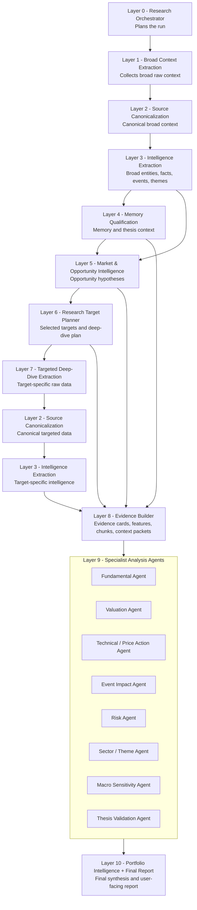

Below is the detailed implementation design for:

```text
Layer 9 — Specialist Analysis Agents
```

Layer 9 is where your system starts doing **specialist investment analysis**, but still in a controlled, evidence-linked way.

Layer 8 prepares:

```text
evidence cards
numeric features
text chunks
thesis cards
target evidence packs
agent context packets
```

Layer 9 consumes those packets and produces structured specialist assessments such as:

```text
fundamental assessment
valuation assessment
technical / price-action assessment
event impact assessment
risk assessment
sector/theme assessment
macro sensitivity assessment
management commentary assessment
fund/ETF/REIT assessment
proxy/cross-domain assessment
thesis validation assessment
```

Layer 9 does **not** produce the final buy/sell/hold decision. That belongs to Layer 10.

---

# Layer 9 — Specialist Analysis Agents

## Layer purpose

Layer 9 answers:

```text
What does each specialist think based only on the evidence packet?
Is the company fundamentally strong or weak?
Is valuation attractive, fair, expensive, or unclear?
Is the price action supportive or risky?
Is the event temporary or structural?
What are the key risks?
Does management commentary support or weaken the thesis?
Does the sector/theme support the opportunity?
Does macro context support or pressure the target?
Does the evidence support the thesis or weaken it?
What is still missing before a final decision?
```

Layer 9 should not answer:

```text
Should I buy now?
Should I sell now?
How much money should I allocate?
What exact entry price should I use?
What is the final portfolio action?
```

Layer 9 produces **specialist assessments**.
Layer 10 combines them into the final investor report and portfolio intelligence.

---

# Why Layer 9 is important

Layer 9 prevents one big LLM from making a messy all-in-one conclusion.

Instead of one model saying:

```text
This stock looks good, buy it.
```

Layer 9 separates the analysis into specialist views:

```text
Fundamental Agent:
    Business quality is strong but margins are under pressure.

Valuation Agent:
    Valuation is near peer median, not clearly cheap.

Risk Agent:
    Main risk is structural margin compression.

Event Impact Agent:
    Recent negative news may be temporary, but confirmation is needed.

Management Commentary Agent:
    Management commentary is missing or incomplete.

Thesis Agent:
    Thesis is plausible but confidence should remain moderate.
```

This design reduces hallucination because:

```text
each agent receives only relevant evidence
each agent must cite evidence IDs
each agent outputs structured JSON
agents do not freely chat with each other
final synthesis happens later in Layer 10
```

---

# Where Layer 9 sits in the full architecture



Important rule:

```text
Layer 9 analyzes evidence.
Layer 10 makes the final integrated decision/report.
```

---

# Layer 9 internal architecture

```mermaid
flowchart TB

    IN["Input from Layer 8<br/>agent_context_packets<br/>target_evidence_packs<br/>evidence_cards<br/>numeric_features<br/>text_chunks<br/>thesis_cards<br/>gap reports<br/>contradiction reports"]

    subgraph L9["Layer 9 - Specialist Analysis Agents"]

        M1["layer9_runner.py<br/>Main specialist analysis controller"]

        M2["agent_input_loader.py<br/>Loads Layer 8 outputs"]

        M3["agent_packet_validator.py<br/>Validates each agent packet"]

        M4["specialist_agent_registry.py<br/>Maps agent_type to specialist agent"]

        M5["agent_task_planner.py<br/>Builds agent tasks per target"]

        M6["retrieval_context_service.py<br/>Fetches relevant chunks and evidence"]

        M7["agent_execution_orchestrator.py<br/>Runs agents with structured prompts"]

        subgraph AGENTS["Specialist Agents"]
            A1["market_context_agent.py"]
            A2["sector_theme_agent.py"]
            A3["company_fundamental_agent.py"]
            A4["valuation_agent.py"]
            A5["technical_price_action_agent.py"]
            A6["event_impact_agent.py"]
            A7["risk_agent.py"]
            A8["management_commentary_agent.py"]
            A9["analyst_expectation_agent.py"]
            A10["macro_sensitivity_agent.py"]
            A11["fund_vehicle_agent.py"]
            A12["proxy_cross_domain_agent.py"]
            A13["thesis_validation_agent.py"]
        end

        M8["agent_output_schema_validator.py<br/>Validates JSON outputs"]

        M9["evidence_reference_checker.py<br/>Ensures every finding cites evidence"]

        M10["confidence_calibrator.py<br/>Adjusts confidence based on evidence quality"]

        M11["agent_disagreement_detector.py<br/>Finds conflicts between agents"]

        M12["target_specialist_scorecard_builder.py<br/>Builds per-target dimension scorecard"]

        M13["agent_quality_reporter.py<br/>Creates Layer 9 quality report"]

        M14["layer9_bundle_builder.py<br/>Writes final Layer 9 outputs"]
    end

    OUT["Layer 9 Output<br/>specialist_assessments<br/>target_specialist_scorecards<br/>agent_disagreement_report<br/>risk_flags<br/>thesis_validation_results<br/>layer9_quality_report"]

    IN --> M1
    M1 --> M2
    M2 --> M3
    M3 --> M4
    M4 --> M5
    M5 --> M6
    M6 --> M7
    M7 --> AGENTS
    AGENTS --> M8
    M8 --> M9
    M9 --> M10
    M10 --> M11
    M11 --> M12
    M12 --> M13
    M13 --> M14
    M14 --> OUT
```



---

# Layer 9 high-level input

Layer 9 consumes the evidence package from Layer 8.

```json
{
  "research_run_id": "RUN_2026_05_09_AUTONOMOUS_DAILY_0800",
  "layer8_outputs": {
    "evidence_cards_path": "output/2026-05-09/layer8/evidence_cards.json",
    "numeric_features_path": "output/2026-05-09/layer8/numeric_features.json",
    "text_chunks_path": "output/2026-05-09/layer8/text_chunks.json",
    "vector_index_manifest_path": "output/2026-05-09/layer8/vector_index_manifest.json",
    "thesis_cards_path": "output/2026-05-09/layer8/thesis_cards.json",
    "target_evidence_packs_path": "output/2026-05-09/layer8/target_evidence_packs.json",
    "agent_context_packets_path": "output/2026-05-09/layer8/agent_context_packets.json",
    "evidence_quality_report_path": "output/2026-05-09/layer8/evidence_quality_report.json",
    "contradiction_anomaly_report_path": "output/2026-05-09/layer8/contradiction_anomaly_report.json",
    "evidence_gap_report_path": "output/2026-05-09/layer8/evidence_gap_report.json"
  },
  "layer9_config": {
    "run_agents": [
      "fundamental_agent",
      "valuation_agent",
      "technical_price_action_agent",
      "event_impact_agent",
      "risk_agent",
      "sector_theme_agent",
      "macro_sensitivity_agent",
      "thesis_validation_agent"
    ],
    "strict_evidence_mode": true,
    "allow_agent_partial_output": true,
    "max_retrieved_chunks_per_agent": 12,
    "min_evidence_strength_for_strong_claim": 0.7
  }
}
```

---

# Layer 9 high-level output

Layer 9 produces structured specialist assessments.

```json
{
  "research_run_id": "RUN_2026_05_09_AUTONOMOUS_DAILY_0800",
  "layer": "L9_specialist_analysis_agents",
  "status": "success",
  "specialist_assessments_path": "output/2026-05-09/layer9/specialist_assessments.json",
  "target_specialist_scorecards_path": "output/2026-05-09/layer9/target_specialist_scorecards.json",
  "agent_disagreement_report_path": "output/2026-05-09/layer9/agent_disagreement_report.json",
  "risk_flags_path": "output/2026-05-09/layer9/risk_flags.json",
  "thesis_validation_results_path": "output/2026-05-09/layer9/thesis_validation_results.json",
  "layer9_quality_report_path": "output/2026-05-09/layer9/layer9_quality_report.json"
}
```

---

# Layer 9 output folder

```text
output/2026-05-09/layer9/
├── specialist_assessments.json
├── target_specialist_scorecards.json
├── agent_disagreement_report.json
├── risk_flags.json
├── thesis_validation_results.json
├── agent_execution_trace.json
├── agent_prompt_logs/
├── invalid_agent_outputs.json
├── layer9_quality_report.json
├── layer9_audit_log.json
└── layer9_manifest.json
```

---

# What Layer 9 produces

Layer 9 produces six main outputs:

```text
1. Specialist assessments
2. Target specialist scorecards
3. Agent disagreement report
4. Risk flags
5. Thesis validation results
6. Layer 9 quality report
```

The most important output for Layer 10 is:

```text
target_specialist_scorecards.json
```

Layer 10 uses those scorecards to build the final recommendation/report.

---

# Recommended folder structure

```text
specialist_analysis_layer/
├── layer9_runner.py
├── agent_input_loader.py
├── agent_packet_validator.py
├── specialist_agent_registry.py
├── agent_task_planner.py
├── retrieval_context_service.py
├── agent_execution_orchestrator.py
│
├── agents/
│   ├── market_context_agent.py
│   ├── sector_theme_agent.py
│   ├── company_fundamental_agent.py
│   ├── valuation_agent.py
│   ├── technical_price_action_agent.py
│   ├── event_impact_agent.py
│   ├── risk_agent.py
│   ├── management_commentary_agent.py
│   ├── analyst_expectation_agent.py
│   ├── macro_sensitivity_agent.py
│   ├── fund_vehicle_agent.py
│   ├── proxy_cross_domain_agent.py
│   ├── thesis_validation_agent.py
│   ├── commodity_agent_later.py
│   └── real_estate_regional_agent_later.py
│
├── validators/
│   ├── agent_output_schema_validator.py
│   ├── evidence_reference_checker.py
│   ├── confidence_calibrator.py
│   └── hallucination_guardrail.py
│
├── post_processors/
│   ├── agent_disagreement_detector.py
│   ├── target_specialist_scorecard_builder.py
│   ├── risk_flag_builder.py
│   └── thesis_validation_result_builder.py
│
├── reports/
│   ├── agent_quality_reporter.py
│   └── layer9_audit_logger.py
│
└── layer9_bundle_builder.py
```

---

# Core service modules

## 1. `layer9_runner.py`

### Purpose

Main controller for Layer 9.

### Why important

It coordinates all specialist agent execution and ensures every agent output follows evidence-linked rules.

### Questions it answers

```text
Which targets need specialist analysis?
Which agents should run for each target?
Which evidence packet should each agent receive?
Did each agent cite evidence?
Which assessments passed validation?
What should be sent to Layer 10?
```

### Input

```json
{
  "research_run_id": "RUN_2026_05_09_AUTONOMOUS_DAILY_0800",
  "agent_context_packets_path": "output/2026-05-09/layer8/agent_context_packets.json",
  "target_evidence_packs_path": "output/2026-05-09/layer8/target_evidence_packs.json",
  "evidence_cards_path": "output/2026-05-09/layer8/evidence_cards.json",
  "numeric_features_path": "output/2026-05-09/layer8/numeric_features.json",
  "text_chunks_path": "output/2026-05-09/layer8/text_chunks.json"
}
```

### Logic

```text
Load Layer 8 inputs.
Validate agent packets.
Create agent tasks per target.
Retrieve relevant chunks/evidence for each packet.
Run specialist agents.
Validate agent outputs.
Check evidence references.
Calibrate confidence.
Detect disagreements.
Build target specialist scorecards.
Write Layer 9 bundle.
```

### Output

```json
{
  "status": "success",
  "targets_processed": 10,
  "agent_tasks_created": 58,
  "agent_tasks_success": 54,
  "agent_tasks_partial": 3,
  "agent_tasks_failed": 1,
  "specialist_assessments_created": 54,
  "scorecards_created": 10
}
```

---

## 2. `agent_input_loader.py`

### Purpose

Load all Layer 8 evidence objects.

### Input

```json
{
  "agent_context_packets_path": "",
  "target_evidence_packs_path": "",
  "evidence_cards_path": "",
  "numeric_features_path": "",
  "text_chunks_path": "",
  "thesis_cards_path": "",
  "evidence_gap_report_path": "",
  "contradiction_anomaly_report_path": ""
}
```

### Logic

```text
Read JSON files.
Group evidence by target_id.
Group context packets by agent_type.
Attach evidence gaps and contradictions.
Return all inputs in memory.
```

### Output

```json
{
  "agent_context_packets": [],
  "target_evidence_packs": [],
  "evidence_cards": [],
  "numeric_features": [],
  "text_chunks": [],
  "thesis_cards": [],
  "evidence_gaps": [],
  "contradictions": []
}
```

---

## 3. `agent_packet_validator.py`

### Purpose

Validate that each agent context packet is safe and complete.

### Checks

```text
packet_id exists
target_id exists
agent_type exists
allowed_evidence_card_ids exist
numeric_feature_group_ids exist
thesis_card_id exists if required
evidence gaps are attached
instructions exist
source_traceability_required = true
```

### Output

```json
{
  "packet_id": "AGPACK_20260509_TARGET_001_VALUATION",
  "valid": true,
  "warnings": [],
  "errors": []
}
```

---

## 4. `specialist_agent_registry.py`

### Purpose

Map `agent_type` to implementation.

### Registry example

```python
SPECIALIST_AGENT_REGISTRY = {
    "market_context_agent": "agents.market_context_agent.run",
    "sector_theme_agent": "agents.sector_theme_agent.run",
    "fundamental_agent": "agents.company_fundamental_agent.run",
    "valuation_agent": "agents.valuation_agent.run",
    "technical_price_action_agent": "agents.technical_price_action_agent.run",
    "event_impact_agent": "agents.event_impact_agent.run",
    "risk_agent": "agents.risk_agent.run",
    "management_commentary_agent": "agents.management_commentary_agent.run",
    "analyst_expectation_agent": "agents.analyst_expectation_agent.run",
    "macro_sensitivity_agent": "agents.macro_sensitivity_agent.run",
    "fund_vehicle_agent": "agents.fund_vehicle_agent.run",
    "proxy_cross_domain_agent": "agents.proxy_cross_domain_agent.run",
    "thesis_validation_agent": "agents.thesis_validation_agent.run"
}
```

### Output

```json
{
  "agent_type": "valuation_agent",
  "agent_found": true,
  "module_path": "agents.valuation_agent.run"
}
```

---

## 5. `agent_task_planner.py`

### Purpose

Create executable agent tasks.

### Input

```json
{
  "agent_context_packets": [],
  "target_evidence_packs": []
}
```

### Logic

```text
For each target:
    identify available agent packets
    create one task per agent packet
    attach target_id, agent_type, packet_id
    attach priority
    attach timeout/retry policy
```

### Output

```json
{
  "agent_tasks": [
    {
      "agent_task_id": "AGTASK_TARGET_001_VALUATION",
      "target_id": "TARGET_001",
      "agent_type": "valuation_agent",
      "packet_id": "AGPACK_TARGET_001_VALUATION",
      "priority": "high",
      "required": true
    }
  ]
}
```

---

## 6. `retrieval_context_service.py`

### Purpose

Fetch the exact evidence, features, and chunks required by an agent.

### Why important

Agents should not receive everything. They should receive only the context relevant to their role.

### Input

```json
{
  "packet_id": "AGPACK_TARGET_001_VALUATION",
  "allowed_evidence_card_ids": ["EVID_VAL_001", "EVID_PEER_002"],
  "numeric_feature_group_ids": ["FEAT_VAL_TARGET_001", "FEAT_PEER_TARGET_001"],
  "relevant_chunk_ids": []
}
```

### Logic

```text
Fetch allowed evidence cards.
Fetch numeric feature groups.
Fetch relevant text chunks.
Fetch thesis card.
Fetch evidence gaps.
Fetch contradiction report.
Build compact agent input.
```

### Output

```json
{
  "agent_input_context": {
    "packet_id": "AGPACK_TARGET_001_VALUATION",
    "target_summary": {},
    "questions_for_agent": [],
    "evidence_cards": [],
    "numeric_features": [],
    "text_chunks": [],
    "thesis_card": {},
    "evidence_gaps": [],
    "contradictions": []
  }
}
```

---

## 7. `agent_execution_orchestrator.py`

### Purpose

Run the specialist agents.

### Logic

```text
For rule-heavy agents:
    run deterministic scoring first.
For LLM-heavy agents:
    build structured prompt using context packet.
    require JSON-only output.
    validate output.
If agent fails:
    retry once if retryable.
    otherwise mark partial/failure.
```

### Output

```json
{
  "agent_task_id": "AGTASK_TARGET_001_VALUATION",
  "agent_type": "valuation_agent",
  "status": "success",
  "raw_agent_output_path": "output/2026-05-09/layer9/agent_outputs/AGTASK_TARGET_001_VALUATION.json"
}
```

---

# Specialist agent design

## 8. `market_context_agent.py`

### Purpose

Assess whether the current market background supports or pressures selected targets.

### Why important

A good target may still be risky if the broad market is weak.

### Questions it answers

```text
Is the broad market supportive, neutral, or risky?
Are flows, volatility, rates, and macro conditions supportive?
Should target-level analysis be interpreted cautiously because of market regime?
```

### Input

```json
{
  "agent_type": "market_context_agent",
  "target_id": "MARKET_OR_TARGET",
  "evidence_cards": [],
  "numeric_features": [
    {
      "feature_group": "macro_features"
    }
  ],
  "market_view": {},
  "memory_context": {}
}
```

### Logic

```text
Review macro features.
Review market signal evidence.
Review FII/DII, VIX, breadth, rates, currency, commodities.
Compare with market view from Layer 5.
Assess market support level.
Do not make final investment recommendation.
```

### Output

```json
{
  "assessment_id": "ASSESS_20260509_MARKET_001",
  "agent_type": "market_context_agent",
  "target_id": "MARKET_INDIA",
  "assessment_label": "neutral_to_cautious",
  "summary": "The broad market environment is mixed, with negative FII flows partly offset by domestic buying.",
  "key_findings": [
    {
      "finding": "Institutional flows are mixed.",
      "evidence_refs": ["EVID_FII_DII_001"]
    }
  ],
  "supportive_factors": [],
  "negative_factors": [],
  "uncertainties": [],
  "confidence": 0.72,
  "not_final_recommendation": true
}
```

---

## 9. `sector_theme_agent.py`

### Purpose

Analyze sector/theme strength and relevance.

### Questions it answers

```text
Is this theme meaningful or just noise?
Is it recurring or new?
Is it structural or short-term?
Which sectors are likely affected?
Does the sector/theme support the target thesis?
```

### Input

```json
{
  "agent_type": "sector_theme_agent",
  "target_id": "TARGET_THEME_001",
  "theme_cards": [],
  "sector_theme_views": [],
  "evidence_cards": [],
  "memory_context": {}
}
```

### Logic

```text
Review theme evidence.
Check recurrence and source diversity.
Check policy/macro/sector links.
Check whether theme has investable mapping.
Separate direct evidence from speculative causal links.
```

### Output

```json
{
  "assessment_id": "ASSESS_20260509_THEME_001",
  "agent_type": "sector_theme_agent",
  "target_id": "TARGET_THEME_001",
  "assessment_label": "structurally_interesting_but_needs_mapping",
  "summary": "The AI data center power demand theme appears structurally interesting, but direct listed-company exposure needs verification.",
  "theme_strength": "medium_high",
  "structural_relevance": "high",
  "investment_relevance": "medium",
  "key_findings": [],
  "supportive_factors": [],
  "negative_factors": [],
  "data_gaps": [
    "Need listed company exposure mapping",
    "Need order book confirmation"
  ],
  "confidence": 0.66,
  "evidence_refs": []
}
```

---

## 10. `company_fundamental_agent.py`

### Purpose

Analyze company financial and business quality.

### Questions it answers

```text
Is the company fundamentally strong?
Are revenue and profit growing?
Are margins stable or declining?
Is debt manageable?
Is cash flow healthy?
Is shareholding stable?
Does fundamental quality support the thesis?
```

### Input

```json
{
  "agent_type": "fundamental_agent",
  "target_id": "TARGET_001",
  "numeric_features": [
    {
      "feature_group": "fundamental_features"
    }
  ],
  "evidence_cards": [],
  "text_chunks": [],
  "evidence_gaps": []
}
```

### Logic

```text
Review growth features.
Review margin features.
Review debt and cash flow features.
Review shareholding trend.
Review management commentary chunks if available.
Identify strengths, weaknesses, and missing data.
Return structured assessment only.
```

### Output

```json
{
  "assessment_id": "ASSESS_20260509_TARGET_001_FUND",
  "agent_type": "fundamental_agent",
  "target_id": "TARGET_001",
  "assessment_label": "fundamentally_sound_with_margin_watch",
  "summary": "The company appears fundamentally sound, but margin pressure needs monitoring.",
  "dimension_scores": {
    "growth_score": 72,
    "profitability_score": 68,
    "balance_sheet_score": 75,
    "cash_flow_score": 70,
    "management_quality_signal": 60,
    "overall_fundamental_score": 69
  },
  "supportive_factors": [
    {
      "factor": "Revenue growth remains positive.",
      "evidence_refs": ["EVID_FUND_001"]
    }
  ],
  "negative_factors": [
    {
      "factor": "Operating margin trend is declining.",
      "evidence_refs": ["EVID_MARGIN_001"]
    }
  ],
  "data_gaps": [],
  "confidence": 0.74,
  "not_final_recommendation": true
}
```

---

## 11. `valuation_agent.py`

### Purpose

Analyze valuation attractiveness using valuation, peer, analyst, and price features.

### Questions it answers

```text
Is valuation cheap, fair, expensive, or unclear?
How does valuation compare to peers?
How does valuation compare to history if available?
Is analyst upside meaningful?
Is valuation attractive enough given risks?
```

### Input

```json
{
  "agent_type": "valuation_agent",
  "target_id": "TARGET_001",
  "numeric_features": [
    {
      "feature_group": "valuation_features"
    },
    {
      "feature_group": "peer_features"
    },
    {
      "feature_group": "analyst_revision_features"
    }
  ],
  "evidence_cards": [],
  "evidence_gaps": []
}
```

### Logic

```text
Review PE/PB/EV metrics.
Review peer percentiles.
Review analyst target upside.
Review historical valuation if available.
Adjust confidence if valuation data is incomplete.
Do not say buy/sell.
```

### Output

```json
{
  "assessment_id": "ASSESS_20260509_TARGET_001_VAL",
  "agent_type": "valuation_agent",
  "target_id": "TARGET_001",
  "assessment_label": "fair_to_slightly_attractive",
  "summary": "Valuation appears near fair value with some upside, but not deeply discounted.",
  "dimension_scores": {
    "absolute_valuation_score": 62,
    "relative_valuation_score": 58,
    "analyst_upside_score": 65,
    "valuation_margin_of_safety_score": 55,
    "overall_valuation_score": 60
  },
  "supportive_factors": [],
  "negative_factors": [],
  "data_gaps": [
    "Historical valuation percentile is unavailable."
  ],
  "confidence": 0.68,
  "not_final_recommendation": true
}
```

---

## 12. `technical_price_action_agent.py`

### Purpose

Analyze price trend, momentum, drawdown, support/resistance hints, and event reaction.

### Questions it answers

```text
Is the stock in an uptrend, downtrend, sideways, or recovery?
Was the event reaction large or small?
Is price near 52-week high/low?
Is there abnormal volume?
Is short-term price action supportive or risky?
```

### Input

```json
{
  "agent_type": "technical_price_action_agent",
  "target_id": "TARGET_001",
  "numeric_features": [
    {
      "feature_group": "price_features"
    },
    {
      "feature_group": "event_price_reaction_features"
    },
    {
      "feature_group": "derivatives_features"
    }
  ],
  "evidence_cards": []
}
```

### Logic

```text
Review price returns across horizons.
Review moving averages.
Review drawdown.
Review volume spike.
Review event reaction features.
Review F&O features if available.
Do not recommend trade entry.
```

### Output

```json
{
  "assessment_id": "ASSESS_20260509_TARGET_001_TECH",
  "agent_type": "technical_price_action_agent",
  "target_id": "TARGET_001",
  "assessment_label": "short_term_pressure_medium_term_watch",
  "summary": "Short-term price action is weak after the event, but the medium-term setup requires confirmation.",
  "dimension_scores": {
    "trend_score": 48,
    "momentum_score": 42,
    "volume_confirmation_score": 60,
    "event_reaction_score": 45,
    "overall_price_action_score": 49
  },
  "supportive_factors": [],
  "negative_factors": [],
  "confidence": 0.69,
  "not_final_recommendation": true
}
```

---

## 13. `event_impact_agent.py`

### Purpose

Analyze whether a key event is temporary, medium-term, or structural.

### Questions it answers

```text
What happened?
Is the event material?
Is the impact temporary or structural?
What evidence supports that classification?
What would confirm or invalidate the event thesis?
```

### Input

```json
{
  "agent_type": "event_impact_agent",
  "target_id": "TARGET_001",
  "event_cards": [],
  "event_impact_views": [],
  "event_price_reaction_features": [],
  "relevant_chunks": [],
  "evidence_cards": []
}
```

### Logic

```text
Review Layer 3 event card.
Review Layer 5 event impact view.
Review price reaction.
Review management/news chunks.
Classify event impact as noise/temporary/medium-term/structural/unknown.
List evidence and data gaps.
```

### Output

```json
{
  "assessment_id": "ASSESS_20260509_TARGET_001_EVENT",
  "agent_type": "event_impact_agent",
  "target_id": "TARGET_001",
  "event_id": "EVT_MARGIN_PRESSURE",
  "assessment_label": "medium_term_risk_not_confirmed_structural",
  "summary": "The event appears material and medium-term, but there is not enough evidence to call it structural yet.",
  "event_materiality": "medium_high",
  "temporary_or_structural": "medium_term_uncertain",
  "supportive_factors": [
    {
      "factor": "Price reaction was large and negative.",
      "evidence_refs": ["EVID_EVENT_REACTION_001"]
    }
  ],
  "negative_factors": [],
  "data_gaps": [
    "Need management commentary on margin outlook."
  ],
  "confidence": 0.71,
  "not_final_recommendation": true
}
```

---

## 14. `risk_agent.py`

### Purpose

Analyze downside risks, red flags, contradictions, and missing data.

### Questions it answers

```text
What are the key risks?
Are there financial, governance, legal, macro, sector, or valuation risks?
Are there contradictions in evidence?
Are there critical missing data points?
Should confidence be reduced?
```

### Input

```json
{
  "agent_type": "risk_agent",
  "target_id": "TARGET_001",
  "risk_evidence_cards": [],
  "contradiction_anomalies": [],
  "evidence_gaps": [],
  "numeric_features": [],
  "text_chunks": []
}
```

### Logic

```text
Review debt, margin, cash flow, governance, litigation, regulatory, and event risk evidence.
Review contradiction anomalies.
Review missing data.
Classify risk severity.
Create risk flags.
Do not say avoid/sell as final recommendation.
```

### Output

```json
{
  "assessment_id": "ASSESS_20260509_TARGET_001_RISK",
  "agent_type": "risk_agent",
  "target_id": "TARGET_001",
  "assessment_label": "moderate_risk_with_margin_uncertainty",
  "summary": "The key risk is whether margin pressure becomes structural.",
  "risk_flags": [
    {
      "risk_flag_id": "RISK_TARGET_001_001",
      "risk_type": "margin_pressure",
      "severity": "medium_high",
      "description": "Margin pressure may affect profitability if sustained.",
      "evidence_refs": ["EVID_MARGIN_001", "EVID_EVENT_001"]
    }
  ],
  "contradictions": [],
  "critical_data_gaps": [],
  "risk_score": 64,
  "confidence": 0.76,
  "not_final_recommendation": true
}
```

---

## 15. `management_commentary_agent.py`

### Purpose

Analyze management commentary from concalls, presentations, filings, and official statements.

### Questions it answers

```text
What did management say?
Did management acknowledge the issue?
Did management provide guidance?
Is commentary confident, cautious, defensive, or unclear?
Does commentary support or weaken the thesis?
```

### Input

```json
{
  "agent_type": "management_commentary_agent",
  "target_id": "TARGET_001",
  "text_chunks": [],
  "evidence_cards": [],
  "questions_for_agent": []
}
```

### Logic

```text
Review only high-reliability management/filing chunks.
Extract commentary themes.
Check whether commentary answers target questions.
Separate direct management statements from analyst/opinion statements.
```

### Output

```json
{
  "assessment_id": "ASSESS_20260509_TARGET_001_MGMT",
  "agent_type": "management_commentary_agent",
  "target_id": "TARGET_001",
  "assessment_label": "management_commentary_insufficient",
  "summary": "Recent management commentary was not available, so confidence should be reduced.",
  "management_tone": "unknown",
  "guidance_direction": "unknown",
  "supportive_factors": [],
  "negative_factors": [],
  "data_gaps": [
    "No recent concall transcript available."
  ],
  "confidence": 0.42,
  "not_final_recommendation": true
}
```

---

## 16. `analyst_expectation_agent.py`

### Purpose

Analyze analyst estimates, revisions, recommendation trends, and target price implications.

### Questions it answers

```text
Are analysts raising or cutting estimates?
Is target upside meaningful?
Are recommendations improving or worsening?
Is there high dispersion in estimates?
Does analyst data support or weaken the thesis?
```

### Input

```json
{
  "agent_type": "analyst_expectation_agent",
  "target_id": "TARGET_001",
  "numeric_features": [
    {
      "feature_group": "analyst_revision_features"
    }
  ],
  "evidence_cards": []
}
```

### Output

```json
{
  "assessment_id": "ASSESS_20260509_TARGET_001_ANALYST",
  "agent_type": "analyst_expectation_agent",
  "target_id": "TARGET_001",
  "assessment_label": "mixed_analyst_expectations",
  "summary": "Analyst target upside exists, but EPS revisions are not clearly positive.",
  "dimension_scores": {
    "target_upside_score": 65,
    "revision_momentum_score": 48,
    "recommendation_support_score": 62,
    "overall_analyst_signal_score": 58
  },
  "supportive_factors": [],
  "negative_factors": [],
  "confidence": 0.67,
  "not_final_recommendation": true
}
```

---

## 17. `macro_sensitivity_agent.py`

### Purpose

Analyze how macro conditions affect the selected target.

### Questions it answers

```text
Is this target sensitive to rates, currency, commodities, inflation, liquidity, or global risk?
Does current macro support or pressure the opportunity?
What macro variable should be monitored?
```

### Input

```json
{
  "agent_type": "macro_sensitivity_agent",
  "target_id": "TARGET_001",
  "macro_features": {},
  "sector_theme_context": {},
  "evidence_cards": []
}
```

### Output

```json
{
  "assessment_id": "ASSESS_20260509_TARGET_001_MACRO",
  "agent_type": "macro_sensitivity_agent",
  "target_id": "TARGET_001",
  "assessment_label": "moderately_rate_sensitive",
  "summary": "The target is moderately sensitive to interest-rate and liquidity conditions.",
  "macro_sensitivities": [
    {
      "macro_factor": "interest_rates",
      "sensitivity": "medium",
      "direction": "lower_rates_supportive",
      "evidence_refs": ["EVID_MACRO_001"]
    }
  ],
  "confidence": 0.66,
  "not_final_recommendation": true
}
```

---

## 18. `fund_vehicle_agent.py`

### Purpose

Analyze ETFs, mutual funds, REITs, and InvITs.

### Questions it answers

```text
Is this vehicle a reasonable way to express the theme?
What are the fees, AUM, liquidity, holdings, and concentration?
Does the vehicle match the opportunity?
What risks exist?
```

### Input

```json
{
  "agent_type": "fund_vehicle_agent",
  "target_id": "TARGET_ETF_001",
  "numeric_features": [
    {
      "feature_group": "fund_vehicle_features"
    }
  ],
  "evidence_cards": []
}
```

### Output

```json
{
  "assessment_id": "ASSESS_20260509_ETF_001",
  "agent_type": "fund_vehicle_agent",
  "target_id": "TARGET_ETF_001",
  "assessment_label": "vehicle_needs_comparison",
  "summary": "The vehicle may express the theme, but fee, liquidity, and tracking data need comparison against alternatives.",
  "vehicle_fit_score": 58,
  "supportive_factors": [],
  "negative_factors": [],
  "data_gaps": [],
  "confidence": 0.61,
  "not_final_recommendation": true
}
```

---

## 19. `proxy_cross_domain_agent.py`

### Purpose

Analyze proxy mappings and cross-domain opportunity chains.

### Why important

This supports your non-stock opportunity branch.

Examples:

```text
private company → listed suppliers
industrial corridor → logistics / cement / real estate / REITs
AI data centers → power / electrical equipment / data centers
rate cuts → real estate / NBFCs / bonds
```

### Questions it answers

```text
Is the causal chain reasonable?
Which parts are evidence-backed?
Which parts are speculative?
Which listed proxies or vehicles need further research?
Should this remain a watch item?
```

### Input

```json
{
  "agent_type": "proxy_cross_domain_agent",
  "target_id": "TARGET_OPENAI_PROXY_001",
  "cross_domain_chains": [],
  "proxy_mapping_evidence": [],
  "evidence_cards": [],
  "text_chunks": []
}
```

### Output

```json
{
  "assessment_id": "ASSESS_20260509_PROXY_001",
  "agent_type": "proxy_cross_domain_agent",
  "target_id": "TARGET_OPENAI_PROXY_001",
  "assessment_label": "plausible_but_proxy_exposure_unverified",
  "summary": "The causal chain is plausible, but direct revenue exposure for listed proxies requires verification.",
  "chain_quality": "moderate",
  "speculative_steps": [
    {
      "step": 3,
      "reason": "Listed beneficiary exposure not yet directly supported."
    }
  ],
  "recommended_follow_up_targets": [
    {
      "target_name": "Data center infrastructure theme",
      "target_type": "sector_theme"
    }
  ],
  "confidence": 0.57,
  "not_final_recommendation": true
}
```

---

## 20. `thesis_validation_agent.py`

### Purpose

Validate whether the current evidence supports, weakens, or invalidates the thesis card.

### Questions it answers

```text
Does the evidence support the thesis?
What weakens the thesis?
What invalidates the thesis?
What is still unknown?
Should confidence be upgraded, downgraded, or unchanged?
```

### Input

```json
{
  "agent_type": "thesis_validation_agent",
  "target_id": "TARGET_001",
  "thesis_card": {},
  "evidence_cards": [],
  "specialist_assessments": []
}
```

### Logic

```text
Review thesis statement.
Review supporting evidence.
Review weakening evidence.
Review risk flags.
Review contradictions and gaps.
Classify thesis status.
Do not make final portfolio decision.
```

### Output

```json
{
  "assessment_id": "ASSESS_20260509_TARGET_001_THESIS",
  "agent_type": "thesis_validation_agent",
  "target_id": "TARGET_001",
  "thesis_status": "partially_supported_needs_confirmation",
  "summary": "The thesis is plausible but not fully confirmed because management commentary and margin outlook are incomplete.",
  "supporting_evidence_ids": [],
  "weakening_evidence_ids": [],
  "critical_gaps": [
    "Management commentary missing",
    "Need confirmation that margin pressure is temporary"
  ],
  "confidence_change_recommendation": "hold_or_slight_downgrade",
  "updated_thesis_confidence": 0.58,
  "not_final_recommendation": true
}
```

---

# Later agents

## 21. `commodity_agent_later.py`

Use later for:

```text
gold
crude oil
copper
lithium
natural gas
steel
cement inputs
```

Output:

```json
{
  "agent_type": "commodity_agent",
  "assessment_label": "commodity_pressure_or_support",
  "commodity_sensitivity": [],
  "confidence": 0.0
}
```

## 22. `real_estate_regional_agent_later.py`

Use later for:

```text
industrial corridors
new airports
metro expansion
warehouse hubs
regional infrastructure growth
```

Output:

```json
{
  "agent_type": "real_estate_regional_agent",
  "assessment_label": "regional_opportunity_requires_field_validation",
  "regional_growth_drivers": [],
  "listed_proxy_links": [],
  "confidence": 0.0
}
```

---

# Validation and post-processing modules

## 23. `agent_output_schema_validator.py`

### Purpose

Ensure every specialist assessment follows schema.

### Checks

```text
assessment_id exists
agent_type exists
target_id exists
assessment_label exists
summary exists
evidence_refs exist for key findings
confidence exists
not_final_recommendation = true
no forbidden final recommendation words
```

### Output

```json
{
  "valid_assessments": 54,
  "invalid_assessments": 2,
  "errors": [
    {
      "assessment_id": "ASSESS_BAD_001",
      "error": "missing evidence_refs"
    }
  ]
}
```

---

## 24. `evidence_reference_checker.py`

### Purpose

Ensure every agent finding links back to evidence.

### Rule

```text
No evidence reference → finding is downgraded or removed.
```

### Output

```json
{
  "assessment_id": "ASSESS_TARGET_001_VAL",
  "evidence_check_status": "pass_with_warnings",
  "unsupported_findings": [],
  "downgraded_findings": []
}
```

---

## 25. `confidence_calibrator.py`

### Purpose

Adjust agent confidence based on evidence quality.

### Factors

```text
evidence strength
source reliability
missing data
contradictions
agent output certainty
number of supporting evidence cards
claim vs fact mix
coverage status
```

### Output

```json
{
  "assessment_id": "ASSESS_TARGET_001_VAL",
  "original_confidence": 0.78,
  "calibrated_confidence": 0.68,
  "calibration_reason": [
    "Historical valuation data missing",
    "Peer comparison available",
    "Analyst data available"
  ]
}
```

---

## 26. `hallucination_guardrail.py`

### Purpose

Prevent agents from creating unsupported conclusions.

### Rules

```text
Do not allow buy/sell recommendations.
Do not allow unsupported facts.
Do not allow claims to be treated as facts.
Do not allow final target price or allocation decision.
Do not allow “guaranteed”, “definitely”, or overconfident language.
Do not allow proxy exposure to be called confirmed unless evidence supports it.
```

### Output

```json
{
  "assessment_id": "ASSESS_TARGET_001_PROXY",
  "guardrail_status": "downgraded",
  "issues": [
    "Agent stated proxy exposure as confirmed, but evidence only supports plausibility."
  ],
  "action": "rewrite_or_lower_confidence"
}
```

---

## 27. `agent_disagreement_detector.py`

### Purpose

Detect conflicts between specialist agents.

### Examples

```text
Fundamental Agent: positive
Valuation Agent: expensive
Risk Agent: high risk
Thesis Agent: only partially supported
```

This is not bad. It is useful.

### Output

```json
{
  "agent_disagreements": [
    {
      "target_id": "TARGET_001",
      "disagreement_id": "DISAGREE_20260509_001",
      "type": "valuation_vs_fundamental",
      "description": "Fundamental quality is positive, but valuation is only fair and margin of safety is limited.",
      "related_assessments": [
        "ASSESS_TARGET_001_FUND",
        "ASSESS_TARGET_001_VAL"
      ],
      "severity": "medium",
      "send_to_layer10": true
    }
  ]
}
```

---

## 28. `risk_flag_builder.py`

### Purpose

Consolidate risk flags across agents.

### Output

```json
{
  "risk_flags": [
    {
      "risk_flag_id": "RISK_TARGET_001_MARGIN",
      "target_id": "TARGET_001",
      "risk_type": "margin_pressure",
      "severity": "medium_high",
      "source_agents": ["risk_agent", "event_impact_agent", "fundamental_agent"],
      "evidence_refs": ["EVID_MARGIN_001", "EVID_EVENT_001"],
      "description": "Margin pressure is the main thesis risk."
    }
  ]
}
```

---

## 29. `target_specialist_scorecard_builder.py`

### Purpose

Build one specialist scorecard per target.

### Why important

Layer 10 should not read all raw agent outputs first. It should receive a compact, structured scorecard.

### Input

```json
{
  "target_id": "TARGET_001",
  "specialist_assessments": [],
  "risk_flags": [],
  "disagreements": []
}
```

### Output

```json
{
  "target_scorecard_id": "SCORECARD_20260509_TARGET_001",
  "target_id": "TARGET_001",
  "target_name": "HDFC Bank",
  "ticker": "HDFCBANK.NS",
  "target_type": "listed_company",

  "dimension_scores": {
    "fundamental_score": 69,
    "valuation_score": 60,
    "technical_score": 49,
    "event_impact_score": 55,
    "risk_score": 64,
    "sector_theme_score": 62,
    "macro_support_score": 58,
    "analyst_signal_score": 58,
    "thesis_support_score": 58
  },

  "dimension_labels": {
    "fundamentals": "sound_with_margin_watch",
    "valuation": "fair_to_slightly_attractive",
    "technical": "short_term_pressure",
    "risk": "moderate_risk",
    "thesis": "partially_supported_needs_confirmation"
  },

  "top_supportive_points": [
    {
      "point": "Fundamental quality appears reasonable.",
      "evidence_refs": ["EVID_FUND_001"]
    }
  ],

  "top_risks": [
    {
      "risk": "Margin pressure may become structural.",
      "evidence_refs": ["EVID_MARGIN_001"]
    }
  ],

  "critical_data_gaps": [
    "Recent management commentary unavailable."
  ],

  "agent_disagreement_ids": ["DISAGREE_001"],
  "ready_for_layer10": true,
  "overall_specialist_confidence": 0.64,
  "not_final_recommendation": true
}
```

---

## 30. `thesis_validation_result_builder.py`

### Purpose

Consolidate thesis agent results.

### Output

```json
{
  "thesis_validation_results": [
    {
      "target_id": "TARGET_001",
      "thesis_card_id": "THESIS_CARD_TARGET_001",
      "thesis_status": "partially_supported_needs_confirmation",
      "support_level": "medium",
      "weakening_level": "medium",
      "critical_gaps": [],
      "updated_thesis_confidence": 0.58,
      "send_to_layer10": true
    }
  ]
}
```

---

## 31. `agent_quality_reporter.py`

### Purpose

Create quality report for Layer 9.

### Output

```json
{
  "research_run_id": "RUN_2026_05_09_AUTONOMOUS_DAILY_0800",
  "agent_tasks_created": 58,
  "agent_tasks_success": 54,
  "agent_tasks_failed": 1,
  "agent_tasks_partial": 3,
  "assessments_validated": 54,
  "assessments_downgraded": 6,
  "unsupported_findings_removed": 4,
  "average_assessment_confidence": 0.67,
  "targets_ready_for_layer10": 9,
  "targets_with_critical_gaps": 1
}
```

---

## 32. `layer9_bundle_builder.py`

### Purpose

Build the final Layer 9 output package.

### Output

```json
{
  "research_run_id": "RUN_2026_05_09_AUTONOMOUS_DAILY_0800",
  "layer": "L9_specialist_analysis_agents",
  "created_at": "2026-05-09T14:30:00+05:30",
  "specialist_assessments_path": "",
  "target_specialist_scorecards_path": "",
  "agent_disagreement_report_path": "",
  "risk_flags_path": "",
  "thesis_validation_results_path": "",
  "layer9_quality_report_path": ""
}
```

---

# Main Layer 9 schemas

## Specialist assessment schema

```json
{
  "assessment_id": "ASSESS_20260509_TARGET_001_VAL",
  "research_run_id": "RUN_2026_05_09_AUTONOMOUS_DAILY_0800",
  "target_id": "TARGET_20260509_0001",
  "target_name": "HDFC Bank",
  "ticker": "HDFCBANK.NS",
  "agent_type": "valuation_agent",

  "assessment_label": "fair_to_slightly_attractive",
  "summary": "Valuation appears near fair value with some upside, but not deeply discounted.",

  "dimension_scores": {
    "overall_valuation_score": 60
  },

  "key_findings": [
    {
      "finding": "Valuation is close to peer median.",
      "evidence_refs": ["EVID_PEER_001"]
    }
  ],

  "supportive_factors": [],
  "negative_factors": [],
  "data_gaps": [],
  "risk_flags": [],

  "confidence": 0.68,
  "not_final_recommendation": true,

  "source_packet_id": "AGPACK_20260509_TARGET_001_VALUATION",
  "created_at": "2026-05-09T14:10:00+05:30"
}
```

---

## Target specialist scorecard schema

```json
{
  "target_scorecard_id": "SCORECARD_20260509_TARGET_001",
  "target_id": "TARGET_20260509_0001",
  "target_name": "HDFC Bank",
  "target_type": "listed_company",
  "ticker": "HDFCBANK.NS",

  "dimension_scores": {
    "fundamental_score": 69,
    "valuation_score": 60,
    "technical_score": 49,
    "event_impact_score": 55,
    "risk_score": 64,
    "sector_theme_score": 62,
    "macro_support_score": 58,
    "analyst_signal_score": 58,
    "thesis_support_score": 58
  },

  "dimension_labels": {
    "fundamentals": "sound_with_margin_watch",
    "valuation": "fair_to_slightly_attractive",
    "technical": "short_term_pressure",
    "risk": "moderate_risk",
    "thesis": "partially_supported_needs_confirmation"
  },

  "specialist_assessment_ids": [],
  "risk_flag_ids": [],
  "agent_disagreement_ids": [],
  "critical_data_gaps": [],
  "overall_specialist_confidence": 0.64,
  "ready_for_layer10": true,
  "not_final_recommendation": true
}
```

---

## Agent disagreement schema

```json
{
  "disagreement_id": "DISAGREE_20260509_001",
  "target_id": "TARGET_20260509_0001",
  "disagreement_type": "fundamental_vs_valuation",
  "description": "Fundamental quality is acceptable, but valuation is not clearly cheap.",
  "related_assessment_ids": [],
  "severity": "medium",
  "layer10_handling_hint": "Final synthesis should avoid overconfident positive conclusion.",
  "confidence": 0.76
}
```

---

## Risk flag schema

```json
{
  "risk_flag_id": "RISK_20260509_TARGET_001_001",
  "target_id": "TARGET_20260509_0001",
  "risk_type": "margin_pressure",
  "severity": "medium_high",
  "description": "Margin pressure may weaken profitability if it persists.",
  "source_agents": [
    "risk_agent",
    "event_impact_agent",
    "fundamental_agent"
  ],
  "evidence_refs": [
    "EVID_MARGIN_001",
    "EVID_EVENT_001"
  ],
  "confidence": 0.74
}
```

---

# LLM usage in Layer 9

Layer 9 can use LLMs for specialist reasoning, but under strict controls.

Use LLM for:

```text
fundamental interpretation
valuation explanation
risk reasoning
event temporary-vs-structural analysis
management commentary interpretation
sector/theme reasoning
proxy/cross-domain reasoning
thesis validation
```

Do not use LLM for:

```text
raw numeric calculation
financial ratio calculation
price return calculation
final buy/sell decision
position sizing
unverified ticker resolution
creating facts not in evidence
```

Numeric calculations are already handled in Layer 8.
Layer 9 interprets them.

---

# Standard specialist agent prompt pattern

Every specialist agent prompt should follow this style:

```text
You are a specialist investment analysis agent.

You will receive:
- target summary
- questions for your role
- evidence cards
- numeric features
- selected text chunks
- evidence gaps
- contradiction notes

Rules:
- Use only the provided evidence.
- Do not invent facts.
- Do not make final buy/sell/hold recommendations.
- Do not provide position sizing.
- Every key finding must cite evidence_refs.
- If evidence is missing, say confidence is lower.
- Claims and opinions must not be treated as facts.
- Return JSON only using the required schema.
```

---

# Layer 9 agent communication rule

Agents should not talk to each other freely.

Bad design:

```text
Fundamental Agent talks to Valuation Agent
Valuation Agent talks to Risk Agent
Risk Agent changes the thesis freely
```

Better design:

```text
Each agent receives structured context packet.
Each agent outputs structured assessment.
Post-processing detects disagreements.
Layer 10 performs final synthesis.
```

This prevents compounding hallucinations.

---

# Layer 9 scoring interpretation

Layer 9 can create dimension scores, but they are not final recommendation scores.

Example:

```text
Fundamental score = business quality lens
Valuation score = valuation lens
Technical score = price action lens
Risk score = risk severity lens
Thesis support score = thesis evidence lens
```

Layer 10 decides how to combine them.

---

# What Layer 9 should not do

Layer 9 should not:

```text
collect data
canonicalize data
create memory
select new targets
create deep-dive plan
build evidence cards
make final buy/sell/hold decision
create final investor report
perform portfolio allocation
```

Layer 9 only produces specialist assessments.

---

# Hallucination control in Layer 9

Layer 9 must enforce:

```text
No evidence_refs → finding is invalid or downgraded
No final buy/sell recommendation
No unsupported factual claims
No claim treated as fact
No proxy exposure treated as confirmed without evidence
No high confidence when data gaps are critical
No hidden agent-to-agent reasoning chains
Every output must be JSON-validated
Every assessment must include confidence and limitations
```

This is the layer where strict agent discipline matters most.

---

# What is already implemented vs missing

## Already available upstream

Your system already has or plans to have:

```text
evidence cards
numeric features
text chunks
target evidence packs
agent context packets
thesis cards
risk gaps
contradiction reports
```

These come from Layer 8.

## Layer 9 is mostly new

You need to build:

```text
1. layer9_runner.py
2. agent_input_loader.py
3. agent_packet_validator.py
4. specialist_agent_registry.py
5. agent_task_planner.py
6. retrieval_context_service.py
7. agent_execution_orchestrator.py
8. specialist agents
9. agent_output_schema_validator.py
10. evidence_reference_checker.py
11. confidence_calibrator.py
12. hallucination_guardrail.py
13. agent_disagreement_detector.py
14. risk_flag_builder.py
15. target_specialist_scorecard_builder.py
16. thesis_validation_result_builder.py
17. agent_quality_reporter.py
18. layer9_bundle_builder.py
```

---

# Recommended implementation order for Layer 9

## Step 1 — Core runner and packet loading

Build:

```text
layer9_runner.py
agent_input_loader.py
agent_packet_validator.py
specialist_agent_registry.py
agent_task_planner.py
retrieval_context_service.py
```

Goal:

```text
Layer 8 agent packets → executable agent tasks
```

---

## Step 2 — Start with four MVP agents

Build first:

```text
company_fundamental_agent.py
valuation_agent.py
risk_agent.py
thesis_validation_agent.py
```

These are the most important for stock opportunity analysis.

---

## Step 3 — Add event and technical agents

Build:

```text
event_impact_agent.py
technical_price_action_agent.py
```

These help answer:

```text
Was the price drop temporary?
Did the market overreact?
Is short-term setup risky?
```

---

## Step 4 — Add sector/theme and macro agents

Build:

```text
sector_theme_agent.py
macro_sensitivity_agent.py
market_context_agent.py
```

These make the system stronger for broader market and sector opportunities.

---

## Step 5 — Add management and analyst agents

Build:

```text
management_commentary_agent.py
analyst_expectation_agent.py
```

These are especially useful after filing_docs and analyst_estimates are stable.

---

## Step 6 — Add fund/proxy/cross-domain agents

Build:

```text
fund_vehicle_agent.py
proxy_cross_domain_agent.py
```

These support your opportunity branch beyond direct stock analysis.

---

## Step 7 — Add validators and post-processors

Build:

```text
agent_output_schema_validator.py
evidence_reference_checker.py
confidence_calibrator.py
agent_disagreement_detector.py
target_specialist_scorecard_builder.py
risk_flag_builder.py
```

Goal:

```text
individual assessments → clean scorecards for Layer 10
```

---

# Final Layer 9 contract

## Layer 8 gives Layer 9

```json
{
  "evidence_cards_path": "",
  "numeric_features_path": "",
  "text_chunks_path": "",
  "vector_index_manifest_path": "",
  "thesis_cards_path": "",
  "target_evidence_packs_path": "",
  "agent_context_packets_path": "",
  "evidence_quality_report_path": "",
  "contradiction_anomaly_report_path": "",
  "evidence_gap_report_path": ""
}
```

## Layer 9 gives Layer 10

```json
{
  "specialist_assessments_path": "",
  "target_specialist_scorecards_path": "",
  "agent_disagreement_report_path": "",
  "risk_flags_path": "",
  "thesis_validation_results_path": "",
  "layer9_quality_report_path": ""
}
```

Layer 10 uses these to produce:

```text
final target ranking
buy / wait / avoid / monitor style conclusion
portfolio-aware recommendation
daily market report
opportunity report
risk-adjusted final summary
```

---

# Final Layer 9 summary

Layer 9 is the **specialist analysis layer**.

It transforms:

```text
evidence cards
numeric features
text chunks
thesis cards
target evidence packs
agent context packets
```

into:

```text
specialist assessments
target specialist scorecards
risk flags
agent disagreement reports
thesis validation results
```

The core rule:

```text
Layer 9 analyzes evidence from specialist viewpoints.
Layer 9 does not make the final investment decision.
```

The most important design principle:

```text
Agents should not freely communicate with each other.
They should consume structured evidence packets and return structured, evidence-linked assessments.
```

This keeps your system reliable, auditable, and much safer from hallucination.
