# AI Equity Research Agent — System Architecture

> An automated, multi-layer pipeline that ingests financial news and market data, applies LLM-based analysis, and produces daily investment research reports with actionable buy/watch/avoid recommendations.

---

## System Overview

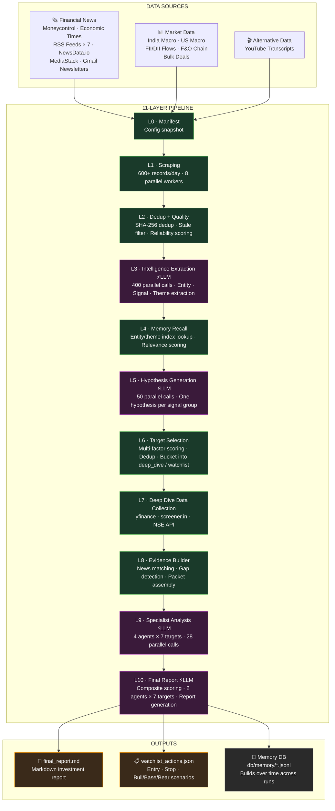

---

## Layer-by-Layer Architecture

### L0 — Manifest

Reads all config YAMLs at run start and writes a single `run_manifest.json` snapshot. Every downstream layer reads config exclusively from this file — ensures all layers run against the same config even if YAMLs change mid-day.

```
src/config/
├── l1_sources.yaml      → scraper URLs, API keys, query strings
├── l2_filters.yaml      → stale thresholds, reliability tiers
├── l3_config.yaml       → LLM provider/model, batch sizes
├── l5_config.yaml       → grouping weights, hypothesis limits
├── l6_config.yaml       → scoring weights, target caps
├── l7_config.yaml       → ticker resolution, data source limits
├── l9_config.yaml       → LLM provider/model, parallel workers
└── l10_config.yaml      → composite weights, recommendation thresholds
```

---

### L1 — Scraping Layer

Runs all scrapers in parallel via `ThreadPoolExecutor(max_workers=8)`. Each scraper is an independent module exposing a single `collect(cfg: dict) → list[dict]` interface.

```mermaid
flowchart LR
    classDef scraper fill:#1e3a5f,stroke:#4a90d9,color:#fff

    subgraph SCRAPERS["12 PARALLEL SCRAPERS"]
        direction TB
        S1["Moneycontrol\nHTML scraper · 5 categories\nmarkets · stocks · earnings\neconomy · companies"]:::scraper
        S2["Economic Times\nHTML scraper · 3 sections\nstocks_news · expert_view\nstocks_recos"]:::scraper
        S3["RSS Feeds\n7 feeds\nMint · NDTV Profit · ET\nMoneycontrol · Hindu Biz\nYahoo Finance IN\nInvesting.com IN"]:::scraper
        S4["NewsData.io API\n4 queries\nNSE/BSE market · Earnings\nRBI/inflation · FII/DII flows"]:::scraper
        S5["MediaStack API\n2 queries\nNifty/Sensex · NSE earnings"]:::scraper
        S6["Gmail API\nNewsletter scraper\nMint Briefing · Zerodha Pulse\nMorningstar · Hindu Business"]:::scraper
        S7["YouTube\nChannel transcripts\nAuto-captioning via yt-dlp"]:::scraper
        S8["India Macro\nNifty daily change\nFII/DII net flows\nMarket breadth"]:::scraper
        S9["US Macro\nS&P 500 · DXY\nVIX · 10Y Treasury yield"]:::scraper
        S10["FII/DII\nDaily institutional flows\nBSE + NSE combined"]:::scraper
        S11["Bulk Deals\nNSE bulk deal data\nQty · Price · Buy/Sell"]:::scraper
        S12["F&O Data\nNIFTY + BANKNIFTY\nOptions chain · OI · PCR"]:::scraper
    end

    SCRAPERS --> OUT["raw_records.json\n600+ records/day\n5 source_types:\nnews_article · market_snapshot\ncorporate_action · newsletter\nvideo_transcript"]
```

**Record schema:** Every scraper output follows a standard format — `source`, `source_type`, `title`, `url`, `published_at` (ISO-8601 IST), `content` (full text), `metadata`.

---

### L2 — Dedup + Quality Filter

Zero LLM calls. Deterministic filtering in a single pass.

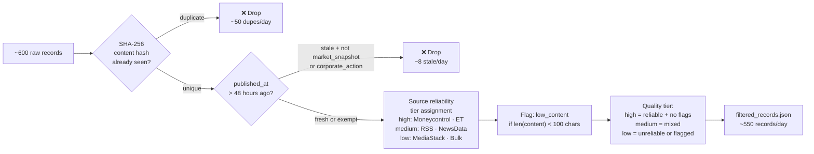

---

### L3 — Intelligence Extraction *(LLM)*

The most compute-intensive layer. Every article gets read by the LLM to extract structured investment signals.

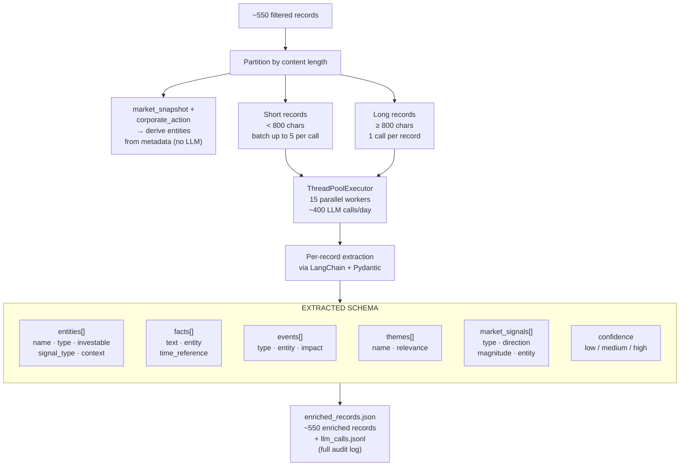

**LLM providers supported:** OpenAI (GPT models), Google Gemini, LM Studio (local models via OpenAI-compatible API).

---

### L4 — Memory Recall

Rule-based. Looks up past investment decisions stored in `db/memory/` to surface historical context for current signals.

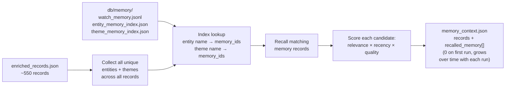

---

### L5 — Hypothesis Generation *(LLM)*

Groups enriched records into signal clusters, detects market regime, and generates one investment hypothesis per group.

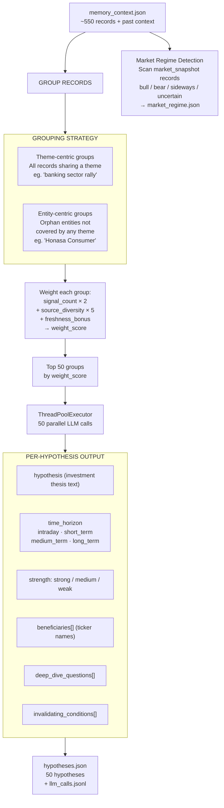

---

### L6 — Target Selection

Rule-based multi-factor scoring. Selects the 7 best targets for expensive deep-dive research.

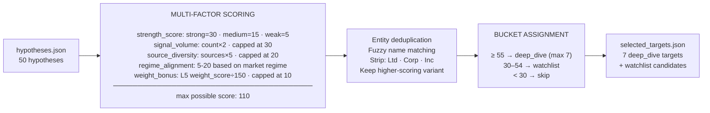

---

### L7 — Deep Dive Data Collection

No LLM. Collects real market and fundamental data for each of the 7 selected targets.

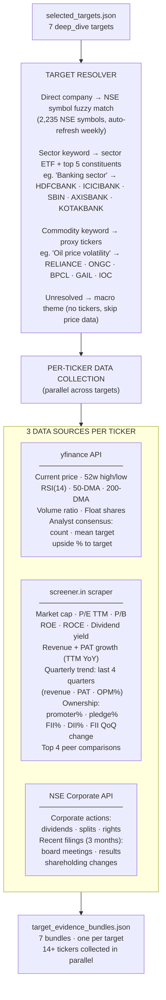

---

### L8 — Evidence Builder

Assembles self-contained evidence packets so L9 agents never need to look backwards in the pipeline.

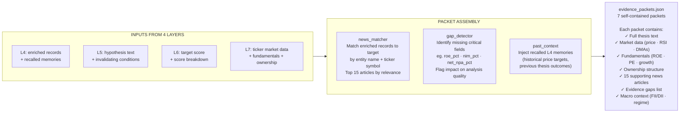

---

### L9 — Specialist Analysis *(LLM × 4 agents)*

The core analytical engine. Four independent LLM agents assess each target from different angles.

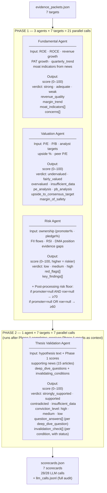

---

### L10 — Final Report *(LLM + rule-based composite)*

Combines 4 specialist scores into a composite, generates human-readable analysis, and writes the investment report.

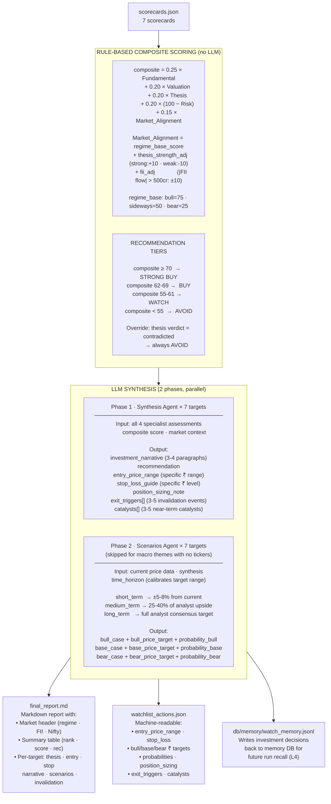

---

## Full Data Flow

| Layer | Input | Output | LLM Calls | ~Time |
|-------|-------|--------|-----------|-------|
| L0 Manifest | 9 config YAMLs | run_manifest.json | — | 1s |
| L1 Scraping | 12 live sources | 600+ raw records | — | 4–5 min |
| L2 Dedup/Quality | 600 records | ~550 filtered | — | 2s |
| L3 Intelligence | 550 records | 550 enriched | ~400 parallel | 8–12 min |
| L4 Memory | 550 enriched | 550 + recalled context | — | 3s |
| L5 Hypothesis | 550 records | 50 hypotheses | 50 parallel | 3–5 min |
| L6 Target Select | 50 hypotheses | 7 deep-dive targets | — | 1s |
| L7 Deep Dive | 7 targets | 7 evidence bundles | — | 30s |
| L8 Evidence | 4 upstream files | 7 packets | — | <1s |
| L9 Specialist | 7 packets | 7 scorecards | 28 parallel | 5 min |
| L10 Final Report | 7 scorecards | report + watchlist | 14 parallel | 2 min |
| **Total** | | | **~492 calls** | **~35–40 min** |

---

## Tech Stack

| Component | Technology |
|-----------|------------|
| Language | Python 3.12+ |
| LLM Orchestration | LangChain (prompt templates, structured output, parallel chains) |
| LLM Providers | OpenAI GPT · Google Gemini · LM Studio (local, OpenAI-compatible) |
| Structured LLM Output | Pydantic v2 (schema-enforced JSON responses) |
| Parallel Execution | `concurrent.futures.ThreadPoolExecutor` |
| Web Scraping | `requests` + `BeautifulSoup4` |
| Market Data | `yfinance` (prices, technicals, analyst consensus) |
| Fundamental Data | screener.in (scraper) |
| Corporate Data | NSE corporate API |
| News APIs | NewsData.io · MediaStack · Gmail API · YouTube Data API |
| RSS Parsing | `feedparser` |
| Memory/Storage | JSONL flat files + JSON indexes (`db/memory/`) |
| Config Management | YAML → JSON manifest snapshot per run |
| Output | Markdown report + JSON machine-readable watchlist |

---

## Output Sample

**Daily Report Summary Table:**

| Rank | Target | Score | Rec | F | V | R | T | MA |
|------|--------|-------|-----|---|---|---|---|----|
| 1 | HDFC Bank | 65 | BUY | 78 | 78 | 62 | 72 | 50 |
| 2 | ICICI Bank | 64 | BUY | 72 | 82 | 72 | 82 | 50 |
| 3 | Honasa Consumer | 62 | BUY | 84 | 58 | 77 | 86 | 50 |
| 4 | Banking Sector | 61 | WATCH | 62 | 82 | 72 | 78 | 50 |
| 5 | Axis Bank | 61 | WATCH | 62 | 80 | 68 | 78 | 50 |
| 6 | Oil Price Volatility | 61 | WATCH | 74 | 72 | 72 | 74 | 50 |
| 7 | Geopolitical Risk | 47 | AVOID | 72 | 0 | 72 | 78 | 50 |

*F=Fundamental · V=Valuation · R=Risk · T=Thesis · MA=Market Alignment*

**Per-target output includes:** Investment narrative (3-4 paragraphs), specific ₹ entry range, stop-loss level with rationale, position sizing guidance, 3-5 exit triggers, 3-5 catalysts, and bull/base/bear price scenarios with probabilities.
